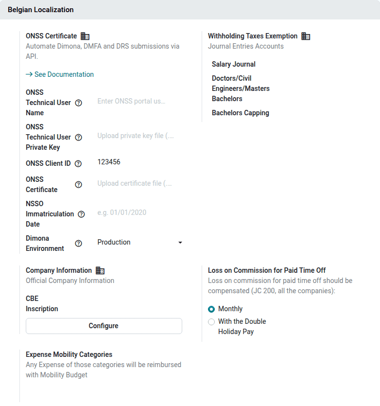
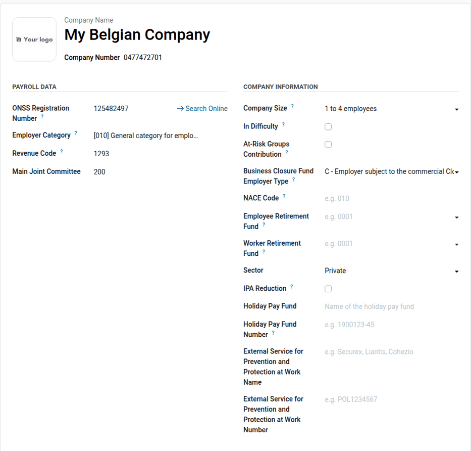
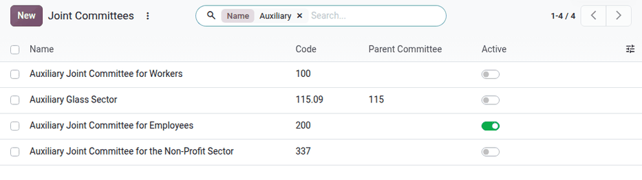
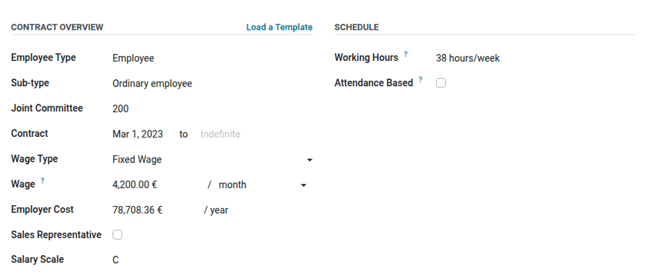

=============
Configuration
=============

This page explains how to set up the Belgian payroll localization: the modules to install, the
company data required by the Belgian administrations, the Belgian reference data (joint
committees, salary scales, employer categories, worker codes, NACE codes, work locations), and the
Belgian information to fill in on each employee.

.. _payroll/l10n_be/configuration/modules:

Modules
=======

The Belgian payroll localization relies on the following modules. Most of them are installed
automatically.

.. list-table::
   :header-rows: 1
   :stub-columns: 1

   * - Name
     - Technical name
     - Description
   * - Belgium - Payroll
     - `l10n_be_hr_payroll`
     - Belgian salary rules, structures, time off types, declarations, and reports. Installed
       automatically with the **Payroll** app when the company is located in Belgium.
   * - Belgium - Payroll with Accounting
     - `l10n_be_hr_payroll_account`
     - Accounting data for the Belgian salary rules. Installed automatically with **Belgium -
       Payroll** and **Payroll with Accounting**.
   * - Salary Configurator (Belgium)
     - `l10n_be_hr_contract_salary`
     - Belgian benefits and personal information in the salary configurator (offers).
   * - Belgian Payroll - Attendance
     - `l10n_be_hr_payroll_attendance`
     - Extra hours of hourly paid employees, based on the **Attendances** app.
   * - Belgian Payroll - Mobility Budget Expenses
     - `l10n_be_hr_payroll_expense`
     - Reimbursement of mobility budget expenses through the payslip.
   * - Belgian Payroll - Sign
     - `l10n_be_hr_payroll_sign`
     - Signature of Belgian payroll documents with the **Sign** app.
   * - Belgium - Accounting Reports & Payroll Bridge
     - `l10n_be_reports_hr_payroll`
     - Bridge between the Belgian accounting reports and the Belgian payroll.

The last five modules are installed automatically as soon as both of their dependencies are
installed (for example, **Belgian Payroll - Attendance** when the **Attendances** app is installed
on a database with the Belgian payroll).

.. seealso::
   :doc:`../../../../general/apps_modules`

.. _payroll/l10n_be/configuration/settings:

Belgian settings
================

Navigate to :menuselection:`Payroll app --> Configuration --> Settings`. When the current company
is located in Belgium, a :guilabel:`Belgian Localization` section is available:

- :guilabel:`ONSS Certificate`: the credentials used to send the Dimona, DmfA, and DRS declarations
  to the ONSS through its API (:guilabel:`ONSS Technical User Name`, :guilabel:`ONSS Technical User
  Private Key`, :guilabel:`ONSS Client ID`, :guilabel:`ONSS Certificate`, :guilabel:`NSSO
  Immatriculation Date`, and :guilabel:`Dimona Environment`). Refer to the :doc:`social_security`
  documentation for details.
- :guilabel:`Cash Register`: only displayed when the employer category of the company covers the
  joint committee 302 (hotel industry). A registered cash system raises the overtime limits.
- :guilabel:`Company Information`: the :guilabel:`CBE Inscription` date of the company. Click
  :guilabel:`Configure` to open the :ref:`company data <payroll/l10n_be/configuration/company>`.
- :guilabel:`Loss on Commission for Paid Time Off`: how the loss on commission during paid time off
  is compensated for the employees of the joint committee 200, for all the companies of the
  database:

  - :guilabel:`Monthly`: on the payslip of the month of the time off.
  - :guilabel:`With the Double Holiday Pay`: once a year, with the
    :ref:`double holiday pay <payroll/l10n_be/double_holiday_pay>`.

- :guilabel:`Withholding Taxes Exemption`: the journal and accounts used to post the withholding
  tax exemptions (scientific research). This setting is visible to accounting users.
- :guilabel:`Expense Mobility Categories`: the expense categories reimbursed through the mobility
  budget.

The **Fleet** app settings also include two Belgian options used by the salary configurator:
:guilabel:`New Vehicle Request` (allow ordering a new car when fewer cars than the given number are
available) and :guilabel:`Temporary Vehicle Choice` (allow employees to select a temporary car while
waiting for the new one).

.. _payroll/l10n_be/configuration/company:

Company data
============

The administrative data of a Belgian employer is stored in the payroll configuration of the
company. To access it, navigate to :menuselection:`Payroll app --> Configuration --> Company data`
(this menu requires the *Administration: Settings* access right), or click :guilabel:`Configure` in
the :guilabel:`Company Information` setting.

The payroll configuration is versioned: the date at the top right of the form is the date from
which these values apply. To change a value from a given date (for example, a new company size or a
new insurance policy) without altering the previous declarations, click the :icon:`fa-plus`
:guilabel:`(plus)` button next to the date to create a new version, then edit it. The payslips and
declarations use the version valid at their date.

The form contains the following sections:

- :guilabel:`Payroll Data`:

  - :guilabel:`ONSS Registration Number`: the 9-digit number given by the ONSS. Click
    :guilabel:`Search Online` to look it up on the social security website.
  - :guilabel:`Employer Category`: the 3-digit category of the company in the DmfA declarations
    (see :ref:`payroll/l10n_be/configuration/employer-categories`).
  - :guilabel:`Revenue Code`: the official revenue code of the company.
  - :guilabel:`Main Joint Committee`: the joint committee proposed by default on new employees.

- :guilabel:`Company Information`: the :guilabel:`Company Size` (as determined by the ONSS),
  :guilabel:`In Difficulty`, :guilabel:`At-Risk Groups Contribution`, the :guilabel:`Business
  Closure Fund Employer Type`, the :guilabel:`NACE Code`, the :guilabel:`Employee Retirement Fund`
  and :guilabel:`Worker Retirement Fund` codes, the :guilabel:`Sector`, the :guilabel:`IPA
  Reduction`, the :guilabel:`Holiday Pay Fund` of the workers, and the :guilabel:`External Service
  for Prevention and Protection at Work`.
- :guilabel:`Insurances`: the accident insurance policies (employees and workers), the group
  insurance, and the default contributions and amounts of the hospital and ambulatory insurances.
- :guilabel:`Withholding Taxes`: the :guilabel:`Declaration Frequency` (:guilabel:`Monthly` or
  :guilabel:`Quarterly`) of the withholding taxes.
- :guilabel:`First Hires`: enable :guilabel:`Reduction for First Hires` to apply the ONSS
  reductions for the first employees of a new employer, and set the caps and the reductions already
  used outside of Odoo.

Most fields are required as soon as the company has employees subject to the ONSS. The payroll
dashboard displays a warning while the company data is incomplete.

.. note::
   On a branch, the fields shared with the parent company are read-only: they are managed on the
   parent company.

.. _payroll/l10n_be/configuration/reference-data:

Belgian reference data
======================

The Belgian payroll comes with the official lists of the ONSS and of the federal administrations.
They are available in :menuselection:`Payroll app --> Configuration --> Belgium`.

.. _payroll/l10n_be/configuration/joint-committees:

Joint committees
----------------

A joint committee (*commission paritaire* / *paritair comité*) groups the employers of a sector. It
determines the salary scales, the sectoral rules, and the ONSS contributions that apply to an
employee.

Navigate to :menuselection:`Payroll app --> Configuration --> Belgium --> Joint Committees` to see
the list. Each joint committee has a :guilabel:`Code`, a name, and, for sub-committees, a
:guilabel:`Parent Committee`.

All the joint committees are archived at installation, except the :guilabel:`Main Joint Committee`
of the company. All the joint committees remain available on the employee form: saving an employee
with an archived joint committee activates it, together with its salary structures, rules, and
payroll warnings. Use the :guilabel:`Active` toggle in the list to activate or archive a joint
committee manually, and the :guilabel:`Selectable` option to hide a committee from the employee
form.

.. note::
   Joint committees cannot be created from the employee form.

.. _payroll/l10n_be/configuration/salary-scales:

Salary scales
-------------

Navigate to :menuselection:`Payroll app --> Configuration --> Belgium --> Salary Scales` to see the
salary scales (for example, the classes A to D of the joint committee 200) of each
:guilabel:`Related Joint Committee`, with their :guilabel:`Code` and description.

On the employee form, the :guilabel:`Salary Scale` field is displayed when the joint committee of
the employee has salary scales. Together with the seniority of the employee, it determines the
minimum wage: a payroll warning lists the employees paid below the minimum wage of their scale.

.. _payroll/l10n_be/configuration/employer-categories:

Employer categories
-------------------

The employer category is the 3-digit code that identifies the type of employer in the DmfA
declarations, and drives the ONSS contribution rates. Navigate to :menuselection:`Payroll app -->
Configuration --> Belgium --> Employer Categories` to see the categories. Each category lists its
allowed :guilabel:`Joint Committees` and :guilabel:`Worker Codes`.

.. _payroll/l10n_be/configuration/worker-codes:

Worker codes
------------

The worker code identifies the type of worker in the DmfA declaration (for example, *Ordinary
employee* or *Student*). Navigate to :menuselection:`Payroll app --> Configuration --> Belgium -->
Worker Codes` to see the codes and the joint committees they apply to. On the employee form, the
worker code is the :guilabel:`Sub-type` field.

.. _payroll/l10n_be/configuration/nace-codes:

NACE codes
----------

The NACE code is the European statistical classification of the economic activity of the company.
Navigate to :menuselection:`Payroll app --> Configuration --> Belgium --> Nace Codes` to see the
list. Set the NACE code of the company in the :ref:`company data
<payroll/l10n_be/configuration/company>`, and, if different, on the work locations.

.. _payroll/l10n_be/configuration/work-locations:

Work locations
--------------

The work locations of a Belgian company are its establishment units, declared in the DmfA. A
default *Office* work location is created for Belgian companies at installation. Navigate to
:menuselection:`Payroll app --> Configuration --> Belgium --> Work Locations` to complete them:

- :guilabel:`BCE Code`: the 10-digit number of the establishment unit, assigned by the Crossroads
  Bank for Enterprises.
- :guilabel:`NACE Code`: the activity of this specific establishment unit.
- :guilabel:`Validity Period from`: the start and end dates of the establishment unit.
- :guilabel:`Competence`: the region or community competent for the establishment unit
  (:guilabel:`FL (Flanders)`, :guilabel:`BR (Brussels)`, :guilabel:`WA (Wallonia)`, or
  :guilabel:`CG (German Community)`).
- :guilabel:`Payslip Language`: the language of the payslips of the employees working there.

The :guilabel:`Employees` smart button lists the employees of the work location.

.. _payroll/l10n_be/configuration/other-data:

Other reference data
--------------------

- :guilabel:`NIS Codes - Belgian Cities` and :guilabel:`NIS Codes - Countries`: the codes of the
  Belgian cities and of the countries used in the declarations.
- :guilabel:`Import ONSS Rates` (visible in :ref:`developer mode <developer-mode>`): imports the
  ONSS contribution rates of each employer category and worker code from the ONSS website, either
  automatically (:guilabel:`Import from ONSS website`) or from the ZIP files downloaded manually.
  The payslips need these rates to compute the employer contributions.
- :guilabel:`Fiscal Mapping` and :guilabel:`Reorganisation Measures`: refer to the
  :doc:`tax_declarations` and :doc:`social_security` documentation.

.. _payroll/l10n_be/configuration/employee-types:

Employee types
==============

The employee types are available in :menuselection:`Payroll app --> Configuration --> Contracts -->
Employee Types`. On a Belgian company, the available types include *Employee*, *Student*, *Intern*,
*Apprenticeship*, and *Business Leader*, as well as Belgian-specific types such as *Worker*,
*Flexi-Employee*, *Flexi-Worker*, and *PFI/IBO*.

On a Belgian employee type, set the default values applied to the employees of this type:

- :guilabel:`Joint Committee`: the default joint committee (by default, the main joint committee of
  the company).
- :guilabel:`Sub-types`: the worker codes allowed for this type.
- :guilabel:`DIMONA Category`: the category used in the Dimona declarations (for example,
  *Student* or *Flexi-job*).

.. _payroll/l10n_be/configuration/employee:

Employee configuration
======================

The contractual information of an employee is stored on the employee form, in versions: each
version is the state of the employee's contract from a given date. Open an employee in the
**Employees** or **Payroll** app (:menuselection:`Payroll app --> Employees --> Employees`). The
Belgian fields are mainly on the :guilabel:`Payroll` tab.

In the :guilabel:`Contract Overview` section:

- :guilabel:`Employee Type`, :guilabel:`Sub-type` (worker code), and :guilabel:`Joint Committee`.
  They are filled in from the employee type and the company data.
- :guilabel:`Contract`: the start date and, for a fixed-term contract, the end date.
- :guilabel:`Wage Type` and :guilabel:`Wage`: the monthly gross salary for a full-time or
  part-time contract, as agreed in the contract.
- :guilabel:`Sales Representative` (joint committee 200): caps the thirteenth month at the highest
  of the wage and the minimum wage of the salary scale D.
- :guilabel:`Salary Scale`: see :ref:`payroll/l10n_be/configuration/salary-scales`.

The other sections of the :guilabel:`Payroll` tab contain:

- :guilabel:`Schedule`: the :guilabel:`Working Hours`. A part-time employee has a part-time working
  schedule; the work time rate is computed from the full-time reference of the company.
- :guilabel:`Benefits` and :guilabel:`Transportation`: the benefits of the employee (company car,
  meal vouchers, phone and internet subscriptions, etc.). See :doc:`payslip`.
- :guilabel:`ONSS`: the :guilabel:`Specific Status`, :guilabel:`Risk Class`, and
  :guilabel:`Work Exemption` declared in the DmfA.
- :guilabel:`Insurances`: the hospital and ambulatory insurances.
- :guilabel:`Lump Sum Allowances`: the lump sum allowances (representation fees). See
  :ref:`payroll/l10n_be/representation_fees`.
- :guilabel:`Taxes & Reduction`: :guilabel:`Starterjob`, :guilabel:`Fiscal Voluntarism`,
  :guilabel:`Impulsion Plan`, and other reductions.
- :guilabel:`Seniority`: the :guilabel:`Fictive Hire Date` and the seniority :guilabel:`At Hiring`,
  used with the effective seniority to determine the minimum wage of the salary scale.

The :guilabel:`Personal` tab contains the information used for the withholding taxes: the
:guilabel:`NISS` (national register number), the marital status and the :guilabel:`Spouse Fiscal
Status`, the disabilities, and the dependent people (children, seniors, other dependents).

The :guilabel:`Holiday Attests` tab lists the holiday certificates of the previous employers. See
:doc:`time_off`.

.. important::
   Changing a contractual field of a version that already has validated or paid payslips creates a
   new version, starting at the date of the change. Use the version timeline at the top of the
   employee form to navigate between versions.

.. _payroll/l10n_be/configuration/structures:

Salary structures
=================

The Belgian employees use the :guilabel:`Belgium Pay` structure type, whose default structure is
:guilabel:`Monthly Pay (BE)`. The other structures of this type are used for specific payments:

.. list-table::
   :header-rows: 1
   :stub-columns: 1

   * - Structure
     - Usage
   * - Monthly Pay (BE)
     - Monthly salary, including the December holiday pay balance and the eco-vouchers. See
       :doc:`payslip`.
   * - Double Holidays (BE)
     - Double holiday pay. See :ref:`payroll/l10n_be/double_holiday_pay`.
   * - 13th Month (BE)
     - Thirteenth month. See :ref:`belgium_payroll/end_of_year_bonus`.
   * - Termination Fees (BE), Termination Holidays N (BE), Termination Holidays N-1 (BE)
     - Departure of an employee. See :doc:`departure`.
   * - Advance Pay (BE)
     - Salary advance, recovered on the next monthly payslips.
   * - CCT90 (BE)
     - Non-recurring result-related bonus (collective labor agreement 90).
   * - Warrants (BE)
     - Warrants granted to the employee.
   * - Profit Sharing Bonus (BE)
     - Profit sharing bonus.

The salary rules of these structures are available in :menuselection:`Payroll app --> Configuration
--> Salary --> Rules`, and the legal amounts and rates they use (thresholds, ceilings, tax scales)
in :menuselection:`Payroll app --> Configuration --> Salary --> Rule Parameters`, with one value per
validity date.

.. seealso::
   - :doc:`../../salaries`
   - :doc:`../../salary_rules`

.. _payroll/l10n_be/configuration/benefits:

Benefits
========

Navigate to :menuselection:`Payroll app --> Configuration --> Salary --> Benefits` to see the
benefits that can be granted to the employees (company car, meal vouchers, lump sum allowances,
insurances, etc.). Each benefit is linked to its salary rules and to a field of the employee form:

- Archiving a benefit hides its field on the employee form and archives its salary rules.
  Unarchiving it shows the field and activates the rules again.
- Some secondary benefits are archived at installation (for example, *Temporary Car*, *Company
  Bike*, and the *Lump Sum Allowance* benefits). Activate the ones the company grants.
- A benefit linked to :guilabel:`Joint Committees` is activated with the first of these joint
  committees.
- With the **Salary Configurator (Belgium)** module, the benefits marked as configurable are
  proposed to the candidates and employees in the salary configurator.

.. _payroll/l10n_be/configuration/premium-pay:

Premium pay
===========

The Belgian payroll provides legal premium pays (*Premium Pay Night*, *Premium Pay Sunday*,
*Premium Pay Holiday*, *Premium Pay Team*, *Premium Pay Continuous Team*, and *Premium Pay
Miscellaneous*), paid by the *Premium Pay* salary rules of the monthly structure. To grant an extra
amount on top of the legal rate of one of them, create a custom premium pay in
:menuselection:`Payroll app --> Configuration --> Salary --> Premium Pay`. The night and team work
premiums also feed the withholding tax exemptions declared in the 274.XX sheets (see
:doc:`tax_declarations`).

.. _payroll/l10n_be/configuration/salary-configurator:

Salary configurator
===================

With the **Salary Configurator (Belgium)** module, the offers (:menuselection:`Payroll app -->
Configuration --> Salary Package Configurator --> Offers`, or from the **Recruitment** app) propose
the Belgian benefits: company car or bike (existing or new vehicle, temporary car), public
transport, mobility budget, meal vouchers, phone and internet subscriptions, insurances, etc. The
candidate fills in the Belgian personal information needed for the payroll (NISS, marital status,
spouse professional situation, dependent people, seniority at hiring).

On the offer, the seniority of the candidate and the salary scale are used to warn when the
proposed wage is below the minimum wage of the scale.

.. seealso::
   - :doc:`../../contracts`
   - :doc:`../../../recruitment/offer_job_positions`

.. _payroll/l10n_be/configuration/warnings:

Payroll warnings
================

The payroll dashboard (:menuselection:`Payroll app --> Dashboard`) lists Belgian configuration
issues: incomplete company data, employees without worker code or NISS, employees paid below the
minimum wage of their salary scale, missing accident insurance, missing work location language,
etc. The available warnings are listed in :menuselection:`Payroll app --> Configuration -->
Dashboard --> Warnings`.
