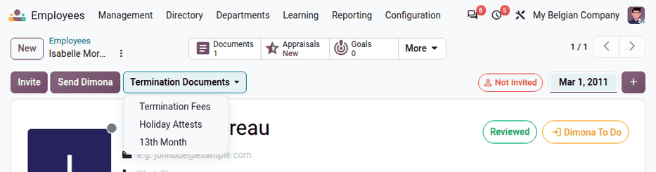
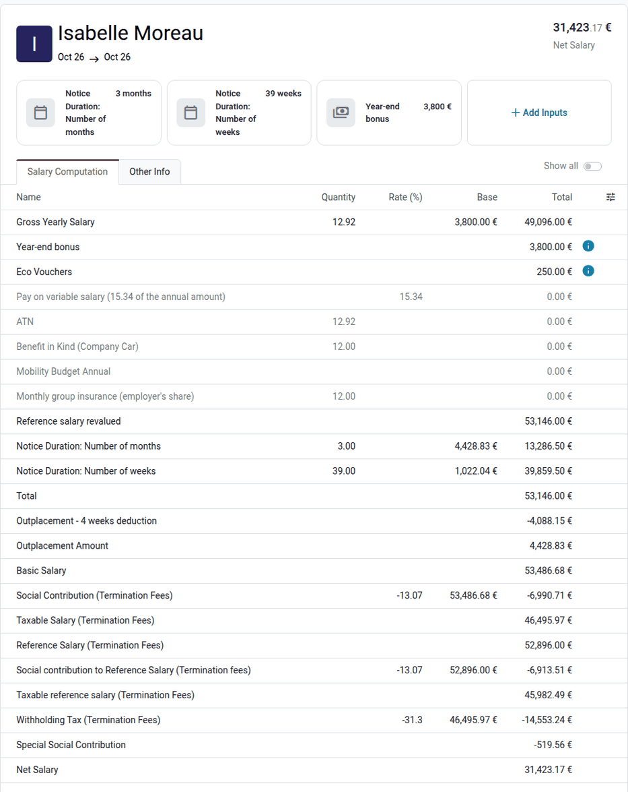
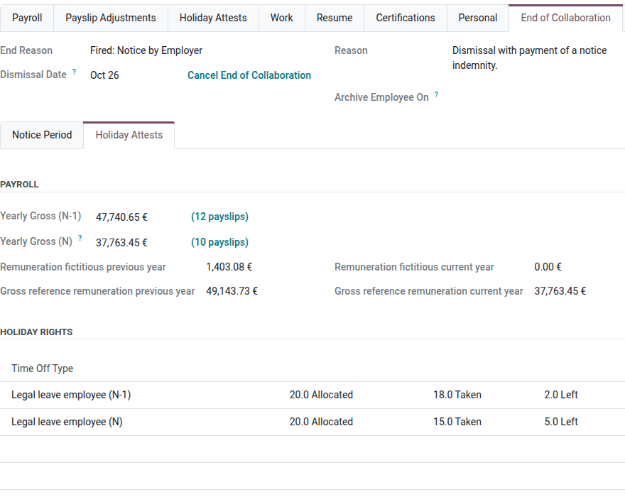
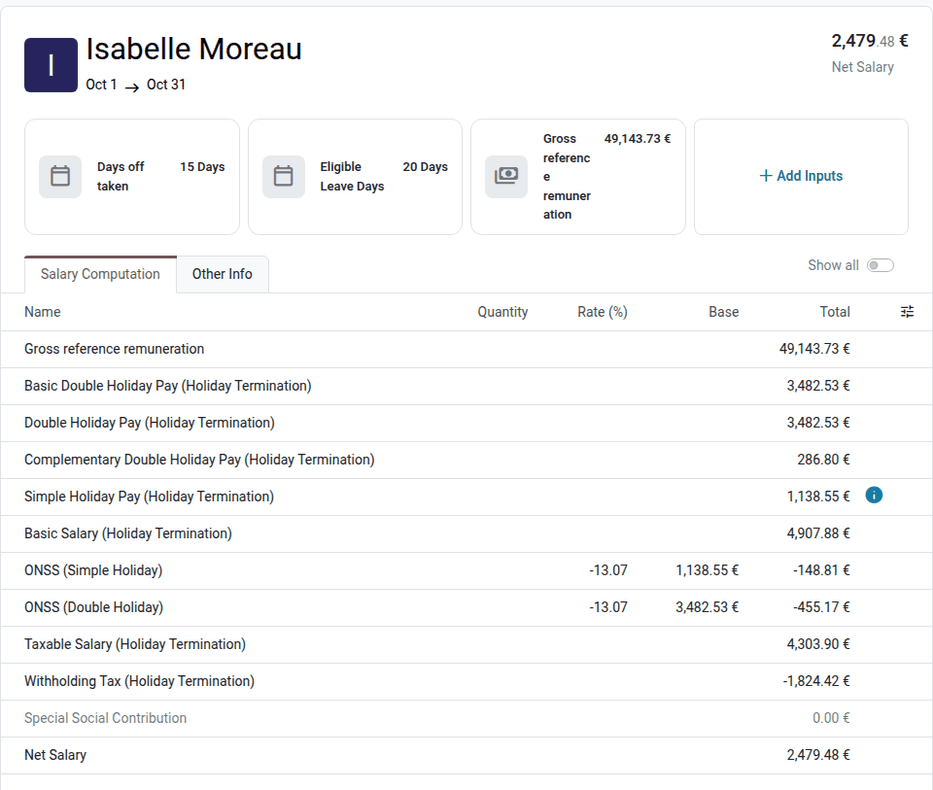
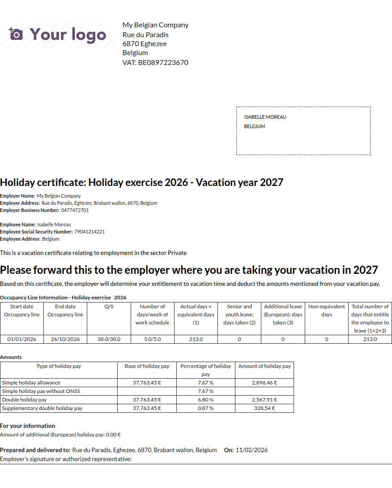

==================
Employee departure
==================

This page covers the payroll steps needed when a Belgian employee leaves the company: the notice
period, the termination fees, the holiday pay upon departure (with the holiday attestations for
the next employer), and the prorated 13th month.

.. seealso::
   :doc:`../../../employees/offboarding`

.. _payroll/l10n_be/departure_registration:

Register the departure
======================

To register the departure of an employee, open the employee form, click the :icon:`more_vert`
:guilabel:`(Actions)` icon, and select :guilabel:`End of Collaboration`. In the :guilabel:`End of
collaboration` pop-up window, fill in the following fields:

- :guilabel:`End Reason`: the reason of the departure. The Belgian reasons are listed in
  :ref:`payroll/l10n_be/departure_reasons`.
- :guilabel:`Dismissal Date`: the date at which the departure process starts (the notification of
  the dismissal or of the resignation). The departure date is computed from this date and from the
  notice period.
- :guilabel:`Reason`: any additional information.
- :guilabel:`Archive Employee On`: the date at which the employee is archived. Clear the field to
  keep the employee active: the Belgian departures without this date are never archived
  automatically, so that the termination documents can still be generated after the departure.

For Belgian employees, the pop-up window contains two more tabs:

- :guilabel:`Notice Period`: the computation of the notice period, see
  :ref:`belgium_payroll/notice_period`.
- :guilabel:`Holiday Attests`: the data used to compute the holiday pay upon departure, see
  :ref:`payroll/l10n_be/holiday_attests`.

.. image:: departure/departure-notice-02.png
   :alt: The End of collaboration pop-up window with the notice period of a dismissed employee.

Click :guilabel:`Confirm`. Odoo:

- sets the end date of the contract to the departure date;
- adds an :guilabel:`End of Collaboration` tab to the employee form, with the same information;
- creates the declaration of the end of the contract to the unemployment sector (DRS), described
  in the :doc:`social security <social_security>` documentation;
- schedules an *Outplacement* activity when the employee is entitled to outplacement.

When the departure is applied (on the :guilabel:`Archive Employee On` date), the time off after
the departure date is cancelled or refused, and the company car stays assigned to the employee,
with a message on the car about the departure.

To cancel a departure that is not applied yet, click :guilabel:`Cancel End of Collaboration` in
the :guilabel:`End of Collaboration` tab of the employee form.

.. _payroll/l10n_be/departure_reasons:

Departure reasons
-----------------

Each departure reason has a Belgian reason code, which defines the notice period and the documents
to generate. The reasons are available in :menuselection:`Employees app --> Configuration -->
Employee --> Departure Reasons`. The :guilabel:`Reason Code (BE)` column is visible in
:ref:`developer mode <developer-mode>`.

.. list-table::
   :header-rows: 1
   :widths: 45 10 45

   * - Departure reason
     - Code
     - Notice period
   * - Resigned: Retired
     - 340
     - Resignation notice
   * - Fired
     - 342
     - Dismissal notice
   * - Resigned
     - 343
     - Resignation notice
   * - Became Freelance
     - 350
     - No notice period tab
   * - Mutual Agreement
     - 351
     - No notice period tab
   * - Resigned: Force Majeure
     - 352
     - No notice
   * - Fired: Early Retirement
     - 353
     - Dismissal notice
   * - Resigned: Anticipated Retirement
     - 354
     - No notice computed
   * - Fired: Serious Misconduct
     - 355
     - No notice
   * - Resigned: Serious Employer Misconduct
     - 356
     - No notice
   * - Dead / Resigned: Medical Force Majeure
     - 357
     - No notice
   * - Fired: Notice by Employer
     - 358
     - Dismissal notice
   * - Fired: Termination by Employer
     - 359
     - Dismissal notice
   * - Contract End: Fixed Term
     - 360
     - No notice
   * - Contract End: Specific Work
     - 361
     - No notice

.. _belgium_payroll/notice_period:

Notice period
=============

The :guilabel:`Notice Period` tab of the :guilabel:`End of collaboration` pop-up window shows:

- :guilabel:`Respect of the notice period`: whether the employee :guilabel:`Works fully`,
  :guilabel:`Works partially`, or :guilabel:`Doesn't work` during the notice period. When the
  employee does not work during the whole notice period, the employer pays termination fees.
- :guilabel:`First Contract`: the first contract of the uninterrupted series of contracts of the
  employee, used for the seniority.
- :guilabel:`Seniority`: the seniority of the employee at the departure date, including the
  seniority recognized at hiring.
- :guilabel:`Notice Period Start`, :guilabel:`Notice Period End`, :guilabel:`Notice Duration`, and
  :guilabel:`Departure Date`: the result of the computation. When the employee works partially,
  enter the last day worked in the :guilabel:`Departure Date` field: the rest of the notice is paid
  as termination fees.
- :guilabel:`Gross Annual Salary as of December 31, 2013`: only for the employees hired before
  2014, see :ref:`payroll/l10n_be/notice_before_2014`.
- :guilabel:`Outplacement`: the outplacement scheme the employee is entitled to, see
  :ref:`payroll/l10n_be/outplacement`.

Start of the notice period
--------------------------

- For a dismissal by the employer, the notice period starts on the Monday that follows a period
  of three days (Monday to Saturday, public holidays excluded) after the dismissal date.
- For a resignation, the notice period starts on the Monday following the dismissal date.
- When the employee does not work during the notice period, or when the reason has no notice
  period, the departure date is the dismissal date.

.. example::
   An employee is dismissed by their employer on Sunday, November 1, 2026. The three days
   following the dismissal are November 2, 3, and 4, so the notice period starts on Monday,
   November 9, 2026.

Duration of the notice period
-----------------------------

The duration depends on the seniority of the employee at the start of the notice period, and on
the departure reason. Odoo uses the following durations (in weeks):

.. list-table::
   :header-rows: 1
   :widths: 40 30 30

   * - Seniority (months)
     - Dismissal
     - Resignation
   * - Less than 3
     - 1
     - 1
   * - 3 to 4
     - 3
     - 2
   * - 4 to 5
     - 4
     - 2
   * - 5 to 6
     - 5
     - 2
   * - 6 to 9
     - 6
     - 3
   * - 9 to 12
     - 7
     - 3
   * - 12 to 15
     - 8
     - 4
   * - 15 to 18
     - 9
     - 4
   * - 18 to 21
     - 10
     - 5
   * - 21 to 24
     - 11
     - 5
   * - 24 to 36
     - 12
     - 6
   * - 36 to 48
     - 13
     - 6
   * - 48 to 60
     - 15
     - 7
   * - 60 to 72
     - 18
     - 9
   * - 72 to 84
     - 21
     - 10
   * - 84 to 96
     - 24
     - 12
   * - 96 to 108
     - 27
     - 13
   * - 108 to 120
     - 30
     - 13
   * - 120 to 132
     - 33
     - 13
   * - 132 to 144
     - 36
     - 13
   * - 144 to 156
     - 39
     - 13
   * - 156 to 168
     - 42
     - 13
   * - 168 to 180
     - 45
     - 13
   * - 180 to 192
     - 48
     - 13
   * - 192 to 204
     - 51
     - 13
   * - 204 to 216
     - 54
     - 13
   * - 216 to 228
     - 57
     - 13
   * - 228 to 240
     - 60
     - 13
   * - 240 to 252
     - 62
     - 13
   * - 252 to 264
     - 63
     - 13
   * - 264 to 276
     - 64
     - 13
   * - 276 to 288
     - 65
     - 13
   * - 288 and more
     - 66, plus one week per started year of seniority after 24 years
     - 13

.. important::
   For the employees hired on or after August 1, 2026, the notice period is one week for a
   seniority of less than six months, both for a dismissal and for a resignation. The employees
   hired before August 1, 2026, keep the durations above.

A resignation during a temporary unemployment for economic reasons has no notice period.

.. _payroll/l10n_be/notice_before_2014:

Employees hired before 2014
---------------------------

For an employee hired before January 1, 2014, and dismissed by the employer, the notice period is
the sum of two parts:

- **Part 1**, for the seniority acquired until December 31, 2013, in months, depending on the
  :guilabel:`Gross Annual Salary as of December 31, 2013` field:

  - :guilabel:`Gross annual salary < 32.254 €`: three months per started period of five years of
    seniority.
  - :guilabel:`Gross annual salary > 32.254 €`: one month per started year of seniority, with a
    minimum of three months.

- **Part 2**, for the seniority acquired since January 1, 2014, in weeks, according to the table
  above.

.. example::
   Isabelle Moreau has worked in the company since March 1, 2011, with a gross annual salary higher
   than 32.254 € at the end of 2013. She is dismissed on October 26, 2026:

   - Part 1: 2 years and 10 months of seniority until December 31, 2013, so three months (the
     minimum).
   - Part 2: 153 months of seniority since January 1, 2014, so 39 weeks.

   Her notice period is three months and 39 weeks.

.. tip::
   The :guilabel:`Fictive Hire Date` and the seniority :guilabel:`At Hiring` fields, in the
   :guilabel:`Seniority` section of the :guilabel:`Payroll` tab of the employee form, are taken into
   account in the seniority.

.. _payroll/l10n_be/outplacement:

Outplacement
------------

When the employer dismisses an employee, Odoo proposes the outplacement scheme:

- :guilabel:`General Scheme`: for a notice period of at least 30 weeks. Four weeks of the notice
  period are converted into outplacement: the termination fees deduct these four weeks, and add the
  outplacement amount.
- :guilabel:`Special Scheme`: for an employee of the private sector aged 45 or more, with at least
  one year of seniority, and working at least half time.
- :guilabel:`Specific Scheme` and :guilabel:`Voluntary Scheme`: to select manually.

.. _payroll/l10n_be/termination_documents:

Termination documents
=====================

Once the departure is registered, the :guilabel:`Termination Documents` button appears at the top
of the employee form. It generates the payslips of the departure:

- :guilabel:`Termination Fees`: the payment of the notice period that is not worked. Only shown
  when the employee does not work during the whole notice period, and not for a resignation.
- :guilabel:`Holiday Attests`: the holiday pay upon departure, for the current year and for the
  previous year, see :ref:`payroll/l10n_be/holiday_attests`.
- :guilabel:`13th Month`: the prorated 13th month, see
  :ref:`payroll/l10n_be/departure_thirteen_month`.

If a payslip already exists for the same period, Odoo opens it instead of creating another one.

These documents are also generated automatically, with the certificate of employment, when the
last monthly payslip of the employee (the payslip of the month of the departure) is created in a
pay run, or when it is validated. The generated payslips are added to the same pay run.

.. _payroll/l10n_be/termination_fees:

Termination fees
----------------

The termination fees are computed on a :guilabel:`Termination Fees` payslip, dated on the start of
the notice period (or on the departure date, when the employee works partially).

The payslip first computes the yearly reference remuneration of the employee, which includes:

- the monthly wage, multiplied by 12.92 (12 months, and the double holiday pay);
- the year-end bonus (13th month), unless it is paid by a sectoral fund;
- 15.34% of the variable salary of the last 12 months;
- the meal vouchers, eco-vouchers, benefits in kind (company car, phone, laptop, etc.), insurances
  (employer's share), stock options, and other recurring benefits.

The notice duration is then converted into termination fees:

- per month: the yearly reference remuneration divided by 12;
- per week: the yearly reference remuneration multiplied by 3, divided by 12 × 13 (one
  fifty-second of the year);
- per day: the yearly reference remuneration divided by 365.

For a manual worker, the reference remuneration is weekly (the yearly remuneration divided by 52).

The :guilabel:`Notice Duration: Number of months` and :guilabel:`Notice Duration: Number of weeks`
salary inputs come from the departure. The year-end bonus, variable salary, and other inputs can be
adapted on the payslip with :guilabel:`Add Inputs`, for example to add a compensation for an
unreasonable dismissal.

.. example::
   Isabelle Moreau earns 3,800.00 € per month, with 250.00 € of eco-vouchers per year:

   - Yearly reference remuneration: :math:`3,800.00 \times 12.92 + 3,800.00 + 250.00 = 53,146.00`
     €
   - Three months: :math:`53,146.00 \div 12 \times 3 = 13,286.50` €
   - 39 weeks: :math:`53,146.00 \times 3 \div 156 \times 39 = 39,859.50` €
   - Outplacement (general scheme): four weeks are deducted (-4,088.15 €), and the outplacement
     amount is added (4,428.83 €)

   The gross termination fees are 53,486.68 €.

To print the termination fees document, click :guilabel:`Print` on the payslip.

.. _payroll/l10n_be/holiday_attests:

Holiday pay upon departure
==========================

When an employee leaves the company, the employer pays the *exit holiday pay*: the simple and
double holiday pay for the paid time off earned in the company, and not taken yet. The employer
also gives the employee a *holiday attestation*, that the new employer uses to grant the paid time
off and to recover the holiday pay already paid (see :ref:`payroll/l10n_be/holiday_pay_recovery`).

Data used for the computation
-----------------------------

The :guilabel:`Holiday Attests` tab of the :guilabel:`End of collaboration` pop-up window (and of
the :guilabel:`End of Collaboration` tab of the employee form) shows:

- :guilabel:`Yearly Gross (N-1)` and :guilabel:`Yearly Gross (N)`: the gross salary of the
  previous year and of the current year, from the validated payslips. Click the number of payslips
  to open them.
- :guilabel:`Remuneration fictitious previous year` and :guilabel:`Remuneration fictitious current
  year`: the salary the employee would have received during the absences that are not paid, but
  assimilated to worked time (for example, a sickness after the guaranteed salary). It is the
  number of days of these absences, multiplied by the daily wage: the monthly wage (and the average
  variable salary), multiplied by 3, divided by 13, divided by the number of days per week.
- :guilabel:`Gross reference remuneration previous year` and :guilabel:`Gross reference
  remuneration current year`: the yearly gross plus the fictitious remuneration.
- :guilabel:`Holiday Rights`: for each time type (legal time off, European time off, youth and
  senior holidays, postponed time off) and each year, the allocated, taken, and remaining days.

.. example::
   Isabelle Moreau was sick for 40 calendar days in 2025, of which 8 working days were not paid
   (`122.00`). Her daily wage is :math:`3,800.00 \times 3 \div 13 \div 5 = 175.38` €, so her
   fictitious remuneration of 2025 is :math:`8 \times 175.38 = 1,403.08` €. With a yearly gross of
   47,740.65 €, her gross reference remuneration of 2025 is 49,143.73 €.

Holiday pay payslips
--------------------

Click :menuselection:`Termination Documents --> Holiday Attests` to generate two payslips:

:guilabel:`Holiday Pay (N Year)`
   The holiday pay earned during the year of the departure, that the employee will take next year:

   - simple holiday pay: 7.67% of the gross reference remuneration of the current year;
   - double holiday pay: 6.8% of the same remuneration, and a complementary double holiday pay of
     0.87%;
   - minus the European time off already paid during the year, see
     :ref:`payroll/l10n_be/european_time_off`.

:guilabel:`Holiday Pay (N-1 Year)`
   The balance of the holiday pay earned during the previous year, only when the employee already
   worked in the company during the previous year:

   - simple holiday pay: 7.67% of the gross reference remuneration of the previous year, minus the
     salary already paid for the legal time off taken during the current year;
   - double holiday pay: the double holiday pay due for the previous year, minus the double holiday
     pay already paid during the current year;
   - the remaining postponed time off of the previous years.

.. example::
   Isabelle Moreau leaves the company on October 26, 2026. She took 15 days of legal time off in
   2026, paid 2,630.77 €, and did not receive her double holiday pay yet:

   - Simple holiday pay N-1: :math:`7.67\% \times 49,143.73 - 2,630.77 = 1,138.55` €
   - Double holiday pay N-1: :math:`7.67\% \times 49,143.73 = 3,769.32` €, paid as 3,482.53 € of
     double holiday pay and 286.80 € of complementary double holiday pay
   - Holiday pay N, on a gross reference remuneration of 37,763.45 €: 2,896.46 € of simple holiday
     pay, 2,567.91 € of double holiday pay (6.8%), and 328.54 € of complementary double holiday
     pay (0.87%)

Holiday attestations
--------------------

Click :guilabel:`Print` on a holiday pay payslip to get the payslip and the holiday attestation
(*holiday certificate*) of the year, to give to the employee. Both documents are also generated
and attached to the payslip when it is validated. The attestation shows the occupation of the
employee, the days of time off already taken, and the holiday pay paid upon departure.

.. important::
   Odoo computes the attestations from the data of the payslips and of the time off: check them
   against the particularities of the employee's contract before giving them to the employee.

.. _payroll/l10n_be/departure_thirteen_month:

13th month upon departure
=========================

For the employees of the joint committee 200, a prorated 13th month is due upon departure when the
employee has enough seniority: six months for a dismissal or a retirement, three years for the other
departure reasons. In that case, the :guilabel:`13th Month` option of the :guilabel:`Termination
Documents` button generates a :guilabel:`13th Month` payslip, dated on the departure date. Its
computation is described in the :doc:`annual payments <annual_payments>` documentation.
