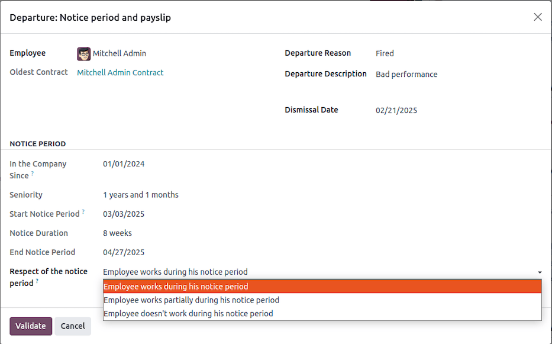

==================
Employee departure
==================

This page covers the payroll steps needed when a Belgian employee leaves the company.

.. _payroll/l10n_be/holiday_attests:

Departure: holiday attests
==========================

Overview
--------

In Belgium, when an employee leaves a company, the employer is required to provide vacation
attestations. These documents help the new employer determine the employee's vacation entitlements
and any vacation pay due. Odoo facilitates the automatic generation of these attestations based on
payroll and time-off data.

Types of attestations
---------------------

Odoo generates two types of vacation attestations:

#. **For the previous year (N-1)**: If the employee has not yet taken all the vacation days from the
   previous year.
#. **For the current year (N)**: Covering the vacation rights accrued in the year of departure.

Each attestation includes details such as:

- The period the employee was employed.
- Agreed working time and any modifications.
- Gross amounts of single and double vacation pay paid.
- Social security contributions paid by the employer.
- Number of vacation days already taken.
- Additional (European) vacation pay and days.

Calculation logic in Odoo
-------------------------

Odoo computes the attestations based on payroll and leave data. The main calculations include:

#. **Retrieving payroll and leave records**

   - The system identifies the employee's payroll records for the current and previous years.
   - It retrieves validated leave requests and allocations.

#. **Computing gross remuneration**

   - The gross annual salary for both the current and previous years is computed from payroll
     records.
   - The average monthly salary is calculated for unpaid leave adjustments.

#. **Time-off calculations**

   - The number of vacation days taken and allocated in the current year is determined.
   - Unpaid leave days are accounted for separately.

#. **Fictitious remuneration calculation**

   - If unpaid leave was taken, Odoo computes a fictitious remuneration adjustment using the
     formula:

     .. math::
        :class: overflow-scroll

        \text{Fictitious Remuneration} = (\text{Unpaid Leave Days} \times
        \text{Average Monthly Salary} \times 3) \div (13 \times 5)

#. **Generating the final attestation**

   - Odoo creates a payroll entry reflecting the vacation pay due.
   - The attestation document is generated and can be printed or exported.

Two payslips are created:

#. **Payslip for the current year** (`termination_payslip_n`)

   This payslip covers the employee's last salary period in the year of termination.

#. **Payslip for the previous year** (`termination_payslip_n1`)

   The one accounts the amount of money converted from the untaken time off of previous year.

Each payslip is generated using the appropriate payroll structure, ensuring correct calculations for
all entitlements and deductions.

Before computing the final payment, the system gathers necessary payroll data:

#. **Annual gross salary calculation**

   To estimate the employee's **annual gross salary**, the system looks for the most recent
   validated monthly payslip. If a payslip is found, the **gross salary** from that payslip is
   multiplied by 12 to get an annual estimate. If no payslip exists, the annual gross salary is set
   to **zero**.

#. **European leave recovery**

   The system retrieves all **European leave days (LEAVE216)** taken by the employee during the
   current year. It then calculates the **total amount paid for these leaves** and determines how
   much should be deducted.

   The deduction follows these principles:

   - If an employee has taken **European holidays (additional vacation days)**, the amount paid in
     advance must be recovered.
   - The recovery is either:

     - Deducted from **the double vacation pay (85%)** for the next year.
     - Or, if the employee leaves, deducted from the final termination payslip.

   - If leave has been taken, the **termination certificate** must specify:

     - The **number of European leave days** already granted.
     - The **gross allowance** corresponding to these days.

   To ensure fairness, the system first checks whether a deduction has already been applied in the
   **double vacation pay**. If so, only the remaining amount is deducted from the final payslip.

   Once the required values are determined, they are recorded in the payslip as
   **additional payroll inputs**:

   - **Gross salary reference**: Includes the final salary amount plus any fictitious remuneration.
   - **European leave deduction**: Deducts the previously paid European leave amounts.
   - **Other inputs**: Allocates time off taken, taxable amounts, and any outstanding allocations.

   After setting these values, the system **computes the payslip** to ensure all deductions and
   payments are correctly applied.

   This process ensures that the final **termination payslip** takes into account all salary
   components, including **annual gross pay, European leave recovery, and any unpaid entitlements**.
   Odoo retrieves past payslips and time-off records to ensure compliance with
   **Belgian payroll regulations**.

By automating this process, Odoo minimizes manual intervention, reducing errors and ensuring
employees receive the correct termination payments.

How does it work in Odoo?
-------------------------

In Odoo, to access the holiday attests process, go to the employee form view and click on
:icon:`fa-cog` :guilabel:`(Action)` then :guilabel:`Departure: Holiday Attests` or navigate to
:menuselection:`Payroll --> Reporting --> Departure: Holiday Attests`.

In the wizard that appears, you can see all the payslips over the current and last year, the time
off requests and allocations. You can also encode the unpaid time off you would like to declare on
that holiday attest.

Once you're ready, click the :guilabel:`Validate & Compute holiday attests` button. Two payslips are
generated for each considered period (N and N-1).

Once validated, two :file:`.pdf` documents are generated. One **classic payslip** and one **holiday
attests** for the future employer.

.. example::

   .. image:: departure/departure-attests-02.png
      :alt: Departure Holiday Attests Payslips.

   .. image:: departure/departure-attests-03.png
      :alt: Departure Holiday Attests Time off.

   .. image:: departure/departure-attests-04.png
      :alt: Departure Holiday Attests Unpaid.

   .. image:: departure/departure-attests-05.png
      :alt: Departure Holiday Attests Payslips.

   In our example, the employee also took one European time off during the N-year.

   For year N-1, you can see that all legal time off were taken.

   .. image:: departure/departure-attests-06.png
      :alt: Departure Holiday Attests Attest N-1.

   .. image:: departure/departure-attests-07.png
      :alt: Departure Holiday Attests Payslip N-1.

   For year N, you can also see the number off additional time off (European) and already taken legal
   time off are taken into account as well.

   .. image:: departure/departure-attests-08.png
      :alt: Departure Holiday Attests Attest N.

   .. image:: departure/departure-attests-09.png
      :alt: Departure Holiday Attests Payslip N.

Important Notes
---------------

By using Odoo's automated attestation generation, companies can ensure compliance with Belgian
labor laws while reducing manual administrative work.

.. important::
   - The feature is only available for companies registered in Belgium.
   - If the notice period is not set for an employee, Odoo will prompt for this information.
   - Employers must ensure vacation attestations are provided before the employee needs to submit
     them to their new employer or the ONEM.

.. _belgium_payroll/notice_period:

Departure: notice period & termination fees
===========================================

This documentation explains how the employee departure process works in the application, focusing
on the notice period calculation and severance pay when the employee does not serve their notice
period.

Overview
--------

This module helps manage employee departures by determining the correct notice period based on
seniority, departure reasons, and specific country regulations (Belgium). It also calculates
severance pay when the employee does not work during their notice period.

Key features
------------

- Automatic calculation of notice period start and end dates.
- Consideration of public holidays and company-specific schedules.
- Calculation of severance pay based on company policies and government rules.
- Generation of a final payslip including termination fees.

Notice period calculation
-------------------------

The notice period depends on several factors:

- The employee's seniority in the company.
- The reason for departure (resignation, dismissal, retirement, etc.).
- Whether the employee works during the notice period or not.
- The salary level before January 1, 2014 (for some cases).

The notice period starts on the first Monday after the departure date unless a specific rule applies
(e.g., a mandatory waiting period of three days for certain dismissals).

Notice duration rules
---------------------

The following table shows the duration of the notice period based on the length of service:

For resigned employees
~~~~~~~~~~~~~~~~~~~~~~

+---------------------+-----------------------+
| Seniority (months)  | Notice Period (weeks) |
+=====================+=======================+
| 0 - 3               | 1                     |
+---------------------+-----------------------+
| 3 - 6               | 2                     |
+---------------------+-----------------------+
| 6 - 12              | 3                     |
+---------------------+-----------------------+
| 12 - 18             | 4                     |
+---------------------+-----------------------+
| 18 - 24             | 5                     |
+---------------------+-----------------------+
| 24 - 48             | 6                     |
+---------------------+-----------------------+
| 48 - 60             | 7                     |
+---------------------+-----------------------+
| 60 - 72             | 9                     |
+---------------------+-----------------------+
| 72 - 84             | 10                    |
+---------------------+-----------------------+
| 84 - 96             | 12                    |
+---------------------+-----------------------+
| 96+                 | 13                    |
+---------------------+-----------------------+

For dismissed employees
~~~~~~~~~~~~~~~~~~~~~~~

+---------------------+-----------------------+
| Seniority (months)  | Notice Period (weeks) |
+=====================+=======================+
| 0 - 3               | 1                     |
+---------------------+-----------------------+
| 3 - 4               | 3                     |
+---------------------+-----------------------+
| 4 - 5               | 4                     |
+---------------------+-----------------------+
| 5 - 6               | 5                     |
+---------------------+-----------------------+
| 6 - 9               | 6                     |
+---------------------+-----------------------+
| 9 - 12              | 7                     |
+---------------------+-----------------------+
| 12 - 15             | 8                     |
+---------------------+-----------------------+
| 15 - 18             | 9                     |
+---------------------+-----------------------+
| 18 - 21             | 10                    |
+---------------------+-----------------------+
| 21 - 24             | 11                    |
+---------------------+-----------------------+
| 24 - 36             | 12                    |
+---------------------+-----------------------+
| 36 - 48             | 13                    |
+---------------------+-----------------------+
| 48 - 60             | 15                    |
+---------------------+-----------------------+
| 60 - 72             | 18                    |
+---------------------+-----------------------+
| 72 - 84             | 21                    |
+---------------------+-----------------------+
| 84 - 96             | 24                    |
+---------------------+-----------------------+
| 96 - 108            | 27                    |
+---------------------+-----------------------+
| 108 - 120           | 30                    |
+---------------------+-----------------------+
| 120 - 132           | 33                    |
+---------------------+-----------------------+
| 132 - 144           | 36                    |
+---------------------+-----------------------+
| 144 - 156           | 39                    |
+---------------------+-----------------------+
| 156 - 168           | 42                    |
+---------------------+-----------------------+
| 168 - 180           | 45                    |
+---------------------+-----------------------+
| 180 - 192           | 48                    |
+---------------------+-----------------------+
| 192 - 204           | 51                    |
+---------------------+-----------------------+
| 204 - 216           | 54                    |
+---------------------+-----------------------+
| 216 - 228           | 57                    |
+---------------------+-----------------------+
| 228 - 240           | 60                    |
+---------------------+-----------------------+
| 240 - 252           | 62                    |
+---------------------+-----------------------+
| 252 - 264           | 63                    |
+---------------------+-----------------------+
| 264 - 276           | 64                    |
+---------------------+-----------------------+
| 276 - 288           | 65                    |
+---------------------+-----------------------+
| 288+                | 66+                   |
+---------------------+-----------------------+

Special case: employees hired before 2014
-----------------------------------------

For employees who started before January 1, 2014, the notice period calculation is divided into two
parts:

Part 1: Seniority acquired before December 31, 2013
~~~~~~~~~~~~~~~~~~~~~~~~~~~~~~~~~~~~~~~~~~~~~~~~~~~

- **Lower-level employees** (annual gross salary ≤ €32,254): The notice period is 3 months for the
  first 5 years of seniority, increasing by 1.5 months per additional year.
- **Higher-level employees** (annual gross salary > €32,254): The notice period is 1 month per
  started year of seniority, with a minimum of 3 months.

Part 2: Seniority acquired from January 1, 2014 onwards
~~~~~~~~~~~~~~~~~~~~~~~~~~~~~~~~~~~~~~~~~~~~~~~~~~~~~~~

The standard notice period rules from 2014 apply to seniority acquired after this date.

The total notice period is the sum of both periods calculated separately.

Severance pay calculation
-------------------------

If an employee does not serve their notice period, severance pay is calculated based on:

- The remaining notice duration.
- The employee's last salary.
- Additional compensation such as bonuses, stock options, and insurance contributions.

The severance pay consists of:

- The current salary, which corresponds either to the full notice period that should normally be
  observed or the remaining part of it.
- Benefits acquired during the contract (e.g., meal vouchers, company car, mobile phone usage).

The current salary is determined as follows:

- The employee's gross monthly salary at the time of dismissal.
- All recurring bonuses, except for one-time bonuses (e.g., team work bonus, seniority bonus).
- Additional compensation for overtime hours worked over a longer period.
- Variable salary (average over the last twelve months).

The system automatically generates a termination payslip including these calculations, ensuring
compliance with Belgian labor laws.

How does it work in Odoo?
-------------------------

In Odoo, to access the departure process, go to the employee form view and click on :icon:`fa-cog`
:guilabel:`(Action)` then :guilabel:`Departure: Notice Period and payslip` or navigate to
:menuselection:`Payroll --> Reporting --> Departure: Notice Period`.

In the wizard that appears, select the reason for departure, provide a description of the departure,
and specify the dismissal date. The employee's seniority is calculated based on their contract
history, and the notice period is determined accordingly. You can also indicate whether the employee
will be working during the notice period.

If the employee is working during the notice period, there are no termination fees to calculate, and
the notice period will be recorded on the employee's form. Click the :guilabel:`Validate` button.

.. note::
   If the employee is working partially or not at all, the wizard will generate and calculate a
   termination fees payslip. Click the :guilabel:`Validate & Compute termination fees` button.

The payslip takes into account all the salaries and benefits the employee would have received over
the course of a year to calculate a virtual annual remuneration. This amount is then prorated based
on the notice period to convert it into a gross salary.

A detailed summary is provided on the payslip.

.. example::
   .. image:: departure/departure-notice-04.png
      :alt: Departure Notice: Termination Fees Payslip 1.

   .. image:: departure/departure-notice-05.png
      :alt: Departure Notice: Termination Fees Payslip 2.

Conclusion
----------

This module simplifies the departure process by providing clear and automatic calculations for the
notice period and severance pay. It helps HR teams ensure compliance and streamline the exit process
for employees.
