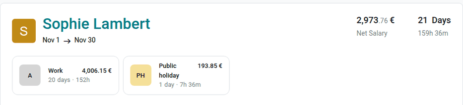
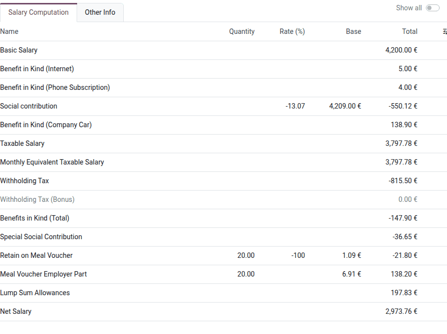
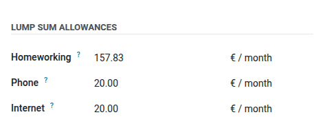

=============================
Payslip and salary components
=============================

This page explains how a Belgian monthly payslip is built and how the main Belgian salary components
are computed: benefits in kind, social security contributions, withholding taxes, meal vouchers,
lump sum allowances, mobility, and insurances.

.. seealso::
   - :doc:`configuration`
   - :doc:`../../payslips`

.. _payroll/l10n_be/payslip_explained:

Understanding the Belgian payslip
=================================

Belgian employees are paid with the :guilabel:`Monthly Pay (BE)` structure. To open a payslip,
navigate to :menuselection:`Payroll app --> Payslips --> Payslips`, and click a payslip.

General information
-------------------

The top of the payslip shows the employee, the pay period, the :guilabel:`Net Salary`, and the
number of paid days and hours. The withholding taxes depend on the personal information of the
employee (marital status, spouse fiscal status, dependent people, disabilities): check them in the
:guilabel:`Personal` tab of the employee form before computing the payslips.

Below, one card per time type summarizes the worked days and hours of the period and their amount:
*Work*, *Public holiday*, the paid time off (*Legal leave employee*), the sick days, etc. A time off
reduces the salary only when its time type is unpaid (for example, unpaid leave or parental leave).
The time types are generated from the working schedule, the time off, and, when used, the
attendances of the employee.

The :guilabel:`Add Inputs` card adds other inputs to the payslip (commissions, expense
reimbursements, deductions, etc.). Some inputs are added automatically, such as the December
holiday pay balance (see :ref:`payroll/l10n_be/december_pay`) or the recovery of a salary advance.

Salary computation
------------------

The :guilabel:`Salary Computation` tab lists the payslip lines. By default, only the main lines are
displayed: enable :guilabel:`Show all` to display the intermediate lines (bases, totals, and
accounting lines). When a line comes with an explanation of its computation, an :icon:`info_f`
:guilabel:`(info)` icon is displayed next to its total: hover over it to read the formula and the
values used.

The main lines are:

- :guilabel:`Basic Salary`: the wage of the employee, prorated when unpaid time off is taken or
  when the employee starts or leaves during the month.
- :guilabel:`Benefit in Kind (...)`: the benefits in kind subject to social security
  contributions, such as the internet and phone subscriptions or the laptop provided by the
  employer.
- :guilabel:`Social contribution`: the employee's social security contribution (ONSS) of 13.07% of
  the gross salary (basic salary and benefits in kind subject to ONSS).
- :guilabel:`Employment Bonus`: a reduction of the employee's social contribution for low wages. It
  decreases as the salary increases, and disappears above a ceiling.
- :guilabel:`Benefit in Kind (Company Car)`: the taxable benefit of the private use of a company
  car. It is subject to withholding taxes, but not to social contributions. See
  :ref:`payroll/l10n_be/company_car`.
- :guilabel:`Taxable Salary`: the gross salary, minus the social contribution, plus the benefits in
  kind subject to withholding taxes.
- :guilabel:`Withholding Tax`: an advance on the personal income tax. It is computed on the
  annualized taxable salary, with the tax scales of the year, minus the reductions for the marital
  status and the dependent people. The scales are revised every year by the `FPS Finance
  <https://finances.belgium.be/fr/entreprises/personnel_et_remuneration/precompte_professionnel/calcul>`_.
- :guilabel:`Withholding reduction`: a reduction of the withholding taxes for low wages.
- :guilabel:`Benefits in Kind (Total)`: the benefits in kind, deducted again from the net salary,
  as the employee received them in kind.
- :guilabel:`Special Social Contribution`: a contribution depending on the household income,
  withheld on the salary and regularized with the income tax.
- :guilabel:`Retain on Meal Voucher` and :guilabel:`Meal Voucher Employer Part`: see
  :ref:`payroll/l10n_be/meal_vouchers`.
- :guilabel:`Lump Sum Allowances`: the representation fees, exempt from social contributions and
  withholding taxes. See :ref:`payroll/l10n_be/representation_fees`.
- :guilabel:`Net Salary`: the amount paid to the employee.

The employer's social contributions are computed on the same payslip, in the *Accounting* lines
(visible with :guilabel:`Show all`). They use the ONSS rates of the employer category of the
company (see :ref:`payroll/l10n_be/configuration/other-data`).

.. seealso::
   `Employment bonus (ONSS instructions)
   <https://www.socialsecurity.be/employer/instructions/dmfa/fr/latest/instructions/deductions/workers_reductions/workbonus.html>`_

.. _payroll/l10n_be/company_car:

Company car
===========

The company car is set on the employee form, in the :guilabel:`Transportation` section of the
:guilabel:`Payroll` tab (:guilabel:`Company Car` field). The car comes from the **Fleet** app, where
its characteristics are encoded (:guilabel:`Catalog Value (Tax Incl.)`, :guilabel:`Registration
Date`, fuel type, and :guilabel:`CO₂ Emissions`). The yearly benefit in kind (:guilabel:`BIK`) is
displayed next to the car.

The yearly benefit in kind is computed as follows:

.. math::
   :class: overflow-scroll

   \text{BIK} = \text{catalog value} \times \text{age coefficient} \times \text{CO}_2
   \text{ percentage} \times \frac{6}{7}

- The age coefficient decreases by 6% per year since the first registration, down to 70%.
- The CO₂ percentage is 5.5%, increased or decreased by 0.1% per gram of CO₂ above or below the
  reference emission of the year (diesel or petrol), with a minimum of 4% and a maximum of 18%.
  Electric and hydrogen cars use the minimum of 4%.
- The benefit in kind cannot be lower than the minimum set by the *Minimum annual car ATN* rule
  parameter (€1,690 in 2026).

On the payslip, the monthly benefit in kind is the yearly amount multiplied by the number of days
of the month, divided by the number of days of the year.

.. example::
   An electric car with a catalog value of €38,500, registered in February 2023, in November 2026:

   - Theoretical benefit: :math:`38,500 \times 0.88 \times 4\% \times 6/7 = \text{€}1,161.60`,
     lower than the minimum, so the yearly benefit is €1,690.
   - Monthly benefit: :math:`1,690 \times 30/365 = \text{€}138.90`.

When an employee has a fuel card without a company car, the private use of the fuel card is taxed
through the *Fuel Card - Private Ride* line.

.. _payroll/l10n_be/meal_vouchers:

Meal vouchers
=============

The meal vouchers are set on the employee form, in the :guilabel:`Benefits` section of the
:guilabel:`Payroll` tab:

- :guilabel:`Meal Vouchers`: the face value of one meal voucher, and the calculation method:
  :guilabel:`/ worked day` (one voucher per day worked) or :guilabel:`/ prorated` (one voucher per
  number of hours worked equivalent to a full-time day, capped at the working days of a full-time
  employee).
- :guilabel:`MV Employee's Share`: the part paid by the employee, withheld on the net salary.

The employer part is the face value minus the employee's share. The face value cannot exceed the
*Max Meal Voucher Amount* rule parameter (€10 since January 2026), and the employee's share cannot
be lower than the *Min Meal Voucher Employee's Share* rule parameter (€1.09). Otherwise, a payroll
warning is displayed.

.. example::
   With a face value of €8 and an employee's share of €1.09, for 20 worked days:

   - :guilabel:`Retain on Meal Voucher`: :math:`20 \times \text{€}1.09 = -\text{€}21.80` on the net
     salary.
   - :guilabel:`Meal Voucher Employer Part`: :math:`20 \times \text{€}6.91 = \text{€}138.20`, for
     information.

To order the meal vouchers, navigate to :menuselection:`Payroll app --> Reporting --> Belgium -->
Meal Vouchers`, and click :guilabel:`New`. Select the :guilabel:`Period` (year and month), and click
:guilabel:`Generate File`: the report lists, for each employee, the number of meal vouchers and
their value from the payslips of the period, and the :guilabel:`CSV` and :guilabel:`XLSX` files to
send to the meal voucher provider. Once the order is placed, click :guilabel:`Mark as done`.

.. _payroll/l10n_be/representation_fees:

Lump sum allowances (representation fees)
=========================================

Lump sum allowances (also called representation fees) reimburse the costs the employee incurs for
the employer (homeworking, phone, internet, car management, work clothes, etc.). Within the limits
accepted by the administrations, they are exempt from social contributions and withholding taxes.

Each allowance is a separate benefit. To grant one, first activate it in :menuselection:`Payroll
app --> Configuration --> Salary --> Benefits` (the *Lump Sum Allowance - ...* benefits are archived
by default). Then, set its amount on the employee form, in the :guilabel:`Lump Sum Allowances`
section of the :guilabel:`Payroll` tab. New employees receive the default amount of the
corresponding *Representation Fee - ... - Amount* rule parameter (for example, €164.21 per month for
homeworking from September 2026, €20 for internet from January 2026).

On the payslip, the allowances are paid:

- in full, for the monthly allowances (homeworking, phone, internet, computer, car management,
  etc.);
- per day worked, for the daily allowances (working tools, work clothes, daily miscellaneous
  allowances);
- per kilometer or per day entered as payslip inputs, for the travel allowances (commute by car or
  bike, itinerant workers, service travel abroad);
- prorated on the hours worked compared to a full-time employee, for the *Monthly Prorated*
  allowances.

No allowance is paid when the employee has no basic salary or only absences during the period.

The allowances are summed in two payslip lines: :guilabel:`Lump Sum Allowances` for the allowances
based on serious criteria, and :guilabel:`Lump Sum Allowances (With Other Criteria)` for the other
ones. To update an amount for all the new employees, edit the corresponding rule parameter in
:menuselection:`Payroll app --> Configuration --> Salary --> Rule Parameters`, and add a value with
its start date.

.. _payroll/l10n_be/mobility:

Commuting and mobility
======================

The :guilabel:`Transportation` section of the :guilabel:`Payroll` tab contains the commuting
benefits:

- :guilabel:`Train Ride`, :guilabel:`Bus Ride`, :guilabel:`Tram Ride`, and :guilabel:`Metro Ride`:
  the public transport reimbursed by the employer (*Train Transportation* and *Public
  Transportation (Tram - Bus - Metro)* lines, exempt within the legal limits).
- :guilabel:`Bike Ride`: the bicycle allowance per kilometer (*Cycle Transportation Reimbursement*
  lines).
- :guilabel:`Mobility Budget`: a monthly budget replacing the company car, spent on sustainable
  mobility. With the **Belgian Payroll - Mobility Budget Expenses** module, the expenses of the
  categories set in the settings are reimbursed through the payslip, and the remaining budget is
  paid in December or at the departure.
- :guilabel:`Company Car` and :guilabel:`Company Bike`: see :ref:`payroll/l10n_be/company_car`.

The private car commute is reimbursed through the *Private car* line.

.. _payroll/l10n_be/insurances:

Insurances
==========

The :guilabel:`Insurances` section of the :guilabel:`Payroll` tab contains the hospital and
ambulatory insurances of the employee, with the number of insured people. The employee
contributions are withheld on the net salary (*Employee Contribution (Hospital Insurance)* and
*Employee Contribution (Ambulatory Insurance)* lines). Their default amounts are set in the
:ref:`company data <payroll/l10n_be/configuration/company>`.

When the *Group Insurance* benefit is active, the group insurance (supplementary pension) of the
employee is configured on the employee form, with the company and employee contributions. The
employee's personal contributions are withheld on the net salary and reduce the withholding taxes.
