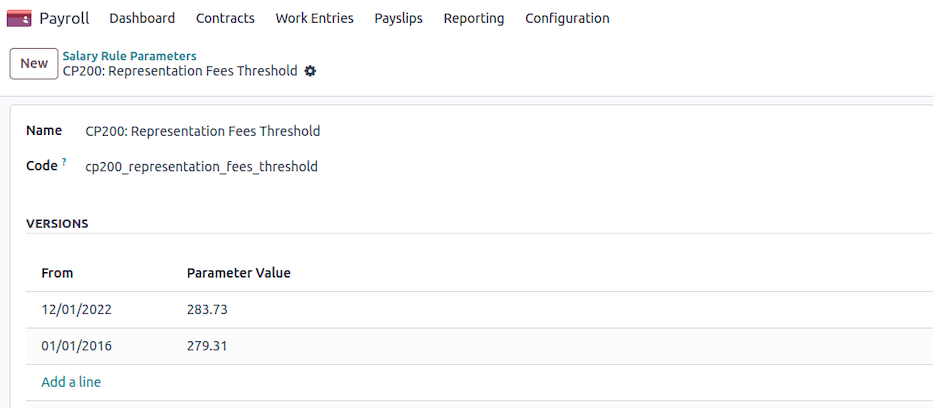

=============================
Payslip and salary components
=============================

This page explains how a Belgian payslip is built and how specific salary components are computed in Odoo.

.. _payroll/l10n_be/payslip_explained:

Understanding the Belgian payslip
=================================

Overview
--------

Providing employees with a clear, transparent payslip is essential for compliance and employee
satisfaction. This guide explains how to interpret a Belgian payslip, detailing key components that
impact salary calculations and deductions.

General information
-------------------

The first section of the payslip contains the employee's general details. It is crucial to verify
the accuracy of the civil status and the number of dependents, as these factors influence tax
calculations. Employers can ensure updates are made through their internal salary configurator or
employee profile management systems.

.. image:: payslip/payslip-explained-01.png
   :alt: How to read a payslip - General Information.

Work entries
------------

This section outlines time-off applications and their impact on salary. The base salary typically
remains constant unless unpaid leave is taken. If an employee has taken unpaid leave, parental
leave, or any unexpected absence, their salary will reflect the corresponding deductions.

.. image:: payslip/payslip-explained-02.png
   :alt: How to read a payslip - Work Entries.

Payroll calculation
-------------------

The core of the payslip details various salary components, deductions, and benefits. Below are the
primary elements:

- **Benefits in Kind**: If applicable, benefits in kind (such as a mobile or internet subscription
  or a laptop) are subject to taxation and impact net remuneration.

  When a company car is provided for personal use, a taxable benefit (ATN) is added to the
  employee's salary. This is determined by:

  - The catalog value and age of the vehicle
  - The vehicle's CO2 emissions

  This benefit is subject to withholding tax and will be adjusted later in the payroll process.
- **Social Security contributions**: A mandatory 13.07% deduction from gross salary is allocated to
  the National Social Security Office (ONSS). This includes:

  - Pensions: 7.5%
  - Health Insurance for Care: 3.55%
  - Health Insurance for Benefits: 1.15%
  - Unemployment: 0.87%

  Additionally, the employer contributes on average 25% of the employer's contributions to the
  National Social Security Office.
- **Employment bonus**: A reduction in employee contributions based on gross salary, which is phased
  out if the salary exceeds a specific threshold.

  .. seealso::
     `More info on job bonuses <https://www.socialsecurity.be/employer/instructions/dmfa/fr/latest/instructions/deductions/workers_reductions/workbonus.html>`_

- **Withholding taxes**: Withholding tax rates are revised annually by the `SPF Finances
  <https://finances.belgium.be/fr/entreprises/personnel_et_remuneration/precompte_professionnel/calcul>`_.

  The tax amount is influenced by:

  - Gross salary
  - Marital status (married, legally cohabiting, or single)
  - Household composition (children or other dependents)

  This serves as an advance payment on professional income tax.
- **Reduction in withholding tax**: A reduction based on gross salary, which is ignored if salary
  surpasses a specific amount.
- **Special Social Security contribution**: A household income-based tax applicable to all employees
  covered by social security.
- **Meal voucher deduction**: Employees receive meal vouchers valued for instance at €8 per workday,
  where:

  - The employer contributes €6.91
  - The employee contributes €1.09

  .. example::
     - 5 worked days -> deduction of €5.45 (:math:`5\times\text{€}1.09`)
     - 22 worked days -> deduction of €23.98 (:math:`22\times\text{€}1.09`)

  Variations in this deduction impact monthly net salary.
- **Representation fees**: An optional net salary component, allocated in two parts:

  - A fixed portion, independent of working hours
  - A prorated portion, adjusted for part-time schedules
- **Net salary**: The final amount deposited into the employee's bank account after deductions.

.. _payroll/l10n_be/representation_fees:

Representation fees
===================

Introduction
------------

Representation fees must be **allocated on the payslip** between **serious and non-serious
representation costs**. By default, the threshold is set at **€283.73**, but it can be adjusted
based on what the company can **legally justify**.

The representation fees is configured on the employee's contract form in the :guilabel:`Expense
Fees` field.

On the payslip, two or one line are displayed in the case the representation fees amount exceeds
the threshold or not.

Breakdown of the threshold
--------------------------

Only part of the representation costs are pro-rated because certain costs are **fully covered** by
the company. These fixed costs include:

.. math::
   :class: overflow-scroll

   \text{€}283.73\text{ Total} = \begin{cases}
   + \text{ €148.73 (Tax, since 2021 - coronavirus)} \\
   + \text{ €30 (Internet)} \\
   + \text{ €25 (Phone)} \\
   + \text{ €80 (Car management fees)} \\
   \end{cases}

The **serious portion** of the representation costs is **not prorated**, while the
**non-serious portion** is prorated based on working time.

Navigate to :menuselection:`Payroll app --> Configuration --> Salary --> Rule Parameters`, and
search for the `CP200: Representation Fees Threshold` record. Then, adapt the current value or
introduce a new one from a given date.

.. note::
   It is possible to define, based on job position, which jobs are eligible to certain criteria in
   the :guilabel:`Payroll` tab.

   .. image:: payslip/representation-fees-04.png
      :alt: Representation Fees Job Position.

Calculation of representation fees
----------------------------------

Conditions for payment
~~~~~~~~~~~~~~~~~~~~~~

Representation fees are only granted if:

- The employee **receives a basic salary**, and
- The employee has **worked at least part of the time**, unless a **salary simulation** is in
  progress.

If the employee is on **full leave** (without any working days), they are **not eligible** for
representation fees.

Determining the work time rate
~~~~~~~~~~~~~~~~~~~~~~~~~~~~~~

- The number of **working days per week** is extracted from the employee's contract.
- If the employee has periods of **incapacity for work** (e.g., illness), the calculation adjusts
  the **work time rate** accordingly:

  - The total **incapacity hours** are determined.
  - If the company follows a **biweekly schedule**, the incapacity hours are divided by **two**.
  - The incapacity **rate** is calculated as:

    .. math::
       :class: overflow-scroll

       \text{incapacity rate} = 1 - \frac{\text{incapacity hours}}{\text{total weekly hours}}

  - The **final work time rate** is then adjusted by multiplying it with the incapacity rate.

Applying the threshold and pro-rating rules
~~~~~~~~~~~~~~~~~~~~~~~~~~~~~~~~~~~~~~~~~~~

- The **default threshold (€283.73)** is applied unless adjusted by the company.
- If the employee has **worked a full-time schedule**, they receive the **full representation fees**
  without reduction.
- If the employee works **part-time** (contractual or due to time credit), only the **non-serious
  portion** of the fees is prorated.

  - The prorated formula for non-serious expenses is:

    .. math::
       :class: overflow-scroll

       \text{adjusted amount} = \text{threshold} + (\text{total fees} - \text{threshold}) \times
       \frac{\text{work time rate}}{100}

- If the employee has **missing workdays**, the final amount is further adjusted:

  - First calculate the **daily reduction**:

    .. math::
       :class: overflow-scroll

       \text{daily reduction} = \frac{(\text{total amount} - \text{threshold}) \times 3}{13 \times \text{days per week}}

  - Then calculate the **final amount**:

    .. math::
       :class: overflow-scroll

       \text{final amount} = max(0, \text{total amount} - \text{daily reduction} \times
       \text{missing days})

Final calculation
~~~~~~~~~~~~~~~~~

- If the employee meets all conditions, the final representation fees amount is
  **rounded to two decimal places** for payroll purposes.
- Employees working a full schedule receive **full reimbursement**, while those working
  **reduced hours** have the **non-serious portion prorated** accordingly.

Conclusion
----------

This calculation ensures **fair allocation** of representation fees by distinguishing between
**fixed serious costs** and **prorated non-serious costs**. The company can adjust the
**threshold (€283.73 by default)** based on **justifiable business expenses**.

Employees working **full-time** receive their full representation fees, while those working
**part-time or with absences** only receive a **pro-rated portion** of the non-serious fees.
