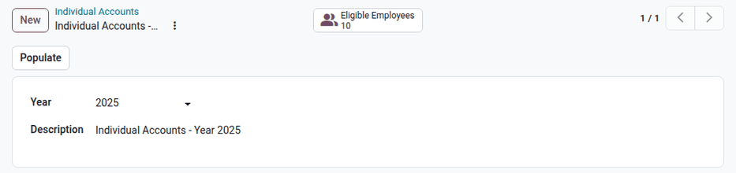
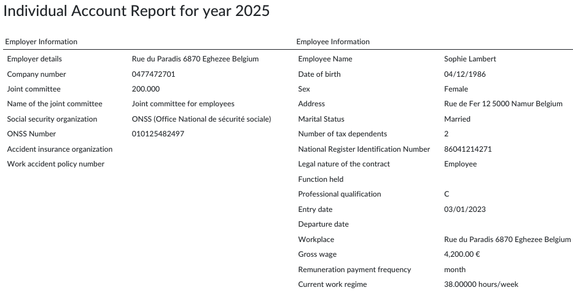
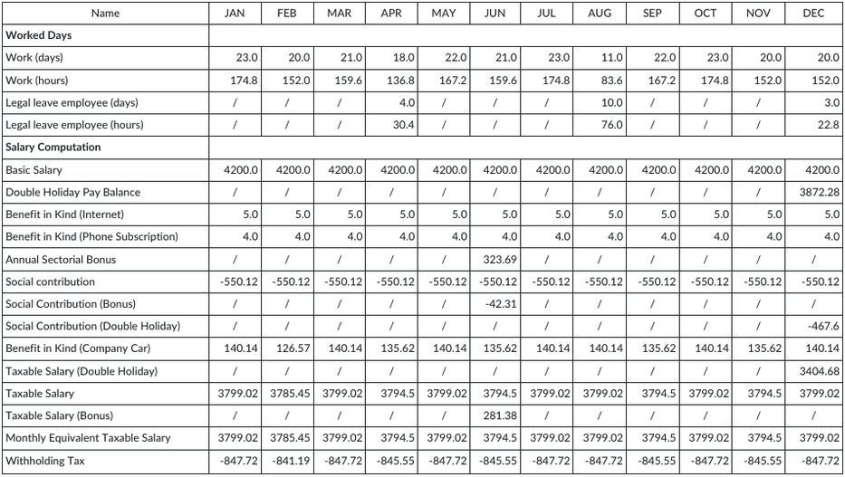
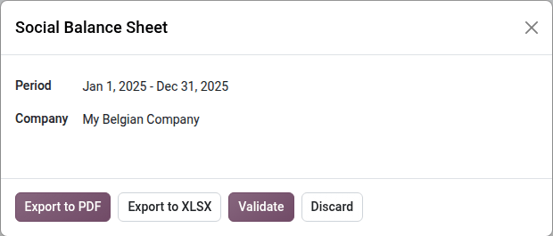
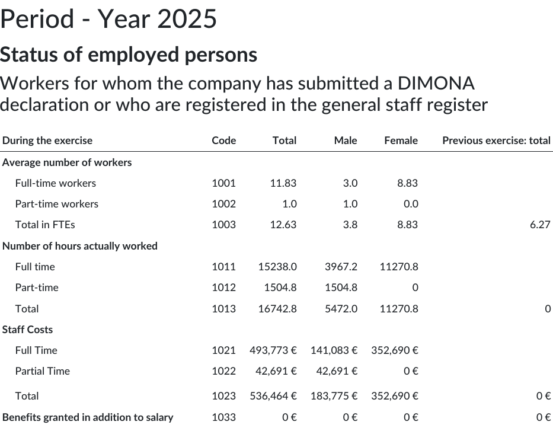
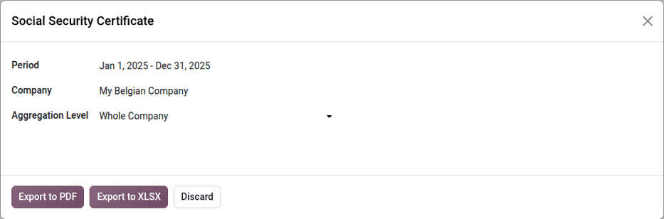
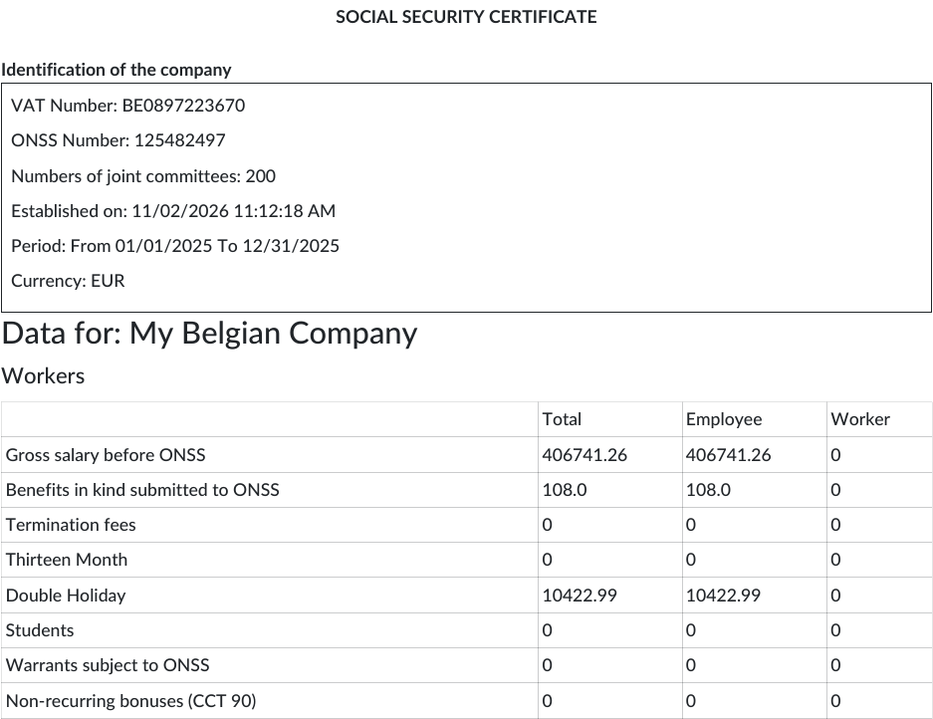

================
Social reporting
================

This page covers the legal social documents generated from the payroll data. They are available
under :menuselection:`Payroll app --> Reporting --> Belgium`, and are computed from the validated
and paid payslips.

.. _payroll/l10n_be/individual_accounts:

Individual accounts
===================

The *individual account* gives, for each worker and for a calendar year, a detailed overview of the
remuneration (earnings, social security contributions, withholding taxes, etc.) and of the working
days, per pay period. It also contains the administrative data related to the remuneration.

Content of the individual account
---------------------------------

The individual account must include the following details, determined by Royal Decree:

- **Employer identification**: name, address, ONSS number, joint committee, holiday fund of the
  workers, insurer of the work accidents, approved social secretariat, and the related affiliation
  numbers.
- **Worker identification**: name, address, date of birth, sex, tax status, type of employment
  contract, job title, professional qualification, workplace, start and end dates of the
  employment, national number, salary, and payment frequency.
- **Remuneration, per pay period**: number of working days and hours, days of interruption of the
  work and their reason (illness, holidays, public holidays, etc.), all the components of the
  remuneration (fixed and variable salary, bonuses, benefits in kind, meal and eco vouchers, holiday
  pay, indemnities, etc.), gross amount, social and tax deductions, net amount paid, and the other
  payments made by the employer (expense reimbursements, allowances, etc.).
- **Totals per quarter and per year**: working days, days of interruption, remuneration subject to
  social security contributions, employee contributions, taxable remuneration, and withholding
  taxes.

The individual account only contains the payments registered in Odoo: make sure that the year-end
bonuses, holiday pay, eco vouchers, and travel expenses of the year are paid through payslips.

Storage and communication
-------------------------

The employer keeps the individual accounts for **five years** after the closing of the account, at
the address registered at the ONSS, at a workplace, at the registered office, or at the approved
social secretariat.

Each worker must receive a copy of their individual account:

- **During employment**: before March 1 of the following year.
- **At the end of employment**: within two months following the end of the quarter in which the
  contract ended.
- **For additional payments after the end of the contract**: within two months of the payment.

Generate the individual accounts
--------------------------------

Navigate to :menuselection:`Payroll app --> Reporting --> Belgium --> Individual Accounts`, and click
:guilabel:`New`. Select the :guilabel:`Year`: the :guilabel:`Description` is filled in
automatically. Click :guilabel:`Populate` to list the employees with validated or paid payslips
during the year, in the company and its branches.

Click the :guilabel:`Eligible Employees` smart button to open the list of the employees. Select the
employees, and click :guilabel:`Generate Reports` to generate their PDF files. The files are
generated in the background, by batches of 30 employees: this can take some time for a large
company. Once generated, each file can be downloaded from the :guilabel:`PDF File` column.

When the **Documents** app is installed, click :guilabel:`Post Reports` to post the generated files
in the payroll folder of each employee, in the **Documents** app. The employees can then access them
from their employee portal.

The first page of the PDF file gives the :guilabel:`Employer Information` and the
:guilabel:`Employee Information`.

The next pages detail the worked days and the payslip lines, month by month, split per salary
structure (for example, the monthly pay and the double holiday pay). The last pages give the same
data per quarter, and the totals of the year.

.. _payroll/l10n_be/social_balance_sheet:

Social balance sheet
====================

The *social balance sheet* (*bilan social / sociale balans*) is a part of the annual accounts of a
company. It describes the workforce, its turnover, and its training during the fiscal year.

The companies that file annual accounts with the National Bank of Belgium (NBB) include it in these
accounts. Some entities that do not file annual accounts must still file a separate social balance
sheet with the NBB: in particular, the hospitals, and the private legal entities employing at least
20 full-time equivalents. The associations and foundations with fewer than 20 full-time equivalents
are not required to complete it. The required model (full or abridged) depends on the size of the
entity.

For the models, the rules, and the filing of the social balance sheet, refer to the `National Bank
of Belgium website <https://www.nbb.be>`_.

Content of the social balance sheet
-----------------------------------

The social balance sheet contains:

- **Status of the employed persons**: the average number of workers (full-time, part-time, and
  full-time equivalents), the hours actually worked, and the staff costs during the fiscal year;
  the number of workers at the end of the fiscal year, by type of contract, by sex and level of
  education, and by professional category.
- **Temporary staff** and personnel made available to the company.
- **Staff movements**: the entries and exits during the fiscal year, by type of contract, and the
  exits by reason.
- **Training**: the training initiatives for the workers during the fiscal year.

Generate the social balance sheet
---------------------------------

Navigate to :menuselection:`Payroll app --> Reporting --> Belgium --> Social Balance Sheet`. Select
the :guilabel:`Period` (by default, the previous calendar year) and the :guilabel:`Company`. The
social balance sheet covers the company and its branches.

The dialog offers the following buttons:

- :guilabel:`Export to PDF`: generate the social balance sheet as a PDF file, which is then available
  for download in the dialog. The figures are split by sex, and by working schedule (full-time,
  part-time, and full-time equivalents), with the total of the previous fiscal year when available.
- :guilabel:`Export to XLSX`: download the same data as a spreadsheet, with the codes of the NBB
  model, to import it in the software used to prepare the annual accounts.
- :guilabel:`Validate`: when the **Documents** app is installed, save the PDF file (if generated)
  and the spreadsheet in the **Documents** app, in the folder of the payroll managers, then close
  the dialog.

.. note::
   When the **Accounting** app is installed with the Belgian accounting reports, the XBRL export of
   the annual accounts (:menuselection:`Accounting app --> Reporting --> Statement Reports -->
   Annual Statements`, then :guilabel:`XBRL`) includes the social balance sheet computed from the
   payroll data of the fiscal year.

The data the payroll cannot know, such as the temporary staff costs and the training initiatives,
must be completed manually in the annual accounts.

.. _payroll/l10n_be/social_security_certificate:

Social security certificate
===========================

The *social security certificate* details all the social charges paid by the employees and the
employer during a period, per type of remuneration (monthly pay, double holiday pay, year-end bonus,
termination fees, students, benefits in kind, etc.). It is useful for audit companies, and to check
that the declared amounts match the accounting entries.

Navigate to :menuselection:`Payroll app --> Reporting --> Belgium --> Social Security Certificate`,
and fill in the following fields:

- :guilabel:`Period`: by default, the previous calendar year.
- :guilabel:`Company`: the company of the certificate.
- :guilabel:`Aggregation Level`: :guilabel:`Whole Company`, :guilabel:`By Department`, or
  :guilabel:`By Employee`.

Click :guilabel:`Export to PDF` to generate a printable version of the certificate, or
:guilabel:`Export to XLSX` to generate a spreadsheet with the same data. The generated files are
available for download in the dialog. The amounts are split between the employees and the workers.

When the **Documents** app is installed, click :guilabel:`Validate` to save the generated files in
the **Documents** app, in the folder of the payroll managers.

