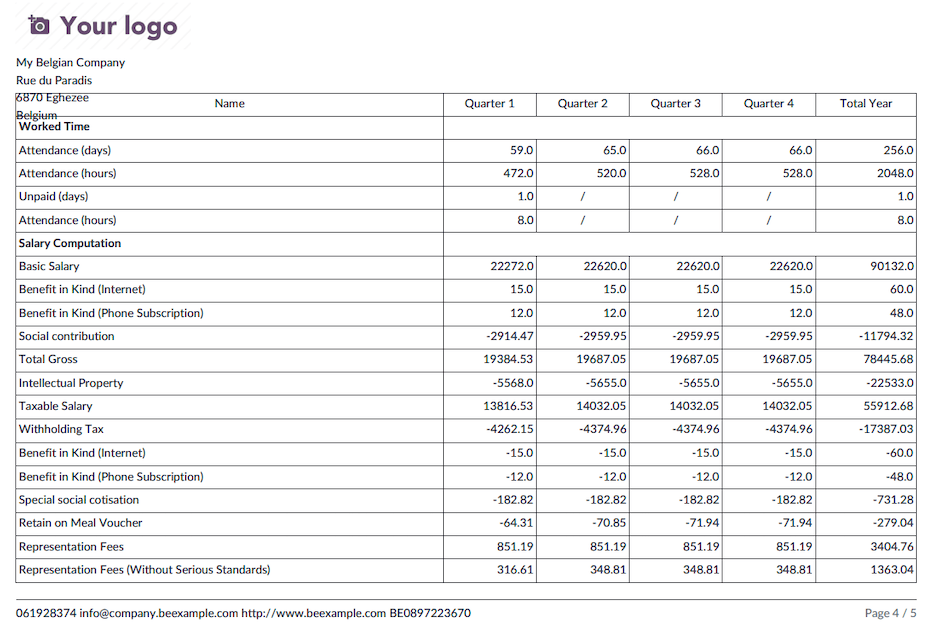
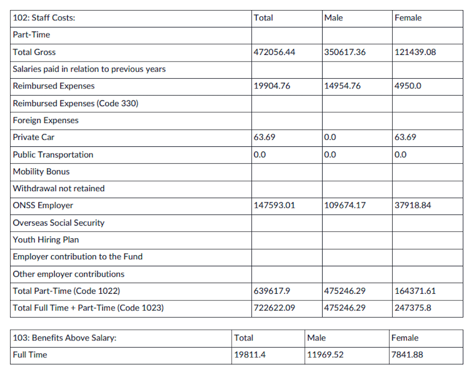
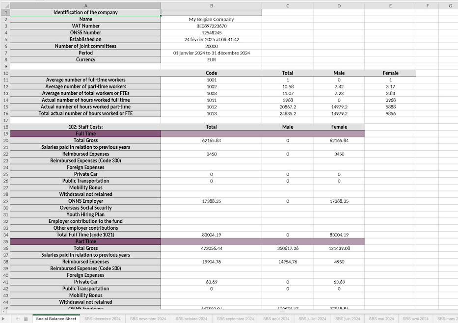
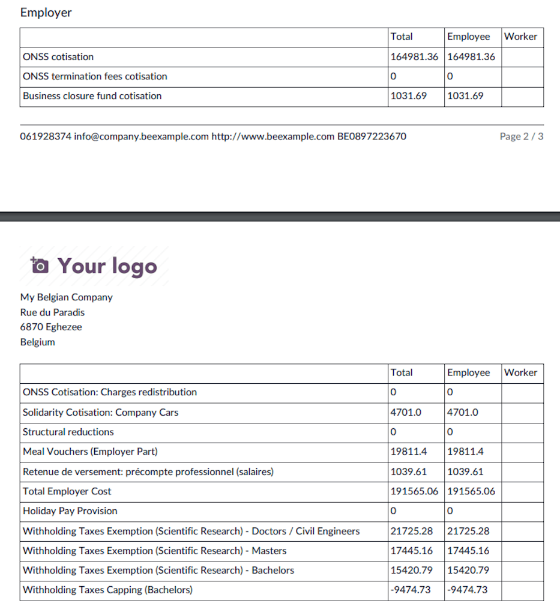
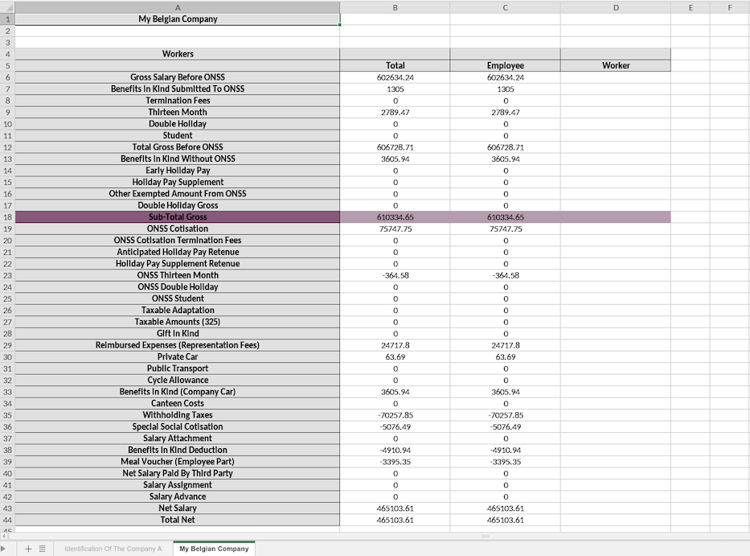

================
Social reporting
================

This page covers the legal social documents generated from payroll data.

.. _payroll/l10n_be/individual_accounts:

Individual accounts
===================

Introduction
------------

The individual account provides workers with a detailed overview of their earnings, deductions
(such as social security contributions, withholding tax, etc.), and the working days performed, on
a pay period basis. Additionally, it contains all relevant administrative data related to
remuneration.

Required information in the individual account
----------------------------------------------

The individual account must include several mandatory details as determined by Royal Decree.

**Employer identification:**

- Name, address, ONSS number, ONVA number
- Relevant joint committee (or sub-committee)
- Name of the holiday fund for workers
- Insurer for work-related accidents
- Approved social secretariat
- Relevant affiliation numbers

**Worker identification:**

- Name, address, date of birth, gender, tax status
- Type of employment contract, job title, professional qualification
- Workplace location (or note if working at multiple locations)
- Start and end date of employment
- Employee ID number, starting salary
- Remuneration components and payment periodicity

**Remuneration components:**

- Per pay period (daily, weekly, bi-weekly, or monthly):

  - Number of working days and hours (regular, additional, and overtime)
  - Days of work interruption and reasons (illness, vacations, public holidays, replacement days,
    compensatory rest days, etc.)
  - Fixed or hourly salary, variable remuneration, bonuses, meal vouchers, eco vouchers, holiday
    pay (including early holiday pay if applicable), severance pay, year-end bonuses (as per
    sectoral or other collective labor agreements), benefits in kind and their estimated value
  - Gross amount of all remuneration components
  - Amounts subject to social and tax deductions
  - Various social and tax deductions: personal ONSS contributions, withholding tax, special
    social security contributions
  - Net amount payable to the worker
  - Other payments made by the employer, including reimbursement of travel expenses, allowances,
    and other payments

- Per quarter:

  - Number of actual working days
  - Days of work interruption by reason
  - Total remuneration subject to social security contributions
  - Employee social security contribution amounts

- Per year:

  - Total amounts subject to social security contributions
  - Employee social security contribution amounts
  - Taxable remuneration and other amounts
  - Withholding tax amount

Responsibility for establishing and updating the individual account
-------------------------------------------------------------------

Belgian employers using **Odoo Payroll** can generate the individual accounts of their workers.

However, to ensure accurate record-keeping, employers must:

- Ensure payment of sector-mandated year-end bonuses
- Ensure that all public holidays, legal vacation days, and compensatory rest days are taken
  before the end of the year
- Plan collective vacation and replacement public holidays in advance
- Pay workers their holiday pay (including early holiday pay if applicable)
- Distribute due eco vouchers
- Pay any required travel expenses between home and work

If these obligations are met, the corresponding data will be included in the individual account.

Storage and retention period of the individual account
------------------------------------------------------

The individual account is a social document that must be kept by the employer for a specified
period after its creation.

Employers may store individual accounts:

- At the ONSS-registered address
- At a workplace
- At their home or registered office if located in Belgium; otherwise, at the residence of a
  designated agent in Belgium
- At the office of the approved social secretariat, if affiliated

Records must be kept legible and in a format allowing efficient oversight. The retention period is
**five years** from the end of the annual closing of the account.

When must workers receive a copy of their individual account?
-------------------------------------------------------------

Each worker must receive a copy of their individual account:

- **During employment:** Before March 1 of the following year
- **At the end of employment:** Within two months following the end of the quarter in which the
  contract ended
- **If additional payments occur after contract termination:** A copy reflecting the additional
  payment must be provided within two months of the payment

Additionally, employers must issue a **simplified individual account** with certain worker and
employer details within two months of the worker's employment start date.

Any modifications to mandatory details, such as job function or workplace location, must be
communicated in writing (e.g., an updated simplified individual account) within one month of the
effective change date.

Generate individual accounts in Odoo
------------------------------------

Navigate to :menuselection:`Payroll app --> Reporting --> Belgium --> Individual Accounts`.

Then select the reference year and click the :guilabel:`Populate` button. The :file:`.pdf` are
displayed as soon as they are available and are generated 30 by 30, this could take some time
according to the number of employees.

On the first page, the :guilabel:`Employer Information` and the :guilabel:`Employee Information` is
listed.

.. image:: reporting/individual-account-03.png
   :alt: Individual Account PDF Header.

The next page displays all the employee worked days and payslip lines, month by month, split by
structure (e.g., End of year bonus and monthly pay).

.. image:: reporting/individual-account-04.png
   :alt: Individual Account PDF Month by Month.

The next page displays the same information quarter by quarter and summarized for the whole year.

Once all PDF files are generated, they can be posted to the employee documents portal if the
**Documents** application is :doc:`installed and properly configured
<../../../../productivity/documents>`.

Select the checkbox of each employee whose documents you want to post, and click the :guilabel:`Post
PDF` button.

.. _payroll/l10n_be/social_balance_sheet:

Social Balance Sheet
====================

Introduction
------------

The *Social Balance Sheet* was introduced by the law of December 22, 1995, as part of measures for
the implementation of the multi-year employment plan. Companies required to file annual accounts
(including some that are not obligated to publish such accounts - see the
`National Bank of Belgium website <https://www.nbb.be>`_ for details) must also prepare and submit a
Social Balance Sheet to the National Bank of Belgium.

The Royal Decree of August 4, 1996, incorporates the Social Balance Sheet into the annual accounts,
specifically as an annex. This makes it an integral part of a company's financial statements.

Contents of the Social Balance Sheet
------------------------------------

The content of the Social Balance Sheet is determined by the Royal Decree of January 30, 2001,
implementing the Company Code. The Social Balance Sheet consists of several sections:

- Sections I and II: Information on employed persons and personnel movements during the fiscal year.
- Section III: Initiatives related to training.

Since the Social Balance Sheet is part of a company's annual accounts, the works council receives
this information as part of its mission regarding economic and financial information.

Additionally, the works council receives data on employment-related benefits along with annual
employment-related information (Trillium). These details were fully integrated into the Social
Balance Sheet until 2008.

Scope of the Social Balance Sheet
---------------------------------

The Social Balance Sheet contains specific data related to workforce composition, staff turnover,
and training programs. Some organizations not required to publish annual accounts must still file a
separate Social Balance Sheet. This applies primarily to certain hospitals and private legal
entities employing at least 20 full-time equivalents (FTEs).

Any company, association, or foundation with at least 20 workers on an annual average (in FTE) must
complete and submit the Social Balance Sheet.

The Social Balance Sheet is part of:

- "Other documents to be filed under the Company and Associations Code" (for companies);
- "Explanatory Notes" (for associations and foundations).

Obligations by entity type
--------------------------

Companies, associations, and foundations required to publish a Social Balance Sheet
~~~~~~~~~~~~~~~~~~~~~~~~~~~~~~~~~~~~~~~~~~~~~~~~~~~~~~~~~~~~~~~~~~~~~~~~~~~~~~~~~~~

For Belgian companies employing at least one FTE:

- **Standardized model**: This schema includes a "Social Balance Sheet" section, which must be
  completed.
- **Specific model**: If the model used does not include a Social Balance Sheet, it must be
  provided separately.

For Belgian associations and foundations employing at least 20 FTEs:

- **Standard model**: Includes a "Social Balance Sheet" section that must be completed.
- **Specific model**: A separate Social Balance Sheet must be submitted if the chosen model does
  not include one.

Associations and foundations with fewer than 20 FTEs may voluntarily complete the Social Balance
Sheet but are not legally required to do so.

For foreign companies, such as branches of foreign corporations and foreign non-profit organizations
(ASBL) with activities in Belgium, the Social Balance Sheet applies only to their Belgian
operations.

The Social Balance Sheet is made publicly available by the Central Balance Sheet Office as part of
the financial statements submission.

Entities required to file a separate Social Balance Sheet
~~~~~~~~~~~~~~~~~~~~~~~~~~~~~~~~~~~~~~~~~~~~~~~~~~~~~~~~~

Certain organizations that do not need to publish annual accounts must still submit a Social Balance
Sheet to the Central Balance Sheet Office. This data is used exclusively for statistical purposes
and is not made publicly available. Submission in these cases is free of charge.

This exception applies to:

- **Hospitals**, unless they are structured as limited liability companies or large ASBLs, which
  must submit full financial statements, including the integrated Social Balance Sheet.
- **Private legal entities** that are not required to submit annual accounts but have at least 20
  employees.

The required model depends on the entity type:

- **Hospitals** must use the full or abridged Social Balance Sheet model based on their size.
- **Foreign entities** must use the full or abridged Social Balance Sheet model, based on the size
  of their Belgian establishments.
- **Private legal entities** with at least 50 employees must use the full model, while those with
  20-49 employees may use the abridged model.

Social Balance Sheet models
---------------------------

The latest versions of the Social Balance Sheet models can be found at the following links:

- **Full Model**

  - PDF: `Full Social Balance Sheet PDF <https://www.nbb.be/doc/ba/models/social%20balance/release_2021_fr_bilan_social_c_20121201.pdf>`_
  - Word: `Full Social Balance Sheet Word <https://www.nbb.be/doc/ba/models/social%20balance/release_2021_fr_bilan_social_c_20121201.docx>`_

- **Abridged Model**

  - PDF: `Abridged Social Balance Sheet PDF <https://www.nbb.be/doc/ba/models/social%20balance/release_2021_fr_bilan_social_a_20121201.pdf>`_
  - Word: `Abridged Social Balance Sheet Word <https://www.nbb.be/doc/ba/models/social%20balance/release_2021_fr_bilan_social_a_20121201.docx>`_

Assistance in completing the Social Balance Sheet
-------------------------------------------------

For guidance on completing the Social Balance Sheet, refer to the following resources:

- **CNC Opinion S100**: `Questions and Answers on the Social Balance Sheet <https://www.nbb.be/doc/ba/models/social%20balance/avis_cnc_s100.pdf>`_
- **CNC Opinion 2009/12**: `Social Balance Sheet and Statutory Workers <https://www.nbb.be/doc/ba/models/social%20balance/avis_cnc_2009_12.pdf>`_
- **Explanatory Note**: `Information on Training Activities <https://www.nbb.be/doc/ba/models/social%20balance/notice_formations_fr_4%20avril%202008.pdf>`_

Submitting a separate Social Balance Sheet
------------------------------------------

A separate Social Balance Sheet must be submitted online as a PDF via the **Filing** application.
The model can be selected under :guilabel:`Other Documents`, with options for :guilabel:`Abridged
Social Balance Sheet` or :guilabel:`Full Social Balance Sheet`.

For further details, visit the National Bank of Belgium's website: `www.nbb.be <https://www.nbb.be/>`_.

Generating Social Balance Sheet in Odoo
---------------------------------------

Navigate to :menuselection:`Payroll app --> Reporting --> Belgium --> Social Balance Sheet` and
select the reference :guilabel:`Period`.

.. image:: reporting/social-balance-sheet-01.png
   :alt: Social Balance Sheet Wizard.

Then click :guilabel:`Export to PDF` or :guilabel:`Export to XLSX` to generate the social balance
sheets containing all the data available in your Odoo database.

The different pieces of information are split by gender, or by working schedule (Part Time, Full
Time, Full Time equivalent), for the whole period, and month by month, as requested by the National
Bank of Belgium.

.. image:: reporting/social-balance-sheet-02.png
   :alt: Social Balance Sheet PDF Header.

.. _payroll/l10n_be/social_security_certificate:

Social Security certificate
===========================

The Social Security certificate in Odoo provides a detailed breakdown of all social charges paid by
the employee or employer, categorized by type (e.g., year-end bonus, private car reimbursement,
double holiday pay, etc.). This report is particularly useful for audit companies and for verifying
that the declared amounts align with accounting entries.

Accessing the Social Security certificate
-----------------------------------------

To generate the Social Security certificate, follow these steps:

#. Navigate to :menuselection:`Payroll app --> Reporting --> Belgium --> Social Security
   Certificate`.
#. Select the reference :guilabel:`Period`.
#. Choose the data :guilabel:`Aggregation Level`:

   - :guilabel:`Whole Company`
   - :guilabel:`By Department`
   - :guilabel:`By Employee`

.. image:: reporting/social-security-certificate-01.png
   :alt: Social Security Certificate Wizard.

Exporting the report
--------------------

Once the selections are made, you can export the report in different formats:

- Click :guilabel:`Export to PDF` to generate a printable version of the Social Security
  certificate.
- Click :guilabel:`Export to XLSX` to generate an Excel file containing all relevant data.

.. image:: reporting/social-security-certificate-02.png
   :alt: Social Security Certificate PDF Header.

This feature ensures full transparency and compliance with social security regulations in Belgium.
