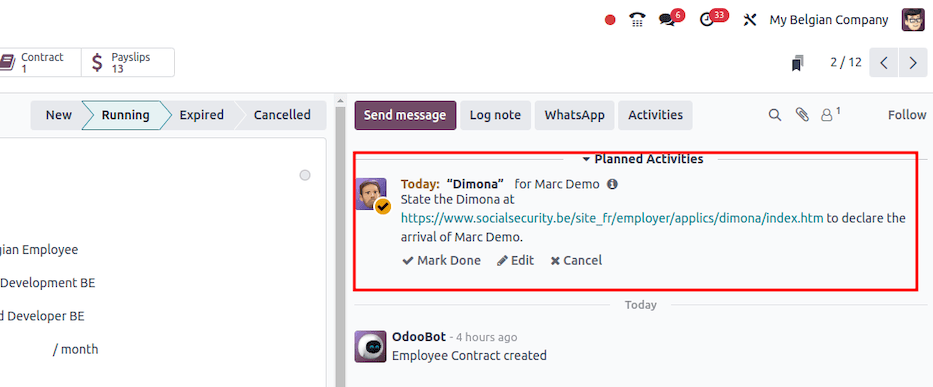
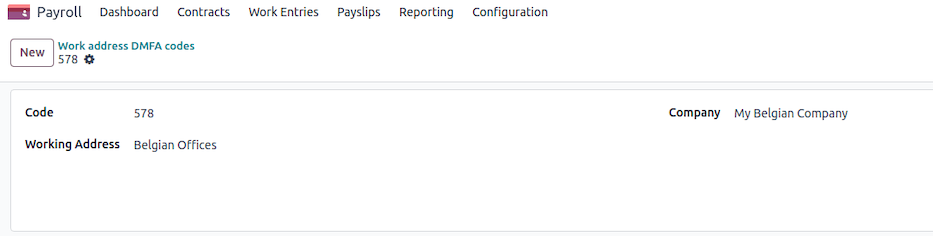
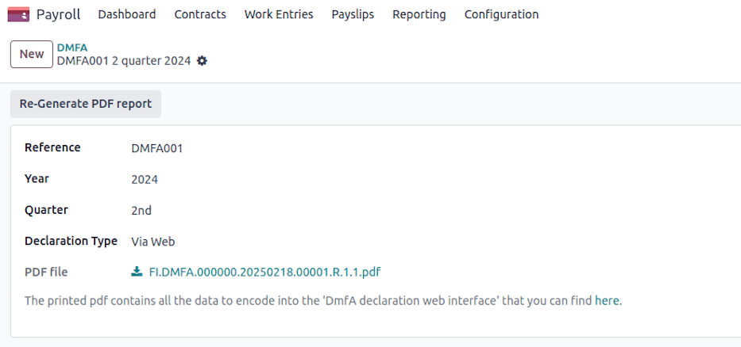
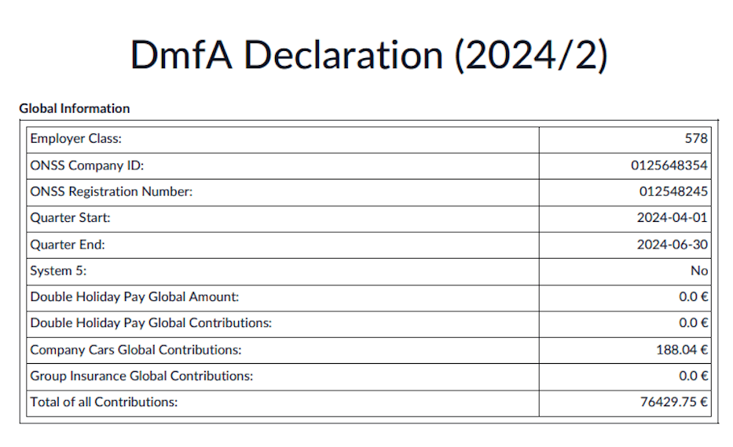
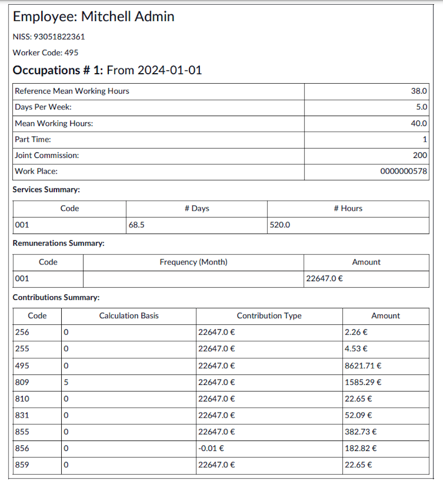
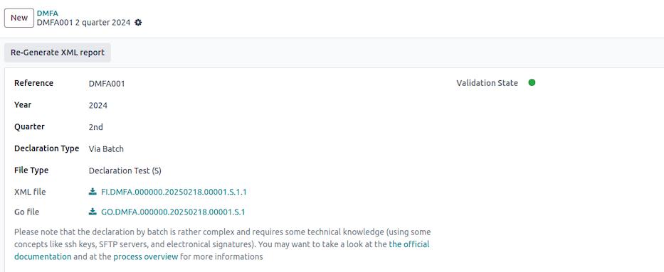
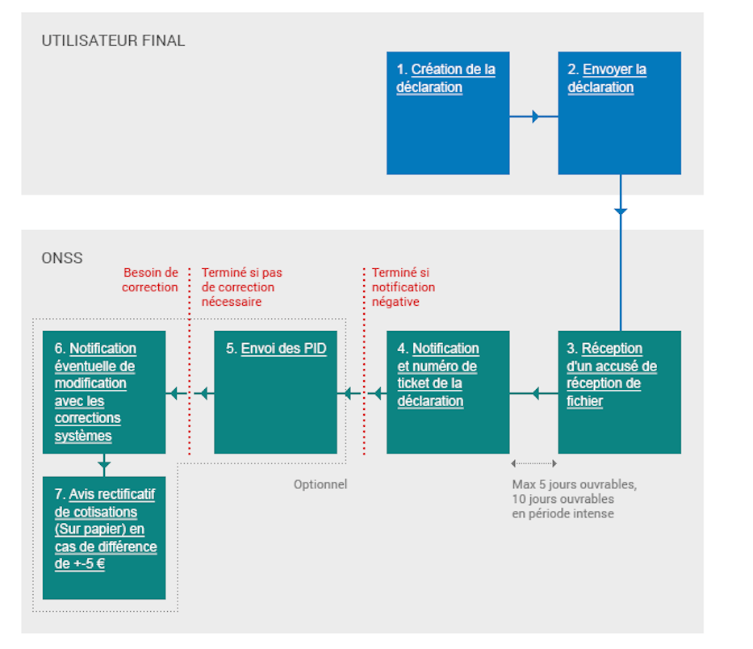

============================
Social security declarations
============================

This page covers the declarations sent to the National Social Security Office (NSSO/ONSS).

.. _payroll/l10n_be/dimona:

DIMONA
======

What is the Dimona?
-------------------

Obligation
~~~~~~~~~~

All employers, both in the public and private sectors, are required to electronically communicate
the entry and exit of their personnel to the National Social Security Office (Royal Decree of
November 5, 2002).

This involves the immediate declaration of employment, also known as DIMONA (Déclaration Immédiate -
Onmiddellijke Aangifte). Its purpose is to immediately notify social security institutions of the
beginning and end of an employment relationship between the worker and the employer.

The declarations submitted by the employer and immediately checked by the NSSO feed into a database
called the *personnel file*. The employer can access it in a secure environment. There are numerous
search criteria: they can be based on characteristics and combinations of characteristics.

Failure to comply with this reporting obligation may result in criminal penalties as provided for
in Article 181 of the Social Penal Code.

Furthermore, in case of omission of declaration, the employer will owe the NSSO a solidarity
contribution.

Concept and terminology
~~~~~~~~~~~~~~~~~~~~~~~

Employer-worker relationship
****************************

The relationship between the "employer" and the "worker" couple. This relationship includes stable
data (employer identification number, worker's national identification social security number
(NISS), start date of the relationship, and optionally end date), which will be maintained even in
case of creation, closure, modification, or cancellation of a period. This relationship begins with
the worker's first engagement and ends at the end of their last occupation. In the personnel file,
"employer-worker" relationships constitute the first level of consultation. The second level
encompasses all Dimona periods;

Dimona period
*************

A period is created with each IN declaration, thus at the beginning of each new occupation. It is
closed by an exit date at the end of each occupation. The employer-worker relationship, on the
other hand, is maintained until the end of the last occupation. Several Dimona periods may or may
not succeed each other within the same employer-worker relationship.

Any changes generated by an OUT declaration, a modification (UPDATE), or a cancellation (CANCEL)
occur at this second level.

This Dimona period is identified by a "period identification number". It is assigned to each IN
declaration and constitutes the unique identification key of a period for submitting OUT,
modification, or cancellation declarations.

Dimona number
*************

A unique number assigned by the NSSO to each Dimona declaration (IN, OUT, UPDATE, CANCEL,...). For
an IN declaration, it is the period identification number. When declarations are submitted via file
transfer, multiple Dimona numbers are created: one number per employment relationship included in
the structured message;

Dimona characteristics
**********************

Mandatory data of a Dimona declaration. There are four: the industry sector number, worker type,
sub-entity (reserved for certain public sector employers), and user (for temporary workers).
Characteristics are always linked to a period. In case of different characteristics, multiple
periods can coexist;

Receipt confirmation
********************

Confirms for web users that the declaration has been received (appears immediately on the screen);

Receipt acknowledgment
**********************

Electronic message for batch senders indicating whether the file is usable for the NSSO. This
"receipt acknowledgment" contains the ticket number (:dfn:`file identification number`) and the file
status: accepted or rejected depending on whether the file is readable or not;

Notification
************

Electronic message with feedback on the processing of the declaration. The notification is the
immediate result of form and content checks. It can be of three types: positive (Dimona accepted),
negative (Dimona rejected), or provisional (only in case of problems with worker identification).
The provisional notification will always be followed by a positive or negative notification.

For the declaration of students under a student contract (STU), the notification will also contain
a warning if the student is declared for more than 475 hours. If the declaration was made via a
secure channel, the exact number of days of excess will be communicated.

For the daily declaration of occasional workers in the hospitality industry, the notification will
also contain a warning if the worker is declared for more than 50 days and/or for the employer
quota, if more than 100 days of occasional work have been declared.

Once you have received this notification, you have five working days to contest the accuracy of the
data mentioned therein. At the end of this period, these data will be considered final. For any
disputes, you must contact the Eranova Contact Center (tel: 02 511 51 51, email:
contactcenter@eranova.fgov.be).

Note that if the employer is affiliated with an approved social secretariat or a full-service
secretariat, they may not receive any notification. In this case, notifications are electronically
transmitted to the social secretariat or full-service secretariat, even for declarations that the
employer has submitted personally. However, the employer has access to the personnel file, where
they can view all data.

Channels
~~~~~~~~

The Dimona declaration must be submitted in the form of an electronic message via one of the
following channels:

- web
- personnel file
- file transfer
- web service (REST)
- Dimona Mobile

The choice of one channel over another has no impact on the declaration. Therefore, you can freely
choose the channel you will use.

Any declaration modifications can also be made through any of these four channels. The channel
through which the original declaration was submitted plays no role.

A Dimona declaration cannot be submitted via SMS.

Dimona in Odoo
--------------

Manual
~~~~~~

In Odoo, when you have the Belgian Payroll Localization installed, as soon as you have a contract
set to the running stage, it creates an activity for the HR responsible that they need to introduce
the Dimona for today with the correct link to the Dimona Platform (the web channel mentioned in
the Channels section of this article).

Automated
~~~~~~~~~

In Odoo, when you have the Belgian Payroll Localization installed, it is also possible to install
the module Belgium - Payroll - Dimona. This module will allow you to perform the 4 main actions
needed in the Dimona (as seen in Section 1 of this article):

#. Open the dimona
#. Update the dimona
#. Close the dimona
#. Cancel the Dimona

These actions answer the different use case explained in Section 1.

Contract and employee data
**************************

Basically, it checks the contract and employee data needed to create, update, close or cancel.

Error handling
**************

If some information is missing or wrongly configured, the system will return errors and you can
take corrective action in order to make sure your Dimona is correctly sent, updated, closed or
canceled.

Synchronization status
**********************

The status of sync and errors are shown in the chatter of the contract.

Scheduled action
****************

Finally, the cron checks every day, for all contracts that have the status dimona waiting and
triggers the necessary actions to update the dimona status accordingly.

Technical configuration (outside Odoo)
**************************************

Regarding the technical configuration, everything is described in the module information with all
the technical prerequisites. If your customer or partner need further assistance with that, they
need to contact their IT department or representatives as this is not part of Odoo configuration.

Functional configuration (within Odoo)
**************************************

From the Odoo configuration point of view, navigate to :menuselection:`Payroll app --> Configuration
--> Settings` and in the :guilabel:`Belgian Localization` section for :guilabel:`ONSS`, configure
the following:

- :guilabel:`ONSS Company ID`: VAT Number of the Company
- :guilabel:`Registration Number`: 9 digits code received from the NSSO (ONSS - RSZ)
- :guilabel:`DMFA Employer Class`: 3 digits code received from the NSSO (ONSS - RSZ)
- :guilabel:`Expeditor Number ONSS`: Not Mandatory (see technical documentation of the module for
  more information)
- :guilabel:`PEM Certificate`, :guilabel:`PEM Passphare`, :guilabel:`KEY file`: check the module
  information for explanation

.. _payroll/l10n_be/dmfa:

DmfA - Multifunctional Declaration
==================================

Overview
--------

DmfA stands for "Déclaration Multifonctionnelle" or "Multifunctionele Aangifte." It has replaced
the quarterly ONSS declaration since the first quarter of 2003. Through this declaration, employers
submit salary and working time data for their employees.

These data are processed in a way that allows all social security institutions to work with the
same information. The declaration is called "multifunctional" because it is used not only for
social security contribution calculations and reductions but also as a data source for institutions
managing social security rights and benefits.

Sectors utilizing DmfA data include:

- Health insurance
- Unemployment benefits
- Pensions
- Occupational risks (Fedris)
- Family allowances
- Annual leave

All employers registered with ONSS must submit a DmfA declaration.

Relationship with Dimona and DRS
--------------------------------

DmfA is closely linked to two other mandatory declarations:

Dimona (immediate declaration)
~~~~~~~~~~~~~~~~~~~~~~~~~~~~~~

Dimona records the start and end of an employment relationship with an employee.

DRS (social risks declaration)
~~~~~~~~~~~~~~~~~~~~~~~~~~~~~~

During an employment relationship, various social risks may arise, such as termination, workplace
accidents, or long-term illness. When a social risk occurs, social security institutions require
additional information beyond that provided by DmfA and Dimona.

DRS is now primarily an electronic declaration, though paper submissions remain possible.

Who submits the DmfA declaration?
---------------------------------

Self-declaration options
~~~~~~~~~~~~~~~~~~~~~~~~

Employers can submit their DmfA declaration themselves via:

1. **Web Submission:** Suitable for employers with a small workforce. Declarations are entered
   directly through the social security portal.
2. **Batch Submission:** Designed for large employers or organizations handling multiple
   declarations (e.g., social secretariats, payroll software providers). Declarations are submitted
   via file transfer (FTP, SFTP, etc.).

Advantages of web submission
~~~~~~~~~~~~~~~~~~~~~~~~~~~~

- **Automatic access to the company's employee list**: Based on Dimona data. If an employee is
  missing, they must first be declared via Dimona. After 24 hours, the employee list is updated,
  allowing for an accurate DmfA submission.
- **Automatic calculation of net payable amount**: Once all required data is entered, the system
  calculates the total payable amount.
- **Reduction calculations**: The system calculates applicable reductions, except for reductions
  under code "0001" (personal contribution reductions for low-income workers). Employers need to
  check the relevant boxes and, if necessary, provide additional details.

Advantages of batch submission
~~~~~~~~~~~~~~~~~~~~~~~~~~~~~~

- **Submission of large volumes of declarations**: Ideal for organizations managing multiple
  payrolls.
- **Quick response on acceptance status**: Employers receive immediate feedback on whether their
  declaration has been accepted.
- **Error reporting**: The system generates a report on detected anomalies, regardless of
  acceptance status.
- **Automatic correction of calculation errors**: When possible, errors are corrected
  automatically, and employers are notified of adjustments.

Third-Party submission options
------------------------------

Employers who do not wish to submit the DmfA themselves can delegate the task to:

#. **Accredited Social Secretariats**: These organizations handle payroll and declaration tasks
   on behalf of employers.
#. **Service Providers**: These may be companies or individuals with whom the employer has a
   contractual agreement to manage payroll declarations securely.

For more information on accredited social secretariats or service providers, please refer to the
relevant `official DmfA documentation
<https://www.socialsecurity.be/site_fr/employer/applics/dmfa/index.htm>`_.

Configuration
-------------

The declaration is generated under :menuselection:`Payroll app --> Reporting --> Belgium --> DmfA`
as is supposed to work properly after several required configuration steps.

Company
~~~~~~~

To generate a valid DmfA declaration, specific company and employer-related information is required,
(under :menuselection:`Payroll app --> Configuration --> Settings`). These include:

- :guilabel:`ONSS Company ID`
- :guilabel:`ONSS Registration Number`
- :guilabel:`DMFA Employer Class`
- :guilabel:`ONSS Certificate`: certificate for signature file generation (required for batch
  declarations)
- VAT :guilabel:`Company Number`
- :guilabel:`Revenue Code`
- :guilabel:`FFE Employer Type` (Fonds de Fermeture d'Entreprise)

Employee
~~~~~~~~

Additionally, each employee must be assigned to a valid working address, identified with a DmfA
code, in their employee record. This operating unit must be linked to a valid ONSS identification
number to ensure compliance with declaration requirements. Failing to configure this properly may
result in errors during the declaration submission process.

On the employee form, the :guilabel:`Work Address` must be defined.

Under :menuselection:`Payroll app --> Configuration --> DMFA: Work Locations`, you can link the work
address to a ONSS identification number.

Work entry type
~~~~~~~~~~~~~~~

A DmfA code should be defined for each work entry type that is declared. Under
:menuselection:`Payroll app --> Configuration --> Work Entries --> Work Entry Types`, specify the
:guilabel:`DMFA code`.

Potential configuration errors
~~~~~~~~~~~~~~~~~~~~~~~~~~~~~~

During the declaration generation process, configuration issues may arise, triggering errors such
as:

- Terminated employees without or with invalid start/end notice period
- Invalid NISS number for some employees
- Work addresses not linked to an ONSS identification code
- Work entry type missing a corresponding DmfA code
- Other inconsistencies in employer or employee records

Employers should ensure accurate configuration to avoid delays and rejection of their declarations.

Web declaration
~~~~~~~~~~~~~~~

A web declaration generates a PDF summarizing the company's general information, as well as all
employee data that must be manually entered into the system. This includes:

For the company:

For a specific employee:

- **Occupations**: Work schedules, part-time codes, parental leave, exploitation unit, reference
  working hours.
- **Services**: Aggregated work performance (in days and hours) for the quarter, categorized by
  occupation and type. The codification of working time in the DmfA declaration ensures accurate
  reporting of employee activities. Each code corresponds to a specific type of working time or
  absence. For a complete and detailed list of codes, please refer to the official social security
  website: `socialsecurity.be <https://www.socialsecurity.be/employer/instructions/dmfa/fr/latest/instructions/fill_in_dmfa/dmfa_fillinrules/servicedatadeclaration/workingtimecodification.html>`_

  - **1**: All performances covered by a salary subject to ONSS contributions, excluding legal and
    additional vacation for workers.
  - **2**: Legal vacation days for workers.
  - **3**: Additional vacation days for workers.
  - **4**: Compensatory rest days.
  - **5**: Days of illness or non-occupational accident.
  - **6**: Family leave days.
  - **7**: Maternity or paternity leave days.
  - **8**: Strike days.
  - **9**: Temporary unemployment for economic reasons.
  - **10**: Temporary unemployment for bad weather.
  - **11**: Temporary unemployment for force majeure.
  - **12**: Professional training days.
  - **13**: Suspension for disciplinary reasons.
  - **14**: Additional vacation days for employment start or resumption.
  - **15**: Flexible vacation days.

- **Remunerations**: Aggregated by code per occupation:

  - **1**: Regular salary amounts excluding certain indemnities.
  - **2**: Bonuses and similar benefits granted independently of actual working days.
  - **3**: Severance payments expressed in working hours.
  - **7**: Simple vacation pay for exiting employees (subject to contributions).
  - **10**: Personal use of a company vehicle and other mobility benefits.
  - **11**: Simple vacation pay for exiting employees (not subject to contributions).
  - **12**: Advance vacation pay paid by a previous employer (not subject to contributions).

- **Contributions**: Employer and employee contributions, such as:

  - **256**: Asbestos fund contribution.
  - **255**: Special work accident contribution.
  - **495**: Total employer + 13.07% employee contribution.
  - **809**: Enterprise closure fund contribution.
  - **810**: Special enterprise closure fund contribution.
  - **831**: Auxiliary Joint Committee for Employees (CP200) contribution.
  - **855**: Wage restraint contribution.
  - **856**: Special social security contribution.
  - **859**: Temporary unemployment contribution.

Batch declaration
~~~~~~~~~~~~~~~~~

Batch declarations require technical knowledge, including SSH keys, SFTP servers, and electronic
signatures. Employers should refer to the `official batch documentation
<https://www.socialsecurity.be/site_fr/employer/applics/dmfa/batch/home.htm>`_ and `process overview
<https://www.socialsecurity.be/site_fr/employer/applics/dmfa/batch/outline.htm>`_.

A batch submission generates three files:

#. **Declaration file** (e.g., FI.DMFA.112768.20250109.00014.R.1.1)
#. **Launch file** (e.g., GO.DMFA.112768.20250109.00014.R.1)
#. **Electronic signature file** (e.g., FS.DMFA.112768.20250109.00014.R.1.1) (only for real
   declarations, not tests)

The full process includes creating, sending, validating, and potentially correcting declarations.
Rejections and anomalies must be addressed before final acceptance.

#. **Creation of the Declaration**

   - Create an XML document containing employee benefit data, remuneration, and contributions for
     the company.
   - More information on XML files can be found in the *Specifications* page.

#. **Sending the Declaration**

   - Use FTP or SFTP for sending the file. Access requires prior authorization for secure zone
     access by a local manager.
   - Detailed instructions are available on the `Introduce and Modify (via batch)
     <https://www.socialsecurity.be>`_.

#. **File Acknowledgment Receipt**

   - **Positive Receipt**: Indicates the file can be processed. However, this does not guarantee
     acceptance.
   - **Negative Receipt**: Indicates issues with the file structure or access rights.

#. **Notification and Ticket Number for the Declaration**

   - A positive notification is sent for each accepted declaration.
   - Negative notification: Provides information on encountered anomalies.

#. **Sending PID**

   - Employers and SSA will receive PID and version numbers via batch for declarations.

#. **Modification Notification with System Corrections**

   - If corrections are made, a modification notification is sent with corrected values.
