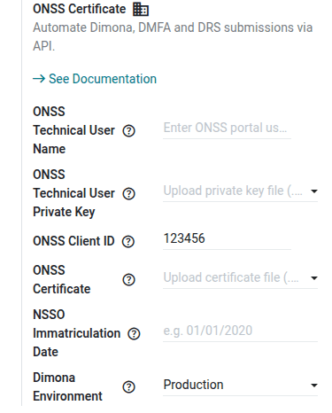

============================
Social security declarations
============================

Belgian employers must report their employees and the salaries they pay to the National Social
Security Office (NSSO, *ONSS* in French, *RSZ* in Dutch). Odoo prepares these declarations from the
employee records and the payslips:

- :doc:`Dimona <social_security/dimona>`: the immediate declaration of the start and end of each
  employment.
- :doc:`DmfA <social_security/dmfa>`: the quarterly declaration of the salaries, working time, and
  social contributions.
- :doc:`DRS <social_security/drs>`: the social risk declarations, sent when an event (end of
  contract, temporary unemployment, illness, maternity, etc.) opens a right to benefits.
- :doc:`Flexi@Work <social_security/flexi_at_work>`: the declaration of the wages paid to
  flexi-job workers.

All these declarations are available under :menuselection:`Payroll app --> Reporting --> Belgium`.

.. toctree::
   :titlesonly:

   social_security/dimona
   social_security/dmfa
   social_security/drs
   social_security/flexi_at_work

.. _payroll/l10n_be/onss_configuration:

Configuration
=============

The declarations use the administrative data of the employer, defined in the :ref:`company data
<payroll/l10n_be/configuration/company>` (ONSS registration number, employer category, company
number, etc.), and the data of each employee (NISS, joint committee, worker code, work location,
etc.).

To send the declarations directly from Odoo, the employer needs a technical user and a certificate
from the ONSS. Navigate to :menuselection:`Payroll app --> Configuration --> Settings`, and fill in
the :guilabel:`ONSS Certificate` setting of the :guilabel:`Belgian Localization` section:

- :guilabel:`ONSS Technical User Name`: the technical user registered on the ONSS portal, used to
  upload the files of the batch declarations.
- :guilabel:`ONSS Technical User Private Key`: the private key of this technical user.
- :guilabel:`ONSS Client ID`: the number of the sender, given by the ONSS when the service is
  registered for the technical user. It is also part of the name of the declaration files.
- :guilabel:`ONSS Certificate`: the certificate used to authenticate on the ONSS web services and
  to sign the declaration files.
- :guilabel:`NSSO Immatriculation Date`: the date the company was registered with the ONSS.
- :guilabel:`Dimona Environment`: the ONSS environment used for the Dimona declarations:

  - :guilabel:`Production`: the real declarations.
  - :guilabel:`Test`: the test environment of the ONSS.
  - :guilabel:`Sandbox`: nothing is sent. Odoo simulates the answers of the ONSS, to train the
    users. In this mode, the :guilabel:`Fetch Declarations (Sandbox)` button is displayed under the
    setting.

.. note::
   These settings are optional. Without them, Odoo still prepares all the declarations, and the
   payroll officer files them on the `social security portal <https://www.socialsecurity.be>`_:
   Odoo then guides the manual Dimona, generates a PDF with the data of the DmfA to encode, and
   lets the payroll officer mark the DRS declarations as done.

   The technical prerequisites (technical user, SSH key, certificate) are described in the `ONSS
   documentation of the batch declarations
   <https://www.socialsecurity.be/site_fr/employer/applics/dmfa/batch/home.htm>`_. The IT department
   or the IT partner of the company usually handles them.

.. _payroll/l10n_be/onss_batch:

Batch declarations
==================

The DmfA (*batch* method), the DRS, and the Flexi@Work declarations are XML files uploaded to the
ONSS. They follow the same flow in Odoo.

Each declaration has an :guilabel:`Environment`:

- :guilabel:`Production`: the real declaration.
- :guilabel:`Circuit Test`: a test of the transmission circuit, with signed files.
- :guilabel:`Declaration Test`: a test of the content of the declaration. The file is not signed,
  so the ONSS certificate is not required.

Generate the file
-----------------

Before generating the file, check the :guilabel:`Validation Errors` tab of the declaration. It lists
the missing or inconsistent data (invalid NISS, employee without Dimona, missing code, etc.), each
with a link to the records to fix. As long as a blocking error (in red) remains, the generation
button is disabled.

Click :guilabel:`Generate XML Report`. Odoo creates the files expected by the ONSS:

- the declaration file, whose name starts with `FI` (for example,
  `FI.DMFA.123456.20261101.00001.R.1.1`);
- the signature file, whose name starts with `FS`, signed with the ONSS certificate (not created in
  the :guilabel:`Declaration Test` environment);
- the *go* file, whose name starts with `GO`, which tells the ONSS that the upload is complete.

Odoo then validates the declaration file against the XML schema published by the ONSS. If the file
does not match the schema, the declaration moves to the :guilabel:`Error` state, and the error is
displayed on the declaration. After fixing the data, click :guilabel:`Re-Generate XML Report`.

.. tip::
   The file can be downloaded from the declaration, or with the :icon:`fa-download`
   :guilabel:`Download` button of the list view, to upload it manually on the ONSS portal.

Send the file and follow up
---------------------------

Click :guilabel:`Post ONSS Declaration` to upload the files to the ONSS through SFTP, with the
technical user of the company. The declaration moves to the :guilabel:`Pending` state.

The ONSS then answers with an acknowledgment of receipt (the file can be processed or not), and with
a notification (the declaration is accepted or refused, with the list of anomalies). The *ONSS:
Fetch SFTP files* scheduled action downloads these answers every day and updates the state of the
declaration: :guilabel:`In Progress`, :guilabel:`Done`, or :guilabel:`Refused`. The answers are also
logged in the chatter of the declaration.

With the :ref:`developer mode <developer-mode>` activated, two additional menus give access to the
details of the exchanges with the ONSS:

- :menuselection:`Payroll app --> Reporting --> Belgium --> ONSS Declarations`: one line per upload,
  with its :guilabel:`Environment`, its state (:guilabel:`Posted`, :guilabel:`Received`,
  :guilabel:`Notified`, :guilabel:`Error`), the error message, and the related files. The
  :guilabel:`Test SFTP Connection` button checks the access of the technical user.
- :menuselection:`Payroll app --> Reporting --> Belgium --> ONSS Files`: all the files sent to and
  received from the ONSS (declarations, acknowledgments of receipt, notifications, signatures),
  with their type, the declaration they belong to, and their content.
