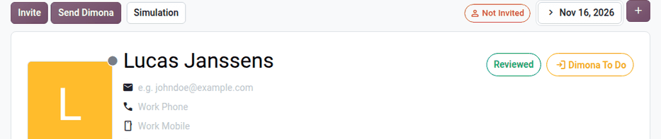
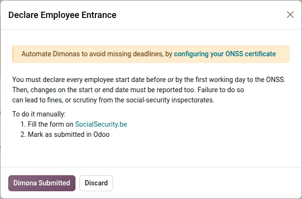
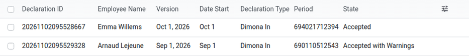

.. _payroll/l10n_be/dimona:

======
Dimona
======

The *Dimona* (*Déclaration immédiate / Onmiddellijke aangifte*) is the immediate declaration of
employment. All employers, in the public and private sectors, must electronically notify the ONSS of
the start and end of each employment relationship (Royal Decree of November 5, 2002). Failing to
declare an employee can lead to criminal penalties (article 181 of the Social Penal Code) and to a
solidarity contribution.

Key concepts
============

- **Employer-worker relationship**: the link between the employer and a worker, identified by the
  worker's national number (NISS). It starts with the first employment of the worker and ends with
  the last one.
- **Dimona period**: each entry declaration opens a period, identified by a period number. The
  following declarations (exit, update, cancellation) refer to this period. Several periods can
  follow one another within the same relationship.
- **Declaration types**:

  - *Dimona In*: the start of an employment, at the latest when the worker starts working.
  - *Dimona Out*: the end of an employment, at the latest on the first working day after its end.
  - *Dimona Update*: a change of the declared data (start date, end date, planned hours of a
    student).
  - *Dimona Cancel*: the cancellation of a declaration, for example when the worker never started.

- **Dimona category**: the type of worker declared (for example, *Other*, *Student*,
  *Flexi-job*, *Apprentice*). Some categories have specific rules: a student declaration requires
  the number of planned hours, and the declaration of a one-day flexi-job contract includes its
  working hours.
- **Notification**: the answer of the ONSS, which accepts the declaration (with or without
  warnings) or refuses it. The employer has five working days to contest the data of an accepted
  declaration.

For the complete rules, refer to the `Dimona instructions of the social security
<https://www.socialsecurity.be/site_fr/employer/applics/dimona/index.htm>`_.

Configuration
=============

The Dimona uses the following data:

- The :guilabel:`ONSS Registration Number` in the :ref:`company data
  <payroll/l10n_be/configuration/company>`.
- On the employee form: the name, :guilabel:`Sex`, date of birth, private address (with a house
  number), and the :guilabel:`NISS` (national number). For a foreign employee without NISS, the
  birth place, birth country and nationality are also required.
- The :guilabel:`Contract` start and end dates, and the :guilabel:`Joint Committee`.
- The :guilabel:`DIMONA Category`, defined on the :ref:`employee type
  <payroll/l10n_be/configuration/employee-types>` of the employee.
- For a student with an hourly wage, the :guilabel:`Student Planned Hours`, displayed next to the
  wage.
- For a one-day flexi-job contract, the :guilabel:`Contract Times` (start and end time of the work).

To send the declarations from Odoo, the :ref:`ONSS certificate <payroll/l10n_be/onss_configuration>`
must also be configured. Otherwise, the declarations are made on the social security portal, and Odoo
keeps track of the ones to do.

Declare an employee
===================

Odoo determines which declaration each employee needs:

- a *Dimona In* when a contract start date is set or changed and no entry was declared for it;
- a *Dimona Update* when the declared start or end date, or the planned hours of a student, change;
- a *Dimona Out* when the departure of an employee is registered;
- a *Dimona Cancel* when a declared contract is archived.

The status of the employee is displayed as a badge at the top right of the employee form:
:guilabel:`Dimona To Do`, :guilabel:`In Progress` (waiting for the answer of the ONSS),
:guilabel:`Dimona` (accepted), or :guilabel:`Dimona Issue` (refused or missing data). When a
declaration is needed, the :guilabel:`Send Dimona` button appears at the top of the employee form.

Automatic declaration
---------------------

When the ONSS certificate is configured, the declaration is sent automatically through the ONSS API
when the employee is saved. If some data is missing, the badge becomes :guilabel:`Dimona Issue` and
the list of problems is posted in the chatter of the employee. After fixing the data, click
:guilabel:`Send Dimona`.

The answers of the ONSS are posted in the chatter of the employee (accepted, accepted with
warnings, refused, or waiting for the identification of the worker). The *Belgian Payroll: Check
DIMONA* scheduled action retrieves them every day, together with the relationships and periods
known by the ONSS.

Manual declaration
------------------

Without ONSS certificate, click :guilabel:`Send Dimona` to open a dialog that explains the
declaration to make, with a link to the social security portal. Once the declaration is filed on the
portal, click :guilabel:`Dimona Submitted` to mark it as done in Odoo.

.. tip::
   The :guilabel:`Dimona to open`, :guilabel:`Dimona to update`, and :guilabel:`Dimona to cancel`
   filters of the employee list show the employees whose declaration must be made. The payroll
   dashboard also displays warnings for the missing Dimona declarations, for the payslips of
   employees without Dimona period, and for the Dimona periods that do not match the employee
   records.

Other declarations
------------------

The :menuselection:`Payroll app --> Reporting --> Belgium --> DIMONA` menu opens the *Manage
DIMONA* dialog, to declare an exit, an update, or a cancellation for any employee. Select the
:guilabel:`Employee`, its :guilabel:`Employee Record`, and the :guilabel:`Declaration Type`
(:guilabel:`Register employee entrance`, :guilabel:`Register employee departure`, :guilabel:`Update
employee information`, or :guilabel:`Cancel employee declaration`), then click :guilabel:`Submit
Declaration`. Enable :guilabel:`Employee Without NISS` to declare a foreign worker who does not have a
Belgian national number yet. Without ONSS certificate, this menu only explains how to declare
manually: use the :guilabel:`Send Dimona` button of the employee form instead.

Follow-up of the declarations
=============================

The following menus list the data exchanged with the ONSS:

- :menuselection:`Payroll app --> Reporting --> Belgium --> Dimona Declarations`: each declaration
  sent, with its :guilabel:`Declaration ID`, the employee, the :guilabel:`Version` (employee record),
  the dates, the :guilabel:`Declaration Type`, the :guilabel:`Period`, and the :guilabel:`State`
  (:guilabel:`Accepted`, :guilabel:`Accepted with Warnings`, :guilabel:`Refused`, or
  :guilabel:`Waiting Sigedis`).
- :menuselection:`Payroll app --> Reporting --> Belgium --> Dimona Periods`: the Dimona periods,
  with their dates and their declarations.
- :menuselection:`Payroll app --> Reporting --> Belgium --> Dimona Relations`: the employer-worker
  relationships, identified by the NISS of the worker, with their periods. The :guilabel:`Dimona
  Relation` smart button of the employee form opens the relationship of the employee.

.. note::
   In the :guilabel:`Sandbox` :guilabel:`Dimona Environment`, nothing is sent to the ONSS. The
   :guilabel:`Check Dimona` button of the employee form opens the answer of the ONSS as JSON data.
   Edit it to simulate an accepted or a refused declaration, then click :guilabel:`Apply Response`.
