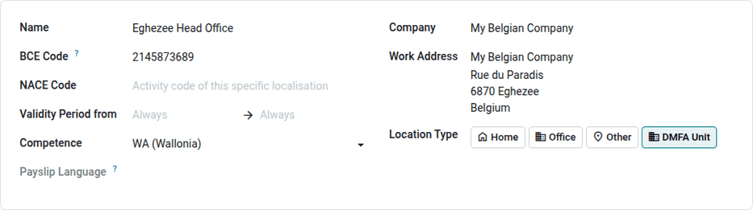
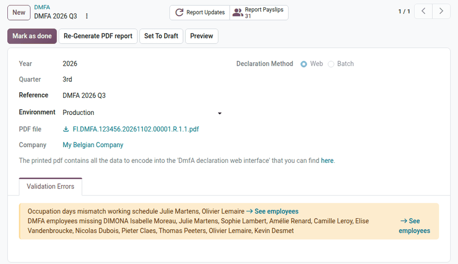
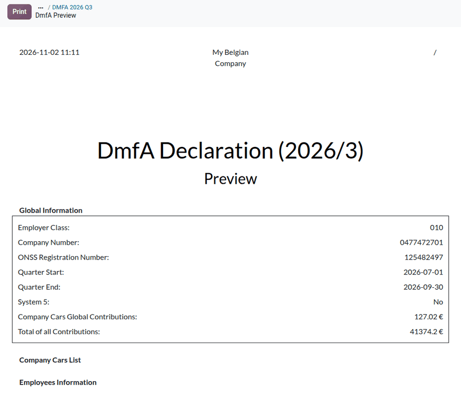
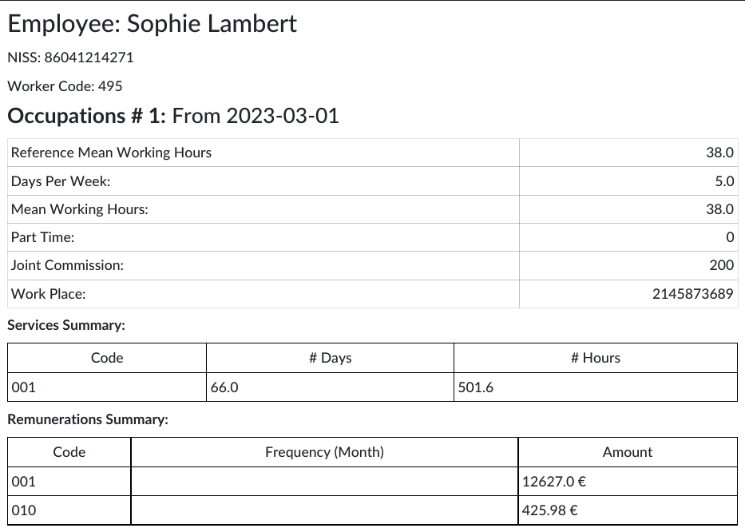
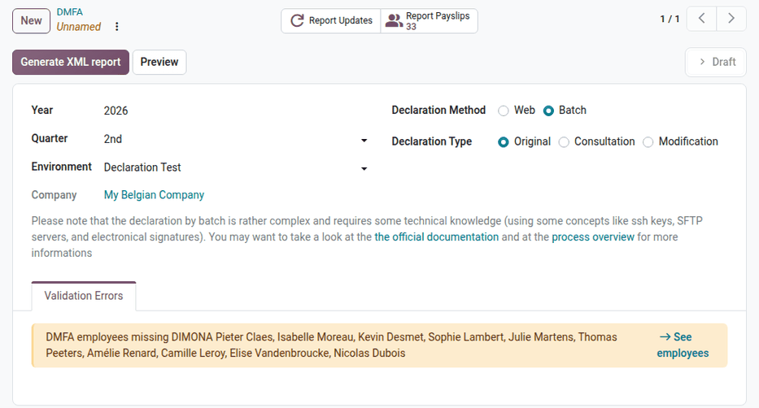

.. _payroll/l10n_be/dmfa:

====
DmfA
====

The *DmfA* (*Déclaration multifonctionnelle / Multifunctionele aangifte*) is the quarterly
declaration of the salaries, working time, and social security contributions of all the employees
of an employer. All the employers registered with the ONSS must submit it, at the latest on the
last day of the month following the quarter.

The data of the DmfA is shared by all the social security institutions: it is used to compute the
contributions and their reductions, and to grant the rights of the workers (health insurance,
unemployment, pensions, occupational risks, family allowances, and annual holidays).

The DmfA is closely linked to the two other declarations:

- the :doc:`Dimona <dimona>` declares the start and end of each employment: an employee can only be
  declared in the DmfA with a Dimona period;
- the :doc:`DRS <drs>` declarations give the additional data needed when a social risk occurs during
  the employment.

The DmfA can be submitted in two ways:

- **Web**: the employer encodes the declaration on the social security portal. Odoo generates a PDF
  file with all the data to encode.
- **Batch**: Odoo generates the XML file of the declaration and uploads it to the ONSS. This method
  requires the :ref:`ONSS certificate <payroll/l10n_be/onss_configuration>`.

For the complete rules, refer to the `DmfA pages of the social security website
<https://www.socialsecurity.be/site_fr/employer/applics/dmfa/index.htm>`_.

Configuration
=============

Before generating the first declaration, check the following data:

- **Company**: the :ref:`company data <payroll/l10n_be/configuration/company>`, in particular the
  :guilabel:`ONSS Registration Number`, the :guilabel:`Employer Category`, the company number, the
  :guilabel:`Company Size`, and the :guilabel:`Business Closure Fund Employer Type`.
- **Establishment units**: each employee is declared in the establishment unit of their work
  address. In :menuselection:`Payroll app --> Configuration --> Belgium --> Work Locations`, create a
  work location with the :guilabel:`DMFA Unit` :guilabel:`Location Type` for each :guilabel:`Work
  Address` of the employees (the same contact as on the employee records), with its 10-digit
  :guilabel:`BCE Code`. Refer to the :ref:`work locations
  <payroll/l10n_be/configuration/work-locations>` documentation for the other fields.
- **Employees**: a valid :guilabel:`NISS`, the :guilabel:`Joint Committee`, the worker code
  (:guilabel:`Sub-type`), and a work address linked to an establishment unit.
- **Time types**: each time type used in the payslips needs a DmfA code. Navigate to
  :menuselection:`Payroll app --> Configuration --> Time Management --> Time Types`, open a time type,
  and fill in the :guilabel:`DMFA` field of the :guilabel:`Declarations` section. The time types
  provided by the Belgian localization are already configured.

ONSS rates
----------

The employer contributions depend on the employer category and on the worker code. Their rates are
published every quarter by the ONSS. The *ONSS: Fetch rates* scheduled action imports them
automatically.

With the :ref:`developer mode <developer-mode>` activated, the :menuselection:`Payroll app -->
Configuration --> Belgium --> Import ONSS Rates` menu imports them on demand: either with the
:guilabel:`Automatic Import` mode (:guilabel:`Import from ONSS website`, from a given year and
quarter), or with the :guilabel:`Manual File Import` mode, from the `.zip` files downloaded from the
`social security website <https://www.socialsecurity.be/site_fr/employer/applics/dmfa/index.htm>`_
(:guilabel:`Import ONSS rates`).

.. _payroll/l10n_be/reorganisation_measures:

Reorganisation measures
-----------------------

The measures of reorganisation of the working time (career breaks, adapted work, CLA 42 new work
regimes, etc.) are declared on the occupations of the employees. The available measures are listed
in :menuselection:`Payroll app --> Configuration --> Belgium --> Reorganisation Measures`, with
their DmfA code.

To declare a measure, select it in the :guilabel:`Working Time Reorganisation` field of the working
schedule of the employee (:menuselection:`Payroll app --> Configuration --> Time Management -->
Working Schedules`). For a variable schedule, the :guilabel:`Time Reorganisation Amount` field gives
the number of hours per week concerned by the measure.

Create a DmfA
=============

Navigate to :menuselection:`Payroll app --> Reporting --> Belgium --> DMFA`, and click
:guilabel:`New`. Fill in the following fields:

- :guilabel:`Year` and :guilabel:`Quarter`: the declared quarter. Only one original declaration
  can exist per company and quarter.
- :guilabel:`Reference`: the reference of the declaration, used to identify it (web method only;
  in batch, the ONSS gives the reference).
- :guilabel:`Environment`: :guilabel:`Production`, :guilabel:`Circuit Test`, or
  :guilabel:`Declaration Test` (see :ref:`payroll/l10n_be/onss_batch`).
- :guilabel:`Declaration Method`: :guilabel:`Web` or :guilabel:`Batch`.

The declaration gathers the validated and paid payslips of the quarter, of the company and of its
branches. The :guilabel:`Report Payslips` smart button lists them. The payslips of employees not
subject to the ONSS (no social security, directors, trainees) and the payslips already declared are
excluded. A termination indemnity is declared in the quarter of the end of the contract.

The :guilabel:`Validation Errors` tab lists the inconsistencies found in the data (employee without
Dimona, work address without establishment unit, time type without DmfA code, invalid NISS, quarter
not over, draft payslips, etc.), with a link to the records to fix. The blocking errors (in red)
must be fixed before generating the declaration.

Click :guilabel:`Preview` to display the content of the declaration before generating it: the
global data of the employer, the company cars, and, for each employee, the occupations, services,
remunerations, deductions, and contributions. For a company with branches, the preview can be
displayed for the whole company or for one branch. Click :guilabel:`Print` to get it as a PDF file.

Reductions
----------

Odoo computes the reductions of social security contributions from the payslips and the employee
data. Once the declaration is generated, the computed reductions are listed in dedicated tabs:
:guilabel:`Elderly Reduction`, :guilabel:`Artist Reductions`, :guilabel:`Unexperienced Employee
Reductions - Flemish`, and :guilabel:`ONSS ACS Deduction`.

The reduction for first hires is chosen in the :guilabel:`First Hires` tab, displayed when the
:guilabel:`Reduction for First Hires` option is enabled in the :ref:`company data
<payroll/l10n_be/configuration/company>`. Select the employee who counts as the first, second,
third (and so on) hire, or click :guilabel:`Prefill first hires` to let Odoo propose them. A message
next to each hire gives the remaining number of quarters of reduction, and a warning is displayed
when the choice does not seem eligible.

Web declaration
===============

With the :guilabel:`Web` method:

#. Click :guilabel:`Generate PDF report`. The declaration moves to the :guilabel:`Ready` state, and
   the :guilabel:`PDF file` is available on the declaration. It contains the data of the employer
   and, for each employee, the occupations (working schedule, joint committee, establishment unit),
   the services per DmfA working time code, the remunerations per DmfA remuneration code, the
   deductions, and the contributions.
#. Encode the data on the `DmfA web application
   <https://www.socialsecurity.be/site_fr/employer/applics/dmfa/index.htm>`_ of the social security
   portal.
#. Enter the :guilabel:`Reference` given by the portal, and click :guilabel:`Mark as done`. The
   payslips of the quarter are marked as declared.
#. Once the contributions are paid, click :guilabel:`Mark as paid`.

If the data changes before the declaration is marked as done, click :guilabel:`Set To Draft`, then
:guilabel:`Re-Generate PDF report`.

To correct a declaration already marked as done, click :guilabel:`Correct DMFA`. Odoo creates a
modification declaration linked to the :guilabel:`Original Declaration`, with an optional
:guilabel:`Justification`, to encode the corrected data on the portal. The :guilabel:`Report
Updates` smart button of the original declaration lists its corrections.

Batch declaration
=================

With the :guilabel:`Batch` method, the :guilabel:`Declaration Type` is :guilabel:`Original` for a
new declaration. Click :guilabel:`Generate XML report`, then :guilabel:`Post ONSS Declaration` to
send it. Refer to :ref:`payroll/l10n_be/onss_batch` for the generated files, the validation, and
the follow-up of the answers of the ONSS. The :guilabel:`ONSS Declarations` smart button lists the
uploads of the declaration.

To correct a declaration accepted by the ONSS:

#. Click :guilabel:`Correct DMFA`. Odoo creates a :guilabel:`Consultation` declaration, which asks
   the ONSS for the data it currently holds for the quarter. A consultation can only be posted in
   the :guilabel:`Production` environment.
#. On the consultation, click :guilabel:`Generate XML report`, then choose the employees in the
   :guilabel:`Select Employees` dialog: :guilabel:`Fetch All Employees`, or a selection of
   :guilabel:`Specific Employees`. Click :guilabel:`Generate XML File`, then post the consultation.
   The answer of the ONSS gives the data it holds for these employees.
#. Click :guilabel:`Submit Correction`. Odoo creates a :guilabel:`Modification` declaration, which
   compares the data of the ONSS with the current payslips.
#. Generate and post the modification, with an optional :guilabel:`Justification`.

Payment of the contributions
============================

The ONSS contributions are paid every quarter. When the **Accounting** app is installed, the
payroll dashboard displays an *ONSS Payment* warning after the declaration is marked as done, to
register the payment of the contributions. Once this payment is paid, the declaration moves to the
:guilabel:`Paid` state.

.. note::
   When payslips of a declared quarter are modified or cancelled afterwards, the payroll dashboard
   displays a warning: the DmfA of the quarter must be corrected.
