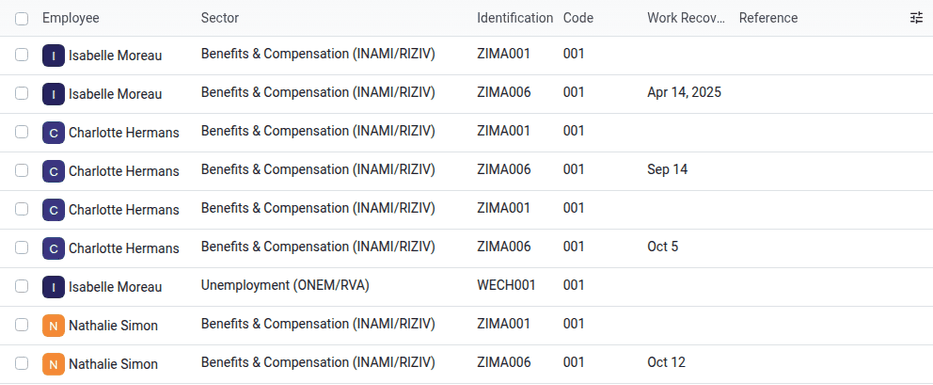
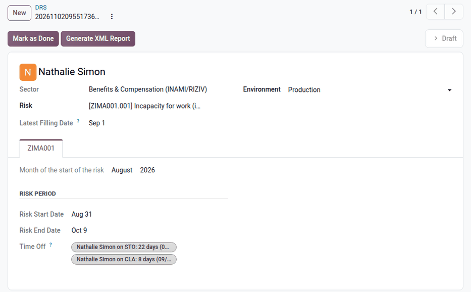

.. _payroll/l10n_be/drs:

===
DRS
===

During an employment, *social risks* can occur: end of the contract, temporary unemployment,
illness, maternity, etc. The social security institutions then need data that the :doc:`Dimona
<dimona>` and the :doc:`DmfA <dmfa>` do not give, to compute the benefits of the worker. The
employer provides this data with the *social risk declarations* (*DRS*, *Déclarations de risques
sociaux / Aangiften sociale risico's*).

Each declaration belongs to a sector of the social security, and to a *scenario* that describes the
risk:

- :guilabel:`Unemployment (ONEM/RVA)`: the *WECH* scenarios, used by the unemployment
  institutions.
- :guilabel:`Benefits & Compensation (INAMI/RIZIV)`: the *ZIMA* scenarios, used by the health
  insurance funds.

Odoo supports the following scenarios:

.. list-table::
   :header-rows: 1
   :widths: 15 85

   * - Scenario
     - Declared risk
   * - WECH001
     - End of the employment contract or unemployment with company supplement, and proof of work
       (former C4 certificate).
   * - WECH002
     - Start of a period of temporary unemployment (right to temporary unemployment).
   * - WECH003
     - Start of a part-time occupation, for a worker who keeps their rights to unemployment
       benefits.
   * - WECH005
     - Monthly hours of temporary unemployment.
   * - WECH006
     - Monthly part-time work, for the income guarantee allowance.
   * - WECH007
     - Monthly work in a sheltered workshop.
   * - WECH008
     - Monthly work under an activation program (for example, the Walloon *Impulsion* plans), for the
       work allowance.
   * - WECH009
     - Right to youth or senior holidays.
   * - WECH010
     - Monthly hours of youth or senior holidays.
   * - ZIMA001
     - Start of an incapacity for work (illness, accident, prophylactic leave), of a maternity leave,
       of a birth, adoption, or foster care leave.
   * - ZIMA002
     - Monthly adapted work, or partial removal from work as a maternity protection measure.
   * - ZIMA003
     - Monthly breastfeeding breaks.
   * - ZIMA006
     - Return to work after an incapacity or a maternity leave.

The list of all the risks defined by the social security, with their validity dates, is stored in
Odoo. The expired risks cannot be selected anymore. For the complete rules of each scenario, refer to
the `DRS administrative instructions
<https://www.socialsecurity.be/employer/instructions/drs/fr/latest/instructions/>`_.

Configuration
=============

The DRS declarations use the same data as the DmfA (company data, employees, establishment units).
The employee must also have a Dimona period covering the declared month.

The time types that trigger a declaration are configured in :menuselection:`Payroll app -->
Configuration --> Time Management --> Time Types`, in the :guilabel:`Declarations` section:

- :guilabel:`DRS trigger`: the risks declared when a time off of this type is approved, or when a
  payslip with this time type is validated.
- :guilabel:`DRS Nature`: the nature of the days of this type, used to describe the days of the
  month in the declarations (worked day, holiday, illness, temporary unemployment, etc.).

The time types provided by the Belgian localization are already configured.

Create the declarations
=======================

Most declarations are created automatically, in draft, when the related event is registered in
Odoo:

- **Departure**: registering the departure of an employee creates a *WECH001* declaration (except
  for a death, a student, or a flexi-job).
- **Time off**: approving a time off whose time type has a :guilabel:`DRS trigger` creates the
  related declarations: *WECH002* and *WECH005* for temporary unemployment, *WECH009* and *WECH010*
  for youth and senior holidays, *ZIMA001* for an illness lasting beyond the guaranteed salary, a
  maternity, birth, or adoption leave, and *ZIMA006* for the return to work. If the time off is
  cancelled or changed, the draft declarations are updated or removed.
- **Payslip**: validating the monthly payslip creates the monthly declarations: *WECH008* for an
  activation program, *ZIMA002* for adapted work or partial removal from work, *ZIMA003* for
  breastfeeding breaks, and *WECH006* and *WECH007* for the employees already declared under
  *WECH003* or *WECH007*.

To create a declaration manually (for example, the first *WECH003* or *WECH007* declaration of an
employee), navigate to :menuselection:`Payroll app --> Reporting --> Belgium --> DRS`, and click
:guilabel:`New`. Select the :guilabel:`Employee`, the :guilabel:`Sector`, and the :guilabel:`Risk`,
then fill in the month of the declaration in the tab of the scenario.

The declaration form displays the data computed for the scenario in a dedicated tab (for example,
the risk period and the time off of a *ZIMA001*, the payslip and the paid hours of a *WECH008*, or
the return to work date of a *ZIMA006*). The :guilabel:`Earliest Filling Date` and
:guilabel:`Latest Filling Date` fields give the period during which the declaration must be filed,
according to the instructions of the social security.

The :guilabel:`Validation Errors` tab lists the missing or inconsistent data (missing Dimona, invalid
remuneration basis, start date before the registration of the company at the Crossroads Bank for
Enterprises, etc.).

Send the declarations
=====================

A DRS declaration can be filed in two ways:

- **On the social security portal**: file the declaration on the portal, then click :guilabel:`Mark
  as Done` in Odoo. If needed, click :guilabel:`Reset to Draft` to reopen it.
- **From Odoo**: click :guilabel:`Generate XML Report`, then :guilabel:`Post ONSS Declaration`.
  Refer to :ref:`payroll/l10n_be/onss_batch` for the generated files and the follow-up of the
  answers of the ONSS.

Once a declaration posted from Odoo is accepted by the ONSS:

- Click :guilabel:`Modify` to replace it. Odoo creates a new declaration, with the current data of
  the employee, to generate and post.
- Click :guilabel:`Cancel` to cancel it. Odoo creates and generates the cancellation declaration,
  which must then be posted.
