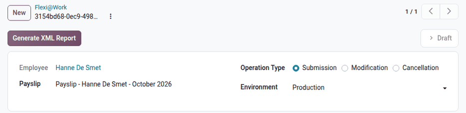

.. _payroll/l10n_be/flexi_at_work:

==========
Flexi@Work
==========

A *flexi-job* is an additional job, with a flexible wage and specific social security rules, open to
some workers in the sectors authorized by the law. Besides the :doc:`Dimona <dimona>` of each
flexi-job (category *Flexi-job*), the employer must declare the wages paid to the flexi-job workers
to the ONSS with the *Flexi@Work* declaration (*FLXWAGE*), for each payslip.

In Odoo, an employee needs this declaration when their worker code (:guilabel:`Sub-type` field) is a
flexi-job code: *050* (flexi-job manual worker) or *450* (flexi-job employee). These codes are the
sub-types of the *Flexi-Worker* and *Flexi-Employee* employee types.

Create the declarations
=======================

A Flexi@Work declaration is created from a validated or paid payslip of a flexi-job worker. Only one
declaration can exist per payslip. To create it:

- from the payslip, click the :icon:`article` :guilabel:`New Flexi@Work` smart button (displayed
  once the payslip is validated or paid);
- from a pay run, click :guilabel:`Flexi@Work` once the payslips are validated or paid;
- from the payslip list, select the payslips and click :guilabel:`Flexi@Work`.

The payroll dashboard also displays a *Missing Flexi@Work* warning for the validated payslips of
flexi-job workers without declaration. Its list has a :guilabel:`Create Flexi@Work` button.

The declarations are listed in :menuselection:`Payroll app --> Reporting --> Belgium -->
Flexi@Work`, and on the employee form with the :icon:`article` :guilabel:`Flexi@Work` smart
button.

Send the declarations
=====================

Open the declaration. It shows the :guilabel:`Employee`, the :guilabel:`Payslip`, and the following
fields:

- :guilabel:`Operation Type`: :guilabel:`Submission` for a new declaration, :guilabel:`Modification`
  to correct a declaration already sent, or :guilabel:`Cancellation` to cancel it.
- :guilabel:`Environment`: :guilabel:`Production` or :guilabel:`Circuit Test`. The ONSS does not
  accept the Flexi@Work declarations in the :guilabel:`Declaration Test` environment.

Click :guilabel:`Generate XML Report`. The declaration contains the period of the payslip, the
employer category and the worker code, and the wage paid, split between the remuneration and the
bonuses. Then click :guilabel:`Post ONSS Declaration`. Refer to :ref:`payroll/l10n_be/onss_batch`
for the generated files and the follow-up of the answers of the ONSS.
