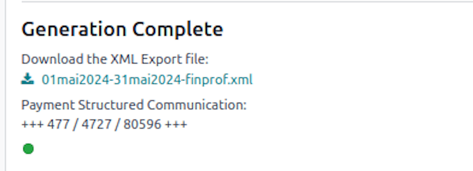

================
Tax declarations
================

This page covers the withholding tax declarations and tax forms generated by Odoo.

.. toctree::
   :titlesonly:

   tax_declarations/273_sheets

.. _payroll/l10n_be/274xx_sheets:

274.XX sheets
=============

This section provides an overview of Declaration 274, its components, and how it is handled within
Odoo.

Declaration 274.10
------------------

Withholding tax is an advance payment on professional income tax. It is calculated based on
guidelines established by the tax administration. While reducing withholding tax is generally not
allowed, employees may request to pay more in order to better match their final tax liability.

Withholding tax must be deducted from both employees' and company directors' income. If the
withholding tax is insufficient, advance tax payments must be made to avoid additional tax
penalties.

In practice, some employees do not inform their employer of personal changes (e.g., having a child),
which can affect tax calculations.

Withholding tax must be declared and paid either quarterly or monthly using form 274. These
declarations must be submitted via the FINPROF application by the 15th of the month following the
reporting period.

Taxable income and corresponding withholding tax must be recorded in fiscal remuneration forms
281.x and summary statements 325x. Employers failing to report these correctly may be subject to a
309% penalty on undisclosed amounts.

The tax administration compares the declared amounts in form 274 with the amounts reported in the
fiscal forms. If withholding tax payments are insufficient, the company may be charged the
difference. If a 274 form is submitted without corresponding tax payment, additional tax penalties
will apply.

It is crucial to adhere to all administrative guidelines to avoid unexpected tax charges.

Declarations 274.32, 274.33, 274.34
-----------------------------------

Withholding tax exemptions for research employees
~~~~~~~~~~~~~~~~~~~~~~~~~~~~~~~~~~~~~~~~~~~~~~~~~

Companies employing scientific researchers may qualify for withholding tax reductions under
specific conditions:

- **Form 281.32** applies to civil engineers and PhD holders.
- **Form 281.33** applies to employees holding a master's degree.
- **Form 281.34** applies to employees holding a bachelor's degree.

Employers engaged in scientific research may be eligible for an exemption from withholding tax
payments. To qualify, they must register their R&D projects with Belspo. From August 1, 2023, this
registration must occur before the project begins.

Tax exemption details
~~~~~~~~~~~~~~~~~~~~~

This tax incentive allows companies to retain 80% of the withholding tax deducted from researchers'
salaries. However, the exemption rate differs for researchers based on their qualifications:

- PhD and master's degree holders: Full 80% exemption.
- Bachelor's degree holders: 50% of the full exemption amount.
- For non-SME companies, this limit is further reduced to 25%.

The exemption applies only to the portion of working time dedicated to scientific research, covering
fundamental research, industrial research, or experimental development.

This exemption does not affect the net salary of employees.

Capping rules
~~~~~~~~~~~~~

The total exemption granted to researchers with a bachelor's degree is limited to 25% of the
exemption granted to PhD and master's degree holders. For small companies (as defined in Article 15
§§ 1-6 of the Companies Code), this limit is doubled. These rules have remained unchanged since
January 1, 2020.

How it works in Odoo
--------------------

Odoo automates the calculation and declaration of withholding tax exemptions using predefined
payroll structures. Below is an explanation of how the system processes these exemptions.

Navigate to :menuselection:`Payroll app --> Reporting --> 274.XX Sheets` to create a
new declaration.

Select the reference :guilabel:`Year` and :guilabel:`Month`, and the different amounts are computed
accordingly.

#. **Payroll calculation**

   - Odoo calculates gross salary and total withholding tax.
   - It accounts for specific payroll components, including December double bonuses.

#. **Filtering eligible payslips**

   - Payslips linked to research-related contracts are considered.
   - Employees are categorized based on their qualifications (PhD, master's, or bachelor's degrees).

#. **Exemption calculation**

   - The withholding tax exemption is calculated at 80% of the withheld amount.
   - Exemptions for bachelor's degree holders are capped according to regulations.

#. **Final adjustments**

   - The system ensures compliance with legal capping rules.
   - If necessary, adjustments are made based on the total exemption granted.

Click on :guilabel:`Export XML file` to generate the file to post on FINPROF portal and the
structured communication to link to your payment.

Click on :guilabel:`Create 274.XX Sheets` to generate the :file:`.pdf` files of those declarations.

.. note::
   In order to for the exemption to work properly, the *Certificate Level* should be correctly
   configured on the employee's form.

   The *Time Percentage R&D* rate should be specified on the employee's contract form as well.

If the accounting application is installed and running properly, you can also post directly the
different amounts in your accounting entries with the :guilabel:`Post Journal Entries` button.

.. note::
   If the *Post Journal Entries* is not present on the wizard, you need to configure the journal and
   the different accounts for each amount type from :menuselection:`Payroll app --> Configuration
   --> Settings`.

   In the :guilabel:`Belgian Localization` section, complete each of the :guilabel:`Witholding
   Taxes Exemption` journal entry accounts.

Employers using Odoo can efficiently manage and report withholding tax exemptions, ensuring
compliance with regulatory requirements.

For further details, consult the Odoo finance documentation or your tax adviser.

.. _payroll/l10n_be/28110_declaration:

281.10 Declaration
==================

Introduction
------------

The Belgian fiscal declaration 281.10 is an annual statement that employers must submit to the tax
authorities, detailing the salaries and benefits provided to each employee. This declaration ensures
accurate tax calculations and compliance with Belgian tax regulations.

Generating the declaration in Odoo
----------------------------------

Odoo provides a streamlined process for generating the 281.10 declaration, offering both a
comprehensive XML file for electronic submission and individual PDF files for record-keeping.

Global XML declaration
~~~~~~~~~~~~~~~~~~~~~~

To generate the global XML file in Odoo, navigate to :menuselection:`Payroll app --> Reporting -->
281.10 Sheet`.

Then, create a new record by selecting the reference :guilabel:`Year`.

.. important::
   The :guilabel:`Sending Type` and :guilabel:`Treatment Type` options are currently experimental
   and should be kept at their default values to ensure a valid original declaration.

Click the :guilabel:`Populate` button to generate the eligible employees, then click the
:guilabel:`Create XML` button. A green indicator will appear to confirm successful file generation.

Individual PDF declaration
~~~~~~~~~~~~~~~~~~~~~~~~~~

To generate individual PDF files for each employee, click the :guilabel:`Populate` button. A line is
generated for each employee who received a payslip during the reference year.

.. note::
   The PDF files are generated automatically in batches of 30, so the process may take some time to
   complete.

Once all PDF files are generated, they can be posted to the employee documents portal if the
**Documents** application is :doc:`installed and properly configured
<../../../../productivity/documents>`.

Select the employees whose documents you want to post, then click the :guilabel:`Post PDF` button.

Once posted, employees can access the PDF from their documents portal via the :icon:`fa-file-text`
:guilabel:`Documents` smart button on their profile.

Submitting the XML declaration
------------------------------

After generating the XML file, it must be submitted to the Belgian tax authorities. Ensure you are
familiar with the `official submission process
<https://finances.belgium.be/fr/E-services/Belcotaxonweb/documentation-technique>`_.

The XML files containing the fiscal data to be sent via the Belcotax-on-web (BOW) application must
be converted to the .bow format.

This conversion requires the use of a validation module available under the *Technical
Documentation* section.

The validation module has two prerequisites:

- Java 8 must be installed.
- The certificate authority that signed the validation module must be recognized.

.. _payroll/l10n_be/28145_declaration:

281.45 Declaration
==================

Introduction
------------

The Belgian fiscal declaration 281.45 is an annual statement that entities must submit to the tax
authorities, detailing the amounts of author's rights and neighboring rights paid to beneficiaries.
This declaration ensures accurate tax reporting and compliance with Belgian tax regulations.

Generating the declaration in Odoo
----------------------------------

Odoo provides a streamlined process for generating the 281.45 declaration, offering both a
comprehensive XML file for electronic submission and individual PDF files for record-keeping.

Global XML declaration
~~~~~~~~~~~~~~~~~~~~~~

To generate the global XML file in Odoo, navigate to :menuselection:`Payroll app --> Reporting -->
281.45 Sheet`.

Then, create a new record by selecting the reference :guilabel:`Year`.

.. important::
   The :guilabel:`Sending Type` and :guilabel:`Treatment Type` options are currently experimental
   and should be kept at their default values to ensure a valid original declaration.

Click the :guilabel:`Populate` button to generate the eligible employees, then click the
:guilabel:`Create XML` button. A green indicator will appear to confirm successful file generation.

Individual PDF declaration
~~~~~~~~~~~~~~~~~~~~~~~~~~

To generate individual PDF files for each employee, click the :guilabel:`Populate` button. A line
is generated for each employee who received a payslip during the reference year.

.. note::
   The PDF files are generated automatically in batches of 30, so the process may take some time to
   complete.

Once all PDF files are generated, they can be posted to the employee documents portal if the
**Documents** application is :doc:`installed and properly configured
<../../../../productivity/documents>`.

Select the employees whose documents you want to post, then click the :guilabel:`Post PDF` button.

Once posted, employees can access the PDF from their documents portal via the :icon:`fa-file-text`
:guilabel:`Documents` smart button on their profile.

Submitting the XML declaration
------------------------------

After generating the XML file, it must be submitted to the Belgian tax authorities. Ensure you are
familiar with the `official submission process
<https://finances.belgium.be/fr/E-services/Belcotaxonweb/documentation-technique>`_.

The XML files containing the fiscal data to be sent via the Belcotax-on-web (BOW) application must
be converted to the :file:`.bow` format.

This conversion requires the use of a validation module available under the *Technical
Documentation* section.

The validation module has two prerequisites:

- Java 8 must be installed.
- The certificate authority that signed the validation module must be recognized.
