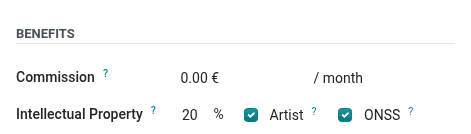
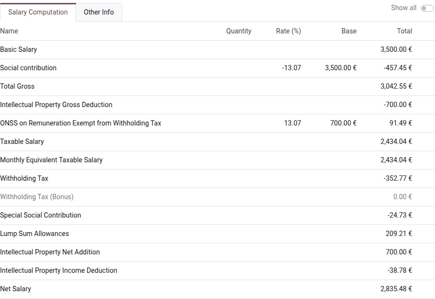
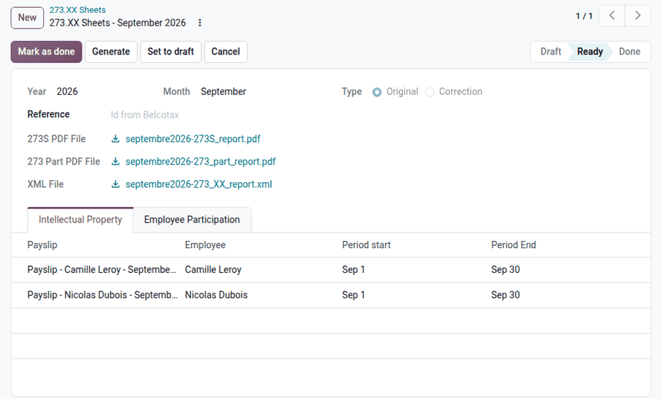

.. _payroll/l10n_be/273_sheets:

=============
273.XX sheets
=============

The *273.XX sheet* is the monthly declaration of the withholding tax on movable income (*précompte
mobilier*) withheld through the payroll. It combines two forms:

- **273S**: the withholding tax on the income from author's rights and neighboring rights
  (*intellectual property*, or *IP*) paid to employees.
- **273 Part** (employee participation): the withholding tax on the profit-sharing bonuses paid to
  employees.

.. _payroll/l10n_be/intellectual_property:

Intellectual property
=====================

Companies can pay part of the remuneration of an employee who creates protected works (software,
designs, texts, etc.) as income from the transfer of their author's rights. This income is not
taxed as a professional remuneration, but subject to a movable withholding tax.

Configure the employee
----------------------

Open the employee form from the **Employees** or **Payroll** app, and go to the :guilabel:`Payroll`
tab. In the :guilabel:`Benefits` section, fill in the following fields:

- :guilabel:`Intellectual Property`: the percentage of the basic salary paid as intellectual
  property income. Leave it at `0` if the employee does not receive any intellectual property
  income.
- :guilabel:`Artist`: tick this checkbox if the employee owns a certificate of artistic work of the
  "plus" or ordinary type.
- :guilabel:`ONSS`: tick this checkbox (default) to compute the social security contributions on the
  whole intellectual property income. Untick it to apply the exemption described below.

Computation on the payslip
--------------------------

When the :guilabel:`Intellectual Property` percentage is set, the monthly payslip splits the basic
salary into a regular remuneration and an intellectual property income, according to the
following rules (amounts of the 2026 income year):

- The intellectual property income is exempt from social security contributions up to 30% of the
  total remuneration, unless the :guilabel:`ONSS` checkbox is ticked on the employee.
- The intellectual property withholding tax is 15% of the intellectual property income, after
  deducting its social security contributions.
- The owners of a certificate of artistic work (:guilabel:`Artist` checkbox) also deduct lump-sum
  professional costs from that base: 50% of the yearly intellectual property income up to 20,590
  EUR, and 25% between 20,590 EUR and 41,180 EUR. Before June 11, 2026, these costs applied to every
  beneficiary.
- The intellectual property income of a year is capped at 77,220 EUR. Above this limit, the
  remaining part is paid as a regular remuneration, and the payslip displays the *Intellectual
  Property Limit Reached* warning.
- The intellectual property income is taxed as a regular remuneration if it exceeds 30% of the
  total remuneration, or if the average intellectual property income of the four previous years
  exceeds the yearly limit.

The payslip shows the following lines:

- :guilabel:`Intellectual Property Gross Deduction`: removes the intellectual property income from
  the taxable remuneration.
- :guilabel:`Intellectual Property - ONSS Exemption` and :guilabel:`Intellectual Property - Part
  Subject to ONSS`: the parts of the intellectual property income exempt from, and subject to,
  social security contributions.
- :guilabel:`ONSS on Remuneration Exempt from Withholding Tax`: the social security contributions
  of the intellectual property income.
- :guilabel:`Intellectual Property Net Addition`: adds the intellectual property income to the net
  salary.
- :guilabel:`Intellectual Property Income Deduction`: the 15% intellectual property withholding tax,
  declared on the 273S.

.. note::
   The amounts and rates come from the *IP* rule parameters of the Belgian localization
   (:menuselection:`Payroll app --> Configuration --> Rule Parameters`), updated each year.

Employee participation
======================

Profit-sharing bonuses are paid with the :guilabel:`Profit Sharing Bonus (BE)` salary structure, in
which the :guilabel:`Profit Sharing Bonus 15%` and :guilabel:`Profit Sharing Bonus 7%` inputs
compute their withholding tax at the corresponding rate. These payslips are declared on the 273 Part
form of the 273.XX sheet.

Create a 273.XX sheet
=====================

Navigate to :menuselection:`Payroll app --> Reporting --> Belgium --> 273.XX Sheets`, and click
:guilabel:`New`. Fill in the following fields:

- :guilabel:`Year` and :guilabel:`Month`: the declared month. By default, the previous month.
- :guilabel:`Type`: keep :guilabel:`Original` for a new declaration. :guilabel:`Correction` is used
  to :ref:`correct <payroll/l10n_be/273_sheets_correction>` a declaration that was already filed.

Click :guilabel:`Populate` to list the payslips to declare. Odoo selects the validated and paid
payslips from January 1 of the year to the end of the declared month that are not yet included in a
*Ready* or *Done* 273.XX sheet. A payslip that was forgotten in a previous month is therefore
declared with the next sheet. The payslips are listed in two tabs:

- :guilabel:`Intellectual Property`: the payslips with an intellectual property income or
  withholding tax, declared on the 273S.
- :guilabel:`Employee Participation`: the profit-sharing bonus payslips, with their gross amounts
  and withholding taxes at 15% and 7%, declared on the 273 Part.

Click :guilabel:`Populate` again to refresh the list, for example after validating more payslips.

Click :guilabel:`Generate` to create the declaration files. Odoo checks the national number (NISS)
of the employees, then generates:

- the :guilabel:`XML File` of the declaration, validated against the official schema,
- the :guilabel:`273S PDF File`, which lists the company information, the total income, and the
  income and withholding tax of each beneficiary,
- the :guilabel:`273 Part PDF File`, which details the profit-sharing bonuses at 15% and 7%.

The sheet moves to the :guilabel:`Ready` stage.

.. important::
   The declared amounts cannot be negative. If the refunds of a declared month exceed the income of
   the current month, Odoo refuses to generate the file: declare these refunds with a correction of
   the month they refer to.

To change a *Ready* sheet, click :guilabel:`Set to draft`: the files are deleted, and the sheet can
be populated and generated again.

File the declaration
--------------------

Download the XML file, and submit it to the FPS Finance through its online service. Then, enter the
reference received for this declaration in the :guilabel:`Reference` field, and click :guilabel:`Mark
as done`. A sheet cannot be marked as done without a reference.

.. _payroll/l10n_be/273_sheets_correction:

Correct a declaration
---------------------

If a payslip included in a *Ready* or *Done* sheet is modified or cancelled, the sheet displays the
following warning: *Some payslips included in this report have been modified or cancelled*.

- For a *Ready* sheet, click :guilabel:`Set to draft`, then :guilabel:`Populate` and
  :guilabel:`Generate` again.
- For a *Done* sheet, click :guilabel:`Correct`. Odoo opens a new sheet of the :guilabel:`Correction`
  type, for the same year and month, with the original sheet in the :guilabel:`Original` field.
  Populate it, generate its files, and file it like an original declaration.

Click :guilabel:`Cancel` to cancel a sheet: its lines and files are deleted. A sheet that was
corrected can only be cancelled after its correction.
