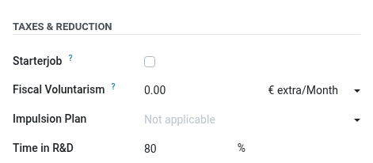
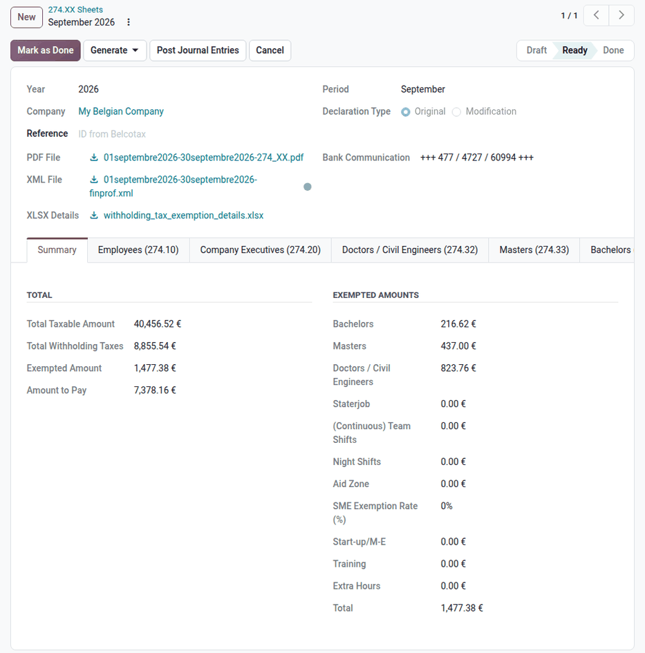
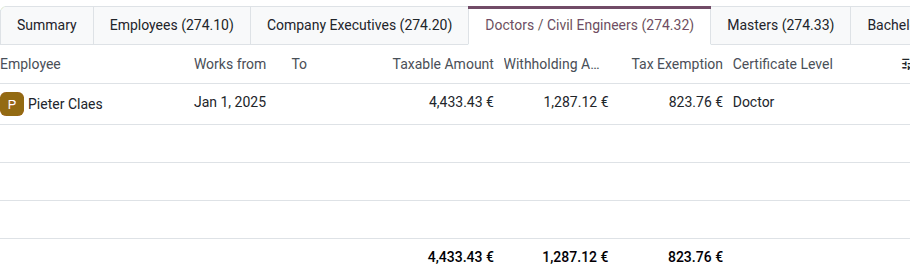

.. _payroll/l10n_be/274xx_sheets:

=============
274.XX sheets
=============

The *274.XX sheet* is the declaration of the professional withholding tax (*précompte
professionnel*) withheld from the remuneration of the employees and company executives. Employers
declare and pay this withholding tax monthly or quarterly, through the FinProf application of the
FPS Finance, by the 15th of the month following the declared period.

The same declaration claims the *withholding tax exemptions*: the parts of the withheld tax that the
employer keeps instead of paying them, for example for the employees working on scientific research.
These exemptions do not change the net salary of the employees.

The taxable remuneration and the withholding tax declared over the year must match the annual
:doc:`281 forms <281_forms>` of the employees.

Configuration
=============

Company
-------

Navigate to :menuselection:`Payroll app --> Configuration --> Company data`, and check the following
fields:

- :guilabel:`Company Number` and :guilabel:`Revenue Code`: both are required to create a 274.XX
  sheet.
- :guilabel:`Declaration Frequency`, in the :guilabel:`Withholding Taxes` section: select
  :guilabel:`Monthly` or :guilabel:`Quarterly`, according to the frequency required by the FPS
  Finance. Small employers declare every quarter, the others every month.
- :guilabel:`Company Size`: the bachelor's degree researchers exemption depends on it (see
  :ref:`payroll/l10n_be/274_scientific_research`).
- :guilabel:`IPA Reduction`: enable it if the company is entitled to the withholding tax exemption
  for small and medium enterprises defined in the interprofessional agreement (274.56).
- :guilabel:`SME Status`: :guilabel:`Startup / early stage` or :guilabel:`Micro Entreprise`, for
  the start-up exemption (274.60 and 274.61). This exemption also requires the :guilabel:`CBE
  Inscription` date, in the :guilabel:`Company Information` section of :menuselection:`Payroll app
  --> Configuration --> Settings`: it is granted during the first 48 months after the registration
  in the Crossroads Bank for Enterprises.

Employees
---------

The exemptions depend on fields of the employee form, in the :guilabel:`Payroll` tab:

- :guilabel:`Time in R&D`, in the :guilabel:`Taxes & Reduction` section: the percentage of working
  time spent on scientific research. This field is only displayed once the :guilabel:`Time
  Percentage in RnD` benefit is unarchived: navigate to :menuselection:`Payroll app -->
  Configuration --> Salary --> Benefits`, select the :guilabel:`Archived` filter, open the benefit,
  and unarchive it.
- :guilabel:`Starterjob` and :guilabel:`Aid Zone`, in the same section, for the 274.62 and 274.81
  exemptions.

The :guilabel:`Certificate Level` of the employee, in the :guilabel:`Education` section of the
:guilabel:`Personal` tab, defines the research exemption that applies: :guilabel:`Doctor` or
:guilabel:`Master: Civil Engineering` (274.32), :guilabel:`Master` (274.33), or
:guilabel:`Bachelor` (274.34).
A :guilabel:`Time in R&D` percentage can only be set for these certificate levels.

Accounting
----------

When the **Accounting** app is installed, the exemptions for scientific research can be posted as a
journal entry. Navigate to :menuselection:`Payroll app --> Configuration --> Settings`, and, in the
:guilabel:`Withholding Taxes Exemption` setting, select the journal and the accounts for the
doctors and masters exemption, the bachelors exemption, and the bachelors exemption capping.

Create a 274.XX sheet
=====================

Navigate to :menuselection:`Payroll app --> Reporting --> Belgium --> 274.XX Sheets`, and click
:guilabel:`New`. Select the :guilabel:`Year`, and the :guilabel:`Month` or the :guilabel:`Quarter`,
depending on the declaration frequency. Keep the :guilabel:`Original` :guilabel:`Declaration Type`
for a new declaration.

Odoo computes the sheet from the validated and paid payslips of the period, for all the branches of
the company. The :guilabel:`Summary` tab shows the totals:

- :guilabel:`Total Taxable Amount` and :guilabel:`Total Withholding Taxes` of the period.
- :guilabel:`Exempted Amount`: the sum of the exemptions listed under :guilabel:`Exempted Amounts`.
- :guilabel:`Amount to Pay`: the withholding taxes minus the exempted amount.

The other tabs detail the employees and amounts of each declaration code. A tab is only displayed
when it has lines, except :guilabel:`Training (274.64)`, :guilabel:`Extra Hours`, and
:guilabel:`Payslips`.

.. list-table::
   :header-rows: 1
   :stub-columns: 1

   * - Tab
     - Content
   * - :guilabel:`Employees (274.10)`
     - The remuneration of the employees, declared on their 281.10 form.
   * - :guilabel:`Replacement Revenues (274.18)`
     - The replacement income paid by the employer for sickness or invalidity, declared on the
       281.18 form.
   * - :guilabel:`Economic Unemployment (274.13)`
     - The complements paid during economic unemployment, declared on the 281.13 form.
   * - :guilabel:`Company Executives (274.20)` and :guilabel:`Presence Tokens (274.30)`
     - The remuneration of company executives (joint committee 999, 281.20 form), and of the
       directors declared on the 281.30 form (:guilabel:`Include Employee in 281.30 Report` option
       of the employee).
   * - :guilabel:`Doctors / Civil Engineers (274.32)`, :guilabel:`Masters (274.33)`, and
       :guilabel:`Bachelors (274.34)`
     - The exemptions for scientific research (see below).
   * - :guilabel:`Untaxed Employees`
     - The employees with the :guilabel:`No Withholding Taxes` option, in the :guilabel:`Posted
       Employee` section of their :guilabel:`Payroll` tab. Their payslips are not declared.
   * - :guilabel:`IPA Reduction (274.56)`
     - The exemption for small and medium enterprises, when :guilabel:`IPA Reduction` is enabled.
   * - :guilabel:`Start-up/M-E (274.60/61)`
     - The start-up or micro-enterprise exemption, when an :guilabel:`SME Status` is set.
   * - :guilabel:`Starterjob (274.62)`
     - The exemption for young employees with a starter job.
   * - :guilabel:`Training (274.64)`
     - The exemption for worker training: select the employees who followed an eligible training
       during the period in the :guilabel:`Trained Employees` field. A warning lists the selected
       employees who do not meet the seniority condition.
   * - :guilabel:`(Continuous) Team Shifts (274.74)` and :guilabel:`Night Shifts (274.75)`
     - The exemptions for shift and night work.
   * - :guilabel:`Aid Zone (274.81)`
     - The exemption for the employees with the :guilabel:`Aid Zone` option.
   * - :guilabel:`Extra Hours`
     - The exemption for overtime (274.44 and 274.55). A warning is displayed when the yearly cap of
       overtime hours is reached.
   * - :guilabel:`Payslips`
     - The declared payslips, with their gross wage and withholding tax.

.. _payroll/l10n_be/274_scientific_research:

Scientific research exemption
-----------------------------

Companies that employ researchers on projects registered with the Federal Science Policy Office
(BELSPO) can keep part of the withholding tax of these researchers:

- The exemption is 80% of the withholding tax of the employee, prorated on the :guilabel:`Time in
  R&D` percentage.
- The total exemption for bachelor's degree holders (274.34) is capped at 25% of the total exemption
  for doctors, civil engineers, and master's degree holders (274.32 and 274.33). This cap is 50% for
  the companies with fewer than 50 employees, according to the :guilabel:`Company Size`. In the
  :guilabel:`Summary` tab, :guilabel:`Bachelors` shows the capped amount.

Generate the declaration
------------------------

Click :guilabel:`Generate`, and select the file to create:

- :guilabel:`PDF`: the printable 274.XX sheet.
- :guilabel:`XML`: the file to upload to FinProf. Odoo validates it against the official schema; if
  it is invalid, the sheet displays the error. The :guilabel:`Bank Communication` to use for the
  payment of the withholding tax is displayed next to the file.
- :guilabel:`XLSX`: the details of the exemptions, one worksheet per declaration code.

The sheet moves to the :guilabel:`Ready` stage. Click :guilabel:`Generate` again to recompute the
files, for example after validating more payslips.

.. tip::
   When the **Accounting** app is installed, click :guilabel:`Post Journal Entries` to create the
   journal entry of the scientific research exemptions. The :icon:`attach_money` :guilabel:`Journal
   Entry` smart button opens it.

File the declaration
--------------------

Upload the XML file to FinProf, and pay the :guilabel:`Amount to Pay` with the bank communication.
Then, enter the reference received from the FPS Finance in the :guilabel:`Reference` field, and
click :guilabel:`Mark as Done`. A sheet cannot be marked as done without a reference.

Correct a declaration
---------------------

When a payslip of a declared period is validated or modified after the sheet is done, the sheet is
flagged, the payroll dashboard displays a warning, and the :guilabel:`Correct` button appears on the
sheet. Click it to create a sheet with the :guilabel:`Modification` :guilabel:`Declaration Type`,
linked to the original sheet. A modification only declares the payslips that its previous
declarations did not include. Generate and file it like an original declaration.

Click :guilabel:`Cancel` to cancel a sheet and its modifications. Only the sheets in the
:guilabel:`Draft` stage can be deleted.
