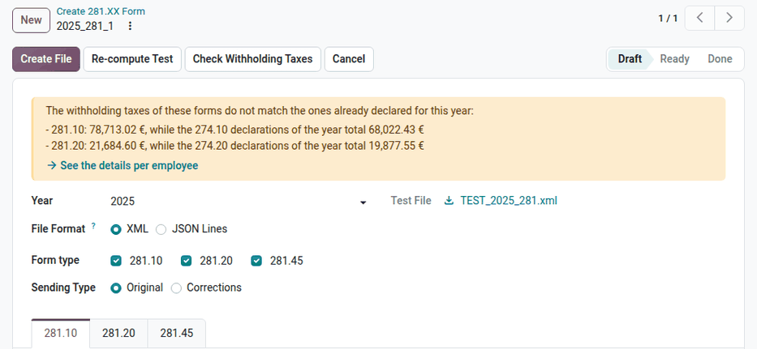
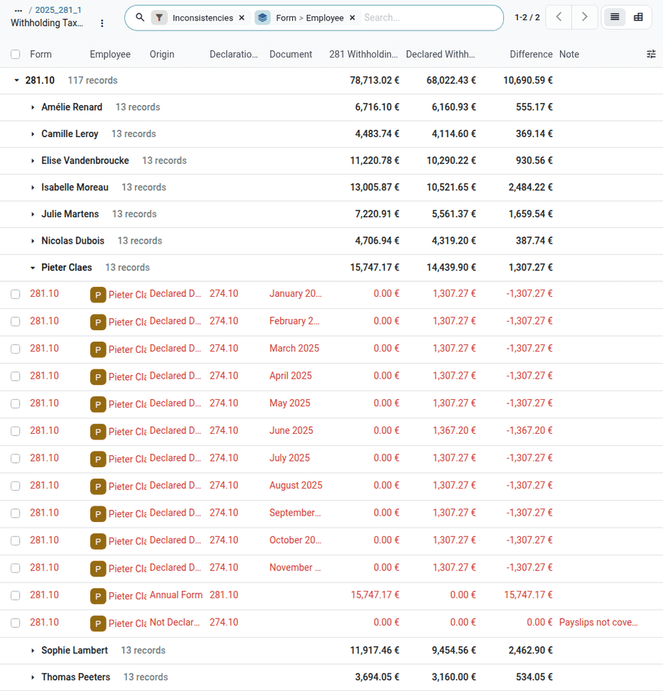
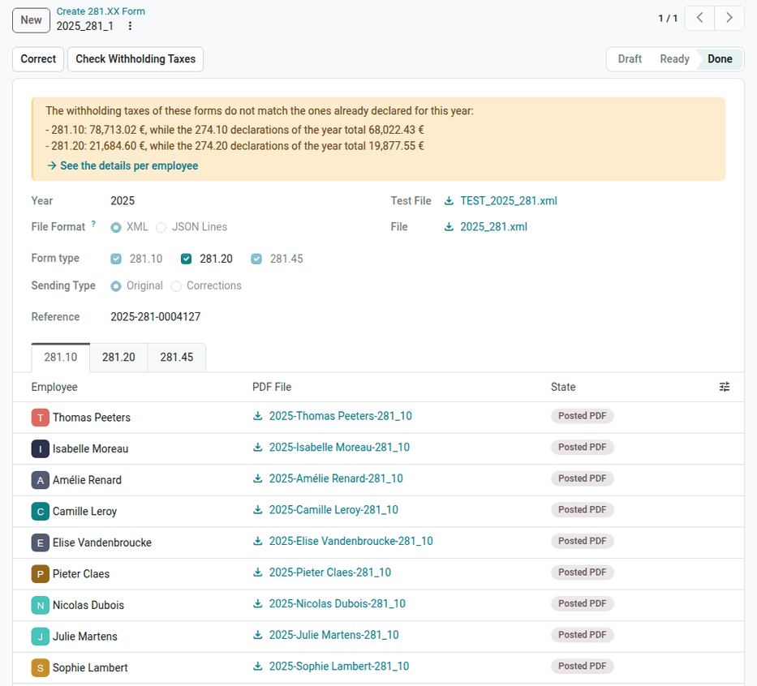
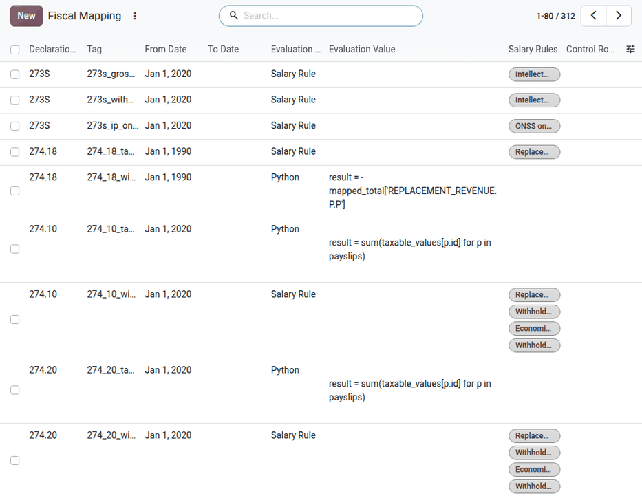

.. _payroll/l10n_be/281_forms:

============
281.XX forms
============

The *281 forms* (*fiches fiscales*) are the yearly tax forms that summarize, for each beneficiary,
the taxable income paid during an income year and the withholding tax deducted from it. The
employer sends them to the FPS Finance through the Belcotax-on-web application, and gives a copy to
each beneficiary for their personal income tax return.

In Odoo, a single *281.XX declaration* generates all the 281 forms of an income year, and the
Belcotax-on-web file that contains them.

.. _payroll/l10n_be/281_form_types:

Form types
==========

Odoo assigns each employee to the forms that match their payslips of the year. An employee can
appear on several forms.

.. _payroll/l10n_be/28110_declaration:

281.10: employees
-----------------

The 281.10 form declares the remuneration of the employees: salaries, benefits in kind, double
holiday pay, termination fees, etc. It includes all the employees, except the company executives and
the employees declared on the 281.30 form.

281.13: economic unemployment
-----------------------------

The 281.13 form declares the unemployment allowances and complements paid by the employer during
economic unemployment. It includes the employees whose payslips contain economic unemployment time
off.

281.18: replacement income
--------------------------

The 281.18 form declares the replacement income paid by the employer during an incapacity for work
due to sickness or invalidity, computed on the payslips by the :guilabel:`Replacement Revenue`
salary rule.

281.20: company executives
--------------------------

The 281.20 form declares the remuneration of the company executives, who are the employees under the
joint committee 999 (*Company Executive*).

281.30: presence tokens
-----------------------

The 281.30 form declares the remuneration of the directors who are not company executives, such as
presence tokens. It includes the employees with the :guilabel:`Include Employee in 281.30 Report`
option, in the :guilabel:`Taxes & Reduction` section of their :guilabel:`Payroll` tab.

.. _payroll/l10n_be/28145_declaration:

281.45: author's rights
-----------------------

The 281.45 form declares the income from author's rights and neighboring rights paid to the
employees, as :ref:`intellectual property <payroll/l10n_be/intellectual_property>`. It includes the
employees who received intellectual property income during the year.

Prerequisites
=============

Before creating the declaration, check the following information, or Odoo stops with an error that
names the records to fix:

- **Company**: the street, ZIP code, city, phone number, and VAT number of the main company.
- **Employees**: a private address (street, ZIP code, city, and country), a valid national number
  (NISS), and the legal :guilabel:`First Name` and :guilabel:`Last Name` (below the legal name of
  the employee). A Belgian ZIP code
  has at most four digits, and a first name at most 30 characters.
- **Your user**: an email address, used as contact of the sending in Belcotax-on-web.

Create the declaration
======================

Navigate to :menuselection:`Payroll app --> Reporting --> Belgium --> 281.XX Sheets`, and click
:guilabel:`New`. Odoo names the declaration after its year, for example `2025_281_1`.

Fill in the following fields:

- :guilabel:`Year`: the income year. By default, the previous year.
- :guilabel:`File Format`: the format of the Belcotax-on-web file, :guilabel:`XML` or
  :guilabel:`JSON Lines` (see :ref:`payroll/l10n_be/belcotax_on_web`).
- :guilabel:`Sending Type`: keep :guilabel:`Original` for the first sending of the year.

Click :guilabel:`Compute`. Odoo selects the validated and paid payslips of the year, lists the
employees of each form, and generates a :guilabel:`Test File`. The :guilabel:`Form type` checkboxes
show the forms that have employees: untick a form to exclude it from the declaration, then click
:guilabel:`Re-compute Test`.

Each form has its own tab, which lists its employees. Click :guilabel:`Print` on a line to download
the PDF form of that employee and check it. The :guilabel:`Untaxed Employees` tab lists the
employees with the :guilabel:`No Withholding Taxes` option, who are not declared.

If a value of an employee cannot be declared (for example a ZIP code that is too long, or no
contract start date), or if the file does not match the official schema, the declaration moves to
the :guilabel:`Error` stage, and the :guilabel:`Error` field describes the problem. Fix it, then
click :guilabel:`Re-compute Test`.

.. _payroll/l10n_be/281_withholding_check:

Check the withholding taxes
---------------------------

The withholding taxes declared on the 281 forms must match the ones already declared during the
year: the 274.10, 274.13, 274.18, 274.20, and 274.30 sheets for the corresponding 281 forms, and the
273S for the 281.45 form. When they differ, the declaration displays a warning with the totals of
each form.

Click :guilabel:`Check Withholding Taxes`, or :guilabel:`See the details per employee` in the
warning, to compare them per form and employee. The list shows, for each employee:

- the :guilabel:`Annual Form` line, with the withholding taxes of the 281 form,
- one :guilabel:`Declared During the Year` line per filed 274.XX or 273.XX sheet,
- a :guilabel:`Not Declared` line, which lists the payslips that no filed sheet covers,
- the :guilabel:`Difference`, and a :guilabel:`Note` that hints at its origin, for example a sheet
  whose payslips changed after it was filed.

The :guilabel:`Inconsistencies` filter is enabled when there are differences. Switch to the pivot
view to compare the totals per declaration.

Correct the 274.XX or 273.XX sheets, or the payslips, before sending the 281 forms.

Generate the file
-----------------

Click :guilabel:`Create File` to generate the final :guilabel:`File`. The declaration moves to the
:guilabel:`Ready` stage. To regenerate the file, click :guilabel:`Re-compute`.

Download the file, and upload it to the Belcotax-on-web application of the FPS Finance. Then, enter
the reference received from Belcotax-on-web in the :guilabel:`Reference` field.

Send the forms to the employees
-------------------------------

Click :guilabel:`Mark as done`, and confirm. A declaration cannot be marked as done without a
reference.

Odoo then generates the PDF form of each employee in the background. The :guilabel:`State` column
of each tab shows the progress, and the :guilabel:`PDF File` column the generated form.

When the **Documents** app is installed, the PDF forms are also posted in the *Payroll* folder of
each employee, and the state becomes :guilabel:`Posted PDF`. The employee receives an email, and
finds the form in their *My Drive* if they have a user. The forms are available from the
:icon:`article_f` :guilabel:`Documents` smart button of the employee form.

.. _payroll/l10n_be/281_correction:

Correct the forms
=================

When payslips of the year change after the computation, the declaration displays the following
warning: *This Declaration needs to be re-computed as Payslips are updated since Last compute*. The
payroll dashboard also displays a warning when a done declaration is no longer up to date, or when
validated payslips of the year are missing from it.

- Before the declaration is done, click :guilabel:`Re-compute`.
- Once it is done, click :guilabel:`Correct`. Odoo creates a new declaration with the
  :guilabel:`Corrections` :guilabel:`Sending Type`, linked to the original declaration in the
  :guilabel:`Original` field. Select the :guilabel:`Treatment Type`:

  - :guilabel:`Modification`: replaces forms already sent.
  - :guilabel:`Add`: adds forms that were not sent.
  - :guilabel:`Cancel`: cancels forms already sent.

  Compute the correction, generate its file, and send it like an original declaration. A
  declaration can only be corrected once: the original declaration then links to its correction.

Click :guilabel:`Cancel` to cancel a declaration that is not done, and :guilabel:`Set to Draft` to
reopen a cancelled declaration.

.. _payroll/l10n_be/belcotax_on_web:

Belcotax-on-web 2.0
===================

From the 2026 income year, Belcotax-on-web only accepts *JSON Lines* files. In this format, the
beneficiaries, the debtor, and the contact of the sending are separate records that the forms refer
to, the amounts are in euros, and Belcotax-on-web computes the totals itself. A form sent again
replaces the previous one.

The :guilabel:`File Format` of the declaration follows the income year:

- Up to the 2025 income year, :guilabel:`XML` is selected by default. Select :guilabel:`JSON Lines`
  to generate a file for a test sending to the new version of Belcotax-on-web.
- From the 2026 income year, :guilabel:`JSON Lines` is mandatory.

Odoo validates each record of the file against the schemas published by the FPS Finance, and lists
the errors per employee.

.. important::
   The schemas of each income year are added to Odoo once the FPS Finance publishes them. Until
   then, Odoo cannot compute the declarations of that income year, and displays an error message
   that asks to update Odoo.

.. note::
   Odoo generates the file, but does not send it: upload it to Belcotax-on-web.

.. _payroll/l10n_be/fiscal_mapping:

Fiscal mapping
==============

The amounts of each zone of the 273S, 274.XX, and 281 forms are defined in a *fiscal mapping*. To
view it, activate the :ref:`developer mode <developer-mode>`, and navigate to
:menuselection:`Payroll app --> Configuration --> Belgium --> Fiscal Mapping`.

Each row defines one zone of a form, for a period:

- :guilabel:`Declaration Code`: the form, for example `281.10` or `273S`.
- :guilabel:`Tag`: the zone of the form.
- :guilabel:`From Date` and :guilabel:`To Date`: the income years the row applies to.
- :guilabel:`Evaluation Type`: how the amount is computed: :guilabel:`Salary Rule` (the total of
  the selected :guilabel:`Salary Rules`), :guilabel:`Python` (an expression), or
  :guilabel:`Control` (the sum of other rows, in :guilabel:`Control Rows`).

The :guilabel:`Fiscal Nature` field of a Belgian salary rule lists the mapping rows that use it.

.. warning::
   The fiscal mapping is maintained by Odoo, and its rows are reset when the Belgian payroll module
   is updated. Do not modify it without the help of the Odoo support.
