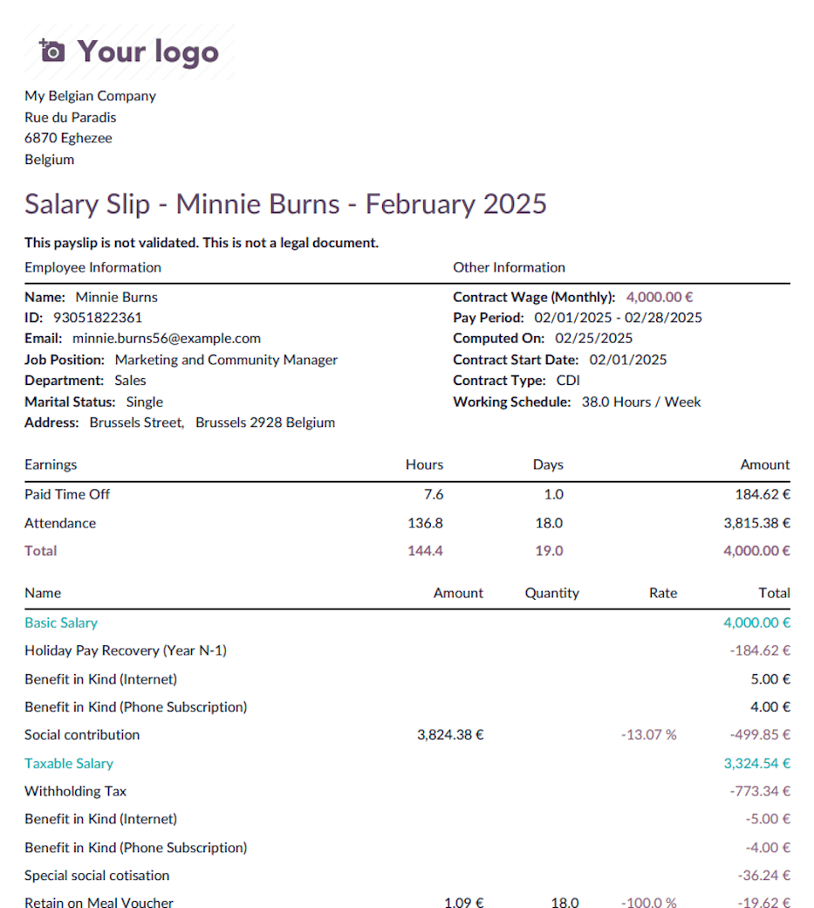
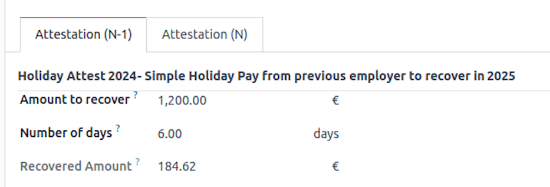
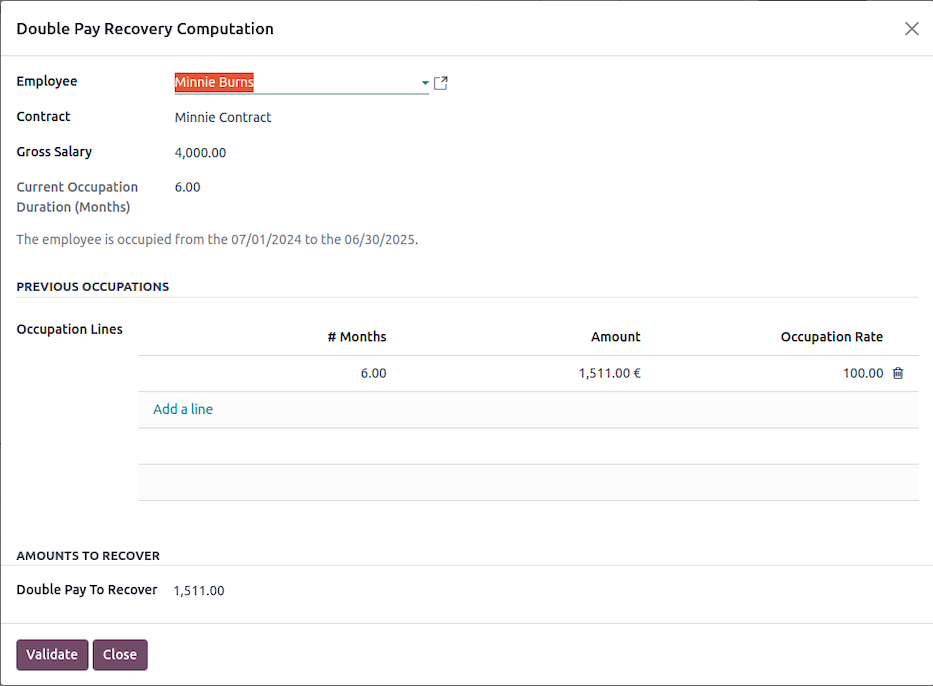
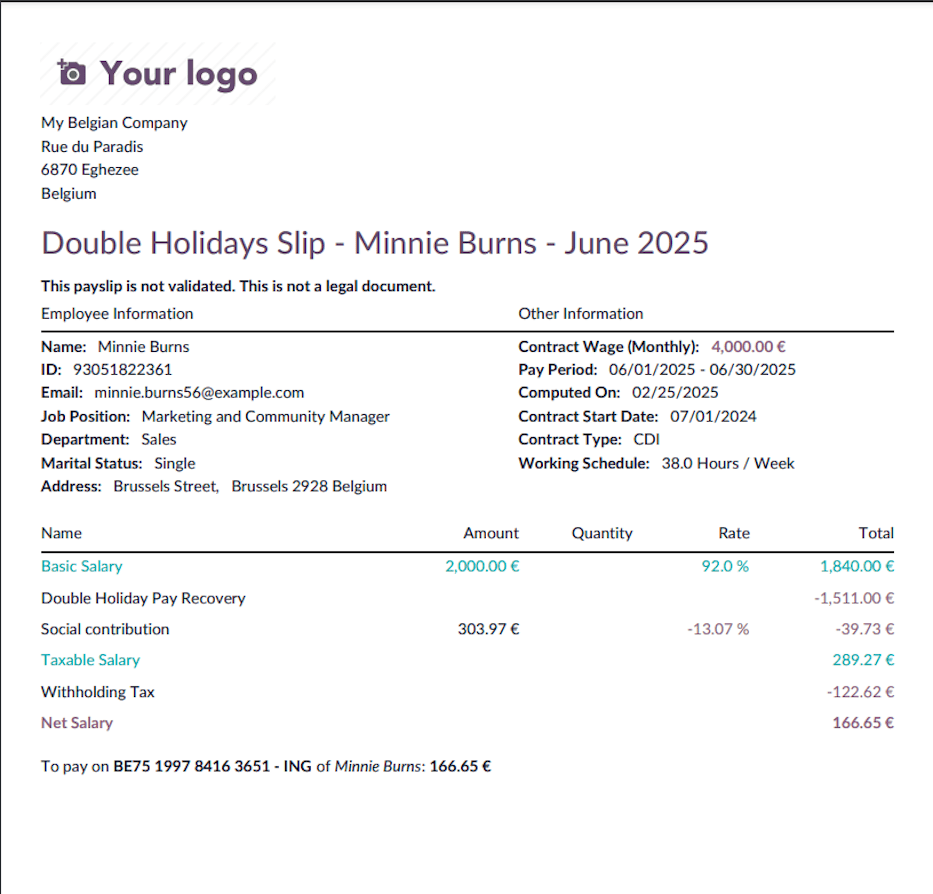

==============================
Time off and working schedules
==============================

This page covers Belgian time off rules and how they impact payroll.

.. _payroll/l10n_be/time_off:

Time off
========

.. _payroll/l10n_be/legal_time_off:

Legal time off
--------------

This guide provides an overview of the basic rules governing legal holiday entitlements in Belgium
for employers using Odoo.

Holiday entitlement calculation
~~~~~~~~~~~~~~~~~~~~~~~~~~~~~~~

Your holiday entitlement for the current year (N) is determined by the number of months worked in
Belgium during the previous year (N-1).

**Calculation details:**

- Employees earn **2 days of leave per month** based on a 6-day work week.
- The entitlement is adjusted for a 5-day work week: :math:`(\text{Total Days} \div 6) \times 5`.

.. example::
   If an employee worked **7 months** in the previous year (N-1):

   - **6-day work week:** :math:`7 \times 2 = 14 \text{ days}`
   - **5-day work week:** :math:`14 \div 6 \times 5 = 11.67 \text{ days}`

**Partial Month Calculation:**

- Worked **1st to 10th**: Full month counted.
- Worked **11th to 19th**: Half month counted.
- Worked **20th onwards**: Month not counted.

**Rounding Rules:**

- Less than **0.35**: Round to **0**.
- Between **0.35 - 0.74**: Round to **0.5**.
- **0.75 and above**: Round to **1**.

For a full-time employee, this typically results in **11.5 days of legal holiday** entitlement.

Maximum holiday entitlement
~~~~~~~~~~~~~~~~~~~~~~~~~~~

Employees are entitled to a maximum of **4 weeks** of holiday based on their working schedule. If an
employee switches between full-time and part-time work, their entitlement is adjusted accordingly.

**Calculation details:**

- **5-day work week**: :math:`4 \times 5 = 20 \text{ days}`
- **4-day work week**: :math:`4 \times 4 = 16 \text{ days}`
- **3-day work week**: :math:`4 \times 3 = 12 \text{ days}`

.. example::
   If an employee joined **Odoo on January 1, 2024**, and plans to switch to a **3-day work week
   from April 1, 2024**:

   **Step 1: Calculate holiday entitlement for 2024**

   - The employee worked **9 months in 2023**.
   - **6-day work week basis**: :math:`9 \times 2 = 18 \text{ days}`
   - Adjusted for **5-day work week**: :math:`18 \div 6 \times 5 = 15 \text{ days}`

   **Step 2: Verify maximum holiday entitlement**

   - For a **5-day work week**, the maximum entitlement is **20 days**.
   - Since the employee is entitled to **15 days**, they remain within the limit.

   **Step 3: Adjust entitlement for the new work schedule**

   - From April 1, 2024, the employee moves to a **3-day work week**.
   - Maximum entitlement for a **3-day work week**: :math:`3 \times 4 = 12 \text{ days}`.
   - If no leave is taken before April 1, the employee may take up to **12 days** from
     their 15-day entitlement.
   - The **remaining 3 days** will be settled at the end of the year.

This ensures compliance with Belgian legal leave regulations and allows employers to manage holiday
entitlements effectively within Odoo.

Legal time off allocation
~~~~~~~~~~~~~~~~~~~~~~~~~

This is possible to generate the legal time off for all your employees at the beginning of a new
year using the wizard in :menuselection:`Payroll app --> Reporting --> Belgium --> Paid Time Off
Allocation`.

Based on your employees occupation over last year, the number of available time off is pre-computed
for each employee.

.. image:: time_off/paid-time-off-allocation-01.png
   :alt: Paid Time Off Allocation Wizard.

Once validated, a draft allocation is generated for each single employee, waiting a manual
confirmation that can be done in batch.

.. image:: time_off/paid-time-off-allocation-02.png
   :alt: Paid Time Off Allocations.

.. _payroll/l10n_be/european_time_off:

European time off
-----------------

How does it work?
~~~~~~~~~~~~~~~~~

If you were not subject to Belgian ONSS contributions before joining our company and do not have
entitlement to legal holidays, or if your entitlement is incomplete, you can apply for European
leave.

To qualify for European leave in a given year, you must work for at least 3 months during that year,
whether with us or another employer. Once you have met this requirement, you will earn 5 days of
European leave. Subsequently, you will accumulate additional days of vacation each month as follows:

- After 3 months: 5 days
- After 4 months: 7 days
- After 5 months: 9 days
- After 6 months: 10 days
- After 7 months: 12 days
- After 8 months: 14 days
- After 9 months: 15 days
- After 10 months: 17 days
- After 11 months: 19 days

.. important::
   The total of legal leave and European leave cannot exceed 20 days per year. You must use all your
   legal holidays before taking European leave.

   European leave entitlement expires on December 31st of the year it is earned and cannot be
   carried over to the following year. To qualify for European leave in a new year, you must
   complete another 3 months of work.

How are these days paid?
~~~~~~~~~~~~~~~~~~~~~~~~

European leaves are paid holidays taken in advance of your "Double Holiday Pay" (the June extra pay)
for the following year. Essentially, the more European leave days you take in a given year, the less
you will receive as June extra pay in the following year.

.. _payroll/l10n_be/sick_time_off:

Sick time off and relapse
=========================

In Belgium, sick leave is managed according to two main regimes:

- **With guaranteed salary**: The employer continues to pay the worker's salary for a specified
  period.
- **Without guaranteed salary**: The worker receives benefits from the mutual insurance company
  after the guaranteed salary period.

Sick leave with guaranteed salary
---------------------------------

The guaranteed salary is a period during which the employer continues to pay the salary of the
worker who is unable to work.

**Employees**: The employer pays 100% of the salary during the first full month of incapacity.
After this period, if the incapacity continues, the worker falls under the mutual insurance regime.

Sick leave without guaranteed salary
------------------------------------

After the guaranteed salary period, the ONEM (National Employment Office) or the mutual insurance
company takes over.

- **Long-term illness**: An incapacity lasting more than 30 days leads to benefits from the mutual
  insurance company.
- **Relapse**: If a worker returns to work and then becomes ill again for the same reason within
  14 days, this may be considered a relapse, and the rules for guaranteed salary may be adjusted.

Management in Odoo
------------------

In Odoo, sick leave is automatically managed if the absences are related to the *Sick Time Off*
work entry type.

- **Recording time off**: The employee records their absence through the **Time Off** module.
- **Automation of work entries**: If the request is approved, Odoo automatically generates the
  corresponding Work Entries.
- **Impact on payroll**: The guaranteed salary is automatically calculated according to the rules
  configured based on the worker's status (employee).
- **Compensation after the guaranteed salary**: Once the guaranteed salary period has expired, Odoo
  adjusts the Work Entries to reflect the transition to the mutual insurance company.

Thus, Odoo ensures a smooth and compliant management of sick leave according to Belgian regulations.

.. _payroll/l10n_be/holiday_pay_recovery:

Holiday pay recovery
====================

This document explains how Odoo calculates the recovery of holiday pay (both simple and double) for
employees in Belgium who have changed employers. When an employee moves from one company to another,
their previous employer may have already paid their holiday pay for the previous year. This amount
needs to be recovered by the new employer, and this guide outlines how this is managed in Odoo.

Understanding holiday pay in Belgium
------------------------------------

In Belgium, employees are entitled to annual leave and corresponding holiday pay, which consists of:

- **Simple holiday pay**: Regular salary payments for the days of leave taken.
- **Double holiday pay**: An additional payment, typically equal to approximately 92% of the gross
  monthly salary, given when employees take their annual leave.

When an employee changes jobs, their previous employer may have already paid these amounts. To avoid
double payment, the new employer needs to recover the amounts already paid.

Recovery of simple holiday pay
------------------------------

The recovery of simple holiday pay in Odoo is based on the following criteria:

#. The recovery applies if the employee has taken leave in the current year and their previous
   employer already paid the holiday pay.
#. The calculation considers the number of leave days taken and the hours worked per week.
#. The recovery process is split into:

   - **Year N**: The current year's holiday pay recovery.
   - **Year N-1**: The recovery of holiday pay from the previous year.

The system checks:

- If the employee's first contract date with the company was in the previous year.
- If the employee has a pending holiday pay recovery amount.
- If the recovery has not already been processed.
- If the employee has taken annual leave.

If all conditions are met, Odoo calculates the amount to be deducted from the payroll to account
for the holiday pay already received from the previous employer.

Recovery of double holiday pay
------------------------------

The recovery of double holiday pay follows these steps:

#. The system verifies the employee's contract and determines their employment duration.
#. The gross salary is calculated based on the employee's contract.
#. The number of months worked in the previous year is identified.
#. A threshold amount is computed as follows:

   .. math::
      :class: overflow-scroll

      \text{Threshold} = \text{Current monthly salary} \times \text{Months worked in previous year}
      \times \text{Occupation rate} \times 7.67%

   If the amount on the holiday certificate from the previous employer is lower than this threshold,
   no limit applies.

#. The system recovers the lower of:

   - The calculated threshold.
   - The actual amount paid by the previous employer.

If the employee has worked for more than 12 months in the current company, no double holiday pay
needs to be recovered.

How to configure in Odoo
------------------------

In the employee form view, under the :guilabel:`Settings` tab, you can enter the various amounts
from holiday attests provided by the new employee.

.. image:: time_off/holiday-pay-recovery-01.png
   :alt: Holiday Pay Recovery Configuration.

For simple holiday pay recovery, you need to enter:

- The :guilabel:`Number of days` for paid leave
- The :guilabel:`Amount to recover` by the employee

.. note::
   The :guilabel:`Recovered Amount` field displays the amount already recovered.

For double holiday pay recovery, you must enter a **line for each employer's holiday attest**. Each
line should include:

- The :guilabel:`# Months` (number of months) the employee worked for that employer
- The :guilabel:`Amount` provided to the employee
- The :guilabel:`Occupational Rate`

Odoo uses this data to compute a **recovery limit**. If the employee now has a lower salary, the
full amount cannot be recovered.

.. tip::
   Be careful not to mix holiday attests for the current year (N) and the previous year (N-1).

For simple holiday pay recovery, the system deducts the amount from each legal time-off period
until:

#. The **total amount** has been fully recovered, or
#. The **number of time-off days** has been matched (if the employee's current salary is lower than
   before).

Once the **payslip** is validated and paid, the recovered simple holiday pay is reflected in the
employee form view.

On the double holiday payslip, click :guilabel:`Compute Double Pay Recovery` to open a wizard that
helps calculate the recoverable amount.

In the :guilabel:`Double Pay Recovery Computation` wizard, you'll find:

- The relevant holiday attests listed in the :guilabel:`Occupation Lines`
- The :guilabel:`Double Pay To Recover` amount based on the threshold

This amount is **editable** if manual adjustments are needed.

Once validated, the double pay recovery is applied to the payslip.

Odoo automates the recovery of both **simple** and **double** holiday pay, ensuring compliance with
**Belgian labor laws**. By analyzing contract details, employment duration, and past payments, Odoo
calculates the necessary deductions and prevents duplicate holiday pay payments.

.. _payroll/l10n_be/working_schedule_change:

Working schedule change
=======================

This guide explains how to modify an employee's working time schedule in the Belgian payroll module
of Odoo. Changing an employee's working hours affects their wage calculation, time-off allocation,
and contract terms.

Steps to change an employee's working schedule
----------------------------------------------

#. Navigate to the employee's contract (:menuselection:`Payroll app --> Contracts`), and select the
   contract of the employee whose working schedule you want to modify.
#. Click on :icon:`fa-cog` :guilabel:`(Action)` and select :guilabel:`Working Schedule Change`. The
   wizard displays the current contract details and allows you to set new working time parameters.
#. Set the new working schedule:

   - Choose the new :guilabel:`Working Schedule` from the available resource calendars.
   - Define the :guilabel:`Start Date` for the change (mandatory).
   - If applicable, specify an :guilabel:`End Date`.
   - If the :guilabel:`Part Time` checkbox is selected, any difference between the reference
     calendar and the employee's new calendar will be covered using the *Absence Work Entry Type*.
     This ensures that the employee's monthly salary remains the same, regardless of the number of
     absence days in a given month. This setup is required for configuring *Time Credit*, *Parental
     Leave*, or *Medical Half-Time* correctly.

#. Adjust the employee's wage:

   - The wizard automatically computes the full-time equivalent wage based on the new working
     schedule.
   - You can review and modify the new wage if necessary.

#. Manage time off allocation:

   - Select the relevant :guilabel:`Time Off Type`.
   - Odoo automatically adjusts the employee's time-off entitlement based on the new working
     schedule using the following formula:

     .. math::
        :class: overflow-scroll

        \text{New Time Off Allocation} = \max(\min(\text{ Computed Allocation},
        \text{ Max Allocation}) + \text{ Leaves Taken}, \text{ Leaves Taken})

     - **Computed Allocation** is the expected leave allocation based on the new schedule.
     - **Max Allocation** is the maximum number of days allowed under the new working time.
     - **Leaves Taken** ensures the employee does not receive fewer days than already used.

#. Decide on a follow-up contract

   - If the working time change is temporary, you can enable :guilabel:`Post Change Contract
     Creation` to automatically create a contract that resumes the previous working schedule after
     the specified end date.

#. Validate the changes

   - Click :guilabel:`Validate` to apply the new working schedule.
   - If the new schedule is the same as the current one, an error will be displayed.
   - The system will create a new contract with the updated working time and wage.
   - If a previous contract existed, it will be closed with an end date before the new contract
     begins.

Result
------

- The employee's new working schedule is recorded.
- Wage and time-off entitlements are adjusted accordingly.
- A follow-up contract is created if applicable.

.. image:: time_off/working-schedule-change-03.png
   :alt: Working Schedule Change New Contracts.

.. _payroll/l10n_be/work_entries_exports:

Work entries exports
====================

What are work entries?
----------------------

In the context of payroll, *work entries* typically refer to records or documentation related to an
employee's work hours and earnings for a specific pay period. These entries are crucial for
accurately calculating and processing employee compensation.

Work entries in the context of payroll are essential for both employees and employers. They provide
a transparent and accurate record of an employee's compensation and deductions, ensuring that
employees are paid correctly and that tax and legal requirements are met. Payroll software and
systems are commonly used to manage and automate these work entries, making the payroll process more
efficient and accurate.

Main concepts
-------------

General
~~~~~~~

In Odoo, work entries mainly refer to *time entries* (attendance tracking), these are work entries
that consist of time records, which include the number of hours worked by an employee during a
given pay period. These entries may specify regular working hours, overtime hours, and any other
relevant time-related information, such as breaks, paid time off, unpaid time off, parental leave,
credit-time, etc.

Work entries serve a dual role in payroll management. First, they enable organizations to
independently compute employee payslips. Second, they facilitate the transmission of pertinent data
to external payroll service providers, who then use this information to calculate and generate the
payslips.

Work entries
~~~~~~~~~~~~

- They have a Name: used to identify the type of entry (e.g., Attendance, Paid Time Off, etc.).
- They have a Payroll Code: used in Odoo's salary rules computations
- They have an External Code: used to provide the correct Work Entry code to an external payroll
  service provider.
- They are generated based on the configuration of the contract and the time off types
- They have a duration, a start and end date, a state and are always linked to an employee.

Work entry types
~~~~~~~~~~~~~~~~

- They are the main source of configuration for your work entries. Thanks to your different types
  of work entries, you'll be able to differentiate the time records of your employees.
- They have a name.
- They contain a code, external code, payroll code and a color for visual tracking.
- They allow other types of configurations such as how they are displayed in payslips, decide
  whether this type of work entry should be considered as paid or unpaid (eg. unpaid leave), decide
  whether this type of work entry has a link with time off, is valid for some advantages or how it
  should be reflected in your reporting.

Time off types
~~~~~~~~~~~~~~

As mentioned above, since work entry types can be linked to a time off type, you are also able to
define the work entry type for each time-off type. On the time off type you have a many2one
relation with the work entry type.

Steps to generate the work entries of your staff
------------------------------------------------

#. Create all the employees
#. Create a contract and set its status to :guilabel:`Running` for each employee.

   In the contract, choose the :guilabel:`Work Entry Source`. It tells the system how work entries
   for an employee should be generated. It can be based on:

   - :guilabel:`Working Schedule`: Odoo uses the predefined working hours and days set in the
     employee's working schedule to generate work entries. This is useful for regular, predictable
     shifts.
   - :guilabel:`Attendances`: Work entries are generated from the employee's attendance records
     (i.e., when they check-in and check-out).
   - :guilabel:`Planning`: Work entries are created based on the validated shifts or slots allocated
     to the employee in the **Planning** app (often used for scheduling roles like retail shifts,
     restaurants, etc.).

#. Generate the work entries each month

   Odoo automatically creates the work entries in the **Payroll** app based on the work entry source
   of the contract and the different time-offs taken. You can edit the work entries manually. You
   can always decide to regenerate work entries manually but be careful if you already made some
   manual changes, Odoo will regenerate the work entries based on what it knows (e.g., your working
   schedule and time off).
#. Managing conflicts

   Conflicts are pointing to entries that can't be validated without your intervention. This means
   you'll have to qualify the entry and decide which is the correct entry to be defined for the time
   period if you want to be able to generate the payslip or validate the entries. Conflicts arise
   when there are overlapping entries or when Odoo detects that there is a time off request still
   pending for validation. For instance, if an employee is marked as attending work and at the same
   time there's a paid leave request to be validated for the same period, that's a conflict.

   Conflicts can be managed by filtering on the conflicting entries and resolving the discrepancy.
   Since **Odoo 16.4**, Odoo filters by default on conflicting entries. For prior versions, you can
   still filter manually on conflicting entries or use the conflicting menu item.
#. Once the conflict is resolved you can either proceed to generate the payslips for your employees
   or export your work entries to the right entity.

Export work entries
-------------------

.. tip::
   This section is about exporting work entries to SD Worx, but the configuration and behavior is
   similar for other exports to Partena, Group S and UCM.

Introduction
~~~~~~~~~~~~

This sheet is here to help you learn how Odoo's **SD Worx** (`l10n_be_hr_payroll_sd_worx`) module
simplifies payroll by enabling easy export of work entries. This guide provides quick steps to
generate :file:`.txt` files for direct import into SD Worx calendars, saving time and ensuring
accuracy.

First and foremost, it's important to understand there is no direct integration between Odoo and
SD Worx. There is no automatic exchange of information, either way. Odoo does not communicate
directly with SD Worx, and the reverse is also true.

How does it work?
~~~~~~~~~~~~~~~~~

In reality, Odoo provides a standardized export in .txt format for employees' work entries,
allowing the generation of a file that conforms to a specific format for inputting these entries
into the SD Worx software.

What does it mean in terms of data management?
~~~~~~~~~~~~~~~~~~~~~~~~~~~~~~~~~~~~~~~~~~~~~~

Since there is no direct integration between both systems, it implies that certain data will need
to be manually entered into both systems. For instance, when you create a new employee in Odoo,
you'll also need to manually create the employee in SD Worx (and vice versa). This manual data
entry requirement extends to various aspects such as contracts, work schedules, salary details,
and personal information about employees.

Essentially, all the information necessary for SD Worx to calculate salaries and generate payslips
must be manually inputted into both systems.

What's the advantage of exporting to SD worx?
~~~~~~~~~~~~~~~~~~~~~~~~~~~~~~~~~~~~~~~~~~~~~

Odoo is an integrated software that can comprehensively handle all variable payroll elements,
including employee personal information, contract details, various time-off types, and other work
entry categories. Through Odoo's integration capabilities, you can access all this crucial data in
one centralized location, making it easily accessible for your HR team and employees.

This integration not only ensures data accuracy but also maintains consistency, reducing the
likelihood of errors when transmitting work entry information to your external payroll provider.
With the module in place, a single click generates a :file:`.txt` file that's ready for direct
import into SD Worx, streamlining the entire data transmission process.

Steps to set up the SD Worx module
~~~~~~~~~~~~~~~~~~~~~~~~~~~~~~~~~~

.. important::
   You must be logged into a Belgian company for the following steps to work.

#. :ref:`install <general/install>` the **Belgium - Payroll - Export to SD Worx**
   (`l10n_be_hr_payroll_sd_worx`) module.
#. Go to :menuselection:`Payroll app --> Configuration --> Settings` to fill in the :guilabel:`SD
   Worx code` field. This is the company's SD Worx code, you get it directly from the SD worx
   software. When you create a company, it has a unique identifier which you need to set in the
   field.
#. For each employee, under the :guilabel:`Settings` tab, fill in the :guilabel:`SDWorx code` field.
#. For work entry types, under the :guilabel:`Settings` tab, fill in the :guilabel:`SDWorx code`
   field as well.

You can now export your work entries in the SD Worx :file:`.txt` format by opening the wizard under
:menuselection:`Payroll app --> Reporting --> Belgium --> Export Work Entries to SDWorx`.

The file contains a series of lines such as the following line of text:
`1111110000024K2023042370100360`

Each line represents a work entry, and the structure is outlined below:

- `111111` -> Company SD Worx code
- `0000024` -> Employee SD Worx code
- `K` -> Delimiter
- `20230423` -> Date
- `7010` -> SD Worx work entry code
- `0360` -> Duration (edited)

Once the :file:`.txt` file is exported, it can be directly imported in this format into the SD Worx
software. Doing so updates the calendars of each collaborator.
