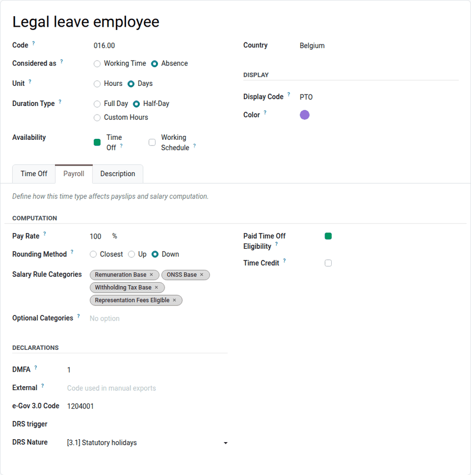
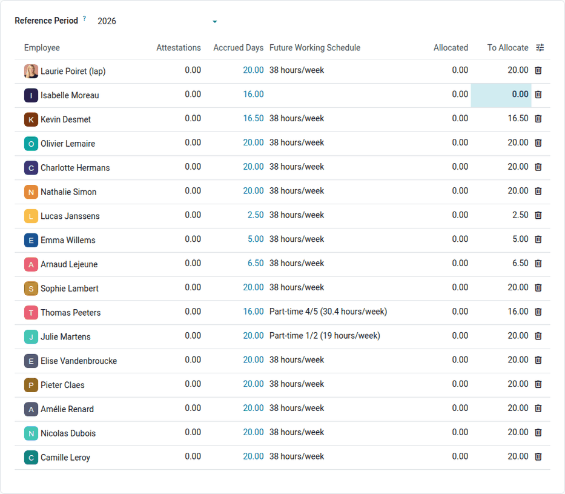
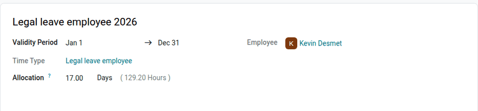
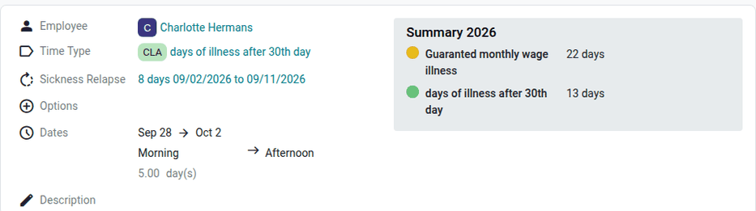
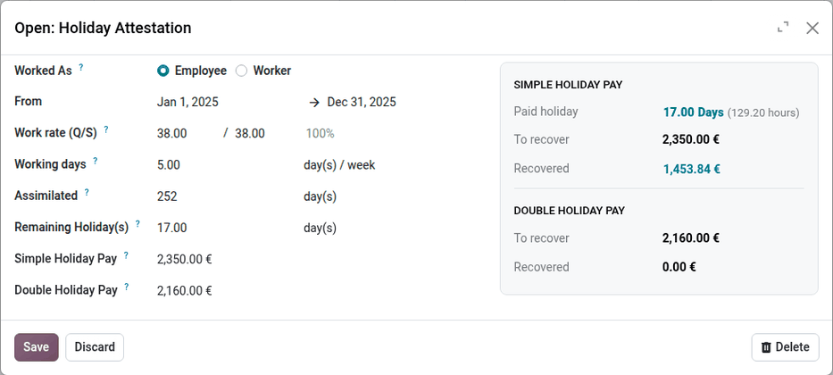
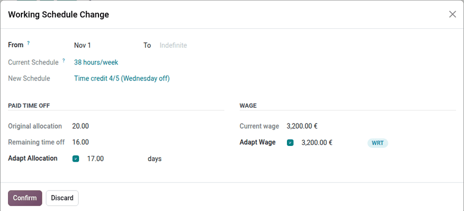

==============================
Time off and working schedules
==============================

This page covers the Belgian time off rules handled by Odoo, and how time off and working schedule
changes impact Belgian payslips.

In Odoo, every kind of time off (paid time off, sickness, unemployment, etc.) is a *time type*. The
time off requests and allocations of the **Time Off** app, the working schedules, and the
attendances are converted into *worked days* lines on the payslip, according to their time type.

.. _payroll/l10n_be/time_types:

Belgian time types
==================

The Belgian payroll localization comes with its own set of time types, restricted to the
companies located in Belgium. Their codes follow the format of the main Belgian social
secretariats (for example, `016.00` for the legal leave of employees, `013.00` for the
guaranteed monthly wage in case of illness, or `147.00` for time credit).

To view them, navigate to :menuselection:`Time Off app --> Configuration --> Time Types`, or
:menuselection:`Payroll app --> Configuration --> Time Management --> Time Types`.

On top of the standard time type settings, the :guilabel:`Payroll` tab of a Belgian time type
contains:

- :guilabel:`Time Credit`: the time type reduces the working time of the employee as part of a
  working time reorganisation (time credit, parental leave, etc.). See
  :ref:`payroll/l10n_be/working_schedule_change`.
- :guilabel:`Declarations` section: the codes used to declare the time type to the social security
  (:guilabel:`DMFA` code, :guilabel:`e-Gov 3.0 Code`), the :guilabel:`DRS trigger` and
  :guilabel:`DRS Nature` used for the electronic declarations of social risks, and an
  :guilabel:`External` code, used in the :ref:`time entries export
  <payroll/l10n_be/work_entries_exports>`.

The :guilabel:`Description` tab explains in which case the time type should be used.

.. tip::
   In the time types list view, the :guilabel:`Computed in Holiday Rights` filter shows the time
   types that are assimilated to worked time for the computation of the holiday pay.

.. _payroll/l10n_be/time_off:

Time off
========

.. _payroll/l10n_be/legal_time_off:

Legal time off
--------------

In Belgium, the paid time off of a year (the *vacation year*) depends on the time worked during
the previous year (the *holiday exercise*). A full year of work in the previous year gives four
weeks of paid time off in the employee's current working schedule: 20 days for a 5-day week, 16
days for a 4-day week, etc.

The legal time off of employees uses the :guilabel:`Legal leave employee` (`016.00`) time type.
The time off of the manual workers, paid by their holiday fund, uses the :guilabel:`Annual
holiday (workers)` (`142.00`) time type.

.. _payroll/l10n_be/legal_time_off_computation:

Holiday entitlement calculation
~~~~~~~~~~~~~~~~~~~~~~~~~~~~~~~

Odoo computes the entitlement in hours, then converts it into days:

#. For each period of the reference year covered by a contract, the share of the year worked is
   the number of working days of the period (Monday to Saturday) divided by the number of working
   days of the whole year. This share, multiplied by four weeks of the hours per week of the
   working schedule of the period, gives the accrued hours.
#. Each period is capped at the hours per week of the working schedule of the next year, so that
   an employee moving to a part-time schedule does not receive more hours than four weeks of their
   new schedule.
#. The hours are converted into days with the hours per day of the next year's working schedule,
   rounded down to the nearest half day, and capped at four weeks of the working days per week of
   that schedule.

For a new employee, the paid time off still due by a previous employer, as stated on their
:ref:`holiday attestations <payroll/l10n_be/holiday_pay_recovery>`, is added to the
computation.

.. example::
   An employee starts on March 2, 2026, with a full-time schedule of 38 hours per week (7.6 hours
   per day). The year 2026 has 313 working days (Monday to Saturday), 262 of which are covered by
   their contract:

   - Accrued hours: :math:`262 \div 313 \times 4 \times 38 = 127.23` hours
   - Paid time off for 2027: :math:`127.23 \div 7.6 = 16.74` days, rounded down to **16.5 days**

   Another employee works full time (38 hours per week) until October 31, 2026, then 4/5 (30.4
   hours per week, four days a week) from November 1, 2026. Their 2026 periods are capped at 30.4
   hours per week, which gives 121.6 hours, or **16 days** of 7.6 hours: the maximum for a 4-day
   week.

.. note::
   The computation is based on the periods under contract. Check the result for the employees who
   had absences that are not assimilated to worked time (for example, unpaid leave), and adapt the
   :guilabel:`To Allocate` column if needed.

.. _payroll/l10n_be/legal_time_off_allocation:

Legal time off allocation
~~~~~~~~~~~~~~~~~~~~~~~~~

At the end of a year, generate the legal time off of the next year for all employees with the
*Paid Time Off Allocation* tool. To open it, go to the **Employees** app, select the employees in
the list view, click the :icon:`settings_f` :guilabel:`Actions` button, and select :guilabel:`Paid
Time Off Allocation`. When some employees have no allocation for the current year, the
:guilabel:`Employees require paid time off allocation` warning of the **Payroll** app dashboard
also opens it, with its :guilabel:`Review` button.

Select the :guilabel:`Reference Period`: the year worked. The allocations are created for the
following year. For each employee, the list shows:

- :guilabel:`Attestations`: the remaining days from the holiday attestations of a previous
  employer.
- :guilabel:`Accrued Days`: the paid time off computed for the period. Hover over the value to see
  the details of the worked periods and of the holiday attestations.
- :guilabel:`Future Working Schedule`: the working schedule used to convert the hours into days.
- :guilabel:`Allocated`: the paid time off already allocated for the next year.
- :guilabel:`To Allocate`: the paid time off that will be allocated. This value can be edited.
- :guilabel:`To Postpone (N+1)` and :guilabel:`To Postpone (N+2)`: the postponed paid time off,
  only shown when some days are postponed. See :ref:`payroll/l10n_be/postponed_time_off`.

Click :guilabel:`Generate Allocations` to create the allocations, valid from January 1 to
December 31 of the next year. Click :guilabel:`Refresh` to compute the values again.

The legal time off (and the postponed time off) is tracked both in days and in hours: taking a day
off consumes one day, and the real number of hours of that day in the employee's schedule. The
number of hours is shown next to the number of days on the allocation. A negative balance in
hours is reported on the leave request and on the payslip, with the :guilabel:`Negative Leave
Balance` warning.

.. _payroll/l10n_be/postponed_time_off:

Postponed paid time off
~~~~~~~~~~~~~~~~~~~~~~~

An employee who could not take their paid time off before the end of the year because of an
absence (for example, a sickness in December) can carry it over to the next year:

- On the December payslip of an employee who was absent in December and still has some legal time
  off, the :guilabel:`Days of Paid Time Off remaining` warning appears. Click :guilabel:`Postpone`
  to add the remaining days to the payslip, as the :guilabel:`Remaining Postponed Time Off (N-1)`
  input.
- If the employee was absent for the whole year, the same warning proposes to postpone again the
  days already postponed from the previous year, as the :guilabel:`Remaining Postponed Time Off
  (N-2)` input.

The *Paid Time Off Allocation* tool then creates the allocations of the :guilabel:`Carried over
leave (incapacity)` (`142.24`) and :guilabel:`Carried over leave (incapacity) - Counter Year-2`
(`142.26`) time types for these days.

For a new employee, the days postponed at a previous employer are encoded in the
:guilabel:`Postponed Paid Time Off` section of the :guilabel:`Holiday Attests` tab of the employee
form.

.. _payroll/l10n_be/european_time_off:

European time off
-----------------

Employees who start working in Belgium, or who come back after an interruption, have no or few
legal holidays during their first year. After three months of work in a year, they can take
*European time off* (*additional holidays*), with the :guilabel:`European Time Off` (`142.20`)
time type, allocated manually.

The days of European time off are paid as an advance on the double holiday pay of the next year.
This amount is deducted from:

- the :doc:`double holiday pay <annual_payments>` of the following year,
- or, if the employee leaves the company, the :ref:`holiday pay paid upon departure
  <payroll/l10n_be/holiday_attests>`.

.. important::
   Legal time off must be used before European time off. European time off expires on December 31
   of the year it is earned.

Other time off
--------------

Youth and senior holidays
   Young workers (under 25) and workers aged 50 and over who do not have a full legal time off
   entitlement can get :guilabel:`Youth Holiday` (`142.99`) and :guilabel:`Senior Holiday`
   (`142.49`) allocations. Odoo prevents creating these allocations while the employee still has
   legal time off available, and shows an eligibility warning on the allocation when the age
   condition is not met, or when a young worker has less than one month of seniority at the start
   of the allocation.

Circumstantial leave
   Short leaves for family events or civic duties (marriage, death, communion, court duty, etc.)
   use a single :guilabel:`Circumstancial leave` (`007.00`) time type. Select the event in the
   :guilabel:`Options` field of the leave request or allocation. The maximum duration depends on
   the event and on the joint committee: when an allocation exceeds it, a warning appears on the
   allocation, and the :guilabel:`Allocation(s) Exceeding Allowed Duration` warning appears on
   the **Payroll** app dashboard.

Public holidays
   Public holidays use the :guilabel:`Public holiday` (`006.00`) time type. When a company holiday
   created in :menuselection:`Time Off app --> Configuration --> Company Holidays` falls on a day
   that is not worked in the company's working schedule (for example, a Sunday), Odoo opens the
   :guilabel:`Public Holiday Compensation` wizard, to give the employees a replacement day with
   the :guilabel:`Public Holiday Compensation` (`006.15`) time type. The public holidays worked by
   the employee use the :guilabel:`Worked public holiday` (`006.49`, to be recovered) and
   :guilabel:`Worked public holiday ( no recovery)` (`006.48`) time types.

Temporary unemployment
   Temporary unemployment for economic reasons uses the :guilabel:`Economic unemployment`
   (`137.00`) time type for manual workers, and :guilabel:`Economic temporarly unemployment`
   (`137.20`) for employees and artists. Odoo blocks the time type that does not match the
   employee. Other time types cover unemployment due to bad weather (`151.00`), technical reasons
   (`152.00`), or force majeure (`156.50`). The public holidays that occur during a temporary
   unemployment are paid with dedicated time types. The related declarations to the unemployment
   sector are described in the :doc:`social security <social_security>` documentation.

.. _payroll/l10n_be/sick_time_off:

Sick time off and relapse
=========================

In Belgium, the employer pays the *guaranteed salary* during the first days of an incapacity to
work. After that period, the mutual insurance company pays benefits to the employee.

To record a sickness, create a time off request with the :guilabel:`Guaranted monthly wage
illness` (`013.00`) time type. When the request is approved, Odoo automatically splits it into
several time off, according to the legal periods:

- **Employees**: the first 30 calendar days are paid by the employer (`013.00`). The following
  days are not paid (:guilabel:`days of illness after 30th day`, `122.00`).
- **Manual workers, and employees with a fixed-term contract of less than three months**: the
  first week is paid at 100% (`010.00`), the second week is partially paid (`082.00` for manual
  workers, `072.01` for employees), the third and fourth weeks are partially paid (`072.00`), and
  the following days are not paid (`122.00`). Without one month of seniority, the days are not
  paid.
- After 12 months of incapacity, the days use the :guilabel:`Days of illness after 12 months`
  (`123.00`) time type.

.. example::
   An employee is sick from August 3 to September 11, 2026 (40 calendar days).
   When approved, the request is split into a paid time off from August 3 to September 1 (30
   calendar days, `013.00`) and an unpaid time off from September 2 to September 11 (10 calendar
   days, `122.00`).

During a progressive resumption of work (a working schedule with the :guilabel:`Reintegration
journey < 12 months` time type, `122.04`), a new incapacity for an ordinary illness is not paid by
the employer.

Work accidents use the :guilabel:`Guaranted weekly wage industrial accident` (`009.00`) time type,
which is split in the same way, without any relapse.

.. note::
   - The first day of a sickness can be flagged as without a medical certificate, with the
     :guilabel:`Missing Certificate` option of the time off. Only one day per time off, and two
     days per calendar year, are allowed: the payroll warnings report the other cases.
   - After 8 weeks of consecutive sickness, Odoo schedules an activity for the HR responsible of
     the employee, to contact the occupational medicine.
   - The :guilabel:`Employee on Mutual Health (> 30 days Illness)` warning of the **Payroll** app
     dashboard lists the employees whose guaranteed salary is over.

.. _payroll/l10n_be/sickness_relapse:

Relapse
-------

If an employee falls sick again within a short period after going back to work (14 days before
2026, 56 days since January 1, 2026), the new sickness is a *relapse*: it continues the guaranteed
salary period of the previous sickness, instead of starting a new one.

On a sick time off request, the :guilabel:`Sickness Relapse` field shows the previous sicknesses
that can be linked. Odoo selects the previous sickness automatically when it ends the day before
the new one; otherwise, select it manually before approving the request. The field is also
available when creating time off from the Gantt view.

.. example::
   The same employee falls sick again from September 28 to October 2, 2026, and the time off is
   linked to their previous sickness. Since their 30 days of guaranteed salary are already used, the
   whole relapse uses the unpaid `122.00` time type.

.. _payroll/l10n_be/holiday_pay_recovery:

Holiday pay recovery
====================

When an employee leaves a company, their employer pays the *exit holiday pay*: the simple and
double holiday pay for the paid time off that the employee will take in the next year, at their
new employer. The previous employer gives a *holiday attestation* to the employee.

When the employee takes this paid time off at their new employer, they would receive their salary
a second time. The new employer must therefore recover the holiday pay already paid by the
previous employer.

.. note::
   The holiday attestations described here are those received *from a previous employer*. The
   attestations issued to an employee who leaves the company are described in
   :ref:`payroll/l10n_be/holiday_attests`.

Encode the holiday attestations
-------------------------------

Open the employee form, and go to the :guilabel:`Holiday Attests` tab. Click :guilabel:`Add
Holiday Attestation`, and fill in the information of the certificate:

- :guilabel:`Worked As`: :guilabel:`Employee` or :guilabel:`Worker`. The holiday pay of manual
  workers is paid by their holiday fund: Odoo deducts the solidarity contribution of the holiday
  fund from the amounts, and computes the days with the official conversion table of the holiday
  funds.
- :guilabel:`From`: the period worked at the previous employer. Both dates must be in the same
  year.
- :guilabel:`Work rate (Q/S)`: the hours worked per week (Q) and the reference hours per week of
  a full-time worker (S) at the previous employer.
- :guilabel:`Working days`: the number of days worked per week at the previous employer.
- :guilabel:`Assimilated`: the number of days worked and assimilated (sickness, public holidays,
  etc.), as stated on the certificate.
- :guilabel:`Remaining Holiday(s)`: the number of days of paid time off still to be taken.
- :guilabel:`Simple Holiday Pay` and :guilabel:`Double Holiday Pay`: the amounts paid by the
  previous employer. For a worker, enter the total amount instead.

From these values and the current working schedule of the employee, Odoo computes:

- :guilabel:`Paid holiday`: the days (and hours) of paid time off to allocate for the year
  following the attestation, capped at four weeks prorated by the assimilated days, and at the
  lower of the previous and current hours per week. When the attestation is saved, Odoo creates
  the allocation of legal time off. If the employee already has a legal time off allocation for
  that year, select it in the :guilabel:`Existing Allocations` field to resize it instead of
  creating a new one.
- :guilabel:`To recover` (simple holiday pay): the amount paid by the previous employer, capped at
  7.67% of the current daily wage multiplied by the assimilated days, and prorated when the
  employee now works less.
- :guilabel:`To recover` (double holiday pay): the amount paid by the previous employer, capped at
  92% of the current monthly wage (and of the average variable salary) multiplied by the share of
  the year worked.
- :guilabel:`Recovered`: the amounts already recovered on the validated payslips. Click the amount
  to open the payslips.

.. example::
   An employee joins the company on March 2, 2026, with a holiday attestation for 2025: 252
   assimilated days in a full-time 5-day week, 17 remaining days, 2,350.00 € of simple holiday
   pay, and 2,160.00 € of double holiday pay. Their wage is 3,500.00 € for 38 hours per week.

   - Maximum hours: :math:`252 \times 4 \times 38 \div (5 \times 52) = 147.32` hours
   - Paid holiday: :math:`17 \div 5 \times 38 = 129.2` hours, or **17 days** of 7.6 hours
   - Simple holiday pay to recover: the lowest of 2,350.00 € and :math:`161.54 \times 252
     \times 7.67\% = 3,122.25` €, so **2,350.00 €**
   - Double holiday pay to recover: the lowest of 2,160.00 € and :math:`92\% \times 3,500.00
     \times 252 \div 260 = 3,120.92` €, so **2,160.00 €**

Recovery on the payslips
------------------------

The simple holiday pay is recovered on the monthly payslips, each time the employee takes legal
time off: the :guilabel:`Holiday Pay Recovery` line deducts 90% of the salary of the days off,
within the limit of the amount to recover. In December, or on the last payslip of the employee,
the :guilabel:`Holiday Pay Regularization` line adjusts the total recovered amount to the salary
of the days actually taken, within the same limit.

.. example::
   The same employee takes 10 days of legal time off in July 2026. Their payslip pays 1,615.38 € for
   these days, and the :guilabel:`Holiday Pay Recovery` line deducts :math:`90\% \times 1,615.38 =
   1,453.84` €.

The double holiday pay is recovered on the :doc:`double holiday pay <annual_payments>` payslip of
the following year, with the :guilabel:`Double Holiday Pay Recovery` line.

.. tip::
   Do not mix the holiday attestations of different years: the attestation of year N-1 gives the
   paid time off and the recovery of year N.

.. _payroll/l10n_be/working_schedule_change:

Working schedule change
=======================

Changing the working schedule of a Belgian employee affects their wage and their paid time off.
In Odoo, the change is done directly on the employee form:

#. Open the employee form. If the change starts at a later date than the current version of the
   employee, first create a new version of the employee at the date of the change.
#. In the :guilabel:`Payroll` tab, select the new schedule in the :guilabel:`Working Hours`
   field.
#. If the employee already has a contract and at least one payslip, the :guilabel:`Working
   Schedule Change` wizard opens.

In the wizard:

- :guilabel:`From` and :guilabel:`To`: the period of the new schedule. Set an end date for a
  temporary change (for example, a time credit of one year): Odoo then creates another version
  after the end date, which restores the current schedule and wage.
- :guilabel:`Adapt Allocation`: the new number of days of the legal time off allocation covering
  the start date. When the work rate decreases, the remaining days are prorated with the new rate
  and rounded to the nearest half day, and the days already taken are kept. When the work rate
  increases, Odoo computes the allocation again with the new schedule, within the maximum of four
  weeks of the new schedule. The value can be edited, or the box unticked to keep the allocation
  as is.
- :guilabel:`Adapt Wage`: the new wage, prorated with the new work rate. The days of time credit
  are not deducted from the wage, which is prorated on the payslips instead.

Click :guilabel:`Confirm`. Odoo creates (or updates) the version of the employee starting at the
:guilabel:`From` date, with the new schedule and wage, and updates the allocation, with a message
in its chatter. When the change starts in the
future, the allocation is updated at the start date.

.. example::
   An employee moves from 38 hours per week to a time credit 4/5 on November 1, 2026. Their 2026
   allocation is 20 days, of which 4 are taken. The 16 remaining days are prorated to :math:`16
   \times 80\% = 12.8` days, rounded to 13 days: the new allocation is :math:`4 + 13 = 17` days.

Time credit and other working time reorganisations
--------------------------------------------------

Time credit, parental leave, medical part-time work, and other reorganisations of the working
time are configured in the working schedule: the days or hours that are not worked use a time type
with the :guilabel:`Time Credit` option (for example, :guilabel:`Time credit (with/no motif)`,
`147.00`, or :guilabel:`Parental leave`, `147.05`), instead of being removed from the schedule.

Odoo then:

- excludes these periods from the working time of the employee,
- sets the matching :guilabel:`Working Time Reorganisation` measure on the working schedule (for
  example, *[4] Partial Career Break (ONEm/WSE)*), shown as a tag on the employee form and as a
  :guilabel:`WRT` badge next to the wage,
- keeps the full-time wage on the employee, and prorates it on the payslips.

For a part-time employee, the :guilabel:`Part-time` field of the employee form defines the
unemployment rights of the employee, as declared to the social security.

.. _payroll/l10n_be/work_entries_exports:

Time entries export
===================

Odoo can export the time entries of the employees (worked time and time off, per day and per time
type) to a :file:`.csv` file, for example to send them to an external payroll provider.

.. note::
   The exports dedicated to specific social secretariats (SD Worx, Partena, Group S, UCM, Acerta)
   no longer exist. They are replaced by this standard export.

To export the time entries:

#. Go to the **Employees** app, and select the employees in the list view.
#. Click the :icon:`settings_f` :guilabel:`Actions` button, and select :guilabel:`Export Time
   Entries`.
#. Select the :guilabel:`Month` and the :guilabel:`Year`, and click :guilabel:`Export`.

The file contains one line per employee, day, and time type, separated by semicolons. For Belgian
companies, the columns are: :guilabel:`Date`, :guilabel:`Company`, :guilabel:`Company External
Code`, :guilabel:`Name` and :guilabel:`Code` of the time type, :guilabel:`External Code` of the
time type, :guilabel:`Employee Name`, :guilabel:`Employee Ext. Code`, :guilabel:`NISS`, and
:guilabel:`Duration` (in hours).

.. example::
   `10/01/2026;My Belgian Company;;Work;002.00;;<employee name>;;<NISS>;7.60`

The external codes identify the records in the system of the external provider:

- Company: the :guilabel:`External Code` field of the company form.
- Employee: the :guilabel:`External Code` field, in the :guilabel:`Export` section of the
  :guilabel:`Settings` tab of the employee form.
- Time type: the :guilabel:`External` field, in the :guilabel:`Declarations` section of the
  :guilabel:`Payroll` tab of the time type.
