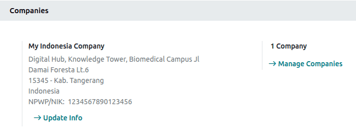
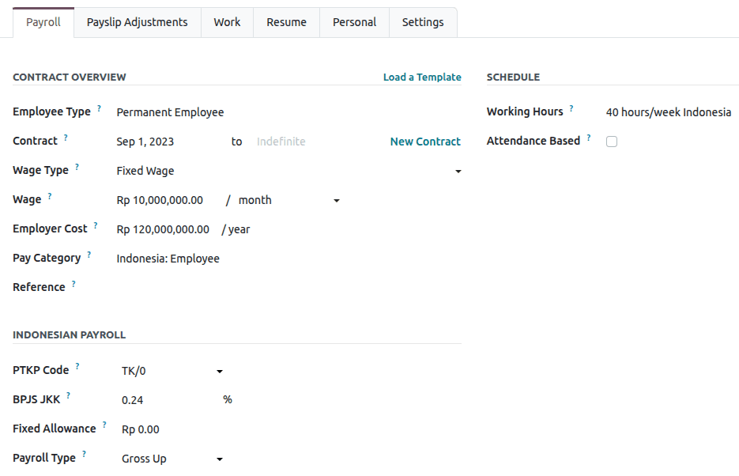
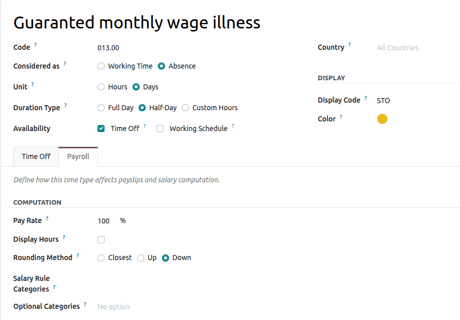
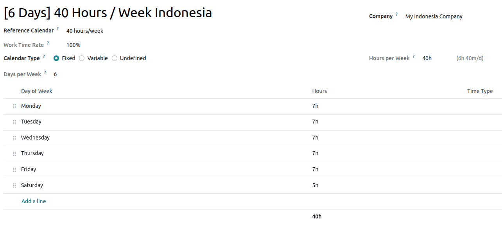
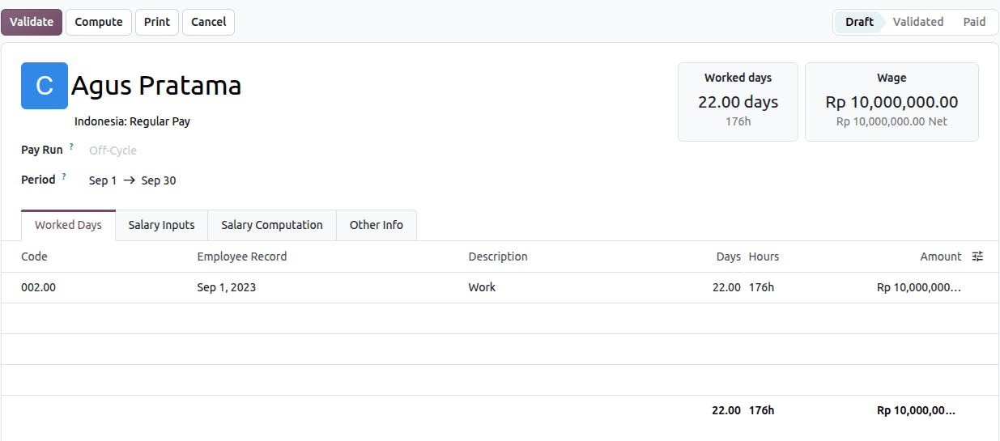
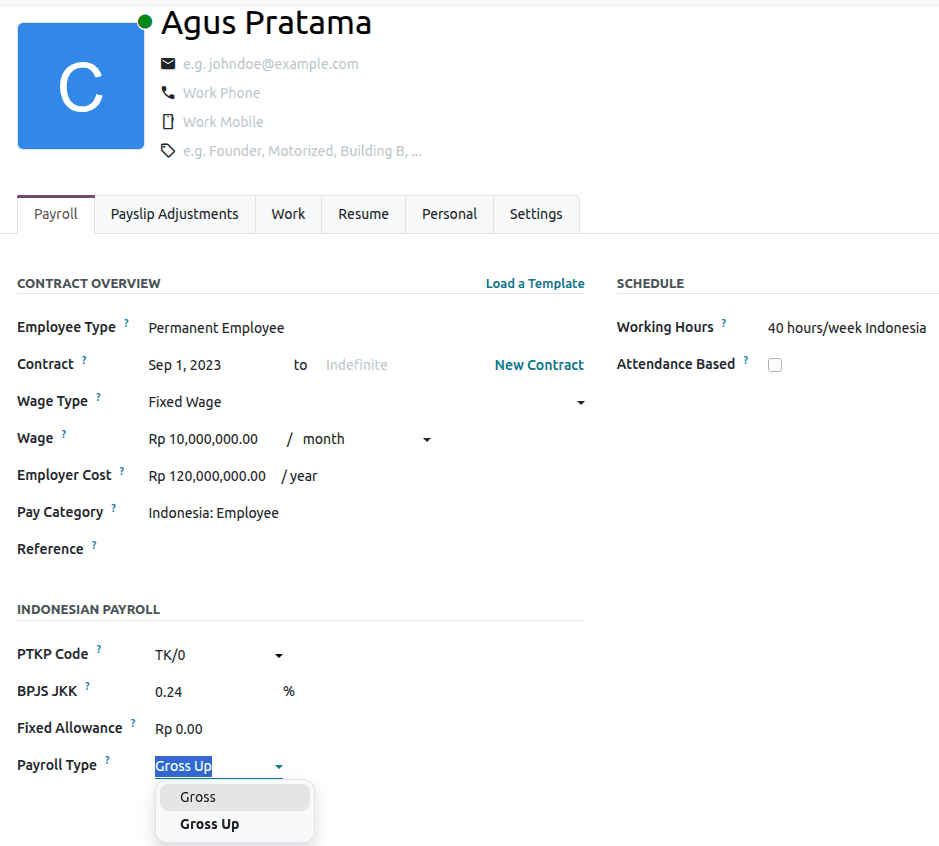
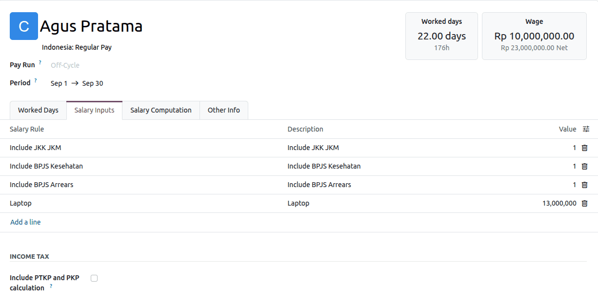
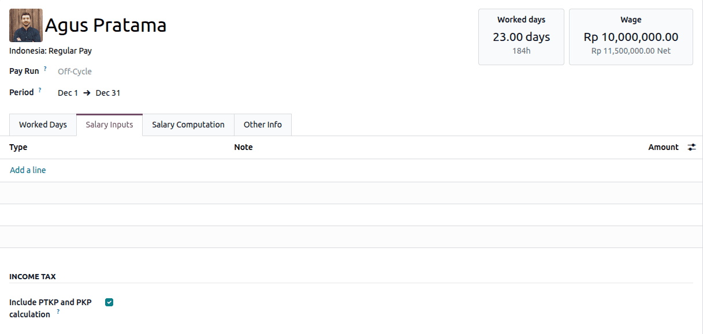
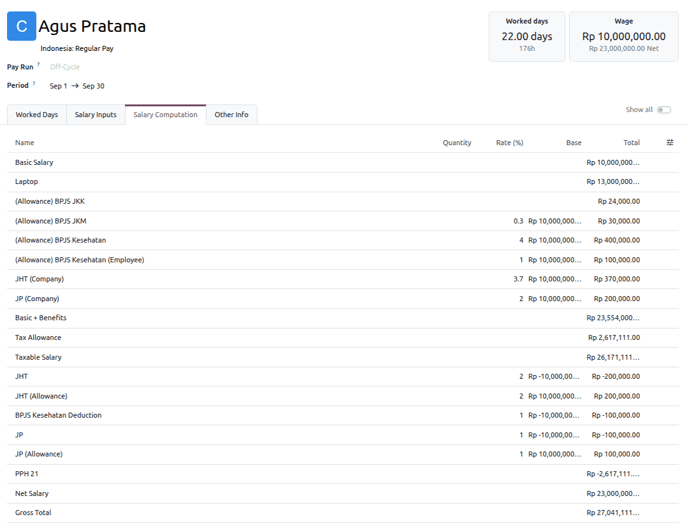

.. _payroll/indonesia:

=========
Indonesia
=========

.. |BPJS| replace:: :abbr:`BPJS (Badan Penyelenggara Jaminan Sosial)`
.. |DJP| replace:: :abbr:`DJP (Directorate General of Taxes)`
.. |TER| replace:: :abbr:`TER (Tarif Efektif Rata-Rata)`
.. |PTKP| replace:: :abbr:`PTKP (Penghasilan Tidak Kena Pajak)`
.. |PKP| replace:: :abbr:`PKP (Penghasilan Kena Pajak)`
.. |JKK| replace:: :abbr:`JKK (Jaminan Kecelakaan Kerja)`
.. |JKM| replace:: :abbr:`JKM (Jaminan Kematian)`
.. |JHT| replace:: :abbr:`JHT (Jaminan Hari Tua)`
.. |JP| replace:: :abbr:`JP (Jaminan Pensiun)`
.. |NPWP| replace:: :abbr:`NPWP (Nomor Pokok Wajib Pajak)`
.. |NIK| replace:: :abbr:`NIK (Nomor Induk Kependudukan)`

The Indonesia payroll localization computes salaries and taxes in line with the requirements of the
|DJP| and local labor regulations. Key features include:

- **Income tax (PPh 21)**: Automated Gross-Up calculations, updated for the |TER| tax mechanism.
- **BPJS contributions**: Automated |BPJS| Kesehatan deductions with cut-off logic. If an employee's
  contract starts after the |BPJS| Kesehatan cut-off date, the system can be configured to either
  roll the |BPJS| charge over to the following month or set the current month's charge to zero.
- **Overtime management**: Automated calculation of the hourly wage and overtime pay, according to
  standard Indonesian labor regulations. A 1.5x multiplier is applied to the hourly wage for the
  first hour of overtime, and a 2x multiplier for any subsequent hour.

.. note::
   Before configuring the Indonesia localization, refer to the general :doc:`payroll
   <../../payroll>` documentation. It covers foundational information applicable to all
   localizations, including universal settings, salary structures, and global payroll fields.

.. _payroll/id/apps_modules:

Apps & modules
==============

:ref:`Install <general/install>` the following modules to get all the features of the Indonesia
payroll localization:

.. list-table::
   :header-rows: 1

   * - Name
     - Technical name
     - Description
   * - :guilabel:`Indonesia - Accounting`
     - `l10n_id`
     - The base module to manage the chart of accounts and the tax structure for Indonesia.
   * - :guilabel:`Indonesia - Payroll`
     - `l10n_id_hr_payroll`
     - Enables the Indonesian payroll rules.
   * - :guilabel:`Indonesia - Payroll with Accounting`
     - `l10n_id_hr_payroll_account`
     - Installs the link between Indonesian payroll and accounting.

.. _payroll/id/general_configurations:

General configurations
======================

Odoo supports multicompany management. First, the company must be configured. Navigate to
:menuselection:`Settings app --> Companies --> Manage Companies`. Select an existing company or
create a new one, and configure the following fields:

- :guilabel:`Company Name`: Enter the business name in this field.
- :guilabel:`Address`: Complete the full address, including the :guilabel:`City`, :guilabel:`State`,
  :guilabel:`Zip Code`, and :guilabel:`Country`.
- :guilabel:`NPWP/NIK`: Enter the company's tax identification number (|NPWP|) or national identity
  number (|NIK|). This information is needed to generate E-Faktur (electronic tax invoices) and to
  comply with Indonesian tax reporting requirements.

.. _payroll/id/payroll_configuration:

Payroll configuration
=====================

.. _payroll/id/settings:

Settings
--------

Navigate to :menuselection:`Payroll app --> Configuration --> Settings`, and scroll down to the
:guilabel:`Indonesia Localization` section to configure the default |JKK| rate for the entire
company.

- :guilabel:`BPJS JKK (%)`: Under :guilabel:`Company Information`, enter the applicable percentage
  of the occupational accident security program (from `0.24%` to `1.74%`).

.. _payroll/id/employee_configuration:

Employee configuration
======================

To create an employee record, navigate to :menuselection:`Employees app --> Employees`. Click
:guilabel:`New` in the upper-left corner. Fill in the primary contact details (name, email, work
phone, and mobile phone), then configure the following tab:

Payroll tab
-----------

Under the :guilabel:`Payroll` tab, configure the contract and localization details.

- :guilabel:`Contract Overview`: Configure the general contract information, including the
  :guilabel:`Employee Type` and the :guilabel:`Wage`. The Indonesia localization provides two
  employee types:

  - :guilabel:`Permanent Employee`: Select this type for regular, full-time employees.
  - :guilabel:`Non-Permanent Employee`: Select this type for temporary or contract-based employees.

- :guilabel:`Schedule`:

  - :guilabel:`Working Hours`: Select :guilabel:`40 Hours/Week Indonesia` or any :doc:`newly created
    working schedule <../working_schedules>`. Work entries are generated automatically based on the
    employee's working schedule.
  - :guilabel:`Attendance Based`: Enable this option to generate work entries based on the check-in
    and check-out periods logged in the **Attendances** app.

- :guilabel:`Indonesian Payroll`: Fill in the local requirements.

  - :guilabel:`PTKP Code`: Select the non-taxable income status (|PTKP|) of the employee.
  - :guilabel:`BPJS JKK`: Enter the applicable percentage of the occupational accident security
    program.
  - :guilabel:`Fixed Allowance`: Enter the amount of any fixed allowance, if applicable.
  - :guilabel:`Payroll Type`: Select the calculation method of the income tax (PPh 21):

    - :guilabel:`Gross`: The employee bears their own income tax and statutory deductions. The
      take-home pay is the gross salary minus the employee's share of taxes, |BPJS| Kesehatan, and
      |BPJS| Ketenagakerjaan.
    - :guilabel:`Gross Up`: The company provides a *tax allowance* to cover the PPh 21 of the
      employee. Since this allowance is taxable income, the system recalculates the tax iteratively
      until the allowance matches the tax liability of the employee. This method is used to ensure
      that employees receive their agreed net salary, while the company bears the income tax
      expense.

.. note::
   The selected employee type impacts the annual tax calculation. Odoo automatically calculates and
   deducts the *Biaya Jabatan* (occupational tax deduction) from the gross income of
   :guilabel:`Permanent Employee`\s, whereas this deduction is excluded for
   :guilabel:`Non-Permanent Employee`\s.

.. _payroll/id/time_types:

Time types
----------

Navigate to :menuselection:`Payroll app --> Configuration --> Time Types` to review the existing
time types or :doc:`create a new one <../work_entries>`.

When defining a time type, employers can set the following field:

- :guilabel:`Pay Rate`: The rate used to calculate the payment of each leave (e.g., `100%` for sick
  leave).

Odoo supports 16 Indonesia-specific time types, which are used together with the **Time Off** and
**Attendances** apps:

- :guilabel:`Paid Time Off`
- :guilabel:`Sick Time Off`
- :guilabel:`Unpaid Leave`
- :guilabel:`Compensatory Time Off`
- :guilabel:`Attendance`
- :guilabel:`Overtime Hours`
- :guilabel:`Out of Contract`
- :guilabel:`Generic Time Off`
- :guilabel:`Home Working`
- :guilabel:`Bereavement Leave`
- :guilabel:`Marriage Leave`
- :guilabel:`Maternity Leave`
- :guilabel:`Paternity Leave`
- :guilabel:`Public Holiday`
- :guilabel:`Overtime 1`
- :guilabel:`Overtime 2`

.. note::
   The :guilabel:`Overtime 1` and :guilabel:`Overtime 2` time types are used to automatically
   calculate overtime pay based on the hourly wage, in compliance with Indonesian labor regulations.

.. _payroll/id/working_schedule:

Working schedule
----------------

Navigate to :menuselection:`Payroll app --> Configuration --> Working Schedule` to review the
existing working schedules or :doc:`create a new one <../working_schedules>`.

.. _payroll/id/structures_rules:

Structures & rules
------------------

Navigate to :menuselection:`Payroll app --> Configuration --> Structures --> Rules` to review the
salary rules or :doc:`configure company-specific salary rules <../salaries>`.

Indonesia: Regular Pay
~~~~~~~~~~~~~~~~~~~~~~

Odoo provides the :guilabel:`Indonesia: Regular Pay` salary structure to compute compliant payroll
for all regular employees. The following mandatory salary rules are calculated automatically during
a pay run:

- :guilabel:`Basic Salary`: The fixed base salary of the employee for the pay period.
- :guilabel:`Unpaid Leave`: Integrates with the **Time Off** app to automatically deduct the salary
  for any approved unpaid leave taken during the pay period.
- :guilabel:`Fixed Allowance`: The standard fixed allowance (*Tunjangan Tetap*) granted to the
  employee on a regular basis, independent of their attendance.
- :guilabel:`Transport Allowance`: Any transportation allowance provided by the employer.
- :guilabel:`BIK/Natura (House Rent Allowance)`: The housing allowance of the employee. A
  non-taxable maximum cap of IDR 2,000,000 is applied automatically, in accordance with tax
  regulations.
- :guilabel:`Insurance (Flat-Rate)`: A fixed monthly insurance amount, obtained by dividing the
  total annual insurance premium evenly across 12 months.
- :guilabel:`Insurance (Pro-Rate)`: A proportional insurance amount, based on the number of days in
  the billing month: `(Total Insurance / 365) * number of days in the month`.
- :guilabel:`Laptop`: The allowance provided to the employee for the use or purchase of a laptop.
- :guilabel:`Insentif`: Variable, performance-based incentives or bonuses awarded to the employee.
- :guilabel:`THR`: The *Tunjangan Hari Raya* (religious holiday allowance), the mandatory annual
  bonus provided to employees before major religious holidays.
- :guilabel:`Meal Allowance`: The cash-based meal allowance provided when the company does not
  supply physical catering. Because it is distributed in cash, it is treated as taxable income.
- :guilabel:`Overtime`: The total compensation for the logged overtime hours, based on the legally
  mandated multipliers.
- :guilabel:`(Allowance) BPJS JKK`: The company's contribution to the occupational accident security
  program (|JKK|). The rate ranges from 0.24% to 1.74%, depending on the occupational risk level of
  the employee's role.
- :guilabel:`(Allowance) BPJS JKM`: The company's contribution to the death benefit security program
  (|JKM|). A rate of 0.3% is applied automatically.
- :guilabel:`(Allowance) BPJS Kesehatan`: The company's contribution to the mandatory health
  insurance program. A rate of 4% is applied automatically.
- :guilabel:`Previous Month: (Allowance) BPJS Kesehatan`: The retroactive 4% company contribution to
  the health insurance program. It is used when an employee joins after the registration cut-off
  date, so the contribution of the missed first month is deferred and processed in the following
  month's payroll.
- :guilabel:`(Allowance) BPJS Kesehatan (Employee)`: An allowance provided by the company to cover
  the employee's mandatory 1% health insurance contribution, which absorbs the deduction cost on
  the employee's behalf.
- :guilabel:`Previous Month: (Allowance) BPJS Kesehatan (Employee)`: The retroactive allowance for
  the employee's mandatory 1% health insurance contribution.
- :guilabel:`JHT (Company)`: The company's contribution to the old-age security program (|JHT|). A
  rate of 3.7% is applied automatically.
- :guilabel:`JP (Company)`: The company's contribution to the pension security program (|JP|). A
  rate of 2% is applied automatically.
- :guilabel:`Tax Allowance`: The PPh 21 allowance.
- :guilabel:`Taxable Salary`: The total taxable gross income.
- :guilabel:`Meal Allowance (Catering)`: The value of the meals provided directly by the company.
  Because the benefit is provided in kind (catering) rather than in cash, it is non-taxable and is
  recorded only to track the total value of the benefits received by the employee.
- :guilabel:`JHT`: The employee's mandatory contribution to the old-age security program. A 2%
  deduction from the employee's wage is applied automatically.
- :guilabel:`JHT (Allowance)`: An allowance provided by the company to cover the employee's
  mandatory 2% contribution to the old-age security program, which absorbs the deduction cost on the
  employee's behalf.
- :guilabel:`BPJS Kesehatan Deduction`: The mandatory 1% employee deduction for |BPJS| Kesehatan
  coverage.
- :guilabel:`Previous Month: BPJS Kesehatan Deduction`: The retroactive 1% employee deduction for
  health insurance. It is applied in the following month's payroll for new hires who missed the
  initial registration cut-off, so the deferred deduction is captured.
- :guilabel:`JP`: The employee's mandatory contribution to the pension security program. A 1%
  deduction from the employee's wage is applied automatically.
- :guilabel:`JP (Allowance)`: An allowance provided by the company to cover the employee's mandatory
  1% contribution to the pension security program, which absorbs the deduction cost on the
  employee's behalf.
- :guilabel:`Biaya Jabatan`: The occupational expenses, a standard tax deduction recognized under
  Income Tax Article 21 (PPh 21). It accounts for the assumed costs incurred by an employee to earn,
  collect, and maintain their income.
- :guilabel:`PTKP`: The *Penghasilan Tidak Kena Pajak* (non-taxable income). It is the income
  threshold of an individual taxpayer that is legally exempt from income tax in Indonesia, based on
  their marital and dependent status.
- :guilabel:`PKP`: The *Penghasilan Kena Pajak* (taxable income). It is calculated by subtracting
  the occupational expenses (*Biaya Jabatan*), the pension contributions, and the non-taxable
  threshold (|PTKP|) from the total gross income. The result is subject to the Indonesian
  progressive tax rates (from 5% to 35%).
- :guilabel:`Reimbursement`: The approved operational expenses reimbursed to the employee. Because
  these are business expenses returned to the employee rather than compensation, this component is
  entirely non-taxable.
- :guilabel:`PPH 21`: The income tax (*Pajak Penghasilan Pasal 21*) deducted from the employee's
  salary and remitted to the government.
- :guilabel:`Net Salary`: The amount transferred to the employee after all additions (such as
  allowances) and mandatory deductions are applied to the gross income.
- :guilabel:`Gross Total`: The sum of all salary components, including the basic salary and all
  taxable and non-taxable elements.

.. note::
   - The :guilabel:`Tax Allowance` salary rule is only computed if the employee's
     :guilabel:`Payroll Type` is set to :guilabel:`Gross Up`.
   - Several salary rules (e.g., :guilabel:`(Allowance) BPJS Kesehatan (Employee)`,
     :guilabel:`Previous Month: (Allowance) BPJS Kesehatan (Employee)`,
     :guilabel:`JHT (Allowance)`, :guilabel:`JP (Allowance)`) are archived by default. Unarchive
     them before they can be applied to payslips.

.. _payroll/id/run_id_payroll:

Run Indonesian payroll
======================

Before running payroll, the payroll officer must validate the employee :doc:`work entries
<../work_entries>` to confirm pay accuracy. This includes checking that all time off is approved and
that all overtime hours are properly logged.

Work entries are generated automatically based on the employee's :doc:`contract <../contracts>`
configuration. Odoo pulls data from the assigned working schedule, attendance records, planning
shifts, and approved time off.

Once all work entries are verified, draft payslips can be created individually, or in groups using
pay runs.

.. note::
   If the work entries or salary inputs of an employee are modified after the draft payslip is
   created, click the :icon:`fa-gear` :guilabel:`(Actions)` icon, and then select
   :guilabel:`Recompute Whole Sheet` to refresh the :guilabel:`Worked Days` and
   :guilabel:`Salary Inputs` tabs.

.. _payroll/id/individual_payslip:

Individual payslip
------------------

To create an individual payslip in the **Payroll** app:

#. Go to :menuselection:`Payroll app --> Payslips --> Payslips`.
#. Click :guilabel:`New Off-Cycle` to create a payslip for a single employee.
#. Select the :guilabel:`Employee` and the :guilabel:`Period`.

.. tip::
   Odoo manages the pro-rata salary calculation for new employees automatically. There is no need
   to adjust the payslip period to the joining date of the employee. Odoo identifies the days prior
   to the contract start date as :guilabel:`Out of Contract`, and deducts them from the basic
   salary.

Once the payslip is drafted, review it for accuracy. Check the :guilabel:`Worked Days`,
:guilabel:`Salary Inputs`, and :guilabel:`Other Info` tabs to confirm the worked time and the
automated variables are correct. Add any missing optional salary inputs, such as bonuses or
religious holiday allowances.

Then, click :guilabel:`Compute Sheet`, and then :guilabel:`Validate`. Check the accounting process
(journal entries and payments). If there are no errors, payroll is completed for the pay period.

.. important::
   Once the payslip is validated, the corresponding work entries are locked and cannot be edited.
   To make changes, cancel the payslip and set it back to draft.

.. _payroll/id/payroll_type:

Payroll type configuration
--------------------------

The payroll type, :guilabel:`Gross` or :guilabel:`Gross Up`, determines how the income tax of an
employee is calculated. To configure it on the contract of the employee:

#. Go to :menuselection:`Payroll app --> Employees --> Contracts`, and select the contract of the
   employee.
#. In the :guilabel:`Indonesian Payroll` section, locate the :guilabel:`Payroll Type` field.
#. Select :guilabel:`Gross` or :guilabel:`Gross Up` from the drop-down menu.

   - :guilabel:`Gross`: The income tax (PPh 21) is deducted directly from the base salary of the
     employee.
   - :guilabel:`Gross Up`: The company covers the income tax of the employee by providing a
     :guilabel:`Tax Allowance` that offsets the PPh 21 deduction.

.. note::
   The :guilabel:`Tax Allowance` salary rule is only computed if the :guilabel:`Payroll Type` is set
   to :guilabel:`Gross Up`.

.. _payroll/id/salary_calculation:

Salary calculation
~~~~~~~~~~~~~~~~~~

Once the employee configuration is complete, process the Gross or Gross-Up calculation as follows:

#. Go to :menuselection:`Payroll app --> Payslips --> Payslips`, and create or select a payslip.
#. Open the :guilabel:`Salary Inputs` tab.
#. Click :guilabel:`Add a line` to fill in any manual fields related to PPh 21 objects.

To perform the yearly calculation, enable the :guilabel:`Include PTKP and PKP calculation` option in
the :guilabel:`Income Tax` section of the :guilabel:`Salary Inputs` tab. This allows the system to
annualize the non-taxable income (|PTKP|) and the taxable income (|PKP|) for the final calculation.

The results appear in the :guilabel:`Salary Computation` tab, which gives a detailed breakdown of
allowances, deductions, and benefits in kind (BIK). For both the monthly and the yearly calculation,
the final take-home pay is displayed on the :guilabel:`Net Salary` line.

.. _payroll/id/overtime:

Overtime rules
==============

Odoo calculates overtime compensation in compliance with *Peraturan Pemerintah (PP) Nomor 35 Tahun
2021*. Overtime components are excluded from the basic salary calculation, and are computed
separately under dedicated salary rules.

Odoo manages the underlying compliance logic automatically, including:

- **Hourly rate calculation**: The standard hourly rate is calculated based on the legally mandated
  divisor.
- **Tiered multipliers**: The correct compensation rate is applied to the first hour of overtime
  (:guilabel:`Overtime 1`) and to the subsequent hours (:guilabel:`Overtime 2`) worked on a single
  day.

Overtime tracking & logging
---------------------------

Overtime hours can be recorded automatically or adjusted manually:

- **Attendance-based logging**: When using the **Attendances** app, overtime is calculated and
  logged automatically based on the clock-in and clock-out times of the employee.
- **Manual adjustments**: HR administrators or managers can review, adjust, or enter overtime hours
  from the back end to correct discrepancies before generating payslips.

.. _payroll/id/bpjs_kesehatan:

BPJS Kesehatan
==============

Registration cut-offs
---------------------

The |BPJS| portal enforces a registration cut-off window, typically between the 1st and the 7th of
each month, with a hard deadline on the 10th. If an employee joins after the cut-off window closes,
new registrations are not accepted for the current month.

Because of this, HR administrators must handle mid-month joiners using one of the following
scenarios. Odoo can be configured to accommodate either of them:

- **Scenario 1: Deferred retroactive payment (legal compliance)**: The |BPJS| contribution of the
  employee is set to zero for the joining month. In the next month's payroll, the |BPJS| deduction
  is processed retroactively to cover both the missed month and the current month (two months of
  |BPJS| contributions on a single payslip).
- **Scenario 2: Next-month registration (standard HR practice)**: The employer skips the joining
  month. The |BPJS| contribution remains at zero for the first payslip, and the standard
  single-month contribution starts in the next month's payroll.

Manage BPJS for mid-month joiners
---------------------------------

To apply the chosen scenario for an employee who joins after the cut-off date, follow these steps
before confirming their first payslip:

#. Generate the draft payslip of the new employee in :menuselection:`Payroll app --> Payslips -->
   Payslips`.
#. Open the :guilabel:`Salary Inputs` tab.
#. If Odoo calculated a |BPJS| charge for the current month but the employee missed the cut-off,
   manually set the |BPJS| input to `0`.
#. Depending on the chosen scenario:

   - **Scenario 1 (retroactive)**: In the next month's pay run, open the :guilabel:`Salary Inputs`
     tab, click :guilabel:`Add a line`, and enter the retroactive |BPJS| charge alongside the
     standard monthly charge.
   - **Scenario 2 (next month)**: No further action is required. Odoo calculates the standard
     single-month |BPJS| contribution in the next month's pay run.
