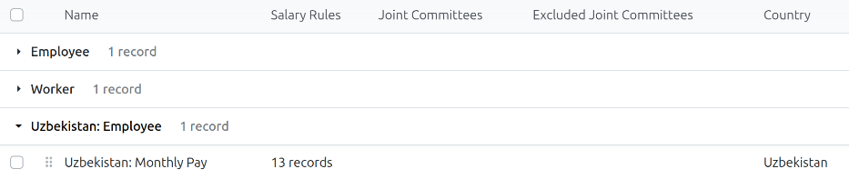

==========
Uzbekistan
==========

The Uzbekistan payroll localization covers salary computations for employees, including compliance
with the Labor Code of Uzbekistan.

Before configuring the Uzbekistan localization, refer to the general :doc:`payroll <../../payroll>`
documentation, which includes the basic information for all localizations, as well as all universal
settings and fields.

.. _payroll/uz_apps:

Apps & modules
==============

:ref:`Install <general/install>` the following modules to get all the features of the Uzbekistan
payroll localization:

.. list-table::
   :header-rows: 1

   * - Name
     - Technical name
     - Dependencies
     - Description
   * - :guilabel:`Uzbekistan - Payroll`
     - `l10n_uz_hr_payroll`
     - - hr_payroll
       - hr_contract_reports
       - hr_work_entry_holidays
       - hr_payroll_holidays
     - Includes the Uzbekistan salary structure and rules, work entry (time off) types, departure
       reasons, severance pay, remaining leave days compensation and annual leave provision,
       compliant with the Labor Code of Uzbekistan.
   * - :guilabel:`Uzbekistan - Payroll with Accounting`
     - `l10n_uz_hr_payroll_account`
     - - hr_payroll_account
       - l10n_us
       - l10n_us_hr_payroll
     - Links the Uzbekistan salary rules to the accounts of the Uzbekistan chart of accounts, so
       validated payslips generate journal entries.

.. seealso::
   :doc:`Configure the Uzbekistan fiscal localization
   <../../../finance/fiscal_localizations/uzbekistan>`

General configurations
======================

First, the company must be configured. Navigate to :menuselection:`Settings app --> Users &
Companies --> Companies`. From the list, select the desired company, and configure the following
fields:

- :guilabel:`Company Name`: Enter the business name in this field.
- :guilabel:`Address`: Complete the full address, including the :guilabel:`City`, :guilabel:`State`,
  :guilabel:`ZIP`, and :guilabel:`Country`.
- :guilabel:`TIN`: Enter the company's :abbr:`TIN (Tax ID Number)`.
- :guilabel:`Currency`: By default, :abbr:`UZS (Uzbekistani som)` is selected. If not, select
  :guilabel:`UZS` from the drop-down menu.
- :guilabel:`Phone`: Enter the company phone number.
- :guilabel:`Email`: Enter the email used for general contact information.

Employees
=========

Every employee being paid must have their employee profiles configured for the Uzbekistan payroll
localization. Additional fields are present after configuring the database for Uzbekistan.

To update an employee form, open the **Employees** app and click on the desired employee record. On
the employee form, configure the required fields in the related tabs.

Payroll tab
-----------

Contract overview section
~~~~~~~~~~~~~~~~~~~~~~~~~

This section holds information that drives salary calculations. Ensure the following fields are
configured:

- :guilabel:`Contract`: Ensure a running :doc:`contract <../contracts>` exists for the employee.
- :guilabel:`Wage Type`: Select how the employee is paid.

  - Select :guilabel:`Fixed Wage` for salaried employees who receive the same amount each pay
    period.
  - Select :guilabel:`Hourly Wage` for employees paid based on hours worked.

- :guilabel:`Pay Category`: Ensure :guilabel:`Uzbekistan: Employee` is selected for this field. This
  defines when the employee is paid, their default working schedule, and the work entry type it
  applies to.

Uzbekistan payroll section
~~~~~~~~~~~~~~~~~~~~~~~~~~

- :guilabel:`Eligible Leaves`: Enter the number of days of annual leave the employee is entitled to,
  for one year of service. The default value is `21.00` days (annual basic minimum leave). This is
  used to compute the :guilabel:`Remaining Leave Days Compensation` and the :guilabel:`Annual Leave
  Provision`.

  .. tip::
     Employees entitled to an extended annual leave (27 or 30 calendar days, depending on the
     extended leave category) are not handled automatically. After the allocation is provided to the
     employee, the :guilabel:`Eligible Leaves` value must be changed manually on the employee
     record.

- :guilabel:`Initial Average Monthly Wage`: Enter the average monthly wage carried over from before
  the employee's first payslip in Odoo, so that historical payroll data does not need to be
  re-entered. This is used for the average wage computation of the first payslips. Click
  :icon:`edit` :guilabel:`Edit` to modify this field.

  .. important::
     If validated payslips for the employee exist from the last 12 months, this field is unable to
     be modified, and an *Invalid Operation* pop-up window appears.

Schedule section
~~~~~~~~~~~~~~~~

- :guilabel:`Working Hours`: Using the drop-down menu, select the default work schedule. This is
  particularly important for employees available to receive overtime pay (typically hourly
  employees, not salaried). The default is :guilabel:`Uzbekistan Working Schedule 40h/Week`, which
  is 8 hours per day, from Monday to Friday, with Saturdays and Sundays being non-working days.

Inputs section
~~~~~~~~~~~~~~

- :guilabel:`Seniority Supplement`: Enter the percentage added to the basic wage, if applicable.
  This depends on the employee's seniority and has nothing to do with performance.
- :guilabel:`Other Allowance`: Enter the fixed monthly amount paid on top of the basic wage, if
  applicable.

Personal tab
------------

Ensure the employee has a minimum of one :ref:`trusted bank account <employees/private-contact>`
listed in the :guilabel:`Bank Accounts` field in the *Private Contact* section.

Payroll **cannot** be processed for employees without a *trusted* bank account. If no trusted bank
account is set, a warning appears on the **Payroll** dashboard and an error occurs when attempting
to run payroll.

Payroll configuration
=====================

Several sections within the **Payroll** app install a salary structure, structure type, and rules
that are specific to Uzbekistan.

Payroll settings
----------------

A couple fields in the **Payroll** app settings must be configred for the Uzbekistan localization.
Navigate to :menuselection:`Payroll app --> Configuration --> Settings` and scroll to the
*Uzbekistan Payroll* section.

.. important::
   The *Uzbekistan Payroll* section **only** appears if the company's country is set to Uzbekistan.

Configure the following fields:

- :guilabel:`Social Tax Category`: Using the drop-down menu, set the rate of the employer social tax
  contribution computed on every payslip. The default value is :guilabel:`Taxpayers`. The options
  are:

  .. list-table::
   :header-rows: 1
   :stub-columns: 0

   * - Social Tax Category
     - Employer social tax rate
   * - Taxpayers
     - 12%
   * - Budgetary organizations
     - 25%
   * - Association “SOS - Children's Villages of Uzbekistan”
     - 7%
   * - Taxpayers using the labor of persons with disabilities
     - 4.7%

- :guilabel:`Annual Leave Type`: Using the drop-down menu, select which :doc:`time type
  <../../time_off/time_off_types>` is used for annual leave. The allocations of this type tells Odoo
  how many leave days are allocated and still valid but not yet used. At the employee's departure,
  the remaining days are paid back through the *Remaining Leave Days Compensation* rule. The default
  is :guilabel:`Annual Labor Leave`.

Pay structures & structure types
--------------------------------

When the *l10n_uz_hr_payroll* module is :ref:`installed <payroll/uz_apps>`, a new :guilabel:`Pay
Structure` gets installed, :guilabel:`Uzbekistan: Employee`. This pay structure includes one
:guilabel:`Structure Type`, :guilabel:`Uzbekistan: Monthly Pay`.

.. list-table::
   :header-rows: 1
   :stub-columns: 0

   * - Pay Structure
     - Wage type
     - Scheduled pay
     - Default working schedule
     - Default work entry type
     - Journal
   * - Uzbekistan: Employee
     - Monthly
     - Monthly
     - Uzbekistan Working Schedule 40h/Week
     - Work
     - Salaries

The :guilabel:`Pay Structure` contains all the individual :ref:`salary rules <payroll/uz_apps>` that
informs the **Payroll** app how to calculate employee payslips.

.. _payroll/uz_rules:

Salary rules
------------

To view the salary rules that inform the salary structure what to do, navigate to
:menuselection:`Payroll app --> Configuration --> Structures` and expand the :guilabel:`Uzbekistan:
Employee` group to reveal the :guilabel:`Uzbekistan: Monthly Pay` structure type. Click
:guilabel:`Uzbekistan: Monthly Pay` to view the detailed salary rules.

Each rule defines how pay is calculated, taking into account factors such as allowances, deductions,
and taxes. The *Basic* and *Allowance* categories are both children of the **Total Wage** category,
which is the base of the social tax, the pension fund, and the personal income tax.

.. list-table::
   :header-rows: 1
   :stub-columns: 0

   * - Rule
     - Code
     - Category
     - Computation
   * - Social Tax - Employer Contribution
     - SOCIAL_TAX_EMPLOYER
     - Company Contribution
     - Social tax rate of the company category x Total Wage. Not displayed on the payslip.
   * - Pension Fund
     - PENSION_FUND
     - -
     - 0.1% x Total Wage.
   * - Seniority Supplement
     - SENIORITY_SUPPLEMENT
     - Allowance
     - Basic salary x Seniority supplement rate.
   * - Severance Payment
     - SEVERANCE
     - Allowance (Total Wage) and Tax Base
     - Only on the departure payslip, if the departure reason is flagged as *Severance Paid*:
       average monthly wage x severance rate.
   * - Personal Income Tax
     - INCOME_TAX
     - Deduction
     - -12% x Total Wage.
   * - Expense Reimbursement
     - EXPENSE_REIMBURSEMENT
     - -
     - Amount entered in the *Salary Inputs* tab of the payslip. It is added to the net wage and is
       not taxed.
   * - Net Salary
     - NET
     - Net
     - Total Wage + Deductions + Expense Reimbursement.

Accounting
----------

When the **l10n_uz_hr_payroll_account** module is installed, the salary rules are linked to the
accounts of the Uzbekistan chart of accounts, and the payslips are posted in the
:guilabel:`Salaries` journal:

.. list-table::
   :header-rows: 1
   :stub-columns: 0

   * - Rule
     - Debit account
     - Credit account
   * - Basic Salary, Seniority Supplement, Bonus, Other Allowance
     - 9421 Salaries, Allowances & Bonus
     - None
   * - Remaining Leave Days Compensation
     - 9422 Unused Leave Days Compensation Expense
     - None
   * - Social Tax - Employer Contribution
     - 9423 Employer Social Tax Expense
     - 6520 State Fund Contributions Payable
   * - Severance Payment
     - 9424 Severance Pay Expense
     - None
   * - Pension Fund
     - 6410 Taxes & Duties Payable — By Tax Type
     - 6530 Individual Pension Fund Contributions Payable
   * - Personal Income Tax
     - 6410 Taxes & Duties Payable — By Tax Type
     - None
   * - Expense Reimbursement
     - 6970 Employee Expense Claims Payable
     - None
   * - Net Salary
     - None
     - 6710 Wages & Salaries Payable

Social tax and other contributions
----------------------------------

The following contributions and taxes are computed on every payslip. All of them are calculated on
the *Total Wage*, which is the sum of the *Basic* and *Allowance* categories (basic wage, seniority
supplement, bonus, other allowance, severance pay and remaining leave days compensation).

.. list-table::
   :header-rows: 1
   :stub-columns: 0

   * - Rule
     - Rate
     - Effect on the payslip
   * - Social Tax - Employer Contribution
     - 12% by default (4.7% to 25% depending on the Social Tax Category)
     - Company contribution paid by the employer. It does not affect the employee's net wage and is
       not displayed on the payslip.
   * - Pension Fund
     - 0.1%
     - Contribution to the individual pension fund (INPS). The rule does not belong to the deduction
       category, so it does not reduce the net wage.
   * - Personal Income Tax
     - 12%
     - Deducted from the employee's wage. Its base is the Total Wage (Basic + Allowances).

Rule parameters
---------------

Some calculations require specific rates associated with them, or wage caps. *Rules Parameters* are
capable of listing a value, either a percentage or a fixed amount, to reference in the salary rules.

Most rules pull information stored in the parameters module to get the rate of the rule (a
percentage) and the cap (a dollar amount).

To view rule parameters, navigate to :menuselection:`Payroll app --> Configuration --> Rule
Parameters`. Here, all rule parameters are displayed with their linked :guilabel:`Salary Rules`,
which can be accessed. Review the parameters associated with a rule by looking for the
:guilabel:`Name` of the rule, and make any edits as needed.

.. important::
   Odoo adds updated rule parameters for the current calendar year. It is **not** recommended to
   edit rule parameters **unless a parameter has changed**, and is different from the rule
   parameters created by Odoo. Check with all local and national regulations *before* making any
   changes to rule parameters.

The rates are not hard-coded in the salary rules. They are stored as rule parameters that are valid
from a given date, so they can be updated without modifying the rules.

.. list-table::
   :header-rows: 1
   :stub-columns: 0

   * - Rule parameter
     - Technical name
     - Value
     - Valid from
   * - Personal Income Tax Rate
     - l10n_uz_income_tax_rate
     - 12%
     - 1 Jan 2019
   * - Pension Fund Contribution
     - l10n_uz_pension_fund_contribution
     - 0.1%
     - 1 Jan 2019
   * - UZ: Social Tax Rates by Company Category
     - l10n_uz_social_tax_rates
     - Taxpayers 12%, Budgetary 25%, SOS 7%, Disability 4.7%
     - 30 Apr 2023
   * - Severance Rates by Years of Service
     - l10n_uz_severance_rates
     - See the End of service section
     - 30 Apr 2023
   * - Monthly Minimum Wage
     - l10n_uz_monthly_minimum_wage
     - 1,360,000 UZS
     - 1 Sep 2026

Leaves
------

The following time off types are available to employees working in Uzbekistan. They are configured
as work entry types of the country and are available in the **Time Off** app.

- :guilabel:`Annual labor leave`: Annual labor leave is requested and counted in calendar days, and
  requires an allocation. The basic minimum leave is 21 calendar days per year (the default for the
  :guilabel:`Eligible Leaves` field).

  Sundays are not paid. When an annual leave request includes one or more Sundays, those days are
  automatically tracked with the *Annual Labor Leave (Sunday)* time off type, which is unpaid, and
  **only** the remaining days are paid. For example, a five day leave that includes one Sunday has
  four paid days.

  The daily value of an annual leave day is always based on 25.3 days per month, regardless of the
  actual number of working days in the month (see the Annual leave pay section).

- :guilabel:`Social leave` `(Labor Code of the Republic of Uzbekistan (Law No. ZRU-798 of 28 October
  2022, in force since 30 April 2023), <https://lex.uz/en/docs/6257291>`_  Art. 236-239): Fully
  paid. It does not require an allocation.
- :guilabel:`Partially paid leave`: Paid at the rate defined on the time off type. The ratio that is
  paid is set by the rate of the time off type (it is 0% by default; change it on the type or
  duplicate the type to define another ratio).
- :guilabel:`Unpaid leave` *(Leave without pay)*: Unpaid. It is a duplicate of the partially paid
  leave with a rate of 0%.
- :guilabel:`Study leave`: Unpaid.
- :guilabel:`Child support leave`: Fully paid.

All the time off types of the Uzbekistan localization are summarized below:

.. list-table::
   :header-rows: 1
   :stub-columns: 0

   * - Time off type
     - Code
     - Paid rate
     - Allocation required
     - Counted in
   * - Annual Labor Leave
     - 016.00
     - 100%
     - Yes
     - Calendar days
   * - Annual Labor Leave (Sunday)
     - 016.00SUN
     - 0% (created automatically)
     - No
     - Calendar days
   * - Social Leave
     - UZSOCIAL
     - 100%
     - No
     - Working days
   * - Partially Paid Leave
     - UZPARTIALLYPAID
     - 0% by default (configurable)
     - No
     - Working days
   * - Leave without pay
     - 158.00
     - 0% (unpaid)
     - No
     - Working days
   * - Study Leave
     - UZSTUDY
     - 0% (unpaid)
     - No
     - Working days
   * - Child Support Leave
     - UZCHILDSUPPORT
     - 100%
     - No
     - Working days
   * - Guaranteed monthly wage illness (sick leave)
     - 013.00
     - 100%
     - No
     - Working days
   * - Public Holiday
     - 006.00
     - 100%
     - Yes
     - Working days
   * - Generic Time Off
     - LEAVE100
     - 100%
     - Yes
     - Working days
   * - Compensatory Time Off
     - LEAVE105
     - 100%
     - Yes
     - Working days

.. note::
   Besides the time off types, the localization provides the following work entry types:
   :guilabel:`Work` (002.00), :guilabel:`Work from home` (002.08), :guilabel:`Overtime hours non
   recoverable - 150%` (040.00), and :guilabel:`Out Of Contract` (000.00, unpaid).

Average wage computation
------------------------

Annual leave pay, severance pay, and the compensation of remaining leave days are not based on the
wage of the current month, but on the employee's average wage. The same computation is used
everywhere:

#. :guilabel:`Average monthly wage`: The Gross of the past 12 months is added up and divided by 12.
   If the employee has worked for less than 12 months in the company, only the months worked are
   taken into account, and the total is divided by the number of months worked.
#. :guilabel:`Average daily wage`: The average monthly wage is divided by 25.3.

   .. math::

    \text{Average daily wage} = \frac{\text{Average monthly wage}}{25.3}

Two cases are covered when the employee has no payslip history in Odoo:

- If the company has just started using Odoo and has its own historical data, the :guilabel:`Initial
  Average Monthly Wage` can be entered on the employee profile and is used for the first payslips.
- If the employee has no historical data at all (for example, hired and resigned in the same month),
  the basic wage and the bonuses of the current month are used for the computation.

Annual leave pay
----------------

Annual labor leave is paid according to the following steps `Labor Code (2023), Art. 216-235, Art.
233 and Art. 257) <https://lex.uz/en/docs/6257291>`_:

#. Compute the average monthly wage and the average daily wage, as explained in the previous
   section.
#. Count the **paid** days of leave of the month. Sundays that fall during the leave are unpaid and
   are excluded.
#. Multiply the average daily wage by the number of paid leave days.

.. math::

   \text{Annual leave pay} = \frac{\text{Average monthly wage}}{25.3}
   \times \text{Number of paid leave days}

Annual leave is fully paid, so it is not connected to a dedicated salary rule: it is part of the
:guilabel:`Basic Salary` rule and appears in the :guilabel:`Worked Days` of the payslip and on the
PDF printout.

.. example::
   An employee earns a wage of 18,000,000 UZS per month and takes a leave of seven calendar days in
   October 2027, from Monday to Sunday, so the leave includes one Sunday.

   - Average daily wage:

     .. math::

        \frac{18,000,000}{25.3} = 711,462.45 \text{UZS}

   - Paid leave days: 7 - 1 Sunday = 6 days (the Sunday is tracked as Annual Labor Leave (Sunday)
     and paid 0).
   - Annual leave pay:

     .. math::

        6 \times 711,462.45 = 4,268,774.70 \text{UZS}

End of service
--------------

When an employee leaves the company, the payslip generated for the period of the departure
automatically includes the two following rules, in addition to the regular rules:

- :guilabel:`Severance Payment`: if the departure reason entitles the employee to it.
- :guilabel:`Remaining Leave Days Compensation`: for the annual leave that the employee has earned
  but not taken.

Departure reasons
~~~~~~~~~~~~~~~~~

Each departure reason has a :guilabel:`Severance Paid` checkbox `(Labor Code (2023), Art. 168,
points 1, 2, 6 and 9) <https://lex.uz/en/docs/6257291>`_ . It decides whether the employee receives
severance pay or not. The following departure reasons are available for Uzbekistan:

.. list-table::
   :header-rows: 1
   :stub-columns: 0

   * - Departure reason
     - Severance Paid
   * - No-fault business reasons (employer-initiated)
     - Yes
   * - Circumstances beyond either party's control
     - Yes
   * - Employee declines a change the employer initiated
     - Yes
   * - Employee's own fault
     - No
   * - Employer-side incapacity
     - No
   * - Resignation
     - No

Severance Payment
~~~~~~~~~~~~~~~~~

The severance pay is an allowance (categories *Allowance* and *Tax Base*) equal to a percentage of
the employee's average monthly wage, computed as for the labor leaves. The percentage depends on the
employee's length of service on the departure date:

.. list-table::
   :header-rows: 1
   :stub-columns: 0

   * - Length of service (X)
     - Severance pay
   * - X < 3 years
     - 50% of the average monthly wage
   * - 3 years ≤ X < 5 years
     - 75% of the average monthly wage
   * - 5 years ≤ X < 10 years
     - 100% of the average monthly wage
   * - 10 years ≤ X < 15 years
     - 150% of the average monthly wage
   * - 15 years ≤ X
     - 200% of the average monthly wage

.. math::

   \mathbf{Severance\ Payment} = \text{Average monthly wage}
   \times \text{Severance rate (according to length of service)}

The rates are stored in the :guilabel:`Severance Rates by Years of Service` rule parameter. If the
departure reason is not flagged as *Severance Paid*, the rule is **not** applied and the employee
receives **no** severance pay.

Remaining Leave Days Compensation
---------------------------------

The compensation of the leave days that were not taken is computed according to Article 224 of the
Labor Code (Labor Code (2023)), by comparing the leave days the employee has **earned** with the
leave days the employee has **taken** since the last anniversary of the joining date:

- **Earned days** = Eligible Leaves / 12 x number of months since the anniversary of the employee's
  joining date.
- **Taken days** = Number of annual leave days taken since the most recent anniversary of the
  employee's joining date, that is, since the start of the current work year. The days are
  identified with the time off type selected in the Annual Leave Type setting.

  .. math::

     \text{Remaining Leave Days Compensation} =
     \text{Average daily wage}
     \times \max(0, \text{Earned days} - \text{Taken days})

Only the positive difference is paid. If the employee has taken more leave than earned, no
compensation is paid and nothing is deducted from the final payslip. Any amount the employee owes
for leave taken in advance has to be recovered outside the payroll computation. The average daily
wage is the one used for the labor leaves (see the Average wage computation section).

.. example::
   An employee with 21 eligible leave days, whose joining anniversary was 6 months before their
   departure, has earned 21 / 12 x 6 = 10.5 days. If the employee has taken 4 days since the
   anniversary, 6.5 days are compensated. With an average daily wage of 711,462.45 UZS, the
   compensation is 6.5 x 711,462.45 = 4,624,505.93 UZS.

Provisions
----------

Provisions are the amounts computed by the employer to account for the payments that will be made to
the employee for the remaining annual leave days. They are computed on every payslip under the
:guilabel:`Company Contribution` category, do not appear on the payslip, and do not affect the
employee's net wage.

- :guilabel:`Annual leave provision`: This is computed by dividing the eligible leave days by 12,
  and multiplying the result by the average daily wage of the employee (the average monthly wage
  divided by 25.3).

  .. math::

   \mathbf{Annual\ Leave\ Provision} =
   \frac{\text{Eligible Leaves}}{12}
   \times
   \frac{\text{Average monthly wage}}{25.3}

.. example::
   With 21 eligible leave days and an average monthly wage of 18,000,000 UZS: 21 / 12 x (18,000,000
   / 25.3) = 1.75 x 711,462.45 = 1,245,059.29 UZS per month.

.. note::
   It is not enabled and does not have any account linked.

Run Uzbekistan payroll
======================

Before running paypoll, the payroll officer must validate employee's time offs and attendances, to
confirm pay accuracy and catch errors. Once everything is correct, draft payslips can be
:ref:`created individually <payroll/payslips/process>` or in :doc:`groups <../pay_runs>`, referred
to in the **Payroll** app as *Pay Runs*.

.. note::
   To cut down on the payroll officer's time, it is typical to process pay runs instead of one
   payslip at a time.

When running a pay run, check that the period, company and employees included are correct before
starting to analyze or validate the data. Once the payslips are drafted, review them for accuracy:

#. In the *Worked Days* tab, ensure that the listed worked time and time off are correct. Annual
   labor leave Sundays are listed on a separate line with an amount of `0`.
#. In the *Salary Inputs* tab, add any missing inputs: :guilabel:`Bonus` and :guilabel:`Expense
   Reimbursement`.
#. Check the various totals: Gross (Total Wage), personal income tax, pension fund, employer social
   tax, severance pay and remaining leave days compensation on departure payslips, and the net
   salary.
#. Click :guilabel:`Compute` to update the salary calculations if there were edits. If everything is
   correct, click :guilabel:`Validate`.

.. example::
   The October 2026 payslip of an employee with a wage of 18,000,000 UZS (22 working days), who
   worked 17 days and took the 7-day annual leave of the previous example, is computed as follows:

.. list-table::
   :header-rows: 1
   :stub-columns: 0

   * - Line
     - Computation
     - Amount (UZS)
   * - Basic Salary
     - 18,000,000 x 17 / 22 (worked days) + 4,268,774.70 (6 paid leave days)
     - 18,177,865.61
   * - Gross
     - Total Wage
     - 18,177,865.61
   * - Personal Income Tax
     - 12% of the Total Wage
     - -2,181,343.87
   * - Net Salary
     - Total Wage + Deductions
     - 15,996,521.74
   * - Pension Fund
     - 0.1% of the Total Wage (does not reduce the net)
     - 18,177.87
   * - Social Tax - Employer Contribution
     - 12% of the Total Wage (company cost)
     - 2,181,343.87
   * - Annual Leave Provision
     - 21 / 12 x (18,000,000 / 25.3) (company cost)
     - 1,245,059.29

Close Payroll
=============

If there are no errors, payroll is completed for the pay period.
