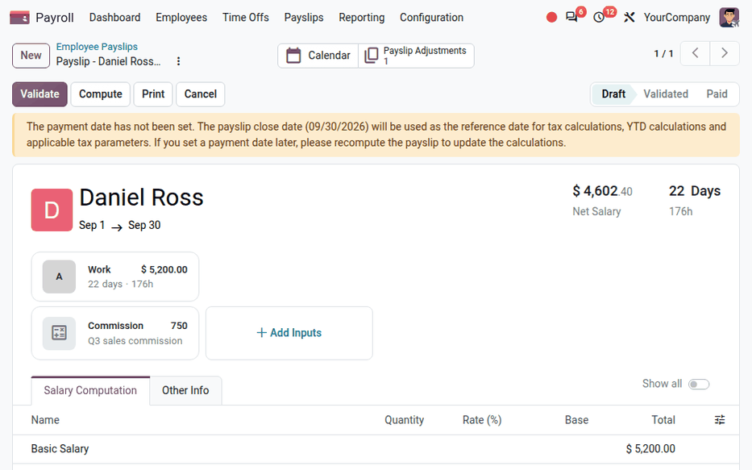
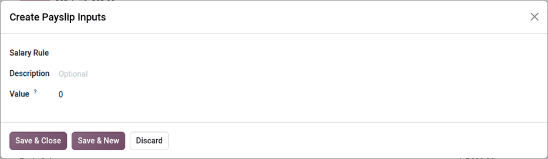
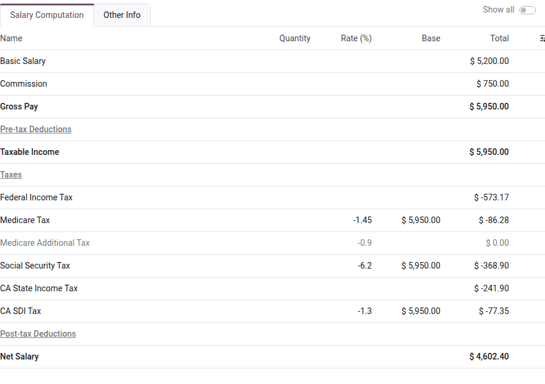
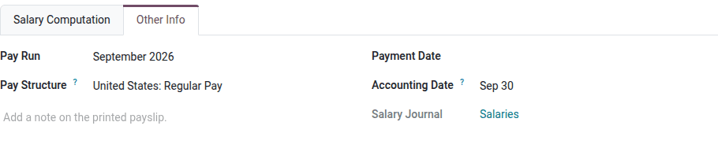
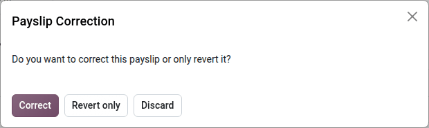
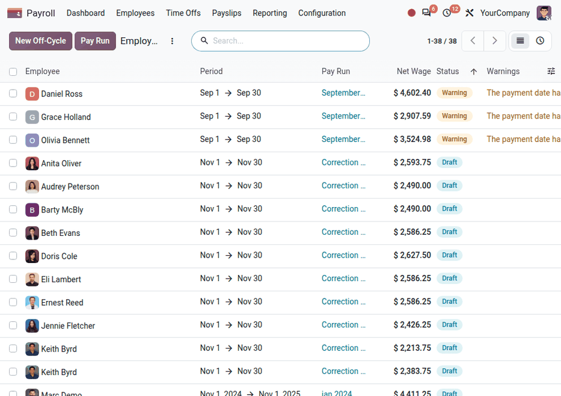

========
Payslips
========

*Payslips* are individual records of payment, containing all the details of how the pay was
calculated (worked time, salary inputs, deductions, taxes, etc.). Payslips are usually created and
processed in groups, through :doc:`pay runs <pay_runs>`. Payslips can also be created individually,
for example for a bonus paid outside of the regular pay period. Such payslips, which do not belong
to a pay run, are called *off-cycle* payslips.

.. _payroll/payslips/new-payslip:

Create a payslip
================

To create an off-cycle payslip, navigate to :menuselection:`Payroll app --> Payslips --> Payslips`,
and click the :guilabel:`New Off-Cycle` button. A blank payslip form loads.

Select the :guilabel:`Employee` being paid. The period of the payslip is set according to the
employee's pay schedule, and can be modified using the dates below the employee name. The
:guilabel:`Pay Structure` (in the *Other Info* tab) is set according to the employee's pay category.

Then, click :guilabel:`Compute`. Odoo computes the worked time of the period, adds the running
:doc:`payslip adjustments <salary_attachments>` of the employee, and calculates every salary rule of
the pay structure.

.. note::
   Only employees with a contract covering the payslip period can be paid. If the employee has
   several contracts during the period, a :guilabel:`Contract` field lets you select the one to
   use. Refer to the :doc:`contracts <contracts>` documentation.

The top of the payslip summarizes the :guilabel:`Net Salary` and the number of paid days and hours.

.. _payroll/payslips/worked-days:

Worked time
-----------

Below the employee name, one card is displayed for each :ref:`time type
<payroll/work-entry-types>` of the period, such as :guilabel:`Work` or :guilabel:`Public holiday`,
with the number of days and hours, and the corresponding amount.

The worked time is computed automatically from the employee's working schedule (or attendances),
time off, and public holidays. To correct it, click the :icon:`calendar_today_f`
:guilabel:`Calendar` smart button. Refer to the :doc:`worked time <work_entries>` documentation.

.. _payroll/payslips/salary-inputs:

Salary inputs
-------------

Salary inputs are additional amounts to include in the payslip, such as commissions, tips,
bonuses, or deductions. The inputs coming from the employee's :doc:`payslip adjustments
<salary_attachments>` are added automatically, and appear next to the worked time cards.

To add another input to this payslip only, click :guilabel:`Add Inputs`. In the :guilabel:`Create
Payslip Inputs` pop-up window, select the :guilabel:`Salary Rule` (only the salary rules that
accept inputs in the employee's pay structure are available), enter an optional
:guilabel:`Description`, and the :guilabel:`Value`, then click :guilabel:`Save & Close`.

Click :guilabel:`Compute` again to update the payslip with the new input.

.. _payroll/payslips/computation:

Salary Computation tab
----------------------

The *Salary Computation* tab lists the result of each salary rule of the pay structure, with its
:guilabel:`Quantity`, :guilabel:`Rate (%)`, :guilabel:`Base`, and :guilabel:`Total`. This includes
the employee's salary and all the deductions, taxes, and contributions defined by the installed
:doc:`payroll localization <payroll_localizations>`.

By default, only the rules relevant for the payslip are shown. Enable the :guilabel:`Show all`
toggle to display every computed rule. When an :icon:`info_f` :guilabel:`(info)` icon is displayed
at the end of a line, hover over it to see how the amount was computed.

While the payslip is in draft, the :guilabel:`Total` of a line can be modified manually, if its
quantity is `1` and its rate is `100%`. The rules computed after the modified line are recomputed
with the new value. Modified lines appear in bold, and the modification is logged in the chatter.

.. important::
   The :guilabel:`Compute` button remains available until the payslip is validated, so the payslip
   can be recalculated at any time, for example after adding an input.

Other Info tab
--------------

- :guilabel:`Pay Run`: The :doc:`pay run <pay_runs>` the payslip belongs to. Leave it empty
  (:guilabel:`Off-Cycle`) for an individual payslip.
- :guilabel:`Pay Structure`: The pay structure used to compute the payslip.
- Note: An optional note printed on the payslip.
- :guilabel:`Payment Date`: The date the employee was paid. This date is set when the payslip is
  :ref:`paid <payroll/payslips/pay-employee>`.
- :guilabel:`Accounting Date` and :guilabel:`Salary Journal`: If the **Accounting** app is
  installed, the date and the journal of the journal entry of the payslip.

.. _payroll/payslips/process:

Process a payslip
=================

Before processing payslips, check for possible issues. Warnings are displayed at the top of the
payslip, and on the :doc:`payroll dashboard <dashboard>`. Most warnings include a link to fix the
issue directly. Some warnings prevent the payslip from being validated.

Processing a payslip consists of :ref:`validating <payroll/payslips/validate>` it, then
:ref:`paying <payroll/payslips/pay-employee>` the employee.

.. _payroll/payslips/validate:

Validate the payslip
--------------------

Once everything on the payslip is correct, click :guilabel:`Validate`, then confirm. The status of
the payslip changes from :guilabel:`Draft` to :guilabel:`Validated`, and the payslip can no longer
be modified.

.. _payroll/payslips/post:

If the **Accounting** app is installed, a draft journal entry is created when the payslip is
validated, in the journal of the pay structure. Click the :icon:`attach_money` :guilabel:`Journal
Entry (Draft)` smart button to open it. The accounting department then reviews and posts it.

Depending on the :guilabel:`Send payslips to employees` setting (see
:ref:`payroll-payroll-settings`), the PDF of the payslip is generated and sent to the employee when
the payslip is validated, when it is paid, or only when clicking :guilabel:`Print` or sending it
manually.

.. _payroll/payslips/payment-report:
.. _payroll/payslips/pay-employee:

Pay the employee
----------------

Click :guilabel:`Pay` on the validated payslip. In the :guilabel:`Pay` pop-up window, configure the
following fields:

- :guilabel:`Mode`: Select :guilabel:`Manually` if the payment is made outside of Odoo, or a file
  format to generate a payment file for the bank: :guilabel:`CSV`, or a format added by the
  localization or by the **Payroll SEPA** setting (such as :guilabel:`NACHA` in the United States,
  or :guilabel:`SEPA`).
- :guilabel:`Payment Date`: The date the payment is made.
- :guilabel:`Include Unpaid`: Tick this checkbox to include other validated, unpaid payslips of the
  same employees in the payment.

Depending on the localization, additional fields can appear, such as the :guilabel:`Bank Journal`
used for the payment.

Click :guilabel:`Download` to download the payment file, then upload it to the bank. Once the
payment is made, click :guilabel:`Mark as Paid`: the status of the payslip changes to
:guilabel:`Paid`.

.. important::
   To be included in a payment file, the employee **must** have a bank account set on their
   employee record, and this bank account must be trusted (:guilabel:`Trust Bank Account` enabled).
   The :doc:`payroll dashboard <dashboard>` lists employees with missing or untrusted bank accounts.

.. tip::
   If a payslip was marked as paid by mistake, click :guilabel:`Mark Unpaid` to set it back to
   :guilabel:`Validated`.

.. _payroll/payslips/correct:

Correct a payslip
=================

A validated or paid payslip cannot be modified. If it is wrong, for example because a time off was
approved after its validation, or because the employee's wage changed retroactively, it must be
corrected.

Odoo flags the payslips that need to be corrected with a warning at the top of the payslip (for
example, :guilabel:`A time off has been modified.`), and on the :doc:`payroll dashboard
<dashboard>`. To correct a paid payslip at any time, click the :guilabel:`Correct` button on the
payslip.

In the :guilabel:`Payslip Correction` pop-up window, click one of the following buttons:

- :guilabel:`Correct`: Odoo creates a validated *refund* payslip that cancels the original payslip
  (with negative amounts), and a new draft payslip for the same period, computed with the current
  data. Both payslips are added to a new pay run, named `Correction (MM/YY)` followed by the pay
  structure. Process this pay run as usual: the employee receives, or pays back, the difference.
- :guilabel:`Revert only`: Odoo only creates the refund payslip, in a new `Revert` pay run.

When the correction is proposed from a warning, and several payslips of the employee are affected,
choose to :guilabel:`Correct this payslip only` or to :guilabel:`Correct all affected payslips`. A
:guilabel:`Keep it as is` button is also available to ignore the warning.

The :icon:`content_copy` :guilabel:`Related Payslips` smart button on the original payslip opens its
refund and its correction.

.. seealso::
   - :doc:`time_off_to_report`
   - :ref:`Versions of the employee record <payroll/contracts/versions>`

Cancel a payslip
================

To cancel a draft or validated payslip that should not be paid, click :guilabel:`Cancel`. The
status of the payslip changes to :guilabel:`Canceled`. Click :guilabel:`Set to Draft` to restore
a cancelled payslip.

Print a payslip
===============

To print a payslip, open it, and click :guilabel:`Print`. The PDF of the payslip is downloaded. The
payslip layout can be customized from the :doc:`payroll dashboard <dashboard>`.

.. _payroll/payslips/all-payslips:

View all payslips
=================

To view all payslips, regardless of status, navigate to :menuselection:`Payroll app --> Payslips
--> Payslips`. Each line displays the :guilabel:`Employee`, the :guilabel:`Period`, the
:guilabel:`Pay Run`, the :guilabel:`Total Cost`, the :guilabel:`Net Wage`, the
:guilabel:`Status`, and the :guilabel:`Warnings` of the payslip.

The :guilabel:`Status` of a payslip is one of the following:

- :guilabel:`Draft`: The payslip has not been validated yet, and can still be modified.
- :guilabel:`Done`: The payslip is validated, and ready to be paid.
- :guilabel:`Paid`: The employee has been paid.
- :guilabel:`Canceled`: The payslip has been canceled.

A :guilabel:`Warning` or :guilabel:`Blocked` tag is displayed instead of the :guilabel:`Draft`
status when the payslip has issues to review. Use the :guilabel:`Has Issues` filter to list them.

Select several payslips to process them together, using the :guilabel:`Compute`,
:guilabel:`Validate`, :guilabel:`Mark as Paid`, :guilabel:`Print`, or :guilabel:`Correct` buttons
that appear at the top of the list.

To export payslips to a spreadsheet, select them, click :icon:`settings_f` :guilabel:`Actions`, then
:guilabel:`Export`, and :ref:`configure the export <essentials/export_import_data/export-data>`.
