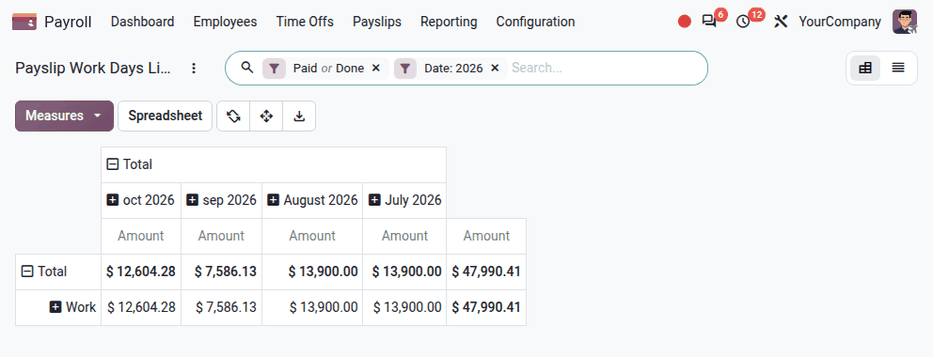
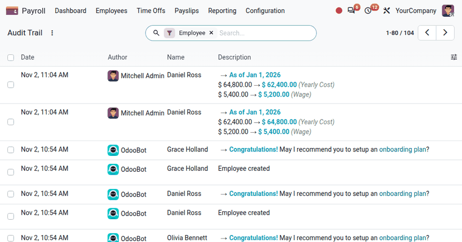

=========
Reporting
=========

The *Reporting* menu of the **Payroll** app provides reports to analyze the payslips, and to audit
the changes made to the data used by payroll.

Payslip reports
===============

The following reports are available in :menuselection:`Payroll app --> Reporting --> Payslip`:

- :guilabel:`Payslips`: The lines of the payslips (one line per salary rule and payslip), to
  analyze the amounts of each salary rule, such as the gross salary, the taxes, or the net salary.
  By default, the report shows the paid payslips of the current year.
- :guilabel:`Working Days`: The worked time of the payslips, by :ref:`time type
  <payroll/work-entry-types>`, with the number of days, hours, and the corresponding amount. By
  default, the report shows the validated and paid payslips of the current year, by month.
- :guilabel:`Other Inputs`: The :ref:`salary inputs <payroll/payslips/salary-inputs>` of the
  payslips, such as commissions or deductions, grouped by salary rule.

These reports open in a pivot view. Click :guilabel:`Measures` to select the values to display,
and click a row or column header to group the data further, for example by :guilabel:`Employee`,
:guilabel:`Department`, or :guilabel:`Pay Run`. Switch to the list view to see the individual
lines.

.. tip::
   The same reports are available for a single pay run: click the :icon:`more_vert`
   :guilabel:`(vertical ellipsis)` icon of a pay run card, then :guilabel:`Work times` or
   :guilabel:`Payroll Journal`.

Audit trail
===========

The *Audit Trail* report lists the changes made to the employees, payslips, contacts, and companies,
with the date, the author, and the old and new values of each modified field. It helps to check who
modified sensitive payroll data, such as a wage or a bank account.

To open it, navigate to :menuselection:`Payroll app --> Reporting --> Logs --> Audit Trail`. By
default, only the changes made to employees are displayed. Remove the :guilabel:`Employee` filter,
or select the :guilabel:`Partners` or :guilabel:`Company` filters, to view other changes.

.. seealso::
   :doc:`headcount`
