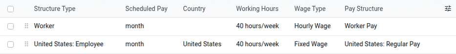
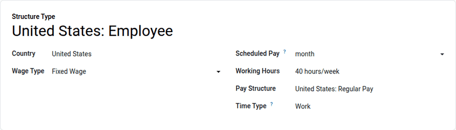
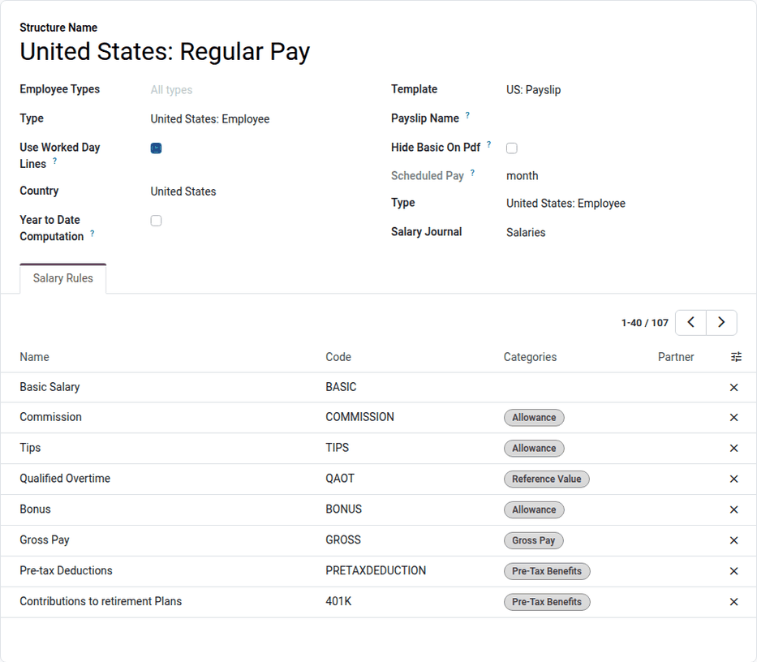

========
Salaries
========

In Odoo, the pay of each employee is computed from the following elements:

- A :ref:`structure type <payroll/salaries/structure-types>`, also called *pay category*, which is
  set on the employee record, and defines the default pay frequency, working schedule, and pay
  structure.
- :ref:`Pay structures <payroll/salaries/structures>`, which group the salary rules used to
  compute a type of payslip (for example, the regular monthly pay, or an end-of-year bonus).
- :doc:`Salary rules <salary_rules>`, which compute each line of the payslip, using :ref:`rule
  parameters <payroll/salary_rules/rule-parameters>` and :ref:`rule categories
  <payroll/salary_rules/rule-categories>`.
- :ref:`Salary inputs <payroll/salaries/salary-input-types>`, the variable amounts entered on the
  employee record or on the payslip, such as commissions or deductions.

When a payslip is computed, Odoo calculates the employee's :doc:`worked time <work_entries>`, then
applies each salary rule of the pay structure, in sequence, to determine the net pay.

.. note::
   The :doc:`payroll localization <payroll_localizations>` installs the structure types, pay
   structures, and salary rules required by the legislation of the country. Use them, rather than
   creating new ones, whenever possible.

.. _payroll/salaries/structure-types:

Structure types
===============

A *structure type* (displayed as :guilabel:`Pay Category` on the employee record) defines the main
payroll characteristics of a group of employees: how often they are paid, their default working
schedule, whether their wage is fixed or hourly, and which pay structure is used by default to
compute their payslips.

.. example::
   A structure type called `Employee` uses a `Regular Pay` structure for the monthly payslips. An
   `End of Year Bonus` structure can be added to the same structure type, for the bonus payslips.

To view the structure types, navigate to :menuselection:`Payroll app --> Configuration --> Salary
--> Structure Types`. The list shows the structure types available for the country of the current
company, such as :guilabel:`Worker` (generic, for employees paid by the hour) and the structure
types of the installed localization.

.. _payroll/salaries/new-structure-type:

Create a structure type
-----------------------

Click :guilabel:`New`, and configure the following fields:

- :guilabel:`Structure Type`: The name of the structure type, such as `Employee` or `Worker`.
- :guilabel:`Country`: The country the structure type applies to. Leave it empty for all countries.
- :guilabel:`Wage Type`: Select :guilabel:`Fixed Wage` for salaried employees, or
  :guilabel:`Hourly Wage` for employees paid according to the hours they work.
- :guilabel:`Scheduled Pay`: The default pay frequency, such as :guilabel:`month` or
  :guilabel:`week`.
- :guilabel:`Working Hours`: The default :doc:`working schedule <working_schedules>` of the
  employees.
- :guilabel:`Pay Structure`: The pay structure used by default to compute the regular payslips.
- :guilabel:`Time Type`: The :ref:`time type <payroll/work-entry-types>` used for the regular
  working time of the employees, such as :guilabel:`Work`.

.. warning::
   When creating a new structure type, ensure all local and national laws are accounted for.
   Confirm the configuration with the accounting department.

.. _payroll/salaries/new-working-hours:

.. tip::
   To create a new working schedule, refer to the :doc:`working schedules <working_schedules>`
   documentation.

.. _payroll/salaries/structures:

Pay structures
==============

A *pay structure* is the set of salary rules used to compute a specific type of payslip. A structure
type can have several pay structures, for example one for the regular pay, and others for bonuses
or termination payslips.

To view the pay structures, navigate to :menuselection:`Payroll app --> Configuration --> Salary
--> Structures`. The structures are grouped by structure type.

Open a pay structure to view and configure the following fields:

- :guilabel:`Employee Types`: The :ref:`employee types <payroll/gen-info>` the structure applies to.
  Leave it empty for all employee types.
- :guilabel:`Type`: The structure type the structure belongs to.
- :guilabel:`Use Worked Day Lines`: Tick this checkbox to compute and display the worked time on
  the payslips. Untick it for structures that do not depend on the worked time, such as a bonus.
- :guilabel:`Country`: The country the structure applies to.
- :guilabel:`Year to Date Computation`: Tick this checkbox to add a column with the amounts
  accumulated since the beginning of the year (see the :guilabel:`YTD Reset Date` setting).
- :guilabel:`Template`: The report used to print the payslips.
- :guilabel:`Payslip Name`: The name given to the payslips of this structure, such as `End of the
  year bonus`. If empty, `Salary Slip` is used.
- :guilabel:`Hide Basic On Pdf`: Tick this checkbox to hide the basic salary on the printed
  payslip.
- :guilabel:`Salary Journal`: If the **Accounting** app is installed, the journal in which the
  journal entries of the payslips are created.

The *Salary Rules* tab lists the :doc:`salary rules <salary_rules>` of the structure.

.. _payroll/salaries/salary-input-types:

Salary inputs
=============

Some amounts cannot be computed from the contract or the worked time, and must be entered for each
employee or each payslip, such as commissions, tips, bonuses, or deductions. In Odoo, these
*salary inputs* are salary rules configured to accept an input value: the value is entered by the
user, then the salary rule computes its effect on the pay.

On the salary rule, the :guilabel:`Inputtable on` field defines where the value is entered:

- :guilabel:`Employee`: The input appears as a field in the *Payroll* tab of the employee record.
  The value applies to every payslip of the employee, until it is modified. For example, the tax
  information of a localization is often entered this way.
- :guilabel:`Payslip`: The input can be added on a payslip with the :guilabel:`Add Inputs` button,
  or through a :doc:`payslip adjustment <salary_attachments>`.

The inputs of a pay structure are grouped in *sections* on the employee record. Refer to the
:doc:`salary rules <salary_rules>` documentation to configure them.

.. note::
   In previous versions of Odoo, salary inputs were configured as separate *Other Input Types*. They
   are now part of the salary rules.

.. seealso::
   - :doc:`salary_rules`
   - :doc:`salary_attachments`
