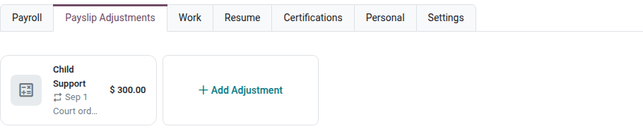
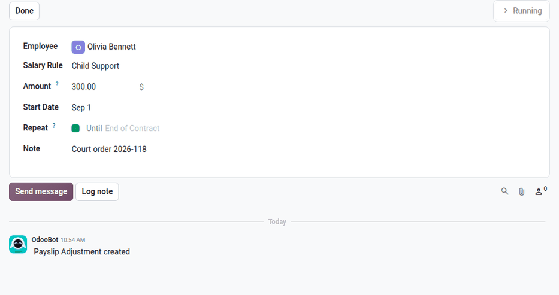
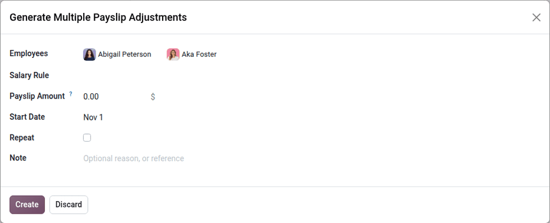
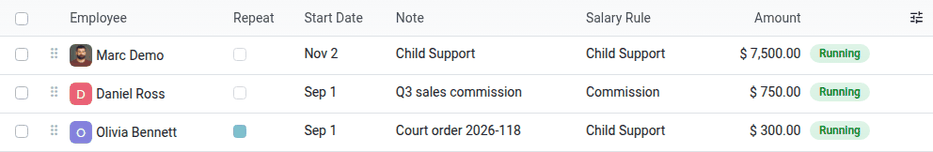

===================
Payslip adjustments
===================

*Payslip adjustments* are amounts added to, or deducted from, an employee's payslips, outside of
their regular salary. They are used for one-time amounts, such as a bonus or a commission, and for
recurring amounts, such as child support, a wage garnishment, union dues, or a bonus divided into
several payments.

Each payslip adjustment is linked to a *salary rule* of the employee's pay structure. While the
adjustment is running, its amount is automatically added as a :ref:`salary input
<payroll/payslips/salary-inputs>` to the employee's payslips, and the salary rule computes its
effect on the pay (for example, as a taxable allowance, or as a deduction from the net salary).

.. _payroll/salary_attachments/types:

Available adjustments
=====================

The adjustments that can be used depend on the employee's pay structure: only the salary rules of
this structure that accept a payslip input are available (see :ref:`salary inputs
<payroll/salaries/salary-input-types>`). For example, the United States pay structure provides,
among others, :guilabel:`Commission`, :guilabel:`Bonus`, :guilabel:`Child Support`,
:guilabel:`Attachment of Salary`, :guilabel:`Assignment of Salary`, :guilabel:`Deduction`, and
:guilabel:`Reimbursement`.

.. danger::
   The salary rules provided by the :doc:`payroll localization <payroll_localizations>` are
   configured according to the local legislation. Modifying them can result in wrong payslips. Only
   create new input rules when absolutely necessary, and check them with the accounting department.

.. _payroll/salary_attachments/create:

Create a payslip adjustment
===========================

Open the employee record, from :menuselection:`Payroll app --> Employees --> Employees`, and click
the *Payslip Adjustments* tab. The running adjustments of the employee are displayed as cards.

Click :guilabel:`Add Adjustment`, and configure the following fields in the pop-up window:

- :guilabel:`Salary Rule`: Select the type of adjustment, such as :guilabel:`Commission` or
  :guilabel:`Child Support`. When the salary rule includes instructions, they are displayed below
  this field.
- :guilabel:`Amount`: The amount to add to each payslip, in the unit of the salary rule (usually a
  monetary amount).
- :guilabel:`Start Date`: The first day from which the adjustment is applied.
- :guilabel:`Repeat`: Leave this checkbox empty for a one-time adjustment, applied on the next
  payslip only. Tick it to apply the amount on every payslip, :guilabel:`Until` the date entered
  next to it, or until the end of the contract if no date is entered.
- :guilabel:`Payslip Description`: An optional reason or reference, such as the number of a court
  order. The description is displayed on the payslip input.

For seizures of salary (such as attachments or assignments of salary), additional fields appear to
enter the bank account of the beneficiary, so the seized amount can be included in the payment
file.

Then, click :guilabel:`Save & Close`.

.. tip::
   The payslip adjustments that apply to a payslip are displayed with the :icon:`content_copy`
   :guilabel:`Payslip Adjustments` smart button of the payslip.

Create adjustments for several employees
----------------------------------------

To create the same adjustment for several employees at once, for example a bonus, navigate to
:menuselection:`Payroll app --> Employees --> Employees`, switch to the list view, select the
employees, then click the :guilabel:`Payslip Adjustment` button at the top of the list.

In the :guilabel:`Generate Multiple Payslip Adjustments` pop-up window, configure the same fields
as above (the :guilabel:`Payslip Amount` is the amount for each employee), then click
:guilabel:`Create`. One adjustment is created for each selected employee.

.. _payroll/salary_attachments/dashboard:

View all payslip adjustments
============================

To view the payslip adjustments of all employees, enable :ref:`developer mode <developer-mode>`,
then navigate to :menuselection:`Payroll app --> Employees --> Payslip Adjustments`.

Each line displays the :guilabel:`Employee`, whether the adjustment is repeated, the
:guilabel:`Start Date`, the :guilabel:`Payslip Description`, the :guilabel:`Salary Rule`, the
:guilabel:`Amount`, and the status: :guilabel:`Running` or :guilabel:`Done`.

Manage payslip adjustments
==========================

A one-time adjustment is marked as :guilabel:`Done` once its amount is fully paid, when the payslip
that includes it is marked as paid. If only part of the amount could be paid, the
:guilabel:`Paid Amount` and the :guilabel:`Remaining Amount` are displayed on the adjustment, and
the remaining amount is applied on the next payslips. A recurring adjustment is no longer applied to
the payslips that start after its :guilabel:`Until` date.

To stop an adjustment before its end, for example when an employee no longer contributes to a
voluntary program, open it, then click :guilabel:`Done`. To apply it again, click
:guilabel:`Running`.

.. note::
   If an adjustment is modified, created, or closed after the payslips of the period were computed,
   a warning is displayed on the affected payslips, so they can be recomputed.

.. example::
   An employee has a court-ordered deduction of $250.00 per month until the end of the year. A
   recurring :guilabel:`Attachment of Salary` adjustment is created, with an :guilabel:`Amount` of
   `250.00`, the first day of the next month as :guilabel:`Start Date`, and December 31 as
   :guilabel:`Until` date. The deduction is applied on each of their payslips until December. If
   the employee pays off the remaining amount in another way, the payroll manager clicks
   :guilabel:`Done` on the adjustment.
