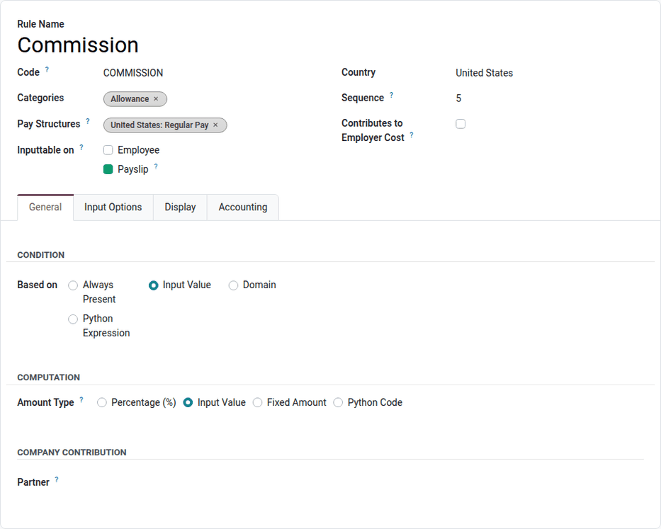
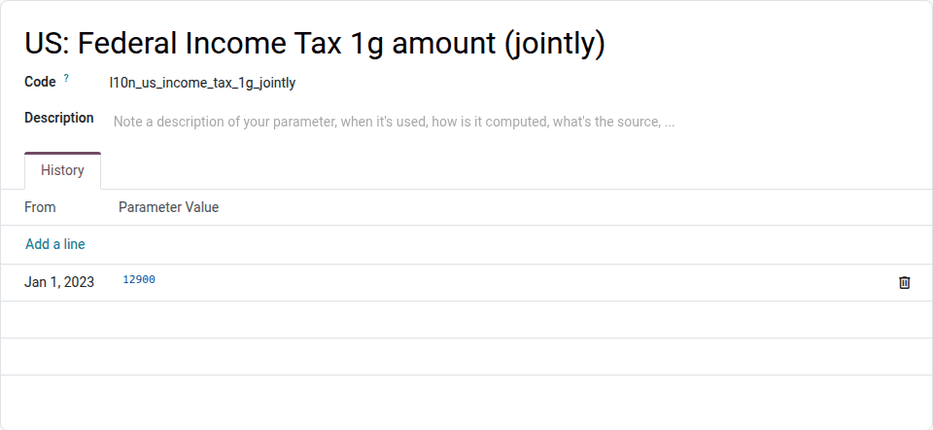

============
Salary rules
============

In Odoo, every :ref:`pay structure <payroll/salaries/structures>` has a set of salary *rules* used
to compute the lines of the payslips: the basic salary, allowances, taxes, deductions, the net
salary, etc. These rules are provided by the :doc:`payroll localization <payroll_localizations>`
and implement the local legislation.

.. warning::
   Modification or creation of rules should **only** be done when necessary, and checked with the
   accounting department. When a rule provided by Odoo is modified, it is no longer updated
   automatically, and a :guilabel:`Reset` button appears on its form to restore the standard rule.

To view all the rules, navigate to :menuselection:`Payroll app --> Configuration --> Salary -->
Rules`. Each line displays the :guilabel:`Name`, :guilabel:`Code`, :guilabel:`Pay Structures`, and
:guilabel:`Categories` of the rule.

Create a salary rule
====================

Click :guilabel:`New`, and configure the following fields in the top part of the form:

- :guilabel:`Rule Name`: The name displayed on the payslip.
- :guilabel:`Code`: The unique code of the rule in its pay structure. The code is used to reference
  the rule in the computation of other rules, and is case sensitive.
- :guilabel:`Categories`: The :ref:`rule categories <payroll/salary_rules/rule-categories>` the rule
  belongs to, such as :guilabel:`Allowance` or :guilabel:`Deduction`. Categories are used to sum the
  results of several rules.
- :guilabel:`Pay Structures`: The pay structures that use the rule.
- :guilabel:`Inputtable on`: Tick :guilabel:`Employee` and/or :guilabel:`Payslip` to make the rule a
  :ref:`salary input <payroll/salaries/salary-input-types>`, whose value is entered on the employee
  record or on the payslip. An *Input Options* tab appears.
- :guilabel:`Country`: The country the rule applies to.
- :guilabel:`Sequence`: The order in which the rule is computed. Rules are computed from the lowest
  to the highest sequence, so a rule can use the results of the rules computed before it.
- :guilabel:`Contributes to Employer Cost`: Tick this checkbox to include the rule in the employer
  cost of the payslip.

General tab
-----------

The *Condition* section defines whether the rule is computed. Select one of the following options
for the :guilabel:`Based on` field:

- :guilabel:`Always Present`: The rule is always computed.
- :guilabel:`Input Value`: The rule is computed only if an input value is entered for it, on the
  employee record or on the payslip.
- :guilabel:`Domain`: The rule is computed only if the payslip matches the :guilabel:`Applicability
  Domain` defined below the field.
- :guilabel:`Python Expression`: The rule is computed only if the Python condition sets `result` to
  `True`. The available variables are listed next to the code editor.

The *Computation* section defines the result of the rule. The total of a rule is `amount * quantity
* rate / 100`. Select one of the following options for the :guilabel:`Amount Type` field:

- :guilabel:`Percentage (%)`: The amount is computed from the Python expression of the
  :guilabel:`Percentage based on` field, and multiplied by the :guilabel:`Percentage (%)` and the
  :guilabel:`Quantity`.
- :guilabel:`Input Value`: The amount is the value entered for the input.
- :guilabel:`Fixed Amount`: The amount is the :guilabel:`Fixed Amount`, multiplied by the
  :guilabel:`Quantity`.
- :guilabel:`Python Code`: The amount is computed by Python code. The available variables
  (`payslip`, `employee`, `version`, `company`, `result_rules`, `categories`, `worked_days`,
  `inputs`) and the expected outputs (`result`, `result_rate`, `result_qty`, `result_name`) are
  listed next to the code editor.

In the *Company Contribution* section, select the :guilabel:`Partner` that receives the amount, if
any, for example a social security or pension organization.

Input Options tab
-----------------

This tab appears when the rule is :guilabel:`Inputtable on` the employee or the payslip:

- :guilabel:`Name`: The label of the input, if it must differ from the rule name.
- :guilabel:`Section`: The section that groups the input on the employee record. Sections are
  managed in :menuselection:`Payroll app --> Configuration --> Salary --> Salary Input Sections`
  (in :ref:`developer mode <developer-mode>`).
- :guilabel:`Selected by Default`: Tick this checkbox to automatically add the input to new
  payslips, with the :guilabel:`Default Value`.
- :guilabel:`Input Suffix`: The unit displayed after the value, such as `per km`.
- :guilabel:`User Instructions`: Instructions displayed to the user who fills in the input value.

Display tab
-----------

This tab defines how the rule appears on the payslip:

- :guilabel:`Visibility`: Display the rule :guilabel:`Always`, :guilabel:`Never`, or only
  :guilabel:`If Result is not zero`.
- :guilabel:`Show in extra info section`: Display the amount in an *Additional Information* section
  of the printed payslip.
- :guilabel:`Title only`: Display only the name and the description of the rule, without amounts.
- :guilabel:`Color`, :guilabel:`Style` (:guilabel:`Bold`, :guilabel:`Italic`,
  :guilabel:`Underline`), and :guilabel:`Position` (:guilabel:`Indented`, :guilabel:`Space on
  top`): The appearance of the line.
- :guilabel:`Display Name`: Additional information printed below the rule name.

Accounting tab
--------------

This tab is only available if the **Accounting** app is installed. It defines how the rule is
recorded in the journal entries of the payslips:

- :guilabel:`Debit Account` and :guilabel:`Credit Account`: The accounts of the journal items.
- :guilabel:`Analytic Distribution`: The analytic accounts of the journal items.
- :guilabel:`Split on names`: Create separate journal items according to the name of the payslip
  lines, for example for deductions or payslip adjustments.
- :guilabel:`Excluded from Net`: Exclude the rule from the net salary in the journal entries. Set
  specific debit and credit accounts for it.
- :guilabel:`Set employee on account line`: Set the employee on the journal items.
- :guilabel:`Debit Tax Grids` and :guilabel:`Credit Tax Grids`: The tax grids impacted by the
  journal items.

.. _payroll/salary_rules/rule-parameters:

Rule parameters
===============

Rule parameters store the values used by the salary rules that change over time, such as tax rates,
ceilings, or legal amounts. Each parameter keeps the history of its values, so payslips of a past
period are computed with the values valid at that time.

To view the rule parameters, navigate to :menuselection:`Payroll app --> Configuration --> Salary
--> Rule Parameters`. Each line shows the :guilabel:`Name`, the :guilabel:`Code` (used in the
salary rules), the :guilabel:`Current Value`, and the date it is :guilabel:`Valid Since`.

Open a parameter to view its *History*. To record a new value, for example when the law changes,
click :guilabel:`Add a line`, then enter the date :guilabel:`From` which the value applies, and the
:guilabel:`Parameter Value`.

.. _payroll/salary_rules/rule-categories:

Rule categories
===============

Every rule belongs to one or several rule categories. Categories group the results of several
rules, so that other rules can use their sum (for example, a gross salary rule summing all the
allowances).

To view the categories, navigate to :menuselection:`Payroll app --> Configuration --> Salary -->
Rule Categories`. To create a category, click :guilabel:`New`, then enter its :guilabel:`Name` and
:guilabel:`Code`. Optionally, select a :guilabel:`Parent` category (the results of the category are
then also added to its parent), and a :guilabel:`Country`.

The :guilabel:`Optional on` field lists the :ref:`time types <payroll/new-work-entry-type>` on which
the category can be added as an option, on the time off encoded by HR.

Premium pay
-----------

Some localizations, such as Belgium, define *premium pay* categories (for example, for night or
Sunday work). To grant an extra amount on top of a legal premium pay, navigate to
:menuselection:`Payroll app --> Configuration --> Salary --> Premium Pay`, click :guilabel:`New`,
select the legal premium pay as :guilabel:`Parent`, and enter the extra :guilabel:`Amount per
Hour`, :guilabel:`Amount per Day`, or :guilabel:`Percentage of Hourly Rate`. Custom premium pays
can then be selected as options on the time types and working schedules they are allowed on.
