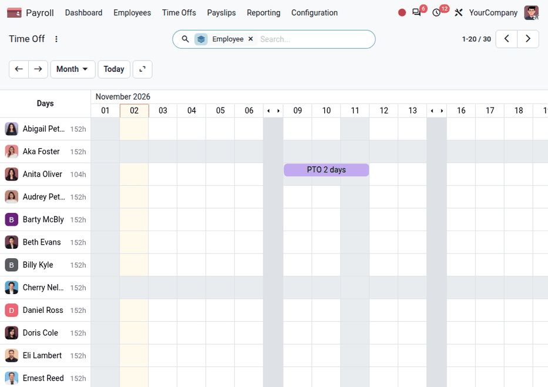
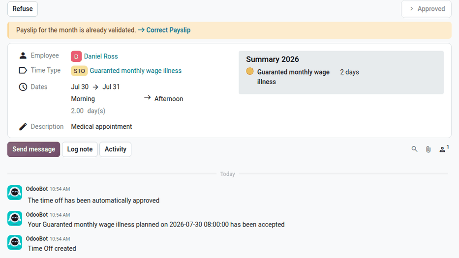
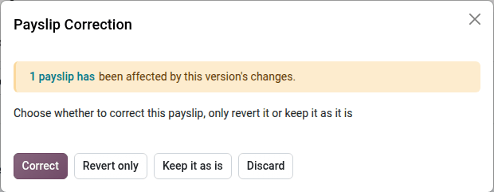

=====================
Time off and payslips
=====================

Approved time off is automatically included in the :doc:`worked time <work_entries>` of the
payslips. However, payroll is often processed a few days before the end of the pay period, and
employees sometimes take unexpected time off, such as sick days, after their payslip has been
validated, or even paid. Odoo detects these situations, so the payslip can be corrected.

.. _payroll/time-off-dashboard:

Time off overview
=================

To view the time off of all employees, navigate to :menuselection:`Payroll app --> Time Offs`. The
time off is displayed in a Gantt view, by employee, with the expected working hours of each
employee for the displayed period. Use the arrows and the scale selector to navigate to the pay
period.

Click a time off to view its details, or click an empty cell to create a time off for an employee.
The :guilabel:`Time Type` of the time off determines how it is paid. Some time types allow
:guilabel:`Options`, additional salary rule categories that payroll users can select on the time off
(see :ref:`time types <payroll/new-work-entry-type>`).

.. tip::
   Before starting a pay run, make sure all the time off requests of the period are approved or
   refused. The time off that is still waiting for approval is listed in the warnings displayed when
   :ref:`creating a pay run <payroll/new-pay-run>`.

Time off approved before the payslip is validated
=================================================

As long as a payslip is in the :guilabel:`Draft` status, approving, refusing, or cancelling a time
off of the same employee and period automatically updates the payslip. No action is needed.

.. _payroll/time-off-to-report/after-validation:

Time off approved after the payslip is validated
================================================

When a time off is approved for a period already covered by a validated or paid payslip, the
payslip is **not** modified. Instead:

- The time off displays the warning :guilabel:`Payslip for the month is already validated.`
- The payslip displays the warning :guilabel:`A time off has been modified.`

.. example::
   The payslips of July are validated and paid on July 28. An employee is sick on July 30 and 31.
   The sick days are approved on August 1: the July payslip still counts these two days as worked
   time, and must be corrected.

To correct the payslip, click :guilabel:`Correct Payslip` on the time off, or :guilabel:`Update
Payslip` on the payslip. The :guilabel:`Payslip Correction` pop-up window opens.

If several payslips of the employee are affected, select whether to :guilabel:`Correct this payslip
only` or to :guilabel:`Correct all affected payslips`, then click one of the following buttons:

- :guilabel:`Correct`: Odoo cancels the original payslip with a validated *refund* payslip (with
  negative amounts), and creates a new draft payslip for the same period, computed with the
  approved time off. Both payslips are added to a new pay run, named `Correction (MM/YY)` followed
  by the pay structure. Process this pay run like any other :doc:`pay run <pay_runs>`: the employee
  receives, or pays back, the difference.
- :guilabel:`Revert only`: Odoo only creates the refund payslip, in a `Revert` pay run.
- :guilabel:`Keep it as is`: The payslip is kept unchanged, and is no longer proposed for
  correction.

.. seealso::
   - :ref:`Correct a payslip <payroll/payslips/correct>`
   - :doc:`../time_off`
