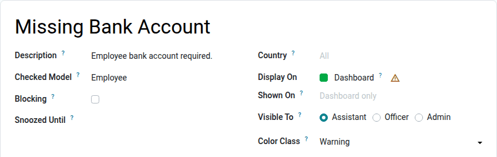
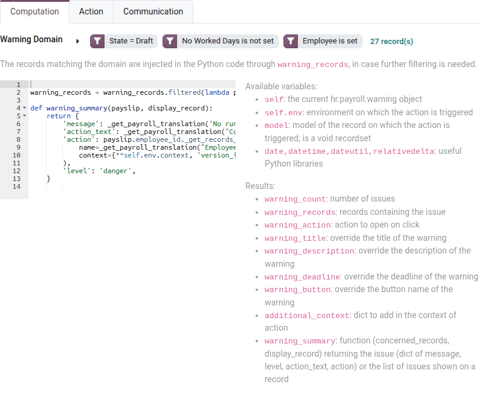
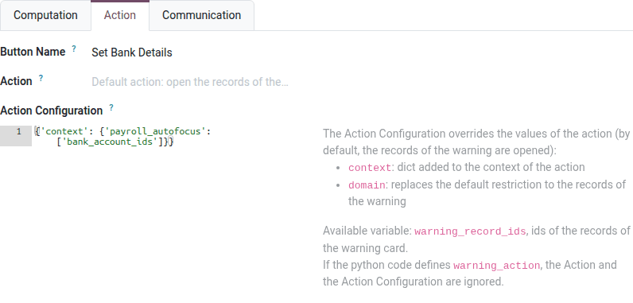
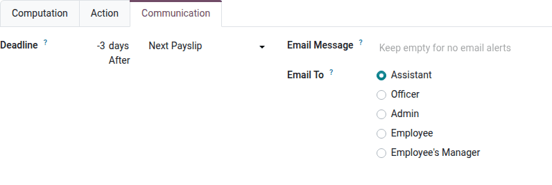
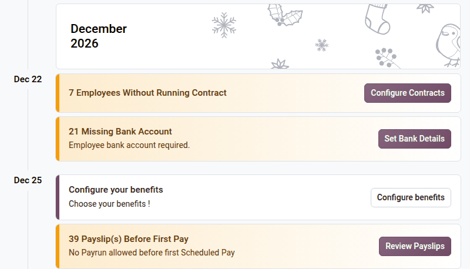
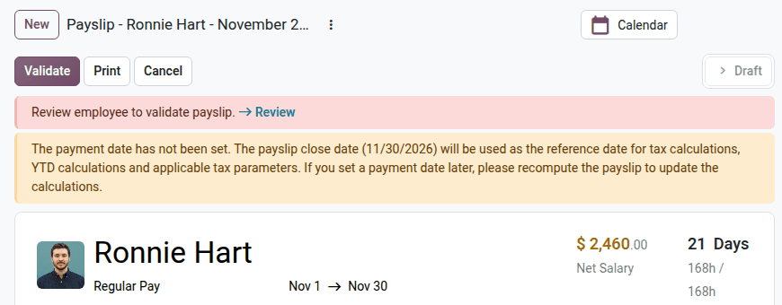
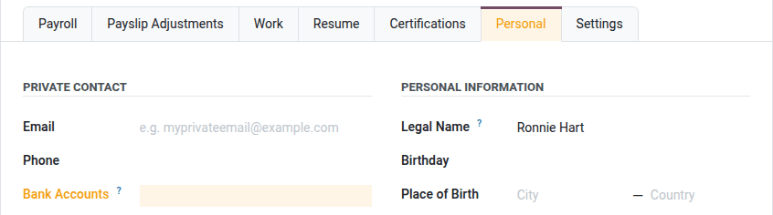
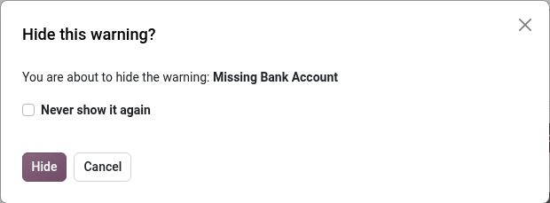

================
Payroll warnings
================

*Payroll warnings* flag missing or inconsistent information, such as an employee without a bank
account or a payslip without a running contract, before it causes errors in payroll. Resolving
these issues ahead of each pay run keeps payroll processing on schedule and avoids corrections
after payment.

Warnings appear as cards on the **Payroll** app dashboard, and as alerts directly on the records
concerned, such as payslips, employees, or time off requests. A warning can also send email
reminders, and block the records displaying it, for example, to prevent a payslip from being
validated until the issue is fixed.

Default warnings are provided by the **Payroll** app and the installed :doc:`payroll localizations
<payroll_localizations>`. They can be adapted, and new warnings can be created to match the
company's internal processes.

.. _payroll/warnings/configuration:

Configuration
=============

To view or configure payroll warnings, navigate to :menuselection:`Payroll app --> Configuration
--> Warnings`. Click :guilabel:`New` to create a warning, or click an existing warning to edit it.

.. note::
   Only users with the *Administrator* access rights for the **Payroll** app can access this menu.

Enter a name for the warning in the title field; this name is the title of the warning card on the
dashboard. Then, fill in the following fields:

- :guilabel:`Description`: a short explanation, displayed on the Dashboard warning card, and as the
  message of the model warning on records.
- :guilabel:`Checked Model`: the type of records the warning checks, such as employees, payslips,
  or time off requests.
- :guilabel:`Blocking`: enable this option to :ref:`block the records
  <payroll/warnings/blocking>` displaying this warning.
- :guilabel:`Snoozed Until`: the date until which the warning is :ref:`hidden from the dashboard
  <payroll/warnings/hide>`.
- :guilabel:`Country`: the country the warning applies to. Only the warnings of the company's
  country, and those without a country, are displayed. Leave this field empty to apply the
  warning to all countries.
- :guilabel:`Display On`: tick :guilabel:`Dashboard` to display the warning on the **Payroll** app
  dashboard.
- :guilabel:`Shown On`: the types of records on which the warning is :ref:`displayed as an alert
  <payroll/warnings/records>`. Leave this field empty to display the warning on the dashboard only.
- :guilabel:`Visible To`: the payroll access rights required to see the warning on the dashboard.
  :guilabel:`Officer` warnings are visible to payroll officers and administrators, and
  :guilabel:`Admin` warnings to administrators only.
- :guilabel:`Color Class`: the color of the Dashboard warning card. On records, :guilabel:`Danger`
  warnings
  are displayed in red, and all others in yellow.

.. note::
   A warning must be displayed on the dashboard, on at least one type of record, or on both.

.. _payroll/warnings/shown-on:

Shown on records
----------------

A warning checks the records of its :guilabel:`Checked Model`, but can be shown on other types of
records linked to them. A record shows the warning when at least one of the records it is linked
to is flagged, unless the :ref:`Python code <payroll/warnings/computation>` decides otherwise.

.. example::
   The *Missing Bank Account* warning checks employees. When :guilabel:`Pay Slip` is added to its
   :guilabel:`Shown On` field, every payslip of an employee without a bank account displays an
   alert.

Depending on the installed apps and localizations, warnings can be shown on:

- :guilabel:`Pay Slip`: at the top of the payslip, and in the :guilabel:`Warnings` column of the
  payslips list.
- :guilabel:`Employee Contract`: at the top of the employee form.
- :guilabel:`Time Off`: on the time off request.
- :guilabel:`Attendance`: on the attendance record.
- :guilabel:`HR Payroll Payment Report Wizard`: in the window used to generate the payment report
  of payslips.
- Localization records, such as social security declarations.

The :guilabel:`Shown On` field only proposes the types of records linked to the
:guilabel:`Checked Model`. The links are predefined, and determine which records are checked for
each displayed record.

.. spoiler:: Links of each type of record

   .. list-table::
      :header-rows: 1
      :stub-columns: 1

      * - Shown On
        - Checked Model
        - Records checked for each displayed record
      * - :guilabel:`Pay Slip`
        - `Pay Slip`
        - The payslip itself
      * -
        - `Employee`
        - The employee of the payslip
      * -
        - `Employee Contract`
        - The contract of the payslip
      * -
        - `Company`
        - The company of the payslip
      * -
        - `Resource Working Time`
        - The working schedule of the employee
      * -
        - `Work Location`
        - The work location of the contract
      * -
        - `Time Off`
        - The employee's time off overlapping the payslip period
      * -
        - `Payroll Configuration`
        - The payroll configuration of the payslip
      * - :guilabel:`Employee Contract`
        - `Employee Contract`
        - The contract itself
      * -
        - `Employee`
        - The employee of the contract
      * -
        - `Pay Slip`
        - The payslips of the contract
      * -
        - `Company`
        - The company of the contract
      * - :guilabel:`Time Off`
        - `Time Off`
        - The time off itself
      * -
        - `Employee`
        - The employee of the time off
      * - :guilabel:`Attendance`, :guilabel:`HR Payroll Payment Report Wizard`
        - Same as :guilabel:`Shown On`
        - The record itself

Localization records follow the same principle. For example, the Belgian DmfA declaration is
linked to the employees, contracts, and payslips it declares.

.. _payroll/warnings/custom-links:

Custom links
~~~~~~~~~~~~

The links are defined in the code. To show custom warnings on other records, a developer can add
links in a custom module depending on the **Payroll** app.

Each type of record showing warnings defines its links in the `_get_warning_links` method. It
returns a dictionary associating each checked model with the path from the displayed record to the
records to check. The path is either a field path, such as `employee_id.bank_account_ids`, or a
function receiving the displayed record and returning the records to check. An empty path means
the displayed record itself.

.. example::
   To show warnings checking bank accounts and attendances on payslips, link each payslip to the
   bank accounts of its employee with a field path, and to the attendances of its employee during
   the payslip period with a function. The custom module must also depend on the **Attendances**
   app.

   .. code-block:: python

      from odoo import api, models

      class HrPayslip(models.Model):
          _inherit = 'hr.payslip'

          @api.model
          def _get_warning_links(self):
              return super()._get_warning_links() | {
                  'res.partner.bank': 'employee_id.bank_account_ids',
                  'hr.attendance': lambda payslip: payslip.employee_id.attendance_ids.filtered(
                      lambda attendance: (
                          payslip.date_from <= attendance.check_in.date() <= payslip.date_to
                      )
                  ),
              }

   Once the module is installed, `Bank Account` and `Attendance` can be selected as the
   :guilabel:`Checked Model` of a warning shown on :guilabel:`Pay Slip`.

To show warnings on a new type of record, the model must also inherit the
`hr.payroll.warning.display.mixin` model, have a `company_id` field, and display the `issues` field
in its form view with the `actionable_warnings` widget:

.. code-block:: xml

   <field name="issues" widget="actionable_warnings" invisible="not issues"/>

By default, a new type of record is only linked to itself. :ref:`Blocking warnings
<payroll/warnings/blocking>` do not block its records unless its code :ref:`checks them
<payroll/warnings/custom-blocking>`.

.. _payroll/warnings/computation:

Computation
-----------

The :guilabel:`Computation` tab defines which records have the issue.

Use the :guilabel:`Warning Domain` field to set the conditions the records must meet to be
flagged. Click :guilabel:`New Rule` to add a condition, and edit the field, operator, and value of
each rule as needed. The number of records currently matching the domain is displayed next to it.

.. example::
   To flag employees without a bank account, set the :guilabel:`Checked Model` to `Employee`, and
   add a rule where the :guilabel:`Bank Accounts` field is not set.

For more complex conditions, the :guilabel:`Python Code` field filters the records further. The
records matching the domain are available in the code through the `warning_records` variable,
which the code replaces with the records to flag. The available variables and the possible results
are listed next to the field. The `display_model` variable contains the type of records the
warning is computed for, or `False` when it is computed for the dashboard.

On the dashboard, the warning checks all the records of the :guilabel:`Checked Model`. On records,
the :ref:`links <payroll/warnings/shown-on>` restrict the computation:

#. The records linked to the displayed records are collected, for example, the employees of the
   payslips being displayed.
#. Only these records are filtered with the :guilabel:`Warning Domain`.
#. The :guilabel:`Python Code` receives the remaining records in `warning_records`. The code runs
   once for all the displayed records, for example, all the payslips of a list, so
   `warning_records` can contain the linked records of several displayed records.
#. Each displayed record shows the warning if at least one of its linked records is still in
   `warning_records` at the end of the code. These records are the `concerned_records` given to
   the `warning_summary` function.

The code can also set the values displayed on the Dashboard warning cards, such as `warning_title`,
which take precedence over the fields of the form. See :ref:`payroll/warnings/values` for the full
list.

To adapt the alerts displayed on records, the code defines a `warning_summary(concerned_records,
display_record)` function. For each record displaying the warning, it receives the flagged records
linked to it, and returns one alert, or a list of alerts. Each alert is a dictionary whose keys,
such as `message` or `level`, override the values built from the form. See
:ref:`payroll/warnings/values` for the full list.

.. example::
   The default *Payslips Without Running Contract* warning checks payslips and is shown on them. Its
   :guilabel:`Warning Domain` selects the draft payslips with an employee, its code keeps those
   outside of the employee's contract, and its `warning_summary` function returns a red `No
   running contract` alert, with a :guilabel:`Contract` button opening the employee.

.. important::
   The :guilabel:`Python Code` runs in a restricted environment that checks every function call it
   makes, so its computation time grows quickly with the amount of code and the number of records
   it loops over. As the warnings are computed each time the dashboard or a record showing them is
   opened, a slow code slows down these views. Keep in the code only what the fields of the form
   cannot do:

   - Set the conditions that can be expressed as rules in the :guilabel:`Warning Domain`, and
     filter the `warning_records` variable in the code instead of searching for records again.
   - Set the button's action with the :guilabel:`Action` and :guilabel:`Action Configuration`
     fields rather than `warning_action`, `additional_context`, or the `action` key of the alerts.
     The :guilabel:`Action Configuration` is a simple dictionary that does not go through the
     restricted environment, and the action of an alert without an `action` key is only computed
     when its button is clicked, instead of each time the alert is displayed.
   - Set the static texts and options in the :guilabel:`Description`, :guilabel:`Button Name`,
     :guilabel:`Color Class`, and :guilabel:`Blocking` fields rather than in the code. When the
     alerts only use these values, the code does not need a `warning_summary` function.

   Fill in these fields with the values the code would set in most cases. The code can still
   override them for specific cases, for example, by returning a different `message` or `action`
   for some alerts only. A field used as a default is only worth it if most alerts or cards keep
   its value.

.. important::
   Writing Python code requires technical knowledge. If the code fails, the warning card on the
   dashboard displays :guilabel:`This warning could not be computed.`, and its
   :guilabel:`See details` button shows the error.

.. _payroll/warnings/action:

Action
------

The :guilabel:`Action` tab configures the button displayed on the Dashboard warning card, and on
the versions shown on the records.

Enter the label of the button in the :guilabel:`Button Name` field, for example, `Set Bank Details`.

With :ref:`developer mode <developer-mode>` enabled, the :guilabel:`Action` and
:guilabel:`Action Configuration` fields define what the button opens. The action of the button is
built in the following order, each step overriding the previous ones:

#. By default, the button opens the flagged records: the record itself if there is only one, or
   the list of the records otherwise.
#. If an :guilabel:`Action` is selected, it replaces the default action.
#. The :guilabel:`Action Configuration`, a Python dictionary, overrides the values of the action
   from the previous step. The `context` key is added to the context of the action, while the
   other keys, such as `domain`, replace the corresponding values. The IDs of the flagged records
   are available through the `warning_record_ids` variable.
#. If the :guilabel:`Python Code` of the :ref:`Computation <payroll/warnings/computation>` tab
   sets `warning_action`, this action replaces all the previous steps: the :guilabel:`Action` and
   :guilabel:`Action Configuration` fields are ignored.
#. Finally, the `additional_context` set by the :guilabel:`Python Code` is added to the context
   of the action, whichever action is used.

When the resulting action lists records of the :guilabel:`Checked Model`, it is restricted to the
flagged records, unless a `domain` is given by the :guilabel:`Action Configuration` or by
`warning_action`.

To :ref:`highlight the fields to fix <payroll/warnings/records>` on the opened records, add their
technical names to the `payroll_autofocus` key of the context.

.. example::
   The default *Missing Bank Account* warning sets the :guilabel:`Action Configuration` to
   `{'context': {'payroll_autofocus': ['bank_account_ids']}}`: its button opens the employees
   without a bank account, and highlights their :guilabel:`Bank Accounts` field.

.. _payroll/warnings/communication:

Communication
-------------

The :guilabel:`Communication` tab sets the deadline of the warning and its email reminders.

The :guilabel:`Deadline` is the number of days after a reference date by which the issue should
be resolved. On the dashboard, the warning cards are sorted by deadline. Select the reference date
in the drop-down menu:

- :guilabel:`Today`: the current date.
- :guilabel:`Next Payslip`: the closing date of the next pay run.
- :guilabel:`Contract Start` or :guilabel:`Contract End`: the start or end date of the employee's
  contract.
- :guilabel:`End of the Month`, :guilabel:`End of the Quarter`, or :guilabel:`End of the Year`:
  the last day of the current month, quarter, or year.
- :guilabel:`Payroll Start Date`: the start date of the company's payroll.

.. tip::
   Enter a negative number of days to set the deadline *before* the reference date, for example,
   `-30` days after :guilabel:`Contract End` to be warned a month before a contract expires.

When the reference date is not :guilabel:`Today`, email reminders can be configured:

- :guilabel:`Email Message`: the content of the email. Leave this field empty to send no email.
- :guilabel:`Email Alert`: the number of days after the deadline when the email is sent if the
  issue is still not resolved.
- :guilabel:`Email To`: the recipients of the email.

  - :guilabel:`Assistant`: all payroll users.
  - :guilabel:`Officer`: payroll officers and administrators.
  - :guilabel:`Admin`: payroll administrators only.
  - :guilabel:`Employee` or :guilabel:`Employee's Manager`: the employees concerned by the issue,
    or their managers. These options are only available when the :guilabel:`Checked Model` is
    `Employee` and a :guilabel:`Warning Domain` is set.

.. _payroll/warnings/values:

Displayed values
----------------

Each value displayed on a Dashboard warning card or on an model warning is built in three steps,
each one overriding the previous one:

#. A default value, used when nothing else is set.
#. The fields of the warning.
#. The values set by the :ref:`Python code <payroll/warnings/computation>`.

.. spoiler:: Values of the Dahsboard warning cards

   .. image:: warnings/warning-card.png
      :alt: A warning card on the Payroll dashboard, with numbers on each of its values.

   .. list-table::
      :header-rows: 1
      :stub-columns: 2

      * - #
        - Value
        - Default
        - Form field
        - Python code variable
      * - 1
        - Title
        -
        - Title of the warning
        - `warning_title`
      * - 2
        - Count
        - Number of flagged records
        -
        - `warning_count`
      * - 3
        - Description
        - None
        - :guilabel:`Description`
        - `warning_description`
      * - 4
        - Color
        - Info
        - :guilabel:`Color Class`
        -
      * - 5
        - Deadline
        - Closing date of the next pay run
        - :guilabel:`Deadline`
        - `warning_deadline`
      * - 6
        - Button label
        - `Review Records`
        - :guilabel:`Button Name`
        - `warning_button`
      * -
        - Button action
        - Opens the flagged records
        - :guilabel:`Action`, :guilabel:`Action Configuration`
        - `warning_action`, `additional_context`

   The :ref:`Action <payroll/warnings/action>` section details how the button action is built.

   To display several cards with values of their own, for example, one card per pay run, the code
   sets `warning_multi_results` to a list of dictionaries, one for each card, with the `name`,
   `description`, `button_name`, `action`, and `warning_date` keys, and optionally the `records`
   and `schedule` keys. These cards replace the default ones, and only keep the :guilabel:`Color
   Class` of the warning.

   In most cases, do not use `warning_multi_results`. The flagged records are already split into
   one card per pay schedule and deadline, and the code then has to build every value of every
   card, including the button action, instead of relying on the fields of the form. Keep it for
   cards that do not match this split, such as the warning that reminds to start the next pay run
   of each employee type.

.. spoiler:: Values of the alerts on records

   .. image:: warnings/alert.png
      :alt: An alert on a payslip, with numbers on each of its values.

   .. list-table::
      :header-rows: 1
      :stub-columns: 2

      * - #
        - Value
        - Default
        - Form field
        - `warning_summary` key
      * - 1
        - Message
        - Title of the warning
        - :guilabel:`Description`
        - `message`
      * - 2
        - Color
        - Yellow
        - :guilabel:`Color Class`: red for :guilabel:`Danger`, yellow otherwise
        - `level`: `danger` or `warning`
      * -
        - Blocking
        - Not blocking
        - :guilabel:`Blocking`
        - `blocking`
      * - 3
        - Button label
        - `Review Records`
        - :guilabel:`Button Name`
        - `action_text`
      * -
        - Button action
        - Opens the concerned records, or no button if it would only open the current record
        - :guilabel:`Action`, :guilabel:`Action Configuration`
        - `action`
      * -
        - Records opened by the button
        - Concerned records
        -
        - `records`, any records, for example, only some of the concerned records
      * -
        - Additional buttons
        - None
        -
        - `extra_actions`, a list of dictionaries with the `action_text` and `action` keys

.. important::
   The variables set by the code for the cards, such as `warning_title`, `warning_action`, or
   `additional_context`, do not apply to the alerts. Alerts only use the fields of the form and
   the keys returned by `warning_summary`.

.. _payroll/warnings/resolve:

Resolve warnings
================

Warnings are resolved by fixing the flagged records. Once a record no longer matches the
conditions of a warning, it is no longer counted on the Dahsboard warning card, and the model
warning disappears from the records showing it.

.. _payroll/warnings/dashboard:

Dashboard
---------

To review all payroll warnings, navigate to :menuselection:`Payroll app --> Dashboard`. The
Dashboard warning cards are sorted by deadline, under the month they are due. Each card displays
the number of records with the issue, the warning title, and its description.

Click the button on a card to open the flagged records.

When the flagged records follow different pay schedules or have different deadlines, the warning
displays one card for each pay schedule and deadline. Cards for a pay schedule other than monthly
display it under their title, for example, `Weekly Scheduled Pay`.

.. _payroll/warnings/records:

Warnings on records
-------------------

Warnings configured to be :guilabel:`Shown On` records appear as alerts at the top of the records
concerned. Red alerts come first, followed by yellow ones.

Click the button of an alert, for example, :guilabel:`Review`, to open the records to fix. There
is no button when it would only open the current record again.

Depending on the warning, the fields to fix are highlighted on the opened record, along with the
tabs that contain them. A field is no longer highlighted once it is modified.

.. _payroll/warnings/blocking:

Blocking warnings
-----------------

An alert from a :guilabel:`Blocking` warning, or that the :ref:`Python code
<payroll/warnings/computation>` of the warning marks as blocking, blocks the record displaying it
until the issue is resolved:

- Payslips cannot be validated or paid. Trying to validate them displays the list of blocking
  issues.
- The payment report of payslips cannot be generated.
- Time off requests are not approved automatically: an approval activity is scheduled instead.
- Localization declarations cannot be generated or sent.

.. important::
   Snoozing a warning only hides it from the dashboard: it still blocks records.

.. _payroll/warnings/custom-blocking:

Block other records
~~~~~~~~~~~~~~~~~~~

A blocking alert only blocks the actions whose code checks it. On the other types of records
showing warnings, such as attendances, blocking alerts are displayed but do not block anything. To
block an action on these records, a developer can check the blocking alerts in a custom module
depending on the app of the action. As the alerts are only readable by payroll and HR users, read
them with `sudo()` if other users can run the action:

- The `has_blocking_issues` field is set on the records showing at least one blocking alert.
- The `_get_blocking_issues` method returns, for each record, its blocking alerts grouped by
  warning, each alert being a dictionary with its `message`.

.. example::
   To prevent validating attendances showing blocking alerts, override their validation in a
   custom module depending on the **Payroll** and **Attendances** apps, and list the messages of
   the blocking alerts in the error.

   .. code-block:: python

      from odoo import models
      from odoo.exceptions import ValidationError

      class HrAttendance(models.Model):
          _inherit = 'hr.attendance'

          def action_validate(self):
              # sudo: the approvers may not have access to the alerts
              blocked = self.sudo().filtered('has_blocking_issues')
              if blocked:
                  blocking_issues = blocked._get_blocking_issues()
                  raise ValidationError('\n'.join(
                      f"{attendance.display_name}: {issue['message']}"
                      for attendance in blocked
                      for issues in blocking_issues[attendance].values()
                      for issue in issues
                  ))
              return super().action_validate()

To block records of a type that does not show warnings yet, first :ref:`make it show warnings
<payroll/warnings/custom-links>`.

.. _payroll/warnings/hide:

Hide a warning
--------------

To temporarily hide a warning from the dashboard, hover over its card, click the :guilabel:`×`
(:guilabel:`Hide warning`) button next to it, then click :guilabel:`Hide`. The warning is snoozed
for 25 days, and its :guilabel:`Snoozed Until` date is updated accordingly.

To hide a warning permanently, tick :guilabel:`Never show it again` before clicking
:guilabel:`Hide`. The warning is archived, but remains in the :ref:`warnings list
<payroll/warnings/configuration>`, where it can be unarchived.
