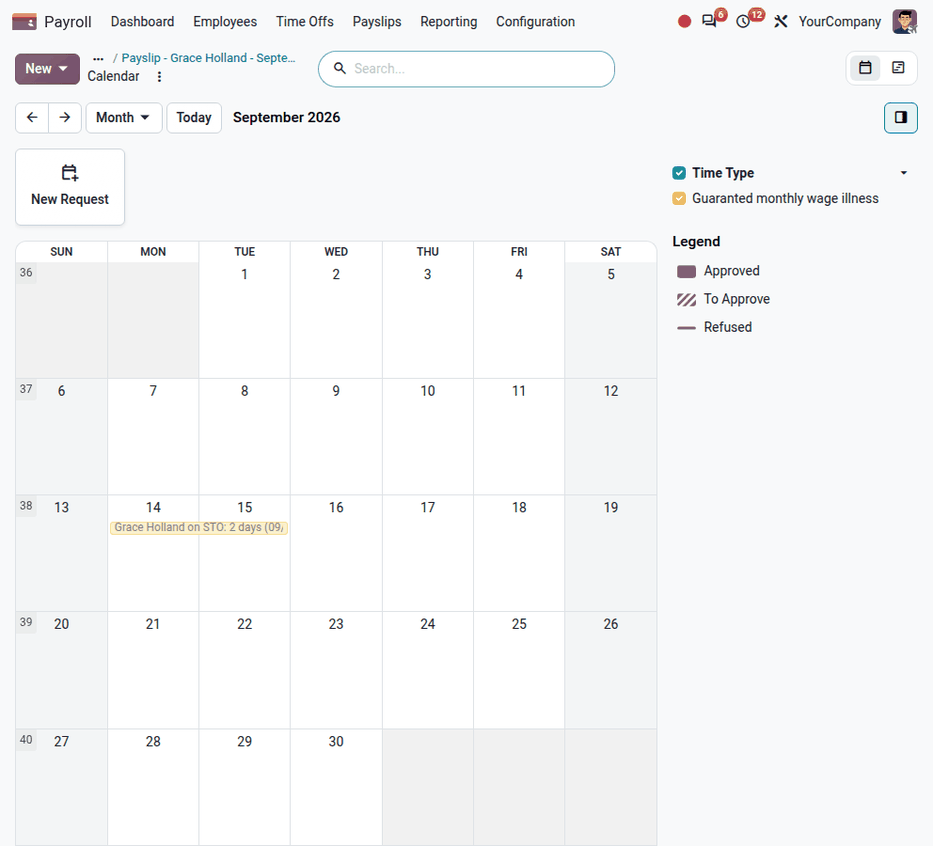
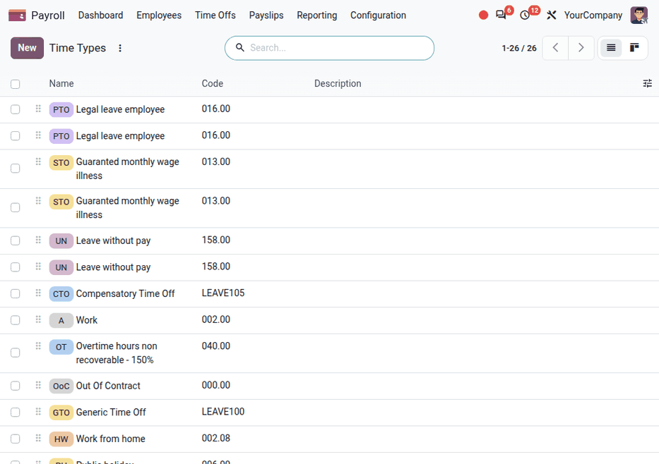
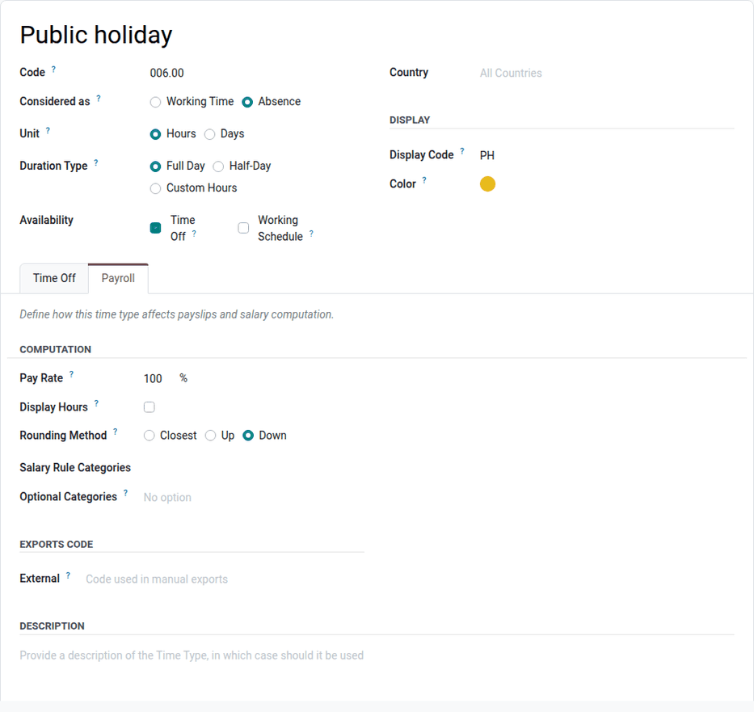
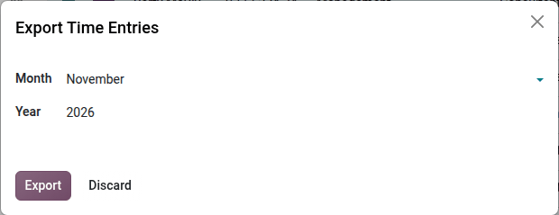

===========
Worked time
===========

To compute a payslip, the **Payroll** app needs to know how each employee spent their time during
the pay period: how many days and hours were worked, and how many were spent on paid or unpaid time
off. Each kind of time is identified by a *time type*, such as :guilabel:`Work`, :guilabel:`Public
holiday`, or :guilabel:`Leave without pay`.

Odoo computes this worked time automatically, for every day of the period, from the following
sources:

- The employee's :doc:`working schedule <working_schedules>`, as defined on the version of their
  :doc:`employee record <contracts>` valid on that day. Each line of the working schedule has a time
  type, :guilabel:`Work` by default.
- If the employee is :guilabel:`Attendance Based`, their check-ins and check-outs in the
  **Attendances** app replace the working schedule.
- The employee's approved time off, from the **Time Off** app. The time type of the time off
  request replaces the scheduled working time it covers.
- The company's public holidays, configured in :menuselection:`Payroll app --> Configuration -->
  Time Management --> Company Holidays`.

Nothing has to be generated or validated: the worked time is recomputed every time a draft payslip
is computed. The result appears at the top of the payslip, as one card per time type, with the
number of days and hours and the corresponding amount (see :ref:`payslips
<payroll/payslips/worked-days>`).

.. note::
   When a time off is approved, refused, or cancelled, or when a version of an employee record is
   modified, the draft payslips covering that period are automatically updated.

.. tip::
   *Time rules* can reclassify part of the worked time, for example to turn the hours worked beyond
   the working schedule into overtime. Time rules are configured in the **Time Off** and
   **Attendances** apps.

.. _payroll/conflicts:
.. _payroll/regenerate-work-entries:
.. _payroll/new-work-entry:

Review and correct the worked time
==================================

Before computing payslips, make sure all time off requests of the period are approved or refused.
When :ref:`starting a pay run <payroll/new-pay-run>`, Odoo warns if time off still needs to be
reviewed, or if no time off at all is recorded for the period.

To check or correct the worked time of a specific employee, open their draft payslip, then click the
:icon:`calendar_today_f` :guilabel:`Calendar` smart button. The calendar of the employee for the
payslip period opens, showing their time off and the other time entries recorded for them.

To record missing time, such as a sick day the employee did not encode, or extra hours, click
:guilabel:`New`, then :guilabel:`New Time Off` (or click a day of the calendar), select the
:guilabel:`Time Type`, the dates, and the duration, then save. Payroll and time off managers can
select any time type here, including working time types such as :guilabel:`Extra Hours`.

Once the time entry is approved, return to the payslip using the breadcrumbs: the payslip is updated
with the new worked time.

.. important::
   If the source of the error is in another app, such as wrong attendances in the **Attendances**
   app, or a wrong working schedule on the employee record, correct it there: the worked time is
   computed again from the corrected data.

   Time off approved *after* the payslip of the period was validated does not change that payslip.
   Instead, the time off and the payslip are flagged so that the payslip can be corrected. See
   :doc:`time_off_to_report`.

.. _payroll/work-entry-types:

Time types
==========

Time types define how each kind of time is counted and paid. To view them, navigate to
:menuselection:`Payroll app --> Configuration --> Time Management --> Time Types`.

Odoo provides generic time types, as well as country-specific ones that are installed with the
:doc:`payroll localization <payroll_localizations>`. Use the :guilabel:`Working Time` and
:guilabel:`Absence Time` filters, or group by :guilabel:`Considered as`, to list each kind of time
type.

.. warning::
   The time types of the payroll localization are used by its salary rules. Modifying them can
   change the result of the payslips. When a preconfigured time type is modified, Odoo stops
   updating it automatically, and a :guilabel:`Reset` button appears on its form to restore the
   standard configuration.

.. _payroll/new-work-entry-type:

Create or modify a time type
----------------------------

Click :guilabel:`New` to create a time type, or open an existing one. Configure the following fields
in the top part of the form:

- :guilabel:`Name`: The name of the time type, such as `Paid Time Off` or `Work From Home`.
- :guilabel:`Code`: The code used to reference the time type in the salary rules and in the
  exports. Changing the code of an existing time type can break the salary rules that use it.
- :guilabel:`Considered as`: Select :guilabel:`Working Time` or :guilabel:`Absence`.
- :guilabel:`Availability`: Tick :guilabel:`Time Off` if employees can select this time type in
  their time off requests, and :guilabel:`Working Schedule` if it can be used on the lines of a
  :doc:`working schedule <working_schedules>`.
- :guilabel:`Country`: Select a country to make the time type available only for companies of that
  country. Leave it empty for all countries.
- :guilabel:`Display Code` and :guilabel:`Color`: The short code (three letters maximum) and the
  color used to display the time type, for example on the payslip and in the calendars.

.. note::
   When the **Time Off** app is installed, the :guilabel:`Unit` and :guilabel:`Duration Type`
   fields, and a *Time Off* tab, define how time off of this type is requested, approved, and
   allocated. Refer to the **Time Off** documentation for details.

Then, configure how the time type is paid in the *Payroll* tab:

- :guilabel:`Pay Rate`: The percentage of the wage paid for this time. For example, `100` for
  standard work or paid time off, `0` for unpaid time off, or `150` for overtime paid at time and a
  half.
- :guilabel:`Display Hours`: Tick this checkbox to show the hours, and not only the days, of this
  time type on the payslip. This field is hidden for Belgian time types.
- :guilabel:`Rounding Method`: For time types requested in days or half-days, select how partial
  days are rounded on the payslip: to the :guilabel:`Closest` value, :guilabel:`Up`, or
  :guilabel:`Down`.
- :guilabel:`Salary Rule Categories`: The salary rule categories that this time type contributes
  to. The salary rules of the pay structure use these categories to compute the amounts, for
  example to add extra hours to the basic salary.
- :guilabel:`Optional Categories`: Additional categories that HR can add, as options, on time off of
  this type.
- :guilabel:`External`: The code of the time type in a third-party payroll software, used in the
  :ref:`time entries export <payroll/work-entries/export>`.
- :guilabel:`Description`: An explanation of when this time type should be used.

.. _payroll/work-entries/export:

Export time entries
===================

When payslips are computed by an external payroll provider, the worked time can be exported to a
CSV file. Navigate to :menuselection:`Payroll app --> Employees --> Employees`, switch to the list
view, select the employees to export, click :icon:`settings_f` :guilabel:`Actions`, then select
:guilabel:`Export Time Entries`.

In the pop-up window, select the :guilabel:`Month` and :guilabel:`Year` to export, then click
:guilabel:`Export`. The file contains one line per employee, day, and time type, with the
:guilabel:`Code` and :guilabel:`External Code` of the time type, the employee's external code, and
the duration in hours.

.. tip::
   The external code of an employee is set in the *Settings* tab of their employee record, in the
   :guilabel:`Export` section. The external code of the company is set on the company form.

.. seealso::
   - :doc:`payslips`
   - :doc:`pay_runs`
   - :doc:`time_off_to_report`
