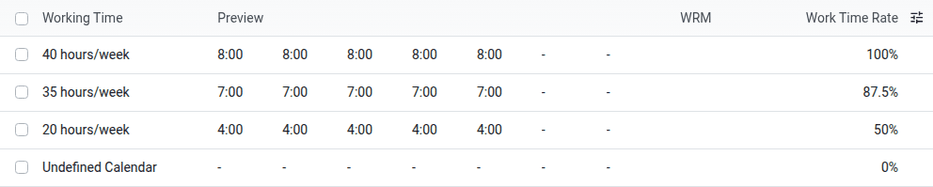
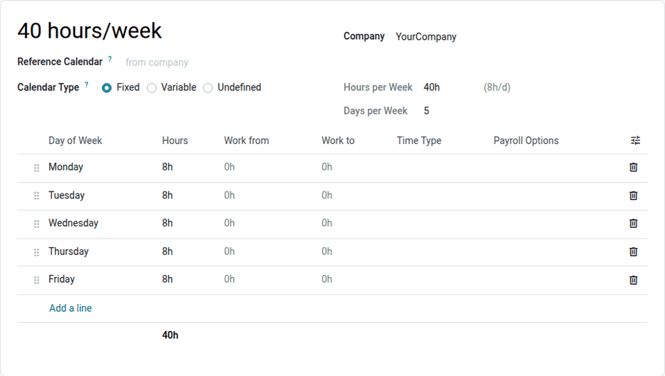

=================
Working schedules
=================

In Odoo, *working schedules* define the hours employees are expected to work. The working schedule
selected on the :doc:`employee record <contracts>` is the basis of the :doc:`worked time
<work_entries>` computed on the payslips: each hour of the schedule counts as worked time, unless
it is covered by a time off or a public holiday.

To view the working schedules, navigate to :menuselection:`Payroll app --> Configuration --> Time
Management --> Working Schedules`. Each line displays the name of the schedule, a preview of the
hours per day of the week, and its :guilabel:`Work Time Rate` compared to a full-time schedule.

.. _payroll/new-working-schedule:

Create a working schedule
=========================

Click :guilabel:`New`, and configure the following fields:

- Name: Enter a clear name, such as `Part-time 20 hours/week`.
- :guilabel:`Company`: The company that uses this schedule.
- :guilabel:`Reference Calendar`: The full-time schedule used to compute the work time rate of this
  schedule. If empty, the default working schedule of the company is used.
- :guilabel:`Calendar Type`: Select one of the following options:

  - :guilabel:`Fixed`: The same weekly pattern repeats every week. The working time is defined by
    the lines of the schedule.
  - :guilabel:`Variable`: The working time is set on specific dates, in a calendar, for example for
    a rotation over several weeks.
  - :guilabel:`Undefined`: There are no predefined working hours. The employee can work whenever
    they want, optionally up to the :guilabel:`Hours per Week` and :guilabel:`Days per Week`
    entered on the schedule. Use this type for employees without a fixed schedule.

- :guilabel:`Hours per Week` and :guilabel:`Days per Week`: Computed from the lines for a fixed
  schedule, entered manually for the other types. The average number of hours per day is displayed
  next to the hours per week.

For a fixed schedule, add one line per working day, with the :guilabel:`Day of Week` and the number
of :guilabel:`Hours`. The total of the week is displayed below the lines.

Additional columns can be displayed with the :icon:`tune` :guilabel:`(Optional columns)` icon:

- :guilabel:`Work from` and :guilabel:`Work to`: The start and end times of the working period,
  when the schedule must define precise hours (for example, morning and afternoon on separate
  lines).
- :guilabel:`Time Type`: The :ref:`time type <payroll/work-entry-types>` of the hours of this line.
  If empty, the time type of the employee's structure type is used (usually :guilabel:`Work`). Only
  time types available for working schedules can be selected.
- :guilabel:`Payroll Options`: If the time type allows options, such as :ref:`premium pay
  <payroll/salary_rules/rule-categories>`, the options applied to the hours of this line.

The :icon:`light_mode` :guilabel:`Public Holidays` and :icon:`person` :guilabel:`Employees` smart
buttons of the form show the public holidays that apply to the schedule, and the employees who use
it.

.. tip::
   Public holidays are managed in :menuselection:`Payroll app --> Configuration --> Time Management
   --> Company Holidays`. Refer to the :doc:`../time_off/public_holidays` documentation.

.. seealso::
   - :doc:`work_entries`
   - :doc:`contracts`
