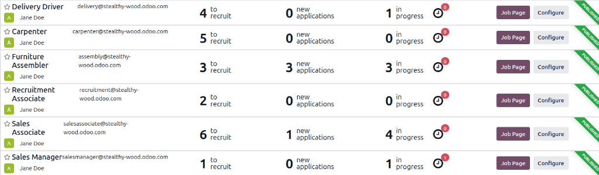
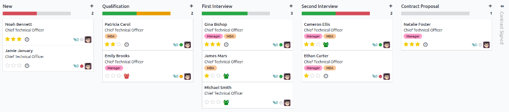
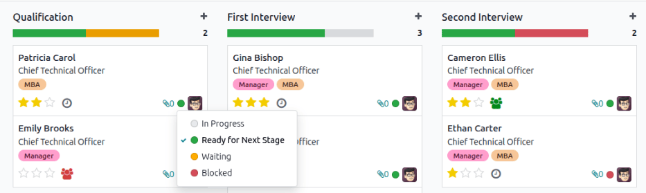
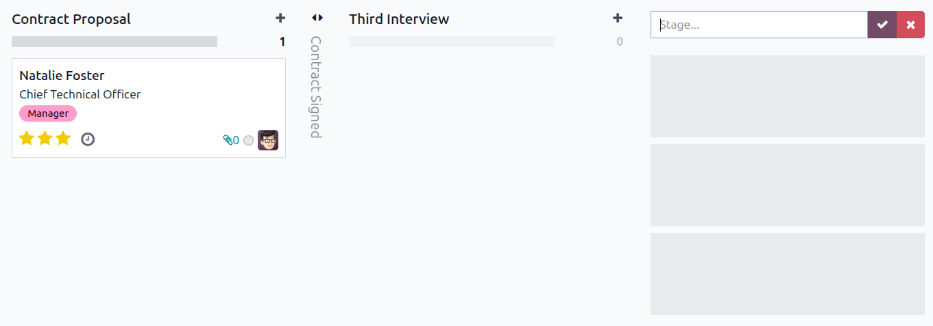
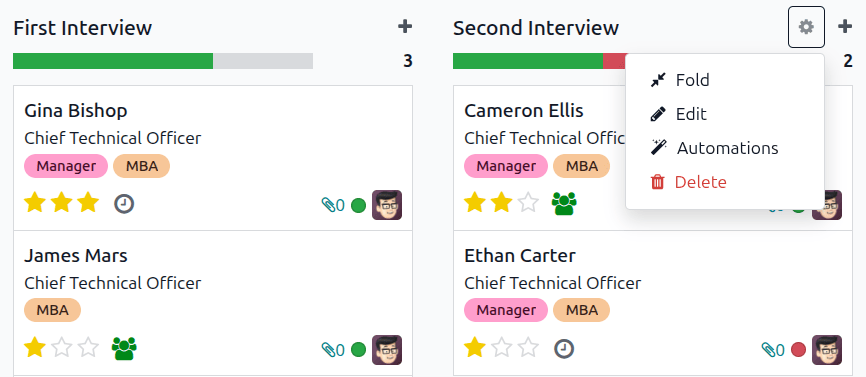
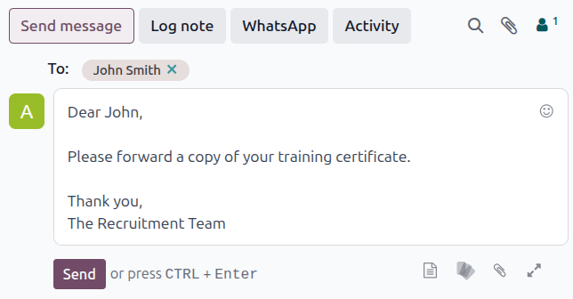
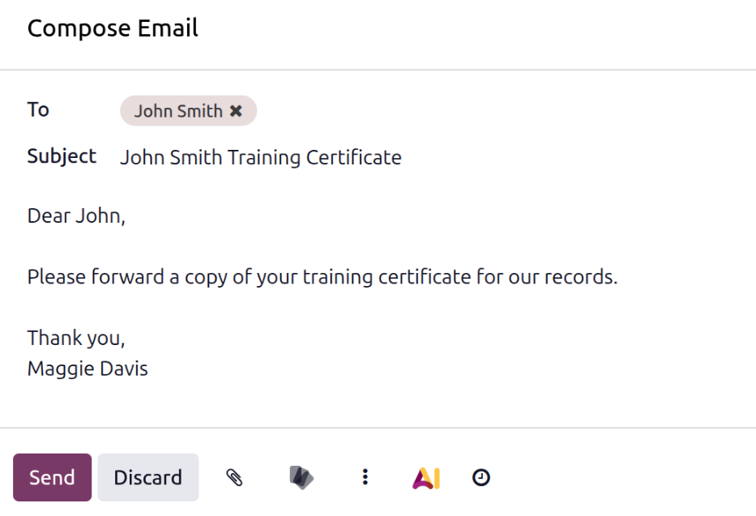

:show-content:

===========
Recruitment
===========

Odoo keeps all job applicants organized with a preconfigured series of steps and stages that each
applicant goes through. Each stage has specific steps that should be performed. These range from
scheduling a phone call, conducting an interview, or sending a job offer, for example. This process
is referred to as the *applicant flow.*

When an applicant applies for a job position, an *applicant card* is automatically created in Odoo's
**Recruitment** app for that specific job position. As the applicant progresses through the
recruitment pipeline, the recruitment team moves their card from one stage to the next.

:ref:`Stages can be configured <recruitment/modify-stages>` so that an email is automatically sent
out using a set, preconfigured template as soon as an applicant's card enters a stage. These
automated emails are defined on each stage in the applicant flow.

The flow described in this document is Odoo's default configuration, but it can be customized to
suit any recruitment process.

.. note::
   Stages apply to all job positions unless :ref:`marked as job-specific
   <recruitment/customize-stages>`  Changes to stages (e.g., additions, deletions) affect all
   positions unless explicitly scoped.

.. _recruitment/settings:

Settings
========

Before creating a job position in Odoo, configure the necessary settings for the **Recruitment**
app. To view and edit the settings, navigate to :menuselection:`Recruitment app --> Configuration
--> Settings`. After any changes are made, click the :guilabel:`Save` button in the corner to save
all the changes.

Job posting
-----------

The *Job Posting* section of the settings page specifies where job positions can be posted. To post
job positions on the website, enable the :guilabel:`Online Posting` option. There is also an option
to post to :ref:`job boards <recruitment/post-job/boards>`.

Process
-------

The *Process* section of the settings page specifies what the database can and cannot do during the
recruitment process.

Send interview survey
~~~~~~~~~~~~~~~~~~~~~

Odoo is capable of having a survey sent to an applicant to gather more information about them.
Surveys can be thought of as exams, or questionnaires, and can be customized in various ways to
provide the recruitment team with valuable insights into the applicant

Enable the :guilabel:`Send Interview Survey` option to send surveys to applicants. Once enabled, an
:icon:`fa-arrow-right` :guilabel:`Interview Survey` internal link appears. Click the
:icon:`fa-arrow-right` :guilabel:`Interview Survey` link to navigate to a list of all created
surveys.

This list includes all surveys that were created in the database, not only surveys used in the
**Recruitment** app. If no surveys have been created, the surveys list displays a :guilabel:`No
Survey Found` message, and presents options to create a survey from several preconfigured survey
templates.

.. seealso::
   :doc:`create/edit surveys <../marketing/surveys/create>`

.. note::
   Enabling the :guilabel:`Send Interview Survey` option will install the **Surveys** application
   once the settings are saved, if not already installed.

Salary package configurator
~~~~~~~~~~~~~~~~~~~~~~~~~~~

When sending an offer to an applicant, an expiration date can be set on the offer. Enter the number
of days an offer is valid for in the :guilabel:`days` field. After the set amount of days has
passed, if the applicant has not accepted the offer, the offer is no longer available.

In-app purchases
----------------

The *In-App Purchases* section of the settings page deals with items that require credits to use,
such as :abbr:`SMS (Short Message Service)` text messages, and digitizing résumés.

.. seealso::
   :doc:`SMS pricing and FAQs <../marketing/sms_marketing/pricing_and_faq>`

Send SMS
~~~~~~~~

It is possible to send text messages to applicants directly through the **Recruitment** app. This
feature requires credits to use. Click the :icon:`fa-arrow-right` :guilabel:`Manage Service & Buy
Credits` internal link, and follow the steps to :doc:`purchase credits
<../marketing/sms_marketing/pricing_and_faq>`.

.. _recruitment/cv-ocr:

Résumé digitization (OCR)
~~~~~~~~~~~~~~~~~~~~~~~~~

When an application is submitted using any of the available methods, such as an online application
submission, emailing a resume to the job position alias, or creating an applicant record directly
from the database, it is possible to have Odoo extract the applicant's name, phone number, and email
address from the résumé and populate the applicant's form. To do so, enable the :guilabel:`Résumé
Digitization (OCR)` option.

When enabled, additional options appear. Click on the corresponding radio button to select one of
the following options:

- :guilabel:`Do not digitize`: This option turns off résumé digitization.
- :guilabel:`Digitize on demand only`: This option only digitizes resumes when requested. A
  :guilabel:`Digitize document` button appears on applicant cards. When clicked, the résumé is
  scanned and the applicant's card is updated.
- :guilabel:`Digitize automatically`: This option automatically digitizes all résumés when they are
  submitted.

Beneath these options are two additional links. Click the :icon:`fa-arrow-right` :guilabel:`Manage
Service & Buy Credits` internal link to purchase credits for résumé digitization. Click the
:icon:`fa-arrow-right` :guilabel:`View My Services` internal link to view a list of all current
services, and their remaining credit balances.

For more information on document digitization and :abbr:`IAP's (in-app purchases)`, refer to the
:doc:`In-app purchase (IAP) <../essentials/in_app_purchase>` documentation.

.. note::
   The :guilabel:`Do not digitize` option may appear redundant but serves a distinct purpose.
   Disabling the :guilabel:`Résumé Digitization (OCR)` option uninstalls the module, while
   :guilabel:`Do not digitize` keeps the module installed but inactive—allowing the user to
   re-enable digitization later without reinstalling the module.

View job positions
==================

To access the Kanban view for a job position, navigate to the main :menuselection:`Recruitment` app
dashboard, which is the default view when opening the application. All job positions appear on the
main dashboard. Click a job position card to navigate to the Kanban view for all the applicants for
that particular job position.

Inside the job application, the Kanban stages appear, with all the applicants populated in their
respective columns, indicating what stage they are currently in. In Odoo, six default stages are
configured:

- :ref:`New <recruitment/recruitment_flow/new>`
- :ref:`Qualification <recruitment/recruitment_flow/qualification>`
- :ref:`First Interview <recruitment/recruitment_flow/first-interview>`
- :ref:`Second Interview <recruitment/recruitment_flow/second-interview>`
- :doc:`Contract Proposal <recruitment/offer_job_positions>`
- :ref:`Contract Signed <recruitment/offer_job_positions/contract-signed>`

The last column, :guilabel:`Contract Signed`, is folded by default. Folded columns appear gray, and
the applicants in it are hidden from view. To expand the folded stage and view the applicant cards
for that column, click anywhere on the thin gray column that says the stage name and the column
expands, revealing the applicants.

Each stage has a color-coded bar beneath the stage name, providing status information for the
applicants in that specific stage. The status colors are:

- :guilabel:`Gray`: The applicant is still in progress in the current stage and is neither ready nor
  blocked from the next stage.
- :guilabel:`Green`: The applicant is ready to move to the next stage.
- :guilabel:`Yellow`: The applicant is waiting for something before a decision can be made.
- :guilabel:`Red`: The applicant is blocked from moving to the next stage.

The status for each card is set manually. To set the status, click on the small circle in the corner
of the applicant card. A status pop-up window appears. Click on the desired status for the
applicant. The status dot on the applicant card as well as the status bar updates.

.. tip::
   The names for the four status colors (`In Progress`, `Ready for Next Stage`, `Waiting`,and
   `Blocked`) :ref:`can be modified <recruitment/modify-stages>`, if desired.

.. _recruitment/customize-stages:

Customize stages
================

Stages can be modified, added, or deleted to match the particular hiring steps of a business.

New stage
---------

To create a new stage, hover to the right of the :guilabel:`Contract Signed` stage, revealing an
:guilabel:`Add Stage` option. Click :guilabel:`Add Stage` and a new column appears. Enter the title
for the new stage in the blank box at the top of the new stage, then click the :icon:`fa-check`
button. The new column appears, and another new stage appears. If no new stages are needed, click
the :icon:`fa-multiply` button in the new stage to close the new stage. Once the stage is created,
click and drag the stage to move it to the desired position in the workflow.

.. _recruitment/modify-stages:

Modify stage
------------

To modify the settings of a stage, hover over the name of the stage, and a :icon:`fa-cog`
:guilabel:`(Settings)` icon appears in the upper corner. Click the :icon:`fa-cog`
:guilabel:`(Settings)` icon, then click :icon:`fa-pencil` :guilabel:`Edit` from the resulting
drop-down menu. An *Edit: (Stage)* pop-up window appears. Make any desired modifications in the
pop-up window, then click :guilabel:`Save` when done.

         displays when clicked.

.. _recruitment/edit-stage:

Edit stage
~~~~~~~~~~

The *Edit: (Stage)* form is where the stage's settings are configured. The only required field is
the :guilabel:`Stage Name`. modify the stage as desired, then click :guilabel:`Save` to save the
changes.

The fields to be populated or modified are:

- :guilabel:`Stage Name`: Type in a name for the stage.
- :guilabel:`Email Template`: Select an :ref:`email template <recruitment/templates>` to be used
  from the drop-down menu. If a template is selected, when the applicant card enters the stage, an
  email is automatically sent to the applicant using the selected template.
- :guilabel:`Folded in Kanban`: Check the box to have the stage appear folded (hidden) at all times
  in the default view.
- :guilabel:`Hired Stage`: Check the box if this stage indicates that the applicant is hired. When
  an applicant's card enters this stage, the card displays a :guilabel:`Hired` banner in the upper
  right corner. If this box is checked, this stage is used to determine the hire date of an
  applicant.
- :guilabel:`Job Specific`: If the stage only applies to specific job positions, select the job
  positions from the drop-down menu. Multiple job positions can be selected.
- :guilabel:`Show in Referrals`: Check the box if this stage should be seen in the **Referrals**
  application, and allow the referrer to accrue points when a referral of theirs reaches this stage.
  The **Referrals** app must be installed to use this option.
- :guilabel:`Points`: If :guilabel:`Show in Referrals` is enabled, this field appears. Enter the
  number of points the employee earns when an applicant moves to this stage.
- :guilabel:`Days to rot`: Enter the number of days that pass before the applicant is considered
  stale. Enter `0` to disable this.
- :guilabel:`Tooltips` section: There are four preconfigured status labels (colored circles) for
  each applicant's card, indicating its status. These colors are displayed at the top of each stage
  to reflect the statuses of the applicants in the stage. The *names* for the label can be modified,
  but the label itself (the color) cannot. The default names and labels are: :guilabel:`In Progress`
  (gray), :guilabel:`Blocked` (red), :guilabel:`Waiting` (yellow),  and :guilabel:`Ready for Next
  Stage` (green).
- :guilabel:`Requirements` section: Enter any internal notes for this stage explaining any
  requirements of the stage.

Delete stage
------------

If a stage is no longer needed, the stage can be deleted. To delete a stage, hover over the name of
the stage, and click the :icon:`fa-cog` :guilabel:`(Settings)` icon that appears. Click
:icon:`fa-trash` :guilabel:`Delete` and a *Confirmation* pop-up warning appears, asking
:guilabel:`Are you sure you want to delete this column?` Click :guilabel:`Delete` to delete the
stage.

.. important::
   If there are applicants currently in the stage being deleted, an error pops up when attempting to
   delete that stage. The records in that stage must be deleted, archived, or moved to a different
   stage before the stage can be deleted.

.. _recruitment/templates:

Email templates
===============

To communicate with the applicant, Odoo has several preconfigured email templates that can be used.
The preconfigured email templates and when to use them are as follows:

- :guilabel:`Recruitment: Applicant Acknowledgement`: This template is used to let the applicant
  know their application was received. This email is automatically sent out once the applicant is in
  the :guilabel:`New` stage.
- :guilabel:`Recruitment: Interest`: This template is used to let the applicant know that their
  application caught the recruiter's attention, and they have been shortlisted for either a phone
  call or an interview.
- :guilabel:`Recruitment: Not interested anymore`: This template is used when an applicant
  communicates that they are no longer interested in the position, and thanks them for their time
  and consideration.
- :guilabel:`Recruitment: Refuse`: This template is used when an applicant is no longer being
  considered for the position.
- :guilabel:`Recruitment: Schedule Interview`: This template is used to let the applicant know that
  they have passed the :guilabel:`Initial Qualification` stage, and they will soon be contacted to
  set up an interview with the recruiter. This email is automatically sent out once the applicant is
  in the :guilabel:`Initial Qualification` stage.

.. note::
   Email templates can be created, modified, and deleted to suit the needs of a business. For more
   information on email templates, refer to the :doc:`../general/companies/email_template` document.

To manually send an email, click :guilabel:`Send message` in the chatter. A text box appears, as
well as the applicant's email address. Enter the message in the text box.

Click the :icon:`fa-expand` :guilabel:`(Open Full composer)` icon in the bottom corner of the
:guilabel:`Send Message` tab in the chatter. A *Compose Email* pop-up window loads, with the
:guilabel:`To` and :guilabel:`Subject` pre-populated. The applicant's email address is entered in
the :guilabel:`To` field, and the :guilabel:`Subject` is `(Applicant's Name)`.

To use a preconfigured email template, click the :icon:`fa-ellipsis-v` :guilabel:`(Templates)` icon
in the bottom of the window. Select the email template to use from the drop-down menu.

Preconfigured email templates may contain dynamic placeholders so unique information can be
populated in the email for a more personalized message to the applicant. Several preconfigured email
templates are available to choose from. Depending on the template selected, the email subject or
body may change.

.. note::
   Only the email templates that are configured for the model load. Other email templates come
   preconfigured in Odoo, but if they are not configured for the recruitment application, they do
   not appear in the list of available templates.

If any attachments need to be added, click the :icon:`fa-paperclip` :guilabel:`(Add Attachment)`
button at the bottom of the window. Navigate to the file to be attached, then click :guilabel:`Open`
to attach it. To delete an attachment, click the :icon:`fa-times` :guilabel:`(Delete)` icon at the
end of the attachment.

If any changes need to be made to the email, edit the body of the email. If the edits should be
saved to be used in the future, the email can be saved as a new template. Click the
:icon:`fa-ellipsis-v` :guilabel:`(Templates)` button in the bottom of the window, and select
:guilabel:`Save as Template`. Options are presented to either overwrite an existing template, or
save a new template. Click on an existing template name to overwrite that template, or click
:guilabel:`Save as Template` to save a new template. A *Create a Mail Template* pop-up window loads.
Enter a name for the template in the :guilabel:`Template Name` field, then click :guilabel:`Save
Template`.

To send the email, click :guilabel:`Send` and the email is sent to the applicant and the email
appears in the chatter.

         preconfigured template.

.. seealso::
   - :doc:`recruitment/new_job`
   - :doc:`recruitment/post_job`
   - :doc:`recruitment/recruitment_flow`
   - :doc:`recruitment/add_applicants`
   - :doc:`recruitment/schedule_interviews`
   - :doc:`recruitment/offer_job_positions`
   - :doc:`recruitment/refuse_applicant`
   - :doc:`recruitment/application_analysis`
   - :doc:`recruitment/source_analysis`
   - :doc:`recruitment/hiring_velocity`
   - :doc:`recruitment/team_performance`

.. toctree::
   :titlesonly:

   recruitment/new_job
   recruitment/post_job
   recruitment/recruitment_flow
   recruitment/add_applicants
   recruitment/schedule_interviews
   recruitment/offer_job_positions
   recruitment/refuse_applicant
   recruitment/application_analysis
   recruitment/source_analysis
   recruitment/hiring_velocity
   recruitment/team_performance
