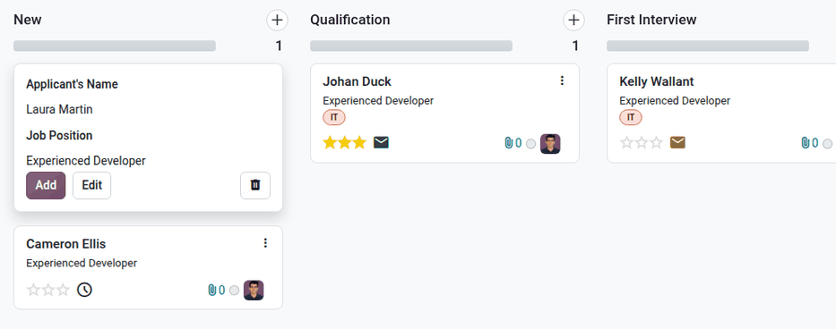
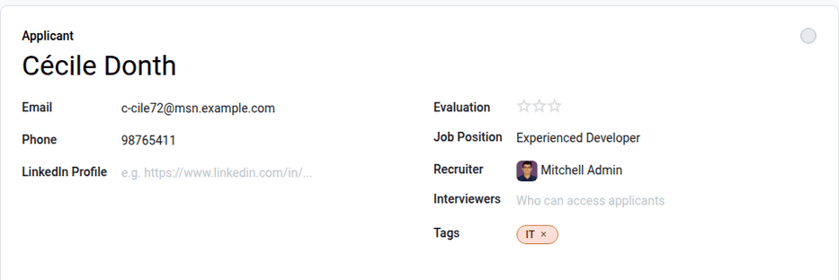
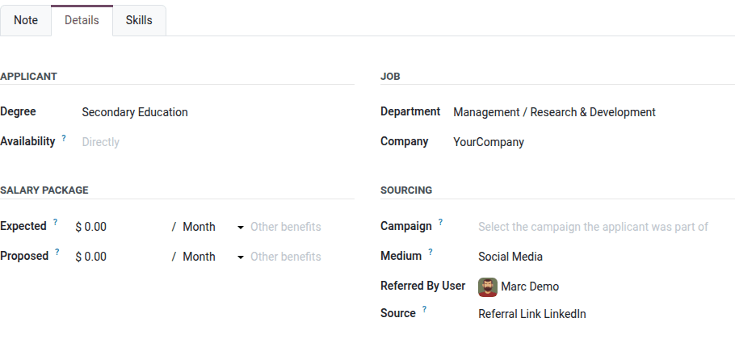
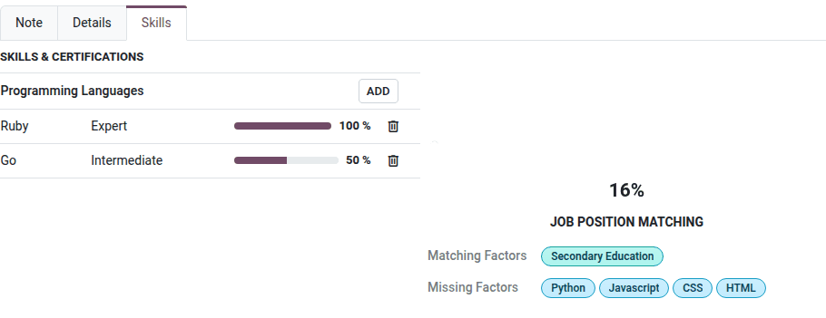

==============
Add applicants
==============

Once an applicant submits an application, either using the online application, or emailing a job
position alias, an applicant card is automatically created in the **Recruitment** app.

However, in some instances, applicants may need to be created manually in the database. This could
be necessary if, for example, a company accepts paper applications in the mail, or is meeting
prospective applicants at an in-person job fair.

To view current applicants, navigate to the :menuselection:`Recruitment` app, then click the desired
job position card. Doing so reveals the *Applications* page, which displays all applicants for that
specific role, in a default Kanban view, organized by stage.

Add applicants from a job position's *Applications* page by using either the :icon:`fa-plus`
:ref:`(quick add) <recruitment/add_applicants/quick-add-applicant>` button, or the :ref:`New
<recruitment/add_applicants/create-new-applicant>` button.

.. tip::
   To create an application from an existing :doc:`talent <talent_pools>`, use the :guilabel:`Apply
   to Jobs` button on the talent's form, or the :guilabel:`Matching Talents` button on the job
   position form, instead of entering the applicant's information again.

.. _recruitment/add_applicants/quick-add-applicant:

Quick add
=========

On the job position's *Applications* page, click the :icon:`fa-plus` :guilabel:`(Quick add)` button
next to the name of the desired stage, and a new applicant card loads.

Enter the following information on the card:

- :guilabel:`Applicant's Name`: Enter the applicant's name in this field. This is displayed as the
  card title in the Kanban view of the *Applications* page.
- :guilabel:`Job Position`: The current job position populates this field. To change it, select a
  different job position from the drop-down menu. The newly-created card then appears on the
  *Applications* page for that selected job position.

After the information is entered, click :guilabel:`Add`. This adds the applicant card to the stage,
and a new blank applicant card appears. Click the :icon:`fa-trash` :guilabel:`(Discard)` icon to
close the blank card.

If preferred, after entering the :guilabel:`Applicant's Name` in the Kanban card, click
:guilabel:`Edit`, and a detailed applicant form loads. :ref:`Enter the information
<recruitment/add_applicants/create-new-applicant>` on the new applicant form.

.. _recruitment/add_applicants/create-new-applicant:

New applicant form
==================

On the *Applications* page, click the :guilabel:`New` button in the corner, and a blank
*Applications* form loads.

By default, the :guilabel:`Job Position` and :guilabel:`Recruiter` fields are populated according to
the :ref:`job position configurations <recruitment/new_job/create-job-position>`. Additionally, the
:guilabel:`Department` and :guilabel:`Company` fields in the *Details* tab may also be populated, if
those details are configured on the job position.

Complete the fields in the following sections on the new applicant form.

.. note::
   Depending on installed applications and configurations, some fields may not be displayed.

.. _recruitment/add_applicants/applicant-details:

Applicant section
-----------------

- :guilabel:`Applicant`: Enter the applicant's name. This field is displayed as the card title in
  the Kanban view of the *Applications* page. This is the **only** required field on the form.
- :guilabel:`Email`: Enter the applicant's email address.
- :guilabel:`Phone`: Enter the applicant's phone number.
- :guilabel:`LinkedIn Profile`: Enter the web address for the applicant's personal profile on
  LinkedIn.
- :guilabel:`Evaluation`: Represents a rating for the applicant: one star (:icon:`fa-star`
  :icon:`fa-star-o` :icon:`fa-star-o`) is :guilabel:`Good`, two stars (:icon:`fa-star`
  :icon:`fa-star` :icon:`fa-star-o`) is :guilabel:`Very Good`, and three stars (:icon:`fa-star`
  :icon:`fa-star` :icon:`fa-star`) is :guilabel:`Excellent`.
- :guilabel:`Job Position`: Select the job position the applicant is applying for. This field is
  populated by default but can be changed if necessary. If left empty, the application is
  considered a spontaneous application.
- :guilabel:`Recruiter`: Select the employee responsible for the entire recruitment process for the
  job position. This field is populated by default with the recruiter of the job position, but can
  be changed if desired.
- :guilabel:`Interviewers`: Using the drop-down menu, select the users who conduct the interviews.
  Any internal user of the company can be selected. Users who are not *Officers* or
  *Administrators* of the **Recruitment** app automatically receive the *Interviewer*
  :doc:`access rights <../../general/users/access_rights>`, which give them access to the
  applications they are assigned to.
- :guilabel:`Tags`: Select as many tags as desired from the drop-down menu. To add a tag that does
  not exist, type in the tag name, then click :guilabel:`Create "new tag"` from the resulting
  drop-down menu. Tags are managed in :menuselection:`Recruitment app --> Configuration -->
  Applications --> Tags`.

.. tip::
   To add custom fields to the applicant form, click the :icon:`fa-ellipsis-v` :guilabel:`(Actions)`
   icon next to the applicant's name, then click :guilabel:`Edit Properties`. Properties are shared
   by all the applicants of the company.

Note tab
--------

Enter any notes regarding the applicant in this tab. These notes are only visible internally to
users who have the proper access rights.

.. example::
   A recruiter met an applicant at a job fair and had a discussion regarding the job position as
   well as the applicant's prior history. They also had a furniture assembly display, with different
   pieces to be assembled. This allowed the recruiters to view the applicant's skills in real time.
   The recruiter uses the *Note* tab to enter the following information:

   `Met the applicant at a job fair. They have previously worked in furniture assembly for Furniture
   R Us. They demonstrated their skills at our assembly display, and finished assembling a chair in
   under 3 minutes - which was the fastest among all participants today.`

Details tab
-----------

The *Details* tab houses various information regarding the applicant and the job position.

Applicant section
~~~~~~~~~~~~~~~~~

Enter the following information in the respective fields:

- :guilabel:`Degree`: Select the applicant's highest level of education from the drop-down menu.
  Degrees are managed in :menuselection:`Recruitment app --> Configuration --> Applications -->
  Degrees`.

- :guilabel:`Availability`: Select the available start date for the applicant. To select a date,
  click on the field to reveal a calendar. Navigate to the date the applicant can start, and click
  to select it. Leaving this field blank indicates the applicant can start immediately.

Job section
~~~~~~~~~~~

The following fields are preconfigured when creating a new applicant, as long as these fields are
specified on the job position form. Editing the fields is possible, if desired.

- :guilabel:`Department`: Select the job position's department using the drop-down menu.
- :guilabel:`Company`: Select the job position's company using the drop-down menu. This field
  **only** appears in a multi-company database.

Salary package section
~~~~~~~~~~~~~~~~~~~~~~

Configure both the expected and proposed salary and benefits in this section. Fill out the following
fields:

- :guilabel:`Expected`: Enter the applicant's requested salary amount in this field, then select the
  period the amount refers to (:guilabel:`Hour`, :guilabel:`Day`, :guilabel:`Week`,
  :guilabel:`Bi-Week`, :guilabel:`Month`, or :guilabel:`Year`). The currency is the currency of the
  company. If any benefits are requested by the applicant, enter them in the :guilabel:`Other
  benefits` field. The benefits should be short and descriptive, such as `4 Weeks Vacation` or
  `Dental Plan`.
- :guilabel:`Proposed`: Enter the salary amount offered to the applicant in this field. The period
  is the same as for the expected salary. If any benefits are offered to the applicant, enter them in
  the :guilabel:`Other benefits` field. The benefits should be short and descriptive, such as
  `Unlimited Sick Time` or `Health Insurance`.

Sourcing section
~~~~~~~~~~~~~~~~

This section houses the details regarding the way the applicant applied for the job position. This
information is necessary for :doc:`employee referrals <../referrals>`, and allows for
:doc:`reporting on the channels with the highest applicant generation <source_analysis>`.

- :guilabel:`Campaign`: Using the drop-down menu, select the campaign the applicant was part of.
- :guilabel:`Medium`: Using the drop-down menu, specify how the applicant reached out, such as
  :guilabel:`Email`, :guilabel:`Social Media`, or :guilabel:`Website`. To add a new
  :guilabel:`Medium`, type in the medium, then click :guilabel:`Create "(new medium)"`.
- :guilabel:`Referred By User`: If referral points are to be earned for this applicant in the
  **Referrals** application, select the user who referred the applicant from the drop-down menu. The
  **Referrals** application **must** be installed for this field to appear.
- :guilabel:`Source`: Using the drop-down menu, select where the applicant comes from, such as
  :guilabel:`LinkedIn` or :guilabel:`Search engine`. To add a new :guilabel:`Source`, type in the
  source, then click :guilabel:`Create "(new source)"`.

When an applicant applies through a :ref:`tracker link <recruitment/new_job/configure-job-position>`
or a :doc:`referral link <../referrals/share_jobs>`, these fields are populated automatically.

Skills tab
----------

The *Skills* tab houses all the applicant's skills. As :ref:`skills are added <employees/skills>`,
Odoo compares the :ref:`expected skills and degree <recruitment/new_job/job-posting>` configured for
the job position with the applicant's skills and degree.

The :guilabel:`Job Position Matching` gauge updates in real time, showing the percentage of the
job requirements the applicant meets. Beneath the gauge, the :guilabel:`Matching Factors` list the
expected skills and degree the applicant has, and the :guilabel:`Missing Factors` list the ones the
applicant does not have. This aids recruiters when assessing an applicant.

The matching score is also displayed in the list view of the applications, and the
:guilabel:`Matching Score` filter in the search bar shows only the applicants with a score of at
least 50%, 60%, 70%, or 80%.

Applicant card actions
======================

On the Kanban view of the *Applications* page, click the :icon:`fa-ellipsis-v`
:guilabel:`(Dropdown menu)` icon on an applicant card to:

- :guilabel:`Schedule Interview`: Open the calendar to :doc:`schedule an interview
  <schedule_interviews>`.
- :guilabel:`Refuse`: :doc:`Refuse the applicant <refuse_applicant>`.
- :guilabel:`Archive`: Archive the application without refusing it.
- :guilabel:`Add to Pool`: Add the applicant to a :doc:`talent pool <talent_pools>`.
- Select a color for the card.

Applicants without any activity for longer than the number of days defined in the stage's
:ref:`Rotting in <recruitment/edit-stage>` field are highlighted, with the number of days since the
last activity.
