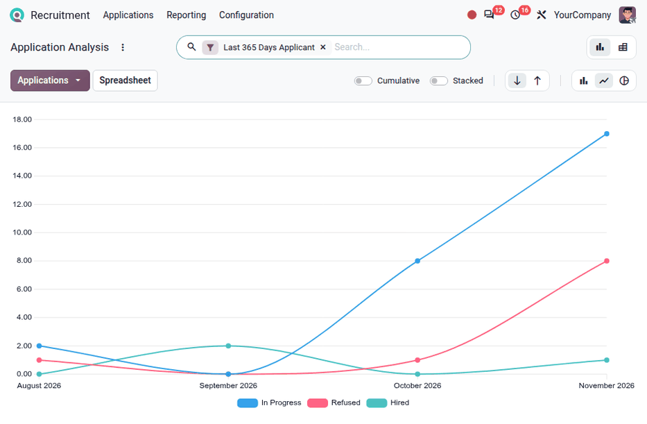
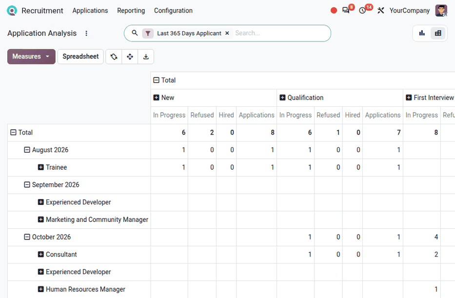
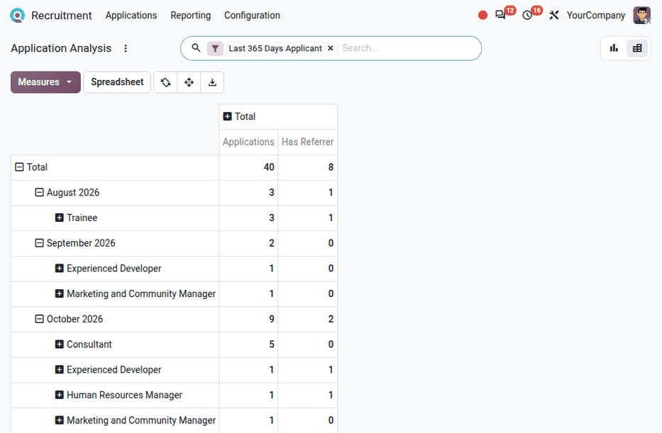

====================
Application analysis
====================

The *Application Analysis* report allows recruiting departments to see the total number of
applications submitted for the past 365 days. Along with the total, the number of hired applicants,
refused applicants, and those still in the pipeline are displayed.

This information can help the recruiting team see how the various rates align with their hiring
goals and pivot their strategies to acquire more desirable applicants.

Application Analysis report
===========================

To view the *Application Analysis* report, navigate to :menuselection:`Recruitment app --> Reporting
--> Application Analysis`. This presents a line chart of all applicants for the last 365 days (the
default :guilabel:`Last 365 Days Applicant` filter), by month.

Three separate color-coded metrics are presented: :guilabel:`In Progress`, :guilabel:`Refused`, and
:guilabel:`Hired`.

Hover the cursor over a month of the chart, and a pop-up window appears, displaying the specific
numbers for that month.

.. _recruitment/application_analysis/pivot:

Pivot table view
----------------

For a more detailed view of the information in the *Application Analysis* report, click the
:icon:`oi_view-pivot` :guilabel:`(Pivot)` icon in the corner. This displays all the information in a
pivot table.

In this default view, the months are displayed in the rows, with each job position nested beneath
them. The columns display the various stages of the recruitment pipeline, further divided by how
many applicants are :guilabel:`In Progress`, :guilabel:`Refused`, or :guilabel:`Hired`, along with
the total number of :guilabel:`Applications`. The displayed information can be modified, if
desired.

.. tip::
   To only view the total number of applicants, regardless of their stage, click
   :icon:`indeterminate_check_box` :guilabel:`Total` in the top row. All the stages collapse,
   displaying only the total number of applications that are :guilabel:`In Progress`,
   :guilabel:`Refused`, and :guilabel:`Hired`, along with the totals for all three in the
   :guilabel:`Applications` column. These numbers are organized by month, then job position.

Use case: applicants with referrals
~~~~~~~~~~~~~~~~~~~~~~~~~~~~~~~~~~~

To get a better understanding of how effective the company's :doc:`referral program <../referrals>`
is, the *Application Analysis* report can be modified to show how many applicants were referred by
current employees.

From the :ref:`pivot table view <recruitment/application_analysis/pivot>` of the *Application
Analysis* report, first click the :guilabel:`Measures` :icon:`arrow_drop_down` button to reveal a
drop-down menu of options.

Click :guilabel:`Has Referrer` to activate this measure. Then, click :guilabel:`In Progress`,
:guilabel:`Refused`, and :guilabel:`Hired` to deactivate those default measures, and keep
:guilabel:`Applications` active. Click away from the drop-down window to close it. Then click
:icon:`indeterminate_check_box` :guilabel:`Total` above the columns to condense all the displayed
values.

Now, the columns display the number of applicants that came from a referral in the :guilabel:`Has
Referrer` column, and the total number of applicants in the :guilabel:`Applications` column, for
each month and job position.

Hired through referrals
***********************

It is possible to modify this report even further to see how many referred applicants end up being
hired. To view this data, also activate the :guilabel:`# Hired by Referral` measure in the
:guilabel:`Measures` :icon:`arrow_drop_down` drop-down menu.

To view the current state of the applicants instead, click on a :icon:`add_box_f` :guilabel:`(job
position)` row, which reveals a drop-down menu. Then, click :guilabel:`State` to show the various
states applicants are currently in.

.. note::
   Only states that have applicants in them are shown for each job position. If a state does **not**
   have any applicants, it does not appear in the list.
