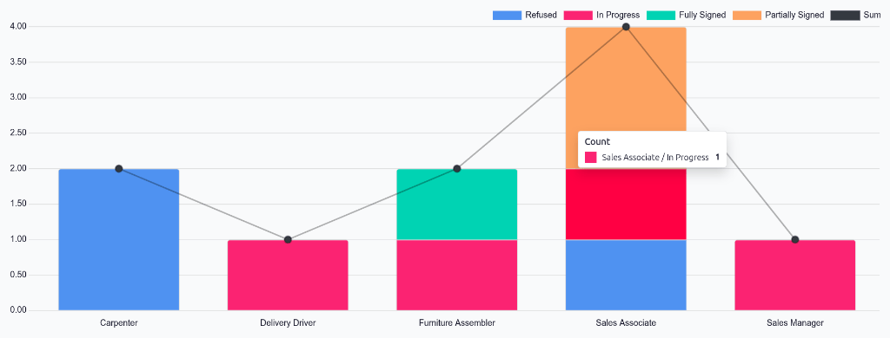
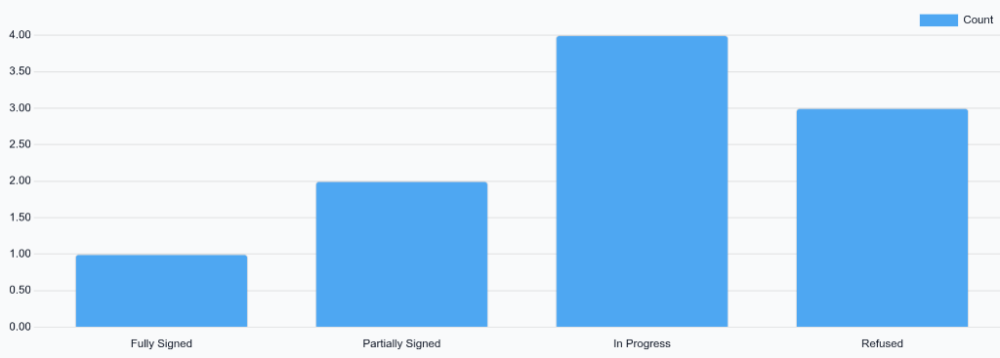

==============
Offer analysis
==============

The *Offer Analysis* report provides a high-level summary of job offers, grouped by job position and
status. This allows recruiters to view offer activity across different job positions and track how
many offers are in each stage.

Using the *Offer Analysis* report, recruiters can compare the number of open positions with the
number of offers made, identify positions with limited offer activity, and monitor the progress of
recruitment efforts. For example, positions with fewer offers may indicate a need to adjust
recruitment strategies to attract more qualified applicants. By reviewing offer data across
positions and statuses, recruiters can identify potential gaps in the hiring process and make more
informed decisions to support recruitment goals.

View offer analysis report
==========================

To access the *Offer Analysis* report, navigate to :menuselection:`Recruitment app --> Reporting -->
Offer Analysis`. By default, the report displays offer data for all job positions in a
:icon:`fa-bar-chart` :guilabel:`(Bar Chart)` with :icon:`fa-database` :guilabel:`(Stacked)` groups.
The default filter is :guilabel:`Last 365 Days Offers`, showing information for the last 365 days.

Job positions are listed on the x-axis, with color-coded blocks showing the number of offers in each
stage along the y-axis. Hover over a stage to view the number of offers in that stage for the job
position. The stages are color-coded as follows:

.. list-table::
   :header-rows: 1
   :stub-columns: 1

   * - Color
     - Status
     - Description
   * - Red
     - In progress
     - The offer was sent to the employee but the offer is unsigned by all parties.
   * - Orange
     - Partially signed
     - A minimum of one person has signed the contract, but other signatures are required.
   * - Green
     - Fully signed
     - The offer was accepted and all parties have signed the contract.
   * - Blue
     - Refused
     - The offer was refused by the applicant.

Use case: view offers by state
==============================

A large, growing company with hundreds of employees is constantly recruiting. Due to the large
number of roles they are continuously filling, it can be difficult to keep track of all the job
offers and where each offer stands.

To aid the team, the *Offer Analysis* report can be modified to show all offers by state, instead of
by job position. To view offers by state, navigate to :menuselection:`Recruitment app --> Reporting
--> Offer Analysis`. Click into the search bar and select the :guilabel:`Offer State` option in the
:icon:`oi-group` :guilabel:`Group By` column. This provides a high-level overview of where all
offers stand.

Click on a column to open a list view of all the offers in that particular state. This is helpful
when trying to finalize all open offers, or see how many were refused or completed.

