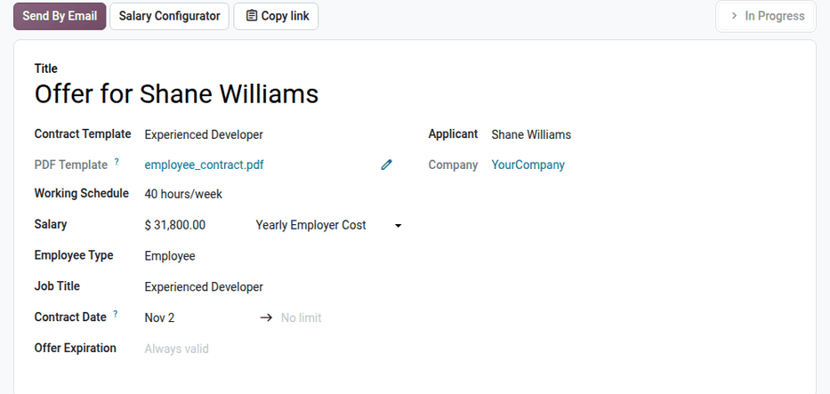
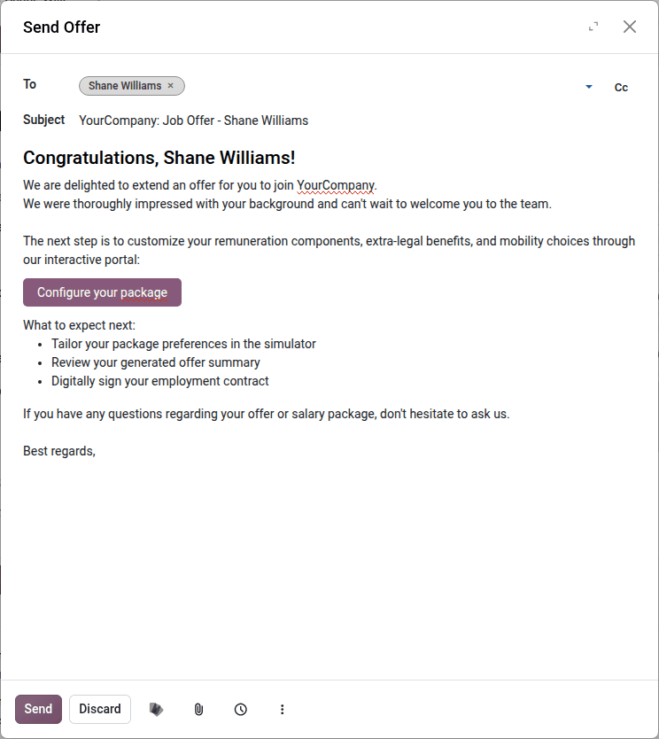
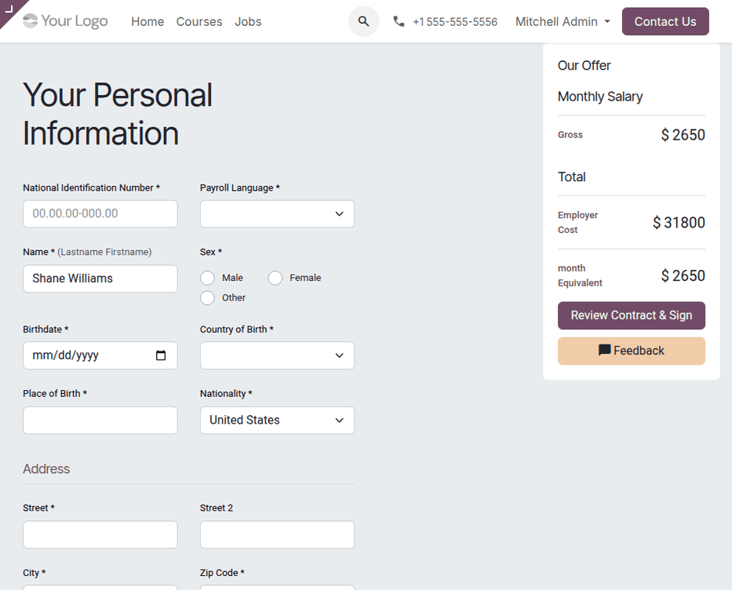
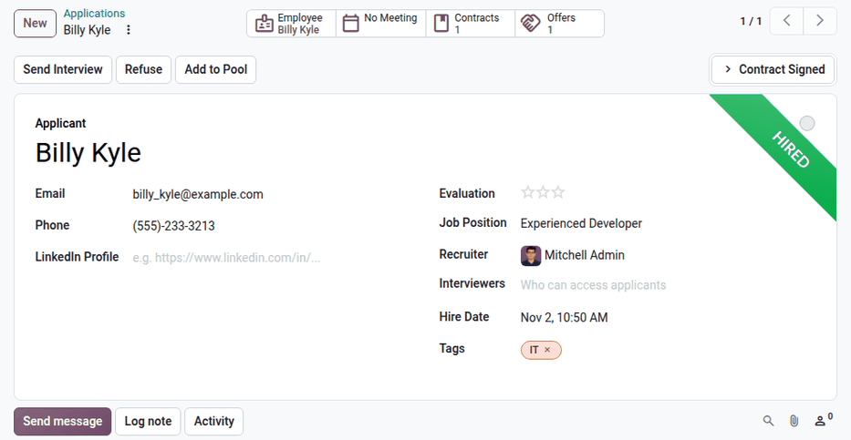

===================
Offer job positions
===================

After an applicant has successfully passed the various interview stages, the recruitment team is
ready to send an offer for employment. The recruiter :ref:`generates an offer
<recruitment/offer_job_positions/contract-proposal>` from the applicant's form and sends it by
email. The applicant reviews the offer in the *salary configurator*, then signs it. Once :ref:`all
parties have signed <recruitment/offer_job_positions/contract-signed>`, the employee record and its
contract details are activated, and the applicant is marked as hired.

.. important::
   The *Salary Configurator* module (`hr_contract_salary`) **must** be :ref:`installed
   <general/install>` to send an offer using the :guilabel:`Generate Offer` button. The **Sign**
   application is required for the applicant to sign the offer online.

.. _recruitment/offer_job_positions/contract-proposal:

Contract proposal
=================

When an offer is ready to be sent, first move the applicant to the :guilabel:`Contract Proposal`
stage.

Navigate to the **Recruitment** app, click on the job position card, then click the desired
applicant card. Click the :guilabel:`Contract Proposal` stage in the status bar at the top of the
applicant's record.

Next, click the :guilabel:`Generate Offer` button. Odoo creates an offer for the applicant, logs it
in the applicant's chatter, and opens the *Offer for (applicant)* form. An :icon:`handshake`
:guilabel:`Offers` smart button then appears on the applicant's form.

.. note::
   The :guilabel:`Generate Offer` button is not available for :doc:`talents <talent_pools>`, nor for
   applicants who are already hired or refused.

Most fields are pre-populated with information from the job position and its :guilabel:`Contract
Template`. Update or add any relevant information in the corresponding fields.

.. note::
   Depending on the localization setting for the company and which applications are installed, some
   fields may differ or not appear on the offer form.

Offer fields
------------

- :guilabel:`Title`: The name of the offer, in a default `Offer for (applicant)` format.
- :guilabel:`Contract Template`: The contract template used to populate the offer. By default, it is
  the :guilabel:`Contract Template` set on the :ref:`job position
  <recruitment/new_job/configure-job-position>`. Use the drop-down menu to select a different
  template, if desired. Contract templates are managed in :menuselection:`Recruitment app -->
  Configuration --> Contracts --> Templates`.
- :guilabel:`PDF Template`: The PDF document the applicant must sign to accept the offer. Click the
  :icon:`edit` :guilabel:`(Edit Signatories)` icon next to the field to define who signs the
  document. The :guilabel:`Send By Email` and :guilabel:`Salary Configurator` buttons are only
  available once a PDF template is set.
- :guilabel:`Working Schedule`: The working schedule offered to the applicant.
- :guilabel:`Salary`: The salary offered to the applicant. Select how this amount is expressed in
  the field next to it: :guilabel:`Gross Per Month`, :guilabel:`Yearly Employer Cost`, or
  :guilabel:`Net Per Month`.
- :guilabel:`Employee Type`: The type of employee offered (for example, :guilabel:`Employee` or
  :guilabel:`Intern`).
- :guilabel:`Job Title`: The title of the position offered. The name of the job position populates
  this field by default. The title can be modified to suit the specific applicant's position and
  provide more details.

  .. example::
     An applicant is offered a marketing manager job at a shoe company, specifically for the
     children's line. The :guilabel:`Job Title` is modified for their specific responsibilities,
     `Marketing Manager: Children's Shoes`.

- :guilabel:`Contract Date`: The date the proposed contract starts. The default date is the current
  date. If the contract has a specific end date, enter it in the second field. Leave the second
  field empty for a contract with no end date.
- :guilabel:`Offer Expiration`: The last day the offer is valid. After this date, the offer is
  marked as *Expired* and can no longer be signed. Leave this field empty to keep the offer valid
  indefinitely.
- :guilabel:`Applicant`: The name of the applicant. Click the name to open the applicant form.
- :guilabel:`Company`: The company offering the job position.
- :guilabel:`Salary Simulation Preview`: The estimated :guilabel:`Gross`, :guilabel:`Net`,
  :guilabel:`Benefits`, and :guilabel:`Company cost` of the offer, per month and per year. These
  numbers are estimates and should be used for reference only.

Send offer
----------

Once all desired modifications have been made to the offer, click the :guilabel:`Send By Email`
button to open the *Send Offer* pop-up window.

The default `Recruitment: Your Salary Package` email template is used, and the :guilabel:`To`,
:guilabel:`Subject`, and email body are pre-populated based on the email template. The email
contains a :guilabel:`Configure your package` button, which links to the offer in the salary
configurator.

If any attachments need to be added, click the :icon:`attach_file` :guilabel:`(Add Attachment)`
button, then select the file to attach.

Once the email is ready, click :guilabel:`Send`. The pop-up window closes, and the offer is sent to
the applicant.

.. tip::
   Instead of sending the offer by email, click :icon:`assignment` :guilabel:`Copy link` to copy the
   link to the offer, and share it with the applicant another way. Click :guilabel:`Salary
   Configurator` to preview the offer as the applicant sees it.

.. _recruitment/offer_job_positions/configure-package:

Configure your package
----------------------

When the applicant clicks the :guilabel:`Configure your package` button in the email, the offer
opens in the salary configurator, on the company website.

The applicant enters their personal information, such as their address, birth date, and contact
details. This information is transferred to the employee record once it is created. Depending on
the localization and the contract template, the applicant can also adjust their benefits, and the
summary of the offer on the side of the page updates accordingly.

If the applicant has a question, they can click :guilabel:`Feedback`, type a message, and click
:guilabel:`Send`. The message is posted in the chatter of the offer.

Applicant signature
-------------------

The applicant clicks the :guilabel:`Review Contract & Sign` button to accept the offer, and the
document to sign loads. Click :guilabel:`Click to start` to begin signing the document. All fields
are populated according to the information entered in the salary configurator, but can be modified
if necessary.

Click :guilabel:`Next` to navigate to the subsequent fields of the document. Once all fields are
configured, click :guilabel:`Sign it`, and an *Adopt Your Signature* pop-up window loads. Modify the
default signature if desired, then click :guilabel:`Sign all` to apply the signature. When done,
click the :guilabel:`Validate & Send Completed Document` button, and the document is signed.

When the applicant submits the salary configurator, Odoo creates the employee record and the
corresponding contract details (the employee's first :doc:`version <../employees/new_employee>`),
with the information entered in the salary configurator. Both remain archived until all parties have
signed. Once the applicant has signed, the employee is linked to the applicant, and the offer moves
to the :guilabel:`Partially Signed` status, or directly to :guilabel:`Fully Signed` if no one else
has to sign the document.

Management signatures
---------------------

Once the applicant has signed the document, the other signatories configured on the PDF template
(typically the HR responsible) must sign it.

The person responsible for signing the document receives an activity alert that their signature is
requested in the **Sign** app.

.. _recruitment/offer_job_positions/contract-signed:

Contract signed
===============

Once all parties have signed the document, the offer moves to the :guilabel:`Fully Signed` status,
and Odoo:

- activates the employee record and its contract details;
- moves the applicant to the first stage marked as :guilabel:`Hired Stage` (by default,
  :guilabel:`Contract Signed`); a green :guilabel:`Hired` banner appears on both the applicant's
  card and form;
- adds an :icon:`badge` :guilabel:`Employee` smart button to the applicant's form, linking to the
  new employee.

The signed document is available from the :icon:`book` :guilabel:`Signed Contract` smart button on
the offer.

Manage offers
=============

To view all offers, navigate to :menuselection:`Recruitment app --> Applications --> Offers`. Offers
are grouped by status:

- :guilabel:`In Progress`: The offer was created, and no one has signed it yet.
- :guilabel:`Partially Signed`: The applicant has signed, and other signatures are still required.
- :guilabel:`Fully Signed`: All parties have signed.
- :guilabel:`Expired`: The :guilabel:`Offer Expiration` date has passed before the offer was signed.
- :guilabel:`Refused`: The offer was refused.
- :guilabel:`Cancelled`: The offer was cancelled.

To refuse an offer, open it, click the :icon:`more_vert` :guilabel:`(Actions)` icon, then click
:guilabel:`Refuse`. Select a reason, then confirm. Refusal reasons are managed in
:menuselection:`Recruitment app --> Configuration --> Applications --> Offer Refusal Reasons`.

.. note::
   When an applicant is :doc:`refused <refuse_applicant>`, all their offers that are not yet refused
   are automatically marked as :guilabel:`Refused`.

.. _recruitment/offer_job_positions/new-employee:

Create employee
===============

When an applicant is hired without going through the offer process, for example, if the
applicant's card is moved to the :guilabel:`Contract Signed` stage manually, no employee record
exists yet. In this case, a :guilabel:`Create Employee` button appears on the hired applicant's
form.

Click :guilabel:`Create Employee`, and an employee form loads with information pulled from the
applicant's form, such as the name, contact information, job position, and department.

Fill out the rest of the employee form. For detailed information on the fields, refer to the
:doc:`../employees/new_employee` documentation.

Once completed, the employee record is saved in the **Employees** app.
