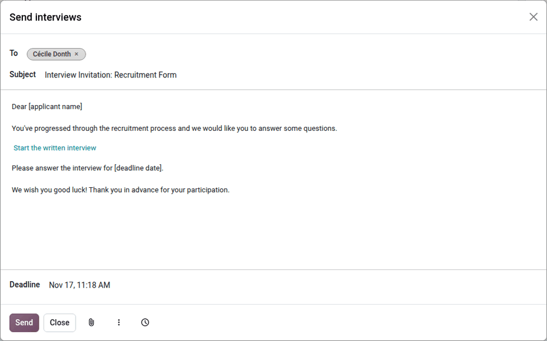

================
Recruitment flow
================

When a prospective employee applies for a job in Odoo, there is a preconfigured process from the
:ref:`initial inquiry <recruitment/recruitment_flow/new>` to the :ref:`creation of a new employee
<recruitment/offer_job_positions/new-employee>` once hired. The following outlines the default
recruitment process for Odoo's **Recruitment** application.

.. important::
   The following is based on Odoo's *default* recruitment pipeline. Be advised that if
   :ref:`modifications are made <recruitment/customize-stages>` to the pipeline, the process
   differs.

.. _recruitment/recruitment_flow/new:

New
===

At the start of the process, all applicants appear in the :guilabel:`New` stage on the
*Applications* page, whether they submitted through the company website, emailed a resumé to the
email alias, or were :doc:`manually added by a recruiter <add_applicants>`.

The :guilabel:`Applicant`, :guilabel:`Email`, and :guilabel:`Phone` number on the applicant's card
are filled as soon as it is created. By default, these details are required for every job position.

.. note::
   If the website application form is modified, different fields may be populated, based on what
   information is required on the website.

Anything typed in the *Short Introduction* section appears in the applicant's chatter as a note from
:guilabel:`OdooBot`, labeled *Other Information*.

Resumé
------

If a resumé was attached to the online application, it appears in the *Files* section of the
chatter. If the **Documents** app is installed, it is also stored in the **Documents**
application.

To find the recruitment documents, navigate to the main :menuselection:`Documents` app dashboard,
and click the :guilabel:`Recruitment` folder on the side. All recruitment documents are stored
within that folder.

.. note::
   Depending on the browser zoom level, or size of the browser screen, the resumé may appear below
   the main applicant card information, or on the right side of the form as a preview.

Send interview
--------------

At any point in the hiring process, an interview can be sent to the applicant to obtain more
information. These interviews are custom-made, and can be formatted in a variety of ways.

The **Surveys** application is required to send interviews to an applicant, so it **must** be
installed, by enabling the :ref:`Send Interview Survey <recruitment/settings>` setting.

Odoo uses the term *interview*, but these can be thought of as questionnaires, surveys, tests,
certifications, etc. The interview sent to an applicant is the :guilabel:`Interview Form` set on the
:ref:`job position <recruitment/new_job/hiring-process>`, and can be formatted to suit each
individual job position's needs. All interview forms are listed in :menuselection:`Recruitment app
--> Configuration --> Interviews`.

.. example::
   A job position for a computer programmer could have an interview in the form of a programming
   quiz to determine the skill level of the applicant. A job position for a restaurant server could
   have a questionnaire inquiring about the applicant's availability, if the desired applicant needs
   to be available on weekend evenings.

To send an interview to an applicant, first open the applicant's card from the *Applications* page
to view the detailed applicant information. In the top corner of the applicant's card, click the
:guilabel:`Send Interview` button. This button only appears if an :guilabel:`Interview Form` is set
on the applicant's job position.

A *Send interviews* pop-up window appears, with the applicant in the :guilabel:`To` field, and the
:guilabel:`Subject` and email body populated.

.. note::
   To send an email to an applicant, there **must** be an email address on the applicant's card.

   If an email address is missing on the applicant's card, the applicant's tag in the
   :guilabel:`To` field appears in red. Click the tag, enter the email address, then save it.

Preconfigured :doc:`email templates <../../general/companies/email_template>` in Odoo use dynamic
placeholders, which are automatically filled with specific data when the email is sent. For example,
the applicant's name, the link to the interview, and the deadline are filled in when the email is
sent.

The :guilabel:`Deadline` field specifies when the interview form must be completed by, and is
populated with a date and time 15 days in the future. To modify this, click on the displayed date
and time, and select the desired date and time. After the deadline, the interview link expires.

The following buttons are available at the bottom of the pop-up window:

- :icon:`attach_file` :guilabel:`(Add Attachment)`: Add attachments to the email.
- :icon:`more_vert` :guilabel:`(Templates)`: Select a different email template, if desired. The new
  email template loads in the email body.
- :icon:`schedule` :guilabel:`(Send Later)`: Send the email at a later date and time.

To send the email with the interview link to the applicant, click :guilabel:`Send` at the bottom of
the *Send interviews* pop-up window.

         preconfigured template.

Once the applicant has answered the interview, an :icon:`edit_square` :guilabel:`Consult Interview`
smart button appears on the applicant's form, to view the answers.

.. tip::
   To send interviews to several applicants at once, open the list view of the applications, select
   the applicants, then click :guilabel:`Send Interviews` at the top of the list.

.. note::
   Interview links automatically expire when the applicant is hired, refused, archived, or deleted.

.. _recruitment/recruitment_flow/qualification:

Qualification
=============

If an applicant is determined to be a good potential fit, they are moved to the
:guilabel:`Qualification` stage.

This stage exists to sort applicants that have potential from those that do not meet the
requirements. No automatic actions, such as emails, are set for this stage. This stage informs the
recruitment team to potentially set up a phone call or an interview with the applicant.

.. note::
   In order to move an applicant's card from one stage to another, the applicant's card can either
   be dragged and dropped in the Kanban view of the *Applications* page to the desired stage, or the
   stage can be modified on the applicant's card.

   To change the stage on the applicant's card, first click the desired applicant's card from the
   *Applications* page. The current stage for the card is displayed at the top of the form, with the
   time the applicant has spent in it. Depending on the screen size, click the current stage to
   reveal all the stages in the status bar.

   Click the desired stage for the card, and the stage changes. A log note indicating the stage
   change appears in the chatter, as well.

  .. image:: recruitment_flow/stage-change.png
     :alt: Change the stage of an applicant by clicking on the desired stage at the top of the
           applicant's card.

.. _recruitment/recruitment_flow/first-interview:

First interview
===============

After an applicant has passed the :guilabel:`Qualification` stage, they can be manually moved to the
:guilabel:`First Interview` stage on the *Applications* page, while in Kanban view.

To move the applicant to the next stage, drag and drop the applicant's card to the :guilabel:`First
Interview` stage.

Alternatively, open the desired applicant's card from the *Applications* page, and click the
:guilabel:`First Interview` stage on the status bar at the top of the individual applicant's card.

.. tip::
   When the **Appointments** app is installed, the :guilabel:`First Interview` stage can be
   modified, so when the applicant's card moves to the :guilabel:`First Interview` stage, an email
   is automatically sent to the applicant, with a link to the recruiting team's calendar, allowing
   the applicant to schedule their interview.

   :ref:`Edit <recruitment/edit-stage>` the :guilabel:`First Interview` stage, and select the
   :guilabel:`Recruitment: Schedule interview` option in the :guilabel:`Email Template` field to
   automate this action. Refer to the :ref:`applicant scheduled interviews
   <recruitment/schedule_interviews/applicant-scheduled>` documentation.

.. _recruitment/recruitment_flow/second-interview:

Second interview
================

After an applicant has passed the :guilabel:`First Interview` stage, they can be moved to the
:guilabel:`Second Interview` stage. To move the applicant to the next stage, drag and drop the
applicant's card to the :guilabel:`Second Interview` stage from the Kanban view of the
*Applications* page, or click on the :guilabel:`Second Interview` stage at the top of the individual
applicant's card.

When the applicant's card moves to the :guilabel:`Second Interview` stage, there are no automatic
activities or emails configured for this stage, by default. The recruiter can now :ref:`schedule a
second interview <recruitment/schedule_interviews/recruitment-scheduled>` with the applicant,
following the same process as the first interview.

.. _recruitment/recruitment_flow/contract-proposal:

Contract proposal
=================

After the applicant has completed the various interview processes, the next step is to :doc:`send
the job offer <offer_job_positions>`.

Once the offer has been sent, drag and drop the applicant's card to the :guilabel:`Contract
Proposal` stage from the Kanban view of the *Applications* page, or click on the :guilabel:`Contract
Proposal` stage at the top of the individual applicant's card.

Contract signed
===============

Once the offer has been :ref:`fully signed by all parties
<recruitment/offer_job_positions/contract-signed>`, the applicant is hired, and the applicant's card
automatically moves to the :guilabel:`Contract Signed` stage.

To hire an applicant without sending an offer, move the applicant's card to the :guilabel:`Contract
Signed` stage manually, then :ref:`create the employee
<recruitment/offer_job_positions/new-employee>`. The :guilabel:`Contract Signed` stage is folded by
default on the *Applications* page, and must be expanded before the applicant's card can be manually
moved. Click the :icon:`arrow_left` :icon:`arrow_right` :guilabel:`(Unfold)` icon above the
:guilabel:`Contract Signed` stage, and the stage expands. Next, drag and drop the applicant's card
to the :guilabel:`Contract Signed` stage from the Kanban view, or click the :guilabel:`Contract
Signed` stage at the top of the individual applicant's card.

Refused
=======

At any point in the recruitment process, an applicant can be :doc:`refused <refuse_applicant>`.
