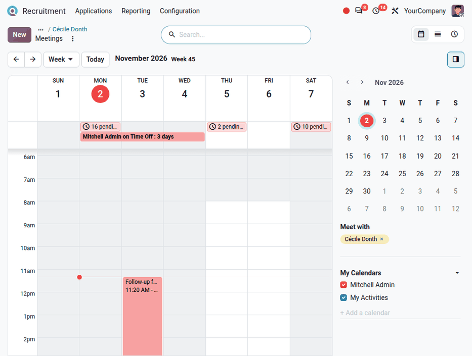
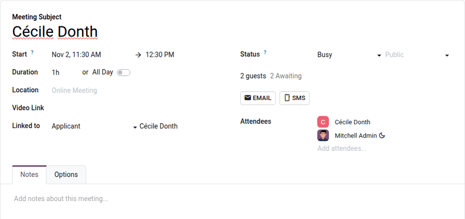

===================
Schedule interviews
===================

Once an applicant has reached the *First Interview* stage, it is time to schedule an in-person,
virtual, or phone interview. This can be done in one of two ways through the **Recruitment** app,
either by the :ref:`recruitment team <recruitment/schedule_interviews/recruitment-scheduled>`, or by
the :ref:`applicant <recruitment/schedule_interviews/applicant-scheduled>`.

When the **Appointments** app is installed, a single drag and drop action can send the applicant an
email with a self-service scheduling link. The applicant selects an available time slot, and the
meeting is automatically added to the calendars of all participants. This eliminates the need for
back-and-forth emails or phone calls.

.. _recruitment/schedule_interviews/recruitment-scheduled:

Recruitment team scheduled interviews
=====================================

When an applicant reaches an interview stage, the recruitment team schedules the interview by first
coordinating a suitable date and time with the applicant and interviewers.

To schedule an interview, navigate to the applicant's card by going to the
:menuselection:`Recruitment` app and clicking the relevant job card. Click the desired applicant's
card on the *Applications* page.

To schedule a phone, virtual, or in-person interview, click the :icon:`calendar_today` :guilabel:`No
Meeting` smart button at the top of the applicant's record.

.. note::
   The :guilabel:`Meetings` smart button displays :icon:`calendar_today` :guilabel:`No Meeting` if
   no meetings are currently scheduled. For applicants who are new to the :guilabel:`First
   Interview` stage, this is the default.

   If there is one meeting already scheduled, the smart button displays :guilabel:`1 Meeting`, with
   the date of the upcoming meeting beneath it. If more than one meeting is scheduled, the button
   displays :guilabel:`Next Meeting`, with the date of the first upcoming meeting beneath it. If all
   the meetings are in the past, the button displays :guilabel:`Last Meeting`, with the date of the
   most recent meeting beneath it.

.. tip::
   An interview can also be scheduled from the Kanban view of the *Applications* page: click the
   :icon:`more_vert` :guilabel:`(Dropdown menu)` icon on the applicant card, then click
   :guilabel:`Schedule Interview`.

Clicking the :guilabel:`Meetings` smart button loads a calendar, showing the scheduled meetings and
events for the currently signed-in user. The applicant appears in the :guilabel:`Meet with` section
of the side panel, and the calendars displayed are listed in the :guilabel:`My Calendars` section.
To hide any calendar, uncheck the box next to its name.

To also view the schedules of the interviewers, click :guilabel:`+ Add a calendar` at the bottom of
the :guilabel:`My Calendars` list, and add each desired interviewer from the resulting drop-down
menu.

To add a meeting to the calendar when in the *Day* or *Week* view, click on the start time of the
meeting and drag down to the end time. Doing so selects the date, time, and length of the meeting,
and opens a quick creation pop-up window. Enter the meeting title, attendees, and location, then
click :guilabel:`Save` to create the meeting, or :guilabel:`More Options` to open the complete
meeting form.

A meeting can also be added by clicking the :guilabel:`New` button, which opens the :ref:`meeting
form <recruitment/schedule_interviews/event-card>` directly.

.. _recruitment/schedule_interviews/event-card:

Meeting form
------------

Configure the information for the interview on the meeting form. The only required information is
the meeting subject, date, and time.

- :guilabel:`Meeting Subject`: Enter the title for the meeting. The default subject is the
  applicant's name.
- :guilabel:`Start`: Configure the start and end date and times for the meeting. Clicking either of
  these fields opens a calendar pop-up window. Click on the desired date to select it, then enter
  the time.
- :guilabel:`Duration`: This field auto-populates based on the :guilabel:`Start` (and end) date and
  time. If the meeting time is adjusted, this field automatically adjusts to the correct duration.
  The default length of a meeting is one hour. Enable the :guilabel:`All Day` toggle to schedule an
  all-day interview.
- :guilabel:`Location`: Enter the address for the interview.
- :guilabel:`Video Link`: If the meeting is virtual, or if a virtual option is available, enter or
  generate the link to the video call.
- :guilabel:`Linked to`: The applicant being interviewed. Click the applicant's name to view the
  applicant's card.
- :guilabel:`Status`: Select if the attendees are marked as :guilabel:`Busy` or
  :guilabel:`Available` during the interview, then determine who can see the meeting using the
  privacy drop-down menu next to it.
- :guilabel:`Attendees`: Select the people attending the meeting. The default attendees are the
  applicant and the current user. Add as many other people as desired, such as the interviewers.
  The number of guests, and the number of guests that have not responded to the invitation, are
  displayed above this field.
- :guilabel:`Notes` tab: Enter any relevant notes in this field. There is an option to enter
  formatted text, such as numbered lists, headings, tables, links, photos, and more. Use the
  powerbox feature by typing a `/` to reveal a list of options.

Once the details are entered, click the :icon:`cloud_upload` :guilabel:`(Save manually)` icon to
save the changes and schedule the interview.

Send meeting to attendees
-------------------------

Once the meeting details are correct, the meeting can be sent to the attendees via :ref:`email
<recruitment/schedule_interviews/email>` or :ref:`SMS <recruitment/schedule_interviews/sms>`. This
is done from the :ref:`meeting form <recruitment/schedule_interviews/event-card>`.

.. _recruitment/schedule_interviews/email:

Via email
~~~~~~~~~

To send the meeting via email, click the :icon:`mail_f` :guilabel:`EMAIL` button above the
:guilabel:`Attendees` field on the meeting form.

An email pop-up window appears. A pre-formatted email using the default :guilabel:`Calendar: Event
Update` email template populates the email body field.

All meeting guests are added to the :guilabel:`To` field by default. Make any desired changes to the
email, then click :guilabel:`Send` to send the email.

.. _recruitment/schedule_interviews/sms:

Via SMS
~~~~~~~

To send the meeting via SMS, click the :icon:`smartphone` :guilabel:`SMS` button above the
:guilabel:`Attendees` field on the meeting form. A *Send SMS* pop-up window appears.

At the top, a banner appears if any attendees do not have valid phone numbers, and lists how many
records are invalid. If a contact does not have a valid mobile number listed, click
:guilabel:`Discard`, edit the attendee's record, then redo these steps.

When no warning message appears, type in the message to be sent to the attendees in the main text
field.

The number of characters and amount of text messages required to send the message (according to
GSM-7 criteria) appears beneath the text field. Click :guilabel:`Put in queue` to have the text sent
later, after any other messages are scheduled, or click :guilabel:`Send now` to send the message
immediately.

.. note::
   Sending text messages is **not** a default capability with Odoo. To send text messages, credits
   are required, which need to be purchased. For more information on IAP credits and plans, refer to
   the :doc:`../../essentials/in_app_purchase` documentation.

.. _recruitment/schedule_interviews/applicant-scheduled:

Applicant scheduled interviews
==============================

Coordinating interview times typically requires several email exchanges or phone calls, and can slow
the recruitment process. Odoo's self-service scheduling removes that bottleneck: when an applicant
is moved to an interview stage, Odoo automatically sends a scheduling link, records the selected
slot, and updates all relevant calendars.

.. important::
   Self-service scheduling requires the **Appointments** app. Once it is installed, the
   :guilabel:`Recruitment: Schedule interview` email template becomes available.

This automation is turned off by default. To activate it, :ref:`modify
<recruitment/schedule_interviews/modify-stage>` the :guilabel:`First Interview` and
:guilabel:`Second Interview` stages and assign the :guilabel:`Recruitment: Schedule interview` email
template to them.

.. _recruitment/schedule_interviews/modify-stage:

Modify stage
------------

:ref:`Modify <recruitment/modify-stages>` the :guilabel:`First Interview` or :guilabel:`Second
Interview` stage so the stage's :guilabel:`Email Template` field is set to :guilabel:`Recruitment:
Schedule interview`.

Send email
----------

After configuring the :guilabel:`First Interview` or :guilabel:`Second Interview` stages to
:ref:`send emails <recruitment/schedule_interviews/modify-stage>`, drag and drop the applicant card
into one of these stages to send the email.

Self-scheduled interview
------------------------

When the applicant receives the email, they click the :guilabel:`Schedule my interview` button in
the email. This navigates the applicant to a private online scheduling page, which shows the
availabilities of the applicant's recruiter, and is **only** accessible through the emailed link.

The applicant selects an available day and time on the calendar, then enters their contact
information. The contact information entered on this form is used to remind the applicant about the
scheduled interview.

Once the applicant confirms the appointment, the interview is scheduled: the meeting is added to the
calendars of the attendees, and linked to the applicant, in the :guilabel:`Meetings` smart button of
the applicant's form.
