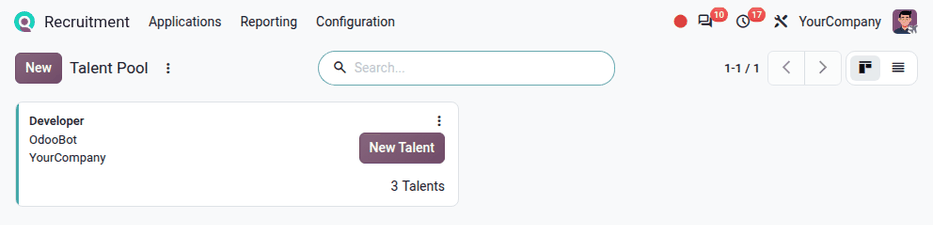
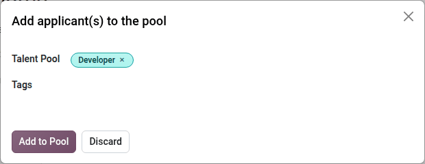
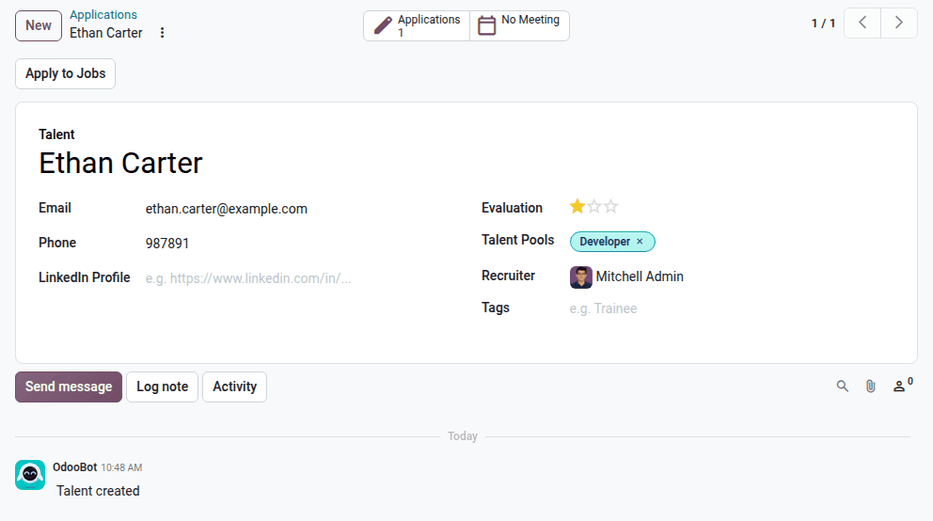

============
Talent pools
============

In Odoo **Recruitment**, an *application* is always linked to one job position. When a promising
applicant is not hired, or when a recruiter meets potential applicants before a position opens, the
applicant's profile can be kept in a *talent pool*.

A *talent* is a copy of an applicant's profile that is not linked to any job position, and that
belongs to one or more talent pools (such as `Developers`, `Sales Reserve`, or `French-speaking`).
Talents are used to quickly create new applications for other job positions, without having to
enter the applicant's information again.

.. _recruitment/talent_pools/create-pool:

Create a talent pool
====================

To view the talent pools, navigate to :menuselection:`Recruitment app --> Applications --> By Talent
Pools`. Each talent pool is displayed in a Kanban card, with its :guilabel:`Pool Manager`, its
company, and its number of talents.

To create a new talent pool, click :guilabel:`New`, and fill out the following fields:

- :guilabel:`Title`: Enter a name for the talent pool. This field is required.
- :guilabel:`Pool Manager`: Select the user responsible for the talent pool. The current user is
  selected by default.
- :guilabel:`Tags`: Select the tags that describe the talents in this pool, such as `Immediately
  Available` or `Own a car`.
- :guilabel:`Color`: Select a color for the talent pool. The color is used on the talent pool card
  and on the talent pool tags.
- :guilabel:`Company`: Select the company the talent pool belongs to.
- :guilabel:`Description`: Describe the talent pool, and the common traits of its talents.

Click anywhere on a talent pool card to view its talents. To modify the talent pool, click the
:icon:`fa-ellipsis-v` :guilabel:`(Dropdown menu)` icon on the card, then click
:guilabel:`Configuration`.

.. _recruitment/talent_pools/add-talents:

Add talents to a pool
=====================

Talents can be added to a pool either by creating them directly, or from an existing application.

Create a talent
---------------

To create a talent directly in a pool, click :guilabel:`New Talent` on the talent pool card. A blank
form loads, with the talent pool already selected in the :guilabel:`Talent Pools` field. Enter the
talent's name, :guilabel:`Email`, :guilabel:`Phone`, and any other relevant information, as on an
:doc:`applicant form <add_applicants>`.

Add an applicant to a pool
--------------------------

To add an existing applicant to a talent pool, open the applicant's form, then click :guilabel:`Add
to Pool`. An *Add applicant(s) to the pool* pop-up window loads. Select the desired :guilabel:`Talent
Pool`, add any :guilabel:`Tags`, then click :guilabel:`Add to Pool`.

Odoo creates a talent from the applicant's information, including the attached documents, and links
it to the original application. A :icon:`fa-users` :guilabel:`Talent Pools` smart button then
appears on the applicant's form. If the applicant is already linked to a talent, the talent is
added to the selected pools instead, and no new talent is created.

.. tip::
   Several applicants can be added to a pool at once. In the list view of the applications, select
   the applicants, then click :guilabel:`Add to Pool` at the top of the list. The :guilabel:`Add to
   Pool` option is also available in the :icon:`fa-ellipsis-v` :guilabel:`(Dropdown menu)` of each
   applicant card in the Kanban view.

.. _recruitment/talent_pools/talent-form:

Talent form
===========

A talent form looks like an applicant form, with the following differences:

- The form is labeled :guilabel:`Talent` instead of :guilabel:`Applicant`.
- There is no :guilabel:`Job Position` field and no stage. Instead, the :guilabel:`Talent Pools`
  field lists the pools the talent belongs to.
- The :guilabel:`Applications` smart button lists all the applications created from the talent.
- The :guilabel:`Apply to Jobs` button is used to create new applications.

The talent and all the applications linked to it share the same personal information. When the name,
:guilabel:`Email`, :guilabel:`Phone`, :guilabel:`LinkedIn Profile`, :guilabel:`Tags`,
:guilabel:`Degree`, :guilabel:`Availability`, or skills are modified on the talent or on one of its
applications, the change is applied to all of them.

.. _recruitment/talent_pools/apply:

Apply talents to job positions
==============================

From a talent
-------------

To create applications from a talent, open the talent's form, then click :guilabel:`Apply to Jobs`.
In the pop-up window that appears, select one or more :guilabel:`Job Positions`, then click
:guilabel:`Apply`.

Odoo creates one application per selected job position, in the first stage of each job position.
The application is a copy of the talent, including its most recent attached document (typically the
résumé).

To apply several talents at once, open a talent pool, select the talents in the list, then click
:guilabel:`Apply to Jobs` at the top of the list.

From a job position
-------------------

To find talents for a specific job position, open the job position form (:menuselection:`Recruitment
app --> Applications --> By Job Positions`, then click :guilabel:`Configure` on the job position
card), and click :guilabel:`Matching Talents`. A *Matching Talents* pop-up window loads.

Click into the :guilabel:`Talents` field to view the talents that have not yet applied to this job
position. When skills are configured on the job position, the talents' matching score is taken into
account in the proposed list. Select the desired talents, then click :guilabel:`Apply` to create
their applications for the job position.

.. seealso::
   - :doc:`add_applicants`
   - :doc:`new_job`
