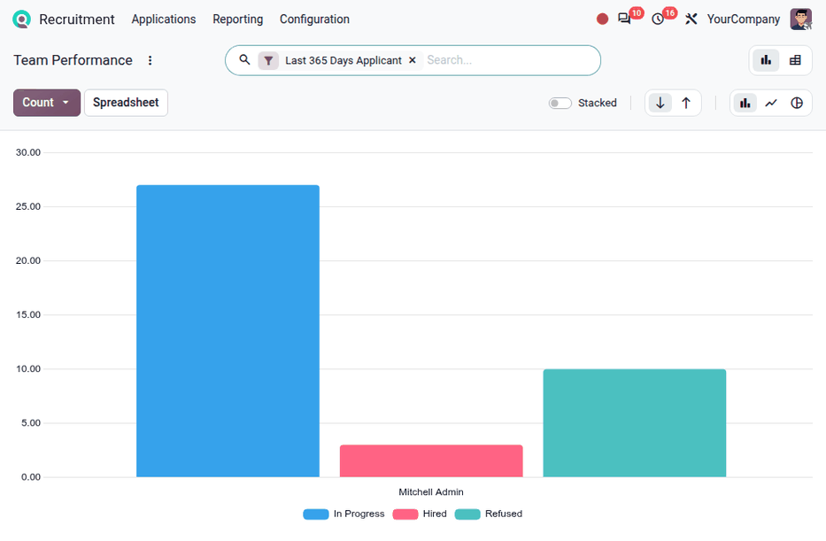
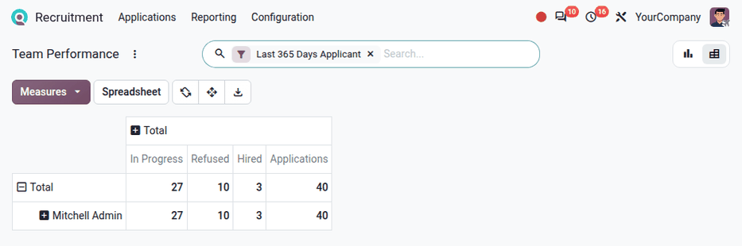

================
Team performance
================

The *Team Performance* report in the **Recruitment** app shows how many applicants each recruiter
manages and what stage their applicants are at.

This information is determined by the individuals populating the :ref:`Recruiter
<recruitment/add_applicants/applicant-details>` field on each applicant form.

View report
===========

To view the *Team Performance* report, navigate to :menuselection:`Recruitment app --> Reporting -->
Team Performance`.

For each recruiter, the number of :guilabel:`In Progress`, :guilabel:`Hired`, and
:guilabel:`Refused` applicants is displayed in a default :icon:`bar_chart` :guilabel:`(Bar
Chart)` view. The default :guilabel:`Last 365 Days Applicant` filter shows all applicants for the
last 365 days.

Hover the cursor over any column to view a popover window, displaying the specific details for that
column.

.. _recruitment/team_performance/pivot:

Pivot table view
----------------

For a more detailed view of the information in the *Team Performance* report, click the
:icon:`oi_view-pivot` :guilabel:`(Pivot)` icon. This displays all the information in a pivot table.

In this view, the recruiters populate the rows, while the columns display the number of applicants
who are still :guilabel:`In Progress`, have been :guilabel:`Refused`, or have been
:guilabel:`Hired`. The last column, :guilabel:`Applications`, is the total number of applicants for
that recruiter.

Comparing the number of :guilabel:`Hired` applicants to the total number of
:guilabel:`Applications` of each recruiter helps identify the most successful recruiters, and the
recruiters who may need support.

