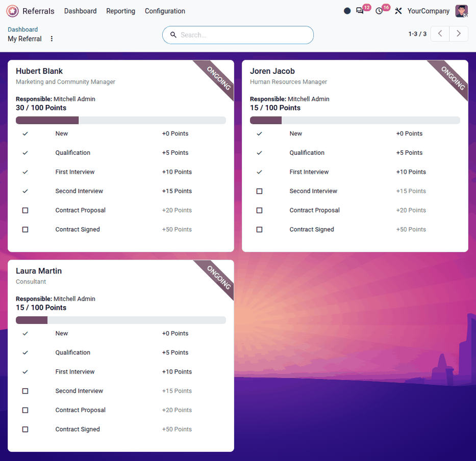

===============
Referral points
===============

The **Referrals** application allows employees to earn points that are then exchanged for
:doc:`rewards <rewards>`.

Current referral points can be viewed on the main **Referrals** app dashboard, which appears when
the application is opened, after the :ref:`onboarding <referrals/onboarding>` slides have been
viewed or skipped.

At the top, a summary of the user's current points is displayed. The left side of the summary
displays the :guilabel:`Total` points earned, and the right side displays the points that are
available :guilabel:`To Spend`.

To view the various referral stages, and their respective points, click one of the referral
statuses beneath the avatar. The options are: :guilabel:`Referrals`, :guilabel:`Ongoing`, and
:guilabel:`Successful`.

- :guilabel:`Ongoing`: the number of referrals still in the recruitment pipeline, that have not yet
  been hired or refused.
- :guilabel:`Successful`: the number of referrals that have been hired.
- :guilabel:`Referrals`: the total number of referrals, ongoing and successful combined.

My referrals
============

To see all the referrals, click :guilabel:`Referrals`. The :guilabel:`My Referral` page displays one
card per referral. Each card shows the status of the referral in its top-right corner:

- :guilabel:`Ongoing` (purple): the referral is still in the recruitment pipeline.
- :guilabel:`Hired` (green): the referral has been hired.
- :guilabel:`Not Hired` (red): the referral has been refused.

Each referral card lists the name of the applicant, the name of the job position, the recruiter, and
the points earned.

Points
------

Each recruitment stage has its own number of points, set in the **Recruitment** app. Only the stages
with the :guilabel:`Show to Referrer` option enabled appear on the referral cards and earn points.
As a stage can be specific to some job positions, the points can differ between job positions.

By default, a hired referral earns 100 points:

- :guilabel:`New`: 0 points
- :guilabel:`Qualification`: 5 points
- :guilabel:`First Interview`: 10 points
- :guilabel:`Second Interview`: 15 points
- :guilabel:`Contract Proposal`: 20 points
- :guilabel:`Contract Signed`: 50 points

.. seealso::
   :ref:`Modify the points of a stage <recruitment/modify-stages>`

On each referral card, beneath the points, a progress bar shows the points already earned out of the
points of a hired referral.

Beneath the progress bar, each recruitment stage is listed with its points. A :icon:`check`
:guilabel:`(Done)` icon appears next to the stages the referral has reached.
