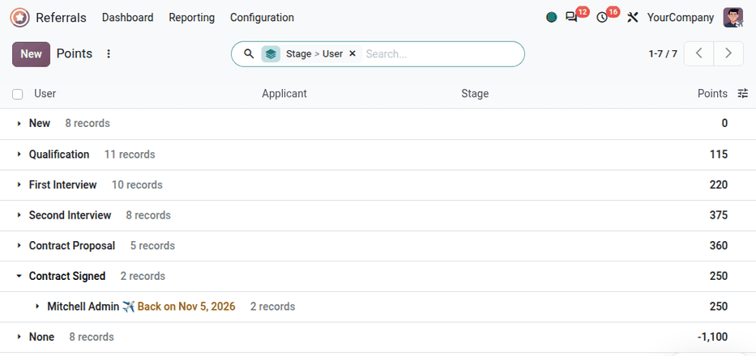

=============
Points report
=============

The points report in the **Referrals** app allows managers to view the total :doc:`point <points>`
contribution from employees, which can provide insight into the most effective referrers.

.. important::
   **Referrals** :ref:`administrators <referrals/access-rights>` see the points of all users. Users
   with the *User: Referral only* access right only see their own points.

To access the *Points* report, navigate to :menuselection:`Referrals app --> Reporting --> Points`.
This loads the :guilabel:`Points` report in a default list view, grouped by :guilabel:`User`, with
the users listed in alphabetical order, by first name.

All rows are collapsed by default, displaying the :guilabel:`User` name, the total number of
individual entries logged for the user, and the total :guilabel:`Points` they have earned.

Click on a row to expand the entries for that user. Each line displays the :guilabel:`Applicant`,
the :guilabel:`Stage` the applicant reached, and the corresponding :guilabel:`Points` earned for the
stage. The displayed :guilabel:`Points` appear in green if the user earned points for the stage, and
appear in black if no points are received for the stage. Rewards bought by the user appear as lines
with negative points, in red, without stage. To only display these lines, use the :guilabel:`Gifts`
filter; to hide them, use the :guilabel:`Points` filter.

.. note::
   Stages that do not earn referral points still appear on the list, if the applicant reached that
   stage. In this example, applicants who reach the :guilabel:`New` stage do *not* receive any
   referral points, and zero (:guilabel:`0`) appears in the :guilabel:`Points` column, in black.

   .. image:: points_report/points-report.png
      :alt: Individual points earned by the user Marc Demo for all their referrals.

Use case: most effective referrers
==================================

One way to use the :guilabel:`Points` report is to assess which users are referring successful
applicants who become employees. This is done by grouping the :guilabel:`Points` report by stage,
to show the points earned from the :guilabel:`Contract Signed` stage.

Navigate to :menuselection:`Referrals app --> Reporting --> Points`. Remove the default
:guilabel:`User` grouping in the search box. Click the search bar to open the search options, and in
the :guilabel:`Group By` column, select :guilabel:`Stage` in the :guilabel:`Custom Group` drop-down
menu, then select :guilabel:`User` in the same drop-down menu.

Expand the :guilabel:`Contract Signed` row. The users listed beneath it are the users whose
referrals were hired. The user with the highest number of entries, and the highest number of
:guilabel:`Points`, is the most successful referrer.

