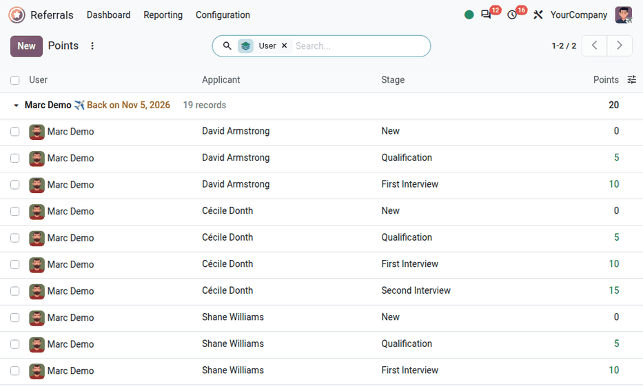

=============
Points report
=============

The points report in the **Referrals** app allows managers to view the total :doc:`point <points>`
contribution from employees, which can provide insight into the most effective referrers.

To access the *Points* report, navigate to :menuselection:`Referrals app --> Reporting --> Points`.
This loads the :guilabel:`Points` report in a default list view, grouped by :guilabel:`User`, with
the users listed in alphabetical order, by first name.

.. important::
   The report displays the points of all users to the users with the **Referrals**
   :guilabel:`Administrator` :ref:`access rights <referrals/access-rights>`, and only their own
   points to the users with the :guilabel:`User: Referral only` access rights.

All rows are collapsed by default, displaying the :guilabel:`User` name, the total number of
individual entries logged for the user, and the total :guilabel:`Points` they have earned.

Click on a row to expand the entries for that user. Each line displays the :guilabel:`Applicant`,
the :guilabel:`Stage` the applicant reached, and the :guilabel:`Points` of that stage:

- green: the user earned points for the stage;
- black: the stage gives no points (e.g., the :guilabel:`New` stage);
- red, without stage: a reward bought by the user, with its cost as negative points.

To only display the rewards bought, use the :guilabel:`Gifts` filter. To hide them, use the
:guilabel:`Points` filter.

