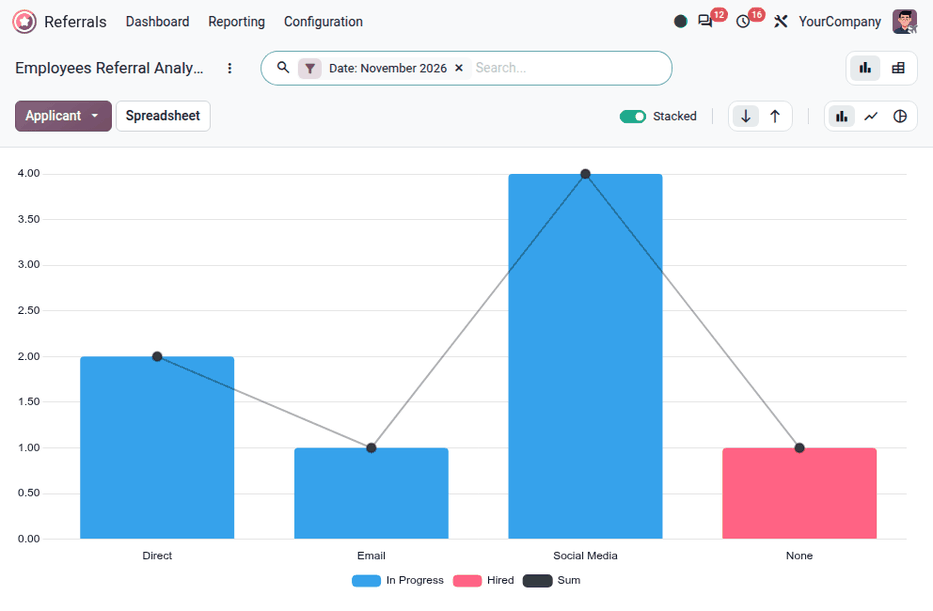

===========================
Employees referral analysis
===========================

The *Employees Referral Analysis* report in the **Referrals** app helps recruiters and managers
learn where applicants are applying from, when referred by a current employee. Additionally, the
*Employees Referral Analysis* report shows the number of applicants hired, refused, and still in the
recruitment pipeline, for each medium.

.. important::
   Only users with the **Referrals** :guilabel:`Administrator` :ref:`access rights
   <referrals/access-rights>` have access to this report.

Employees referral analysis report
==================================

To access the *Employees Referral Analysis* report, navigate to :menuselection:`Referrals app -->
Reporting --> Referral Analysis`. This loads the :guilabel:`Employees Referral Analysis` report in a
default :icon:`bar_chart` :guilabel:`Bar Chart`.

The graph is presented with the :guilabel:`Stacked` option enabled, with the number of
referrals on the y-axis, and the :guilabel:`Medium` of the applicant (e.g., *Social Media*,
*Email*, *Direct*, etc.) on the x-axis. If a medium does **not** appear on the
report, that indicates there are no referrals from that particular medium.

Referral amounts for all states are displayed, including :guilabel:`Not Hired` (refused),
:guilabel:`In Progress`, and :guilabel:`Hired`. The default filter is set to the current month.

Hover over any bar to view a popover containing specific data for that particular bar.

In this view, it is clear which :guilabel:`Medium` is the most successful.

