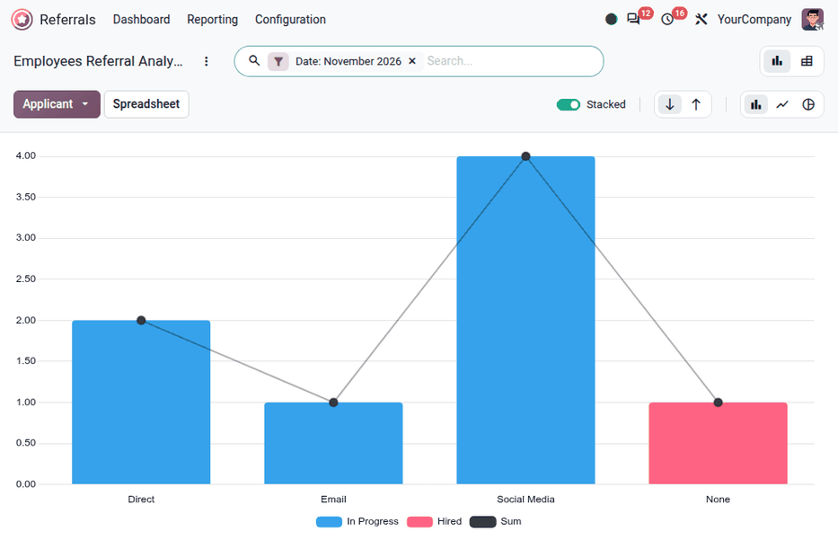
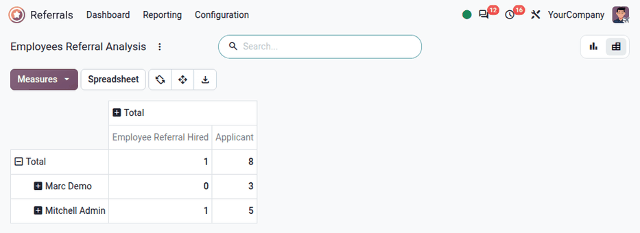

===========================
Employees referral analysis
===========================

The *Employees Referral Analysis* report in the **Referrals** app helps recruiters and managers
learn where applicants are applying from, when referred by a current employee. Additionally, the
*Employees Referral Analysis* report shows the number of applicants hired, refused, and still in the
recruitment pipeline, for each medium.

.. important::
   Only **Referrals** :ref:`administrators <referrals/access-rights>` have access to this report.

Employees referral analysis report
==================================

To access the *Employees Referral Analysis* report, navigate to :menuselection:`Referrals app -->
Reporting --> Referral Analysis`. This loads the :guilabel:`Employees Referral Analysis` report in a
default :icon:`bar_chart` :guilabel:`Bar Chart`.

The graph is presented with the :guilabel:`Stacked` option enabled, with the number of
referrals on the y-axis, and the :guilabel:`Medium` of the applicant (e.g.: *Social Media*,
*Email*, *Direct*, etc.) on the x-axis. If a medium does **not** appear on the
report, that indicates there are no referrals from that particular medium.

Referral amounts for all states are displayed, including :guilabel:`Not Hired` (refused),
:guilabel:`In Progress`, and :guilabel:`Hired`. The default filter is set to the current month.

Hover over any bar to view a popover containing specific data for that particular bar.

In this view, it is clear which :guilabel:`Medium` is the most successful.

Use case: hired referrals
-------------------------

One way to use the reporting feature is to assess which employees are referring the highest quality
applicants. This is done by examining how many of their referrals go on to become employees.

In this example, data is examined to determined which employee has the highest number of hired
referrals for the current year.

To view this information, first click the :icon:`oi_view-pivot` :guilabel:`(Pivot)` icon in the
upper-right corner. Next, remove the current filter in the search bar.

Click the search bar to reveal a drop-down menu of search options. Click :guilabel:`Date` in the
:icon:`filter_alt_f` :guilabel:`Filters` column, revealing a drop-down menu of available time
periods, and click :guilabel:`This Year`, then click away to close the window.

Next, click the :guilabel:`Measures` :icon:`arrow_drop_down` button in the upper-left corner, then
deselect :guilabel:`Earned Points` and :guilabel:`Employee Referral Refused` to hide those metrics.
Click anywhere on the screen to close the drop-down menu.

The information displayed shows how many total applicants each employee referred
(:guilabel:`Applicant`), and how many of those applicants were hired (:guilabel:`Employee Referral
Hired`), for the current year.

This information can be helpful to the recruitment team, so they can determine the most active
referrers in the company, and who is the most successful in terms of hires.

.. tip::
   The pivot table can be inserted into a new or existing :doc:`spreadsheet
   <../../productivity/spreadsheet/insert>`, if desired.

   To do so, click the :guilabel:`Spreadsheet` button right above the table. An *Insert in
   Spreadsheet* pop-up window appears, asking which spreadsheet to insert the pivot table into.
   Select the desired spreadsheet or dashboard from the presented options. Alternatively, select
   :guilabel:`Blank spreadsheet` to create a new one.

   Click :guilabel:`Insert`, and the selected spreadsheet loads, with the new table in it.

   The :guilabel:`Spreadsheet` button is only available to users who can edit spreadsheets, such as
   **Documents** users, or **Dashboards** administrators.
