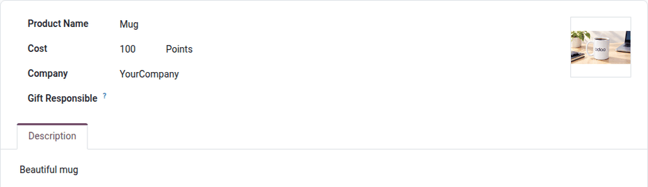
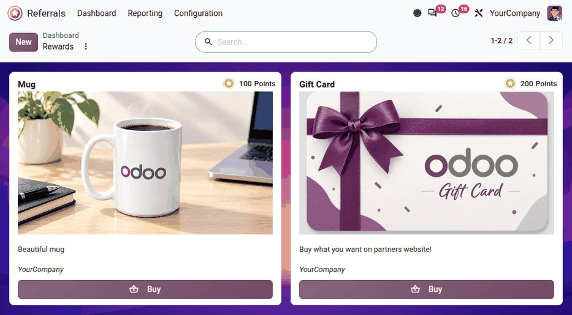

=======
Rewards
=======

After employees have successfully earned referral points, they can exchange their points by
purchasing rewards in Odoo's **Referrals** application. Rewards **must** be :ref:`created and
configured <referrals/create>` before employees can :ref:`redeem points for rewards
<referrals/redeem>`.

.. _referrals/create:

Create rewards
==============

Rewards are the only configurations needed when setting up the **Referrals** application.

.. important::
   Only **Referrals** :ref:`administrators <referrals/access-rights>` can create rewards. A
   :guilabel:`Gift Responsible` can modify the rewards they are responsible for.

To add rewards, navigate to :menuselection:`Referrals app --> Configuration --> Referrals -->
Rewards`. Click :guilabel:`New`, and a reward form loads. Enter the following information on the
form:

- :guilabel:`Product Name`: Enter the name as it should appear for the reward. This field is
  required.
- :guilabel:`Cost`: Enter the amount of points required to redeem the reward.
- :guilabel:`Company`: Select the company the reward is configured for using the drop-down menu. If
  a reward is available for multiple companies, each company **must** configure a reward for their
  specific company. This field **only** appears in multi-company databases; if this field appears,
  it is required.

  .. example::
     A database set up for three different companies offers a gift card as a reward. In the
     database, there are three separate rewards listed for a gift card, one for each of the three
     companies.

- :guilabel:`Gift Responsible`: Select the person responsible for procuring and delivering the
  reward to the recipient using the drop-down menu. This person receives an activity when the reward
  is bought in the **Referrals** app, so they know when to deliver the reward to the recipient.
- :guilabel:`Image`: Add a photo of the reward, in the image field in the top-right corner of the
  form. The photo appears on the rewards page.
- :guilabel:`Description` tab: Type in the description for the reward. This is visible on the reward
  card, beneath the photo. This field is required.

.. important::
   It is advised to enter a :guilabel:`Cost` and add an image. If a cost is not entered,
   the default cost is listed as zero, which would list the reward as free in the reward shop. If a
   photo is not selected, a placeholder icon is displayed on the rewards page.

.. _referrals/redeem:

Redeem rewards
==============

In order to redeem a reward, points must be earned. These points can then be used to purchase a
reward.

To purchase a reward, click the :guilabel:`Rewards` button on the main :guilabel:`Referrals`
dashboard. All the configured rewards are listed in individual reward cards.

The required point amount needed to purchase a reward is listed in the top-right corner of the card.

If the user has enough points to purchase a reward, a :icon:`shopping_basket` :guilabel:`Buy`
button appears at the bottom of the reward card. If they do not have enough points for a reward, the
reward card displays the number of points still needed, instead of a :icon:`shopping_basket`
:guilabel:`Buy` button.

Click the :icon:`shopping_basket` :guilabel:`Buy` button on a reward to purchase it. A
*Confirmation* pop-up window appears, asking if the user is sure they want to purchase the reward.
Click :guilabel:`Ok` to purchase the item, or :guilabel:`Discard` to close the window, and cancel
the purchase.

After :guilabel:`Ok` is clicked, the pop-up window closes, and the points used to purchase the
reward are subtracted from the user's available points. The rewards presented are now updated to
reflect the user's current available points.

