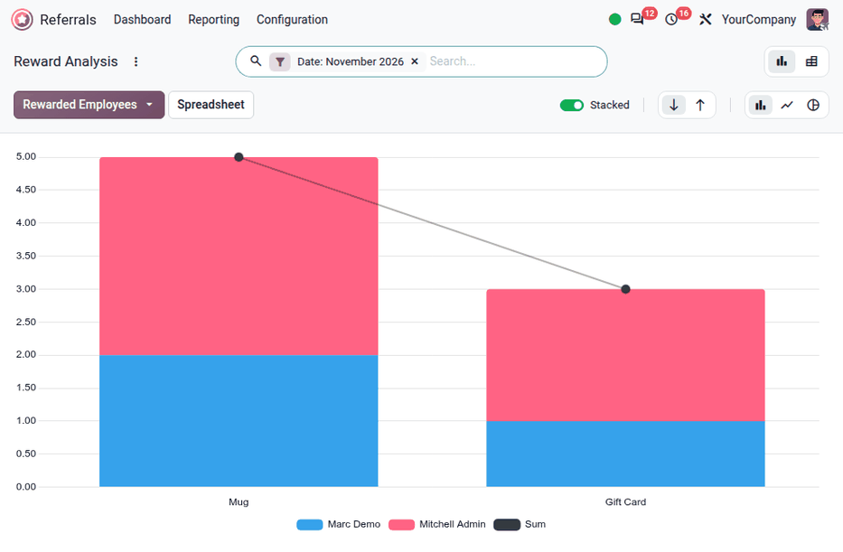

==============
Rewards report
==============

In the **Referrals** app, it is possible to view a report of the rewards that employees have
redeemed. This can help determine the most popular rewards and which rewards employees do not
request.

Incentivizing employees to recruit highly qualified applicants is aided by offering :doc:`rewards
<rewards>` that entice employees to earn points. Additionally, it can be helpful for the
**Referrals** app administrator to see what rewards are popular, to ensure a stock of highly
sought-after rewards is always available.

Reward analysis
===============

To view the *Reward Analysis* report, navigate to :menuselection:`Referrals app --> Reporting -->
Rewards`. This opens the :guilabel:`Reward Analysis` report in a default :icon:`bar_chart`
:guilabel:`Bar Chart`, with the :guilabel:`Stacked` option enabled, filtered on the current month.

The X-axis is populated with the various rewards, while the Y-axis is populated with the number of
rewards redeemed by employees (:guilabel:`Rewarded Employees`). All employees who have redeemed
rewards appear in their own identifying color.

The rewards with the highest bars are the most requested. Rewards that are rarely requested may not
need to be kept in stock in the same quantities.

.. important::
   Only **Referrals** :ref:`administrators <referrals/access-rights>` have access to this report.

