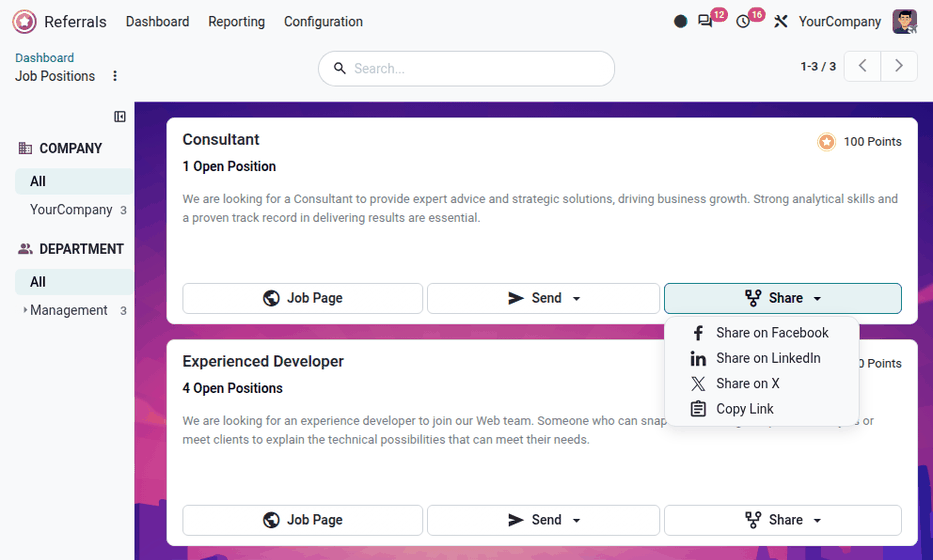
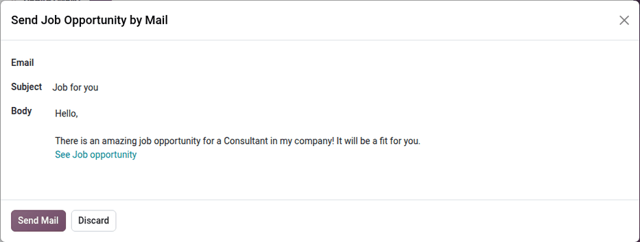

===================
Share job positions
===================

In Odoo **Referrals**, users can earn referral points by sharing job positions with potential
applicants. Individual job positions can be shared in several ways: via :ref:`email
<referrals/email>`, :ref:`SMS <referrals/sms>`, :ref:`WhatsApp <referrals/whatsapp>`, a
:ref:`tracking link <referrals/link>`, and various :ref:`social media platforms <referrals/social>`.

Additionally, *all* job positions can be :ref:`shared via email <referrals/email-jobs>`, instead of
sharing individual job positions, and recruiters can :ref:`promote a job position
<referrals/promote>` to all employees.

.. note::
   Sharing jobs can **only** occur after :ref:`onboarding <referrals/onboarding>` slides have been
   viewed or skipped.

.. _referrals/view-jobs:

View all jobs
=============

To see all job positions that are actively recruiting, click the :guilabel:`View Jobs` button on
the main **Referrals** app dashboard. This presents all job positions, with each job presented with
its own card.

         job position open.

Each job position card contains the following information:

- The title of the job position. This information is taken from the *Job Position* field of the job
  form.
- The total :doc:`points <points>` a user earns when the referred applicant is hired for the
  position.
- The number of :guilabel:`Open Positions` being recruited. This information is taken from the
  :guilabel:`Target` field of the job form.
- The job description detailing the job position. This information is taken from the *Summary* tab
  of the job form.

.. note::
   Only published job positions are visible in the **Referrals** app. To check which job positions
   are published or not, refer to the :doc:`../recruitment/new_job` documentation.

Share an individual job
=======================

To share an individual job position, first click the :guilabel:`View Jobs` button on the main
**Referrals** app dashboard. This presents a list of all currently published jobs. From this page,
an individual job can be shared with someone using one of the methods below. Each method uses a
tracking link specific to the user, so that applicants who apply through it are linked to the user
in the **Referrals** app.

.. _referrals/email:

Send email
----------

To share an individual job position via email, click the :icon:`send_f` :guilabel:`Send`
button on the specific job position card, then click :guilabel:`Send by Email`. A *Send Job
Opportunity by Mail* pop-up window appears. Enter the recipient's email address in the
:guilabel:`Email` field.

The :guilabel:`Subject` and :guilabel:`Body` are populated using a default template. The
:guilabel:`Subject` `Job for you` is present, by default, but can be modified, if desired.

The specific title of the job position populates the email body. The `See Job opportunity` text in
the email body is an individualized tracking link to the specific job position listed on the
website.

When the prospective employee receives the email, the link sends them to the job position page,
where they can apply for the position, and the person who referred them is tracked in the
**Referrals** app.

If desired, add any text or closing salutation to the email body. When all edits have been made,
click :guilabel:`Send Mail` to send the email, or click :guilabel:`Discard` to close the pop-up
window.

.. _referrals/sms:

Send SMS
--------

To share an individual job position with someone via SMS (text message), click the
:icon:`send_f` :guilabel:`Send` button on the specific job position card, then click
:guilabel:`Send by SMS`. A *Send Job Opportunity by SMS* pop-up window appears. Enter the
recipient's mobile number in the :guilabel:`Recipient` field.

Modify the prepopulated message, if desired, then click the :guilabel:`Send SMS` button to send the
message, or click :guilabel:`Discard` to close the pop-up window and cancel the message.

.. note::
   Sending text messages is **not** a default capability with Odoo. To send text messages, credits
   are required, which need to be purchased. For more information on IAP credits and plans, refer to
   the :doc:`../../essentials/in_app_purchase` documentation.

.. _referrals/whatsapp:

Send WhatsApp
-------------

When the **WhatsApp** app is installed and configured, job positions can also be shared via
WhatsApp: click the :icon:`send_f` :guilabel:`Send` button on the job position card, then click
:guilabel:`Send by WhatsApp`.

.. note::
   For more information on configuring WhatsApp, refer to the :doc:`../../productivity/whatsapp`
   documentation.

Job page
--------

To see all the details for a job position, click the :icon:`public` :guilabel:`Job Page` button on
the specific card. Doing so opens the job position webpage. This is what an applicant sees before
applying for a position.

.. _referrals/link:

Copy link
---------

To share the job position with a customized tracking link, click the :icon:`family_history`
:guilabel:`Share` button on the job position card, then click :guilabel:`Copy Link`. The link is
copied to the clipboard.

Next, share the link with the prospective employee.

.. _referrals/social:

Share a job via social media
----------------------------

Job positions can also be shared via social media platforms (:ref:`Facebook <referrals/facebook>`,
:ref:`X <referrals/x>`, and :ref:`LinkedIn <referrals/linkedin>`). Click the :icon:`family_history`
:guilabel:`Share` button on the job position card to reveal these options. Once links shared on a
platform have been clicked, the number of clicks is displayed next to the platform in this menu.

.. _referrals/facebook:

Facebook
~~~~~~~~

To share the job position using Facebook, click :icon:`family_history` :guilabel:`Share`, then
:guilabel:`Share on Facebook`.

If the user is already logged into Facebook, Facebook loads in a new tab, where a post is prepared
with the tracking link attached. If the user is *not* logged in, they are prompted to log in first.

Type in any additional information to add to the post, then share the job position using the
available options in Facebook.

.. _referrals/x:

X (formerly Twitter)
~~~~~~~~~~~~~~~~~~~~

To share a job position on X, click :icon:`family_history` :guilabel:`Share`, then
:guilabel:`Share on X`.

If the user is already signed-in to X, an X page loads in a new tab with a pre-populated message
ready to post. If the user is *not* already signed-in, a sign-in screen loads instead, prompting the
user to first sign-in to X.

Type in any additional information, or make any edits to the default message, then share using the
available options in X.

.. _referrals/linkedin:

LinkedIn
~~~~~~~~

To share a job position on LinkedIn, click :icon:`family_history` :guilabel:`Share`, then
:guilabel:`Share on LinkedIn`.

If the user is already logged into LinkedIn, a new tab loads in LinkedIn, with a link to the job
position. If the user is *not* already logged in, a log-in screen loads instead, prompting the user
to log-in to LinkedIn first.

The job position can be shared either in a public post, or in a private message to an individual (or
group of individuals).

Type in any additional information, or make any edits to the message or post, then share using the
available options in LinkedIn.

.. _referrals/email-jobs:

Share job list
==============

Another way to share job opportunities is to share the entire current list of open job positions,
instead of one job position at a time. To do this, navigate to the :menuselection:`Referrals` main
dashboard. Click the :guilabel:`Email a friend` button at the bottom of the screen. A *Send Job
Opportunity by Mail* pop-up window appears.

Enter the email address in the :guilabel:`Email` field. The email can be sent to multiple recipients
by separating each email address with a comma followed by a single space. The :guilabel:`Subject` is
preconfigured with :guilabel:`Job for you`, but can be edited. The email :guilabel:`Body` is also
populated with preconfigured text.

The link to all active job positions is a tracking link to a complete list of all job positions
currently being recruited for. Add any additional text and make any edits to the message body, if
necessary. Then, click :guilabel:`Send Mail` to send the email. This sends the message, and closes
the window.

.. _referrals/promote:

Promote a job position
======================

Recruiters can invite employees to refer people for a specific job position. Open the job position
form (:menuselection:`Recruitment app --> Applications --> By Job Positions`, then click
:guilabel:`Configure` on the job position card), and click :guilabel:`Promote`. This button only
appears when the job position is published.

In the *Promotion Campaign* pop-up window that appears, select the employees to contact in the
:guilabel:`To` field. Leave the field empty to send the email to all the employees who have a user.
Modify the subject and body of the email if desired, then click :guilabel:`Send`. A copy of the
email is logged in the chatter of the job position.

.. _referrals/link-tracker:

Track referral links
====================

To view the performance of the referral links, navigate to :menuselection:`Referrals app -->
Reporting --> Link Tracker`. Users with the *User: Referral only* access right see the links they
created, with the number of clicks on each link. **Referrals** administrators see the referral links
of all users, grouped by campaign.
