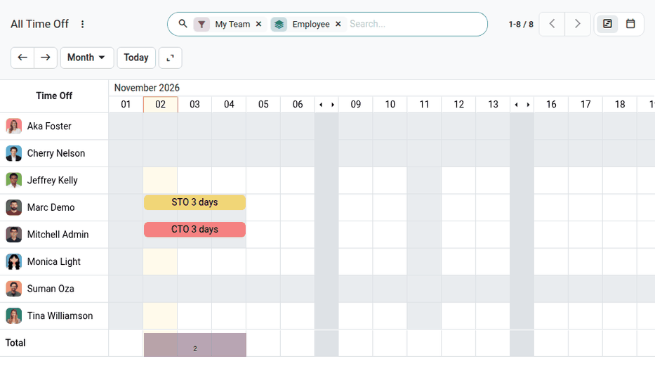

:show-content:

========
Time off
========

Odoo's **Time Off** application serves as a centralized hub for all time-off-related information.
This application manages requests, balances, allocations, approvals, and reports. The following
documents explain each aspect of the **Time Off** application:

.. cards::

   .. card:: Time types
      :target: time_off/time_off_types

      Before time off can be requested, the various time types must be configured.

   .. card:: Public holidays
      :target: time_off/public_holidays

      Configure all public holidays so employees receive the correct days off according to local and
      national laws.

   .. card:: Allocations
      :target: time_off/allocations

      Some time types require management to grant time off to employees before they can request
      it.

   .. card:: Accrual plans
      :target: time_off/accrual_plans

      If time off is earned as employees work, an accrual plan must be configured.

   .. card:: Request time off
      :target: time_off/request_time_off

      Before employees take time off, they must submit a time off request.

   .. card:: My time
      :target: time_off/my_time

      Manage personal time off balances, allocations, and time off requests.

   .. card:: Management
      :target: time_off/management

      Review time off and allocation requests from their respective dashboards.

   .. card:: Reporting
      :target: time_off/reporting

      View a summary of all time off, by employee, time type, or balance.

.. _time_off/overview:

Overview
========

To view a color-coded schedule of the time off of the user and their team, navigate to
:menuselection:`Time Off app --> Overview`. This loads the *All Time Off* dashboard, which displays
a Gantt view of the time off requests, grouped by employee.

By default, the dashboard displays the time off of all employees for the current month. To only
display the time off of the user's team, select the :guilabel:`My Team` filter in the search bar.
Users with *Officer: Manage all requests* or *Administrator* access rights for the **Time Off** app
can also :ref:`add missing time off <time_off/management/overview>` or move existing time off
directly from this view.

To change the time period displayed, click the :guilabel:`Month` :icon:`arrow_drop_down` button to
reveal a drop-down menu. Then, select another period, such as :guilabel:`Week` or
:guilabel:`Quarter`.

To navigate forward or backward in time in the selected increment (:guilabel:`Month`,
:guilabel:`Week`, etc.), click the :icon:`west` :guilabel:`(left arrow)` or
:icon:`east` :guilabel:`(right arrow)` buttons. For example, if :guilabel:`Month` is
selected, the arrows adjust the view by one month. To return to a view containing the current day,
click the :guilabel:`Today` button at any time.

Employees are listed alphabetically, and display their time off, except refused and cancelled
time off. The days off of the employees (such as weekends) are grayed out.

Each time off entry displays the amount of time requested. For users with *Officer: Manage all
requests* or *Administrator* access rights, it is preceded by the display code of the :doc:`time
type <time_off/time_off_types>`. Time off requests that still need to be approved are displayed in
a different style than approved time off.

.. note::
   If the time off entry is small and cannot display any text, the entry appears as a solid color
   with no text. All other entries display the text, but it may be cut off depending on the request
   size.

At the bottom of the Gantt view, in the :guilabel:`Total` line, a bar graph shows how many employees
are projected to be out on any given day. The number on each bar represents the number of employees
out on the highlighted days.

Click on a time off entry to open a pop-up window, containing a summary of the time off entry, such
as the employee, the time type, the dates, and the duration.

Users without *Officer: Manage all requests* or *Administrator* access rights can display the time
off in a calendar instead, by clicking the :icon:`calendar_today` :guilabel:`(Calendar)` icon in the
top-right corner.

.. toctree::
   :titlesonly:

   time_off/time_off_types
   time_off/accrual_plans
   time_off/public_holidays
   time_off/mandatory_days
   time_off/allocations
   time_off/request_time_off
   time_off/my_time
   time_off/management
   time_off/reporting
