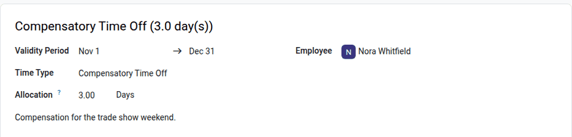
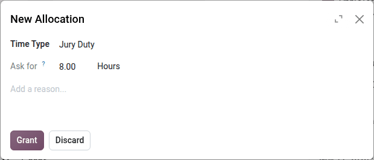
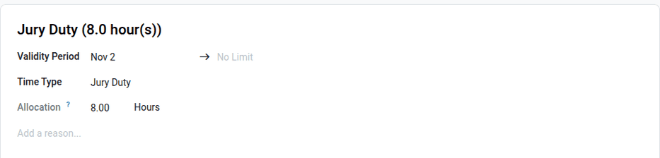

===========
Allocations
===========

Allocations are amounts of time off given to employees, either granted immediately or earned as the
employee works, through an :doc:`accrual plan <accrual_plans>`.

Once :doc:`time types <time_off_types>` and accrual plans have been configured, the next step is
to *allocate*, or give, time off to employees.

The *Allocations* page of the **Time Off** app is **only** visible to users who have either
*Officer: Manage all requests* or *Administrator* access rights for the **Time Off** application,
and to the users set as :ref:`time off approver <employees/approvers>` of an employee. Time off
approvers only see the allocations of the employees they approve. For more information
on access rights, refer to the :doc:`access rights <../../general/users/access_rights/>`
documentation.

.. _time_off/allocation-form:

Allocate time off
=================

To create a new allocation, navigate to :menuselection:`Time Off app --> Management -->
Allocations`. This loads the *Allocations* dashboard, which displays a Kanban view of the allocation
requests of the user's team awaiting approval (see :ref:`time_off/management/manage-allocations`).

Click :guilabel:`New` to allocate time off. This opens a blank allocation form. Enter the following
information on the form:

- :guilabel:`Validity Period`/:guilabel:`Start Date`: The current date populates the first date
  field, by default. To select another date, click on the pre-populated date to reveal a popover
  calendar window. Navigate to the desired start date for the allocation, and click on the date to
  select it.

  If the allocation expires, select the expiration date in the second date field. If the time off
  does *not* expire, leave the second date field blank: it displays :guilabel:`No Limit`.

  If an :guilabel:`Accrual Plan` is selected, this field is labeled :guilabel:`Start Date`, and the
  second field is labeled :guilabel:`Run until`.
- :guilabel:`Time Type`: Using the drop-down menu, select the :doc:`time type <time_off_types>`
  that is being allocated to the employee.
- :guilabel:`Accrual Plan`: Leave this field empty for a *regular allocation*, where the time off is
  given immediately, all at once. To have the employee earn the time off progressively, select an
  :doc:`accrual plan <accrual_plans>` using the drop-down menu. Only the accrual plans of the
  selected time type are proposed.
- :guilabel:`Allocation`: Enter the amount of time that is being allocated to the employee. This
  field displays the time in either :guilabel:`Hours` or :guilabel:`Days`, depending on the
  :guilabel:`Unit` of the selected :doc:`time type <time_off_types>`. For an accrual allocation,
  this field shows the time accrued so far.
- :guilabel:`Employee`: Using the drop-down menu, select the employee being allocated the time off.
- :guilabel:`Add a reason...`: If any description or note is necessary to explain the time off
  allocation, enter it in this field at the bottom of the form.

The name of the allocation is computed automatically from the time type, the amount, and the
validity period.

Once the form is saved, the allocation must be approved, like an :ref:`allocation request
<time_off/management/manage-allocations>`, by clicking :guilabel:`Validate` (or
:guilabel:`Approve`, depending on the approval configured on the time type).

Accrual start date behavior
---------------------------

If the :guilabel:`Start Date` is in the middle of an accrual period, Odoo adjusts it to the start or
end of that period based on the :guilabel:`When the time is accrued?` setting of the :doc:`accrual
plan <accrual_plans>`.

.. example::
   - *At the start of the accrual period*: A :guilabel:`Start Date` of `06/16/25` applies from
     `06/01/25`
   - *At the end of the accrual period*: A :guilabel:`Start Date` of `06/18/25` applies from
     `07/01/25`

Automatic adjustments on the start date to either the beginning or end of an accrual period ensures
accruals align with the defined period boundaries, rather than the exact date entered.

Group allocations
=================

When allocating time off, it is common to allocate time to multiple employees at once, instead of
creating individual allocations.

To allocate time to multiple employees at once, navigate to :menuselection:`Time Off app -->
Management --> Allocations`, and click the :guilabel:`New Group Allocation` button. A *New Group
Allocation* pop-up window loads.

In the :guilabel:`Employees` field, select the employees to allocate time off to. There is no limit
to the number of employees that can be selected. If this field is left empty, the allocation is
granted to **all** the employees of the current company.

Fill out the remainder of the form, which contains the same fields as the individual
:ref:`allocation form <time_off/allocation-form>`, then click :guilabel:`Allocate Time Off`. One
allocation is created and approved for each employee, and the list of the generated allocations
loads.

.. example::
   A company wants to give two days of compensatory time off to the sales representatives who staff
   the company booth at a trade show.

   The time off officer clicks :guilabel:`New Group Allocation`, and configures the form as follows:

   - :guilabel:`Employees`: the six sales representatives.
   - :guilabel:`Validity Period`: :guilabel:`Nov 23` :icon:`oi-arrow-right` :guilabel:`Dec 31`.
   - :guilabel:`Accrual Plan`: left empty, since the time off is given up front, and is not
     *earned* through an accrual plan.
   - :guilabel:`Time Type`: :guilabel:`Compensatory Time Off`.
   - :guilabel:`Allocation`: :guilabel:`2.00 Days`.
   - `Trade show staffing.` is entered as the reason at the bottom.

   .. image:: allocations/group.png
      :alt: A group allocation form granting two days of compensatory time off to six employees.

.. _time_off/request-allocation:

Request allocation
==================

If an employee has used all their time off, or will run out of time off, they can request an
allocation for additional time. Allocations can only be requested for :doc:`time types
<time_off_types>` with the :guilabel:`Allow Employee Requests` option ticked. Allocations can be
requested in one of two ways: either from the main :ref:`Time Off dashboard
<time_off/dashboard-allocation>` or the :ref:`My Allocations list <time_off/view-my-allocations>`.

.. note::
   Both options open a new *Allocation Request* form, but when requested from the main **Time Off**
   *Dashboard*, the form appears in a pop-up window, and the *Validity Period* field does **not**
   appear.

   When requested from the *My Allocations* list, the screen navigates to a new allocation
   request page instead of presenting a pop-up window.

.. _time_off/dashboard-allocation:

Time off dashboard
------------------

To request an allocation from the **Time Off** dashboard, open the **Time Off** app, or navigate to
:menuselection:`Time Off app --> My Time --> Days Off`. Click the :guilabel:`New` button, then
:guilabel:`New Allocation Request`, and a *New Allocation* pop-up window loads.

Configure the following fields on the form:

- :guilabel:`Time Type`: Select the time type being requested using the drop-down menu.
- :guilabel:`Ask for`: Enter the amount of time being requested, either in :guilabel:`Days` or
  :guilabel:`Hours`. The unit of time is determined by the selected :guilabel:`Time Type`.
- :guilabel:`Add a reason...`: Enter a brief description why the time off is being requested.

Click :guilabel:`Submit Request` to send the request for approval. Time off officers see a
:guilabel:`Grant` button instead, which creates the allocation directly.

.. _time_off/view-my-allocations:

My allocations list
-------------------

To request an allocation from the *My Allocations* list, navigate to :menuselection:`Time Off app
--> My Time --> Requests`. Click the :guilabel:`New` button, and an allocation request form loads.

Enter the following information on the *Allocation Request* form:

- :guilabel:`Name`: The name for the allocation request is populated based on the default time off
  type, and displays both the time type and the amount of hours by default. As selections are
  made, the name of the request is updated to reflect the request. The name **cannot** be manually
  modified.
- :guilabel:`Time Type`: Using the drop-down menu, select the time type being requested for the
  allocation. After a selection is made, the :guilabel:`Name` updates with the time type.
- :guilabel:`Validity Period`: By default, the current date populates the first field and the
  second field displays :guilabel:`No Limit`. To change the time frame for the request, click on the
  date, and select the desired date on the calendar popover. If there is an expiration date for the
  request, select the end date in the second field.
- :guilabel:`Allocation`: Enter the amount of time being requested in this field. The format is
  presented in either :guilabel:`Days` or :guilabel:`Hours`, depending on how the :guilabel:`Time
  Type` is configured. Once this field is populated, the name of the allocation request is
  updated to include the amount of time being requested.
- :guilabel:`Add a reason...`: Enter a description for the allocation request in this field. This
  should include any details that approvers may need to approve the request.

The information is automatically saved as it is entered. To view the request, click the
:guilabel:`My Allocations` breadcrumb, or navigate to :menuselection:`Time Off app --> My Time -->
Requests`. The allocation request appears along with any other allocation requests awaiting
approval.

