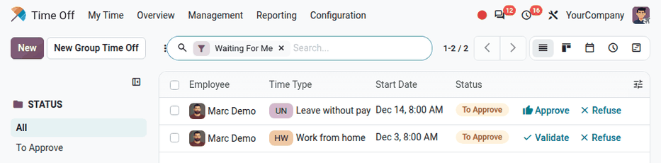
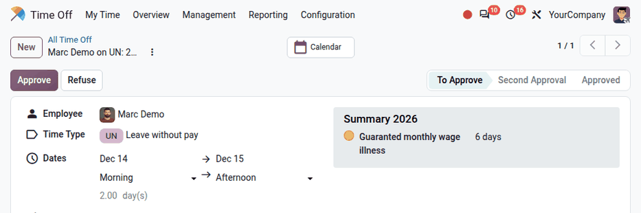
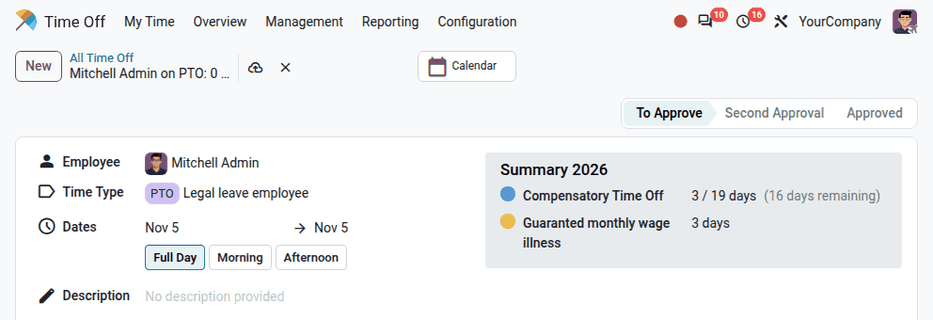
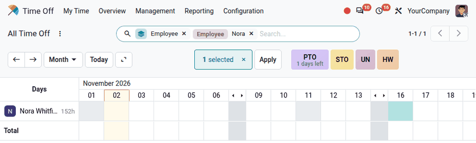
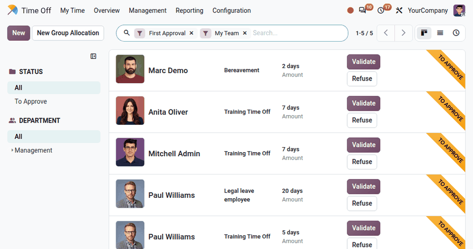
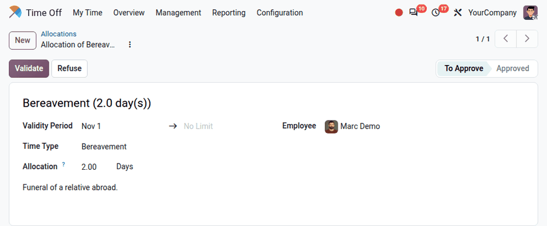

==========
Management
==========

.. _time_off/management/approvals:

Time off requests and allocation requests undergo an approval process before being granted. Requests
either need one or two approvals, if any, depending on how the specific :doc:`time type
<time_off_types>` is configured. All these configurations can be found under the *Management*
section of the **Time Off** application.

.. note::
   The *Management* section in the **Time Off** application is **only** visible to users who can
   :ref:`approve allocation requests and time off requests <employees/work-info-tab>`.

.. _time_off/management/manage-time-off:

View time off requests
======================

To view time off requests waiting for approval, navigate to :menuselection:`Time Off app -->
Management --> Time Off`. Doing so reveals the *All Time Off* page. All time off requests appear in
a default list view. Click the corresponding icon in the top-right corner to display them in a
:icon:`oi_view-kanban` :guilabel:`(Kanban)`, :icon:`calendar_today` :guilabel:`(Calendar)`,
:icon:`schedule` :guilabel:`(Activity)`, or :icon:`view_timeline` :guilabel:`(Gantt)` view
instead.

The only time off requests that are visible on this page belong to employees the user is the
:ref:`time off approver <employees/approvers>` for, or all employees if the user has *Officer:
Manage all requests* or *Administrator* access rights for the **Time Off** application.

The default filter on the :guilabel:`All Time Off` page is :icon:`filter_alt_f` :guilabel:`Waiting
For Me`. This filter only presents time off requests that need to be approved by the user, with a
status of either :guilabel:`To Approve` or :guilabel:`Second Approval`.

On the left side of the :guilabel:`All Time Off` page, there are grouping options that can be used
to narrow down the presented time off requests, located beneath the :icon:`folder_f`
:guilabel:`Status` heading. If this side panel is collapsed, click the :icon:`left_panel_open`
:guilabel:`(Open sidebar)` icon to expand it.

If the :icon:`filter_alt_f` :guilabel:`Waiting For Me` filter is removed, all statuses appear.

.. note::
   If no requests fall under one of the status options, that status is **not** visible on the side
   menu.

Approve or refuse time off requests
===================================

To approve or refuse a time off request, navigate to :menuselection:`Time Off app --> Management -->
Time Off`. At the end of each line (or on each Kanban card), two buttons appear: an
:guilabel:`Approve` or :guilabel:`Validate` button, depending on the status of the request and the
approval configured on its time type, and a :guilabel:`Refuse` button.

To approve a time off request, click the :guilabel:`Approve` button. If the time type requires a
second approval, the request moves to the :guilabel:`Second Approval` status. To validate a time off
request that has already been approved and is waiting on a second approval, or that only requires
one approval, click the :guilabel:`Validate` button. To refuse a request, click the
:guilabel:`Refuse` button.

If more information is needed before approving a time off request, click on the request (except on
the :guilabel:`Approve`, :guilabel:`Validate`, or :guilabel:`Refuse` buttons). Doing so loads the
detailed time off request form.

Depending on the rights of the user, changes can be made. To modify the request, make any desired
changes to the form. All changes are automatically saved.

It is also possible to approve, validate, or refuse the request from this form. Click the
:guilabel:`Approve` button to approve, the :guilabel:`Validate` button to validate, or the
:guilabel:`Refuse` button to refuse the request.

Once a request has been approved, validated, or refused, it disappears from the default
:guilabel:`All Time Off` page. To view *all* requests, including approved and refused requests,
clear the default filters in the search bar.

.. tip::
   An approved time off request can be sent back to approval with the :guilabel:`Back to Approval`
   button on the request form. Employees can cancel their own time off with the :guilabel:`Cancel`
   button on the request form, as long as it has not started yet.

.. _time_off/management/missing:

Add missing time off requests
=============================

If an employee forgets to request time off for days they did not work, a time off record must be
created retroactively. Missing time off records can be done from the :ref:`All Time Off dashboard
<time_off/management/all-time-off>` or from the :ref:`Overview <time_off/management/overview>`.

.. _time_off/management/all-time-off:

From the dashboard
------------------

To create missing time off requests from the *All Time Off* dashboard, navigate to
:menuselection:`Time Off app --> Management --> Time Off`, and click :guilabel:`New`.

On the time off request form, configure the following fields:

- :icon:`person_f` :guilabel:`Employee`: Select the employee missing the time off request.
- :icon:`label` :guilabel:`Time Type`: Select the :doc:`time type <time_off_types>` for the
  request.
- :icon:`schedule` :guilabel:`Dates`: Using the calendar selector, configure the start and end dates
  for the time off request. Depending on how the :doc:`Time Type <time_off_types>` is configured,
  one of the following additional fields may appear:

  - *Duration Selector*: Click the corresponding button to indicate if the request is for a
    :guilabel:`Full Day`, the :guilabel:`Morning`, or the :guilabel:`Afternoon`.
  - *Duration Drop-down*: When the request covers several days, select when the time off starts
    and ends, either :guilabel:`Morning` or :guilabel:`Afternoon`.
  - *Hours*: Select the start and end times of the request.

- :icon:`edit_f` :guilabel:`Description`: Enter any information regarding the request. For example,
  `Family emergency` or `Could not request time off as they were sick.`

A summary of the employee's time off for the year appears in a gray box, listing all the approved
time off and remaining balances.

When a time off officer creates a time off request for another employee, the request is
automatically approved once saved.

.. tip::
   If there is relevant documentation for the request, such as a doctor's note, click the
   :icon:`attach_file` :guilabel:`(Attach files)` button in the chatter, navigate to the desired
   file, then click :guilabel:`Open` to attach the document.

To create the same time off for several employees at once, for example, for a company closure,
click :guilabel:`New Group Time Off` on the *All Time Off* page. In the pop-up window that appears,
select the :guilabel:`Employees` (leave the field empty to select all the employees of the current
company), the :guilabel:`Dates`, and the :guilabel:`Time Type`, enter a description, then click
:guilabel:`Generate Time Off`.

.. _time_off/management/overview:

From the overview
-----------------

To create a missing time off request from the *Overview* dashboard, navigate to :menuselection:`Time
Off app --> Overview`, and the *All Time Off* dashboard loads.

Click on any cell to select that day, or click and drag multiple consecutive cells to select several
days at once. The selected cells are highlighted, and a :guilabel:`# selected` button appears at the
top, indicating how many entries are selected. Next, click the corresponding time type button at the
top of the screen, and the time off record is created. For time types requiring an allocation, the
button displays the employee's remaining balance.

.. tip::
   If the time off record must specify a duration or a description is needed, instead of clicking a
   time type button, click the :guilabel:`Apply` button and a pop-up window loads. Select the time
   type next to the :icon:`label` :guilabel:`(Time Off Type)` icon, and the duration next to the
   :icon:`schedule` :guilabel:`(Dates)` icon. Enter an optional description next to the
   :icon:`edit_f` :guilabel:`(Description)` icon. Once
   the pop-up window is configured, click :guilabel:`Add` to add the missing time off record.

   If the employee does not have enough time off allocated, time off officers see an
   :guilabel:`Allocate and Add` button instead, which also creates the missing allocation.

   .. image:: management/to-pop-up.png
      :alt: The quick add pop-up window, with the duration and description of the time off.

.. note::
   Time off officers can also move a time off by dragging and dropping it in the *Overview*, or
   change its dates by dragging its edges.

.. _time_off/management/manage-allocations:

View allocation requests
========================

To view allocation requests waiting for approval, navigate to :menuselection:`Time Off app -->
Management --> Allocations`. Doing so reveals the :guilabel:`Allocations` page. All allocation
requests appear in a default Kanban view.

The only allocation requests that are visible on this page belong to employees the user is the time
off approver for, or all employees if the user has *Officer: Manage all requests* or
*Administrator* access rights for the **Time Off** application.

The default filters on the :guilabel:`Allocations` page are :icon:`filter_alt_f` :guilabel:`First
Approval`, :icon:`filter_alt_f` :guilabel:`My Team`, and :icon:`filter_alt_f` :guilabel:`Active
Employees`. These filters only present allocation requests that need to be approved for current
employees on the user's team.

On the left side of the :guilabel:`Allocations` page, there are various grouping options that can be
used to narrow down the presented allocation requests, located beneath the :icon:`folder_f`
:guilabel:`Status` and :icon:`group_f` :guilabel:`Department` headings.

To only display allocation requests for specific departments, click on the :guilabel:`Department` on
the left-hand side of the page. Only requests within the selected department are then presented.

If the default filters are removed, all statuses appear.

.. note::
   If no requests fall under one of the status options or departments, that status or department is
   **not** visible on the left-side menu.

Approve or refuse allocation requests
=====================================

To approve or refuse an allocation request, navigate to :menuselection:`Time Off app --> Management
--> Allocations`. At the end of each Kanban card, two buttons appear: an :guilabel:`Approve` or
:guilabel:`Validate` button, depending on the status of the request, and a :guilabel:`Refuse`
button.

If more information is needed before approving an allocation request, click anywhere on the Kanban
card (except for the :guilabel:`Approve`, :guilabel:`Validate`, or :guilabel:`Refuse` buttons).
Doing so loads the detailed allocation request form.

Depending on the rights of the user, changes can be made. To modify the request, make any desired
changes to the form. All changes are automatically saved.

It is also possible to approve, validate, or refuse the request from this form. Click the
:guilabel:`Approve` button to approve, the :guilabel:`Validate` button to validate, or the
:guilabel:`Refuse` button to refuse the request.

Once a request has been approved, validated, or refused, the Kanban card disappears from the default
:guilabel:`Allocations` page. To view *all* requests, including approved and refused requests, clear
the default filters in the search bar.

